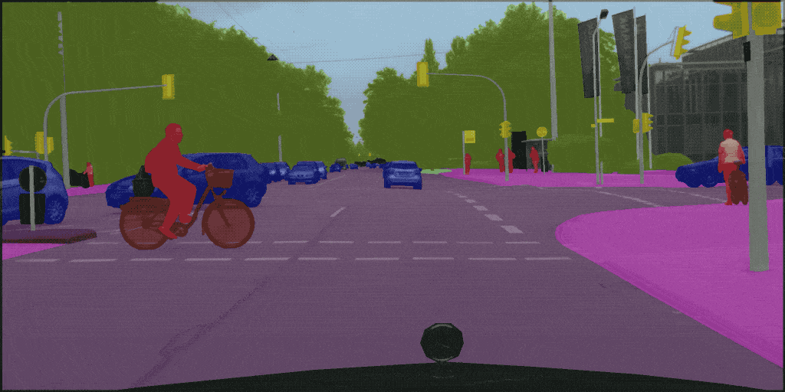

<div align="center">
  
  <div>&nbsp;</div>
  <div align="center">
    <b><font size="5">OpenMMLab 官网</font></b>
    <sup>
      <a href="https://openmmlab.com">
        <i><font size="4">HOT</font></i>
      </a>
    </sup>
    &nbsp;&nbsp;&nbsp;&nbsp;
    <b><font size="5">OpenMMLab 开放平台</font></b>
    <sup>
      <a href="https://platform.openmmlab.com">
        <i><font size="4">TRY IT OUT</font></i>
      </a>
    </sup>
  </div>
  <div>&nbsp;</div>

[](https://pypi.org/project/mmsegmentation)
[](https://pypi.org/project/mmsegmentation)
[](https://mmsegmentation.readthedocs.io/zh_CN/latest)
[](https://github.com/open-mmlab/mmsegmentation/actions)
[](https://codecov.io/gh/open-mmlab/mmsegmentation)
[](https://github.com/open-mmlab/mmsegmentation/blob/main/LICENSE)
[](https://github.com/open-mmlab/mmsegmentation/issues)
[](https://github.com/open-mmlab/mmsegmentation/issues)
[](https://openxlab.org.cn/apps?search=mmseg)

文档: <https://mmsegmentation.readthedocs.io/zh_CN/latest>

[English](README.md) | 简体中文

</div>

<div align="center">
  <a href="https://openmmlab.medium.com/" style="text-decoration:none;">
    </a>
  
  <a href="https://discord.gg/raweFPmdzG" style="text-decoration:none;">
    </a>
  
  <a href="https://twitter.com/OpenMMLab" style="text-decoration:none;">
    </a>
  
  <a href="https://www.youtube.com/openmmlab" style="text-decoration:none;">
    </a>
  
  <a href="https://space.bilibili.com/1293512903" style="text-decoration:none;">
    </a>
  
  <a href="https://www.zhihu.com/people/openmmlab" style="text-decoration:none;">
    </a>
</div>

## 简介

MMSegmentation 是一个基于 PyTorch 的语义分割开源工具箱。它是 OpenMMLab 项目的一部分。

[main](https://github.com/open-mmlab/mmsegmentation/tree/main) 分支代码目前支持 PyTorch 1.6 以上的版本。

### 🎉 MMSegmentation v1.0.0 简介 🎉

我们非常高兴地宣布 MMSegmentation 最新版本的正式发布！在这个新版本中，主要分支是 [main](https://github.com/open-mmlab/mmsegmentation/tree/main) 分支，开发分支是 [dev-1.x](https://github.com/open-mmlab/mmsegmentation/tree/dev-1.x)。而之前版本的稳定分支保留为 [0.x](https://github.com/open-mmlab/mmsegmentation/tree/0.x) 分支。请注意，[master](https://github.com/open-mmlab/mmsegmentation/tree/master) 分支将只在有限的时间内维护，然后将被删除。我们鼓励您在使用过程中注意分支选择和更新。感谢您一如既往的支持和热情，让我们共同努力，使 MMSegmentation 变得更加健壮和强大！💪

MMSegmentation v1.x 在 0.x 版本的基础上有了显著的提升，提供了更加灵活和功能丰富的体验。为了更好使用 v1.x 中的新功能，我们诚挚邀请您查阅我们详细的 [📚 迁移指南](https://mmsegmentation.readthedocs.io/zh_CN/latest/migration/interface.html)，以帮助您无缝地过渡您的项目。您的支持对我们来说非常宝贵，我们热切期待您的反馈！



### 主要特性

- **统一的基准平台**

  我们将各种各样的语义分割算法集成到了一个统一的工具箱，进行基准测试。

- **模块化设计**

  MMSegmentation 将分割框架解耦成不同的模块组件，通过组合不同的模块组件，用户可以便捷地构建自定义的分割模型。

- **丰富的即插即用的算法和模型**

  MMSegmentation 支持了众多主流的和最新的检测算法，例如 PSPNet，DeepLabV3，PSANet，DeepLabV3+ 等.

- **速度快**

  训练速度比其他语义分割代码库更快或者相当。

## 更新日志

最新版本 v1.2.0 在 2023.10.12 发布。
如果想了解更多版本更新细节和历史信息，请阅读[更新日志](docs/en/notes/changelog.md)。

## 安装

请参考[快速入门文档](docs/zh_cn/get_started.md#installation)进行安装，参考[数据集准备](docs/zh_cn/user_guides/2_dataset_prepare.md)处理数据。

## 快速入门

请参考[概述](docs/zh_cn/overview.md)对 MMSegmetation 进行初步了解

请参考[用户指南](https://mmsegmentation.readthedocs.io/zh_CN/latest/user_guides/index.html)了解 mmseg 的基本使用，以及[进阶指南](https://mmsegmentation.readthedocs.io/zh_CN/latest/advanced_guides/index.html)深入了解 mmseg 设计和代码实现。

同时，我们提供了 Colab 教程。你可以在[这里](demo/MMSegmentation_Tutorial.ipynb)浏览教程，或者直接在 Colab 上[运行](https://colab.research.google.com/github/open-mmlab/mmsegmentation/blob/main/demo/MMSegmentation_Tutorial.ipynb)。

若需要将 0.x 版本的代码迁移至新版，请参考[迁移文档](docs/zh_cn/migration)。

## 教程文档

<div align="center">
  <b>mmsegmentation 教程文档</b>
</div>
<table align="center">
  <tbody>
    <tr align="center" valign="center">
      <td>
        <b>开启 MMSeg 之旅</b>
      </td>
      <td>
        <b>MMSeg 快速入门教程</b>
      </td>
      <td>
        <b>MMSeg 细节介绍</b>
      </td>
      <td>
        <b>MMSeg 开发教程</b>
      </td>
    </tr>
    <tr valign="top">
      <td>
        <ul>
        <li><a href="docs/zh_cn/overview.md">MMSeg 概述</a></li>
        <li><a href="docs/zh_cn/get_started.md">安装和验证</a></li>
        <li><a href="docs/zh_cn/notes/faq.md">常见问题解答</a></li>
        </ul>
      </td>
      <td>
        <ul>
          <li><a href="docs/zh_cn/user_guides/1_config.md">教程1：了解配置文件</a></li>
          <li><a href="docs/zh_cn/user_guides/2_dataset_prepare.md">教程2：准备数据集</a></li>
          <li><a href="docs/zh_cn/user_guides/3_inference.md">教程3：使用预训练模型推理</a></li>
          <li><a href="docs/zh_cn/user_guides/4_train_test.md">教程4：模型训练和测试</a></li>
          <li><a href="docs/zh_cn/user_guides/5_deployment.md">教程5：模型部署</a></li>
          <li><a href="docs/zh_cn/user_guides/deploy_jetson.md">在 Jetson 平台部署 MMSeg</a></li>
          <li><a href="docs/zh_cn/user_guides/useful_tools.md">常用工具</a></li>
          <li><a href="docs/zh_cn/user_guides/visualization_feature_map.md">特征图可视化</a></li>
          <li><a href="docs/zh_cn/user_guides/visualization.md">可视化</a></li>
        </ul>
      </td>
      <td>
        <ul>
          <li><a href="docs/zh_cn/advanced_guides/datasets.md">MMSeg 数据集介绍</a></li>
          <li><a href="docs/zh_cn/advanced_guides/models.md">MMSeg 模型介绍</a></li>
          <li><a href="docs/zh_cn/advanced_guides/structures.md">MMSeg 数据结构介绍</a></li>
          <li><a href="docs/zh_cn/advanced_guides/transforms.md">MMSeg 数据增强介绍</a></li>
          <li><a href="docs/zh_cn/advanced_guides/data_flow.md">MMSeg 数据流介绍</a></li>
          <li><a href="docs/zh_cn/advanced_guides/engine.md">MMSeg 训练引擎介绍</a></li>
          <li><a href="docs/zh_cn/advanced_guides/evaluation.md">MMSeg 模型评测介绍</a></li>
        </ul>
      </td>
      <td>
        <ul>
          <li><a href="docs/zh_cn/advanced_guides/add_datasets.md">新增自定义数据集</a></li>
          <li><a href="docs/zh_cn/advanced_guides/add_metrics.md">新增评测指标</a></li>
          <li><a href="docs/zh_cn/advanced_guides/add_models.md">新增自定义模型</a></li>
          <li><a href="docs/zh_cn/advanced_guides/add_transforms.md">新增自定义数据增强</a></li>
          <li><a href="docs/zh_cn/advanced_guides/customize_runtime.md">自定义运行设定</a></li>
          <li><a href="docs/zh_cn/advanced_guides/training_tricks.md">训练技巧</a></li>
          <li><a href=".github/CONTRIBUTING.md">如何给 MMSeg 贡献代码</a></li>
          <li><a href="docs/zh_cn/advanced_guides/contribute_dataset.md">给 MMSeg 贡献数据集教程</a></li>
          <li><a href="docs/zh_cn/device/npu.md">NPU (华为 昇腾)</a></li>
          <li><a href="docs/zh_cn/migration/interface.md">0.x → 1.x 迁移文档</a></li>
          <li><a href="docs/zh_cn/migration/package.md">0.x → 1.x 库变更文档</a></li>
        </ul>
      </td>
    </tr>
  </tbody>
</table>

## 基准测试和模型库

测试结果和模型可以在[模型库](docs/zh_cn/model_zoo.md)中找到。

<div align="center">
  <b>概览</b>
</div>
<table align="center">
  <tbody>
    <tr align="center" valign="bottom">
      <td>
        <b>已支持的主干网络</b>
      </td>
      <td>
        <b>已支持的算法架构</b>
      </td>
      <td>
        <b>已支持的分割头</b>
      </td>
      <td>
        <b>已支持的数据集</b>
      </td>
      <td>
        <b>其他</b>
      </td>
    </tr>
    <tr valign="top">
      <td>
        <ul>
        <li><a href="mmseg/models/backbones/resnet.py">ResNet(CVPR'2016)</a></li>
        <li><a href="mmseg/models/backbones/resnext.py">ResNeXt (CVPR'2017)</a></li>
        <li><a href="configs/hrnet">HRNet (CVPR'2019)</a></li>
        <li><a href="configs/resnest">ResNeSt (ArXiv'2020)</a></li>
        <li><a href="configs/mobilenet_v2">MobileNetV2 (CVPR'2018)</a></li>
        <li><a href="configs/mobilenet_v3">MobileNetV3 (ICCV'2019)</a></li>
        <li><a href="configs/vit">Vision Transformer (ICLR'2021)</a></li>
        <li><a href="configs/swin">Swin Transformer (ICCV'2021)</a></li>
        <li><a href="configs/twins">Twins (NeurIPS'2021)</a></li>
        <li><a href="configs/beit">BEiT (ICLR'2022)</a></li>
        <li><a href="configs/convnext">ConvNeXt (CVPR'2022)</a></li>
        <li><a href="configs/mae">MAE (CVPR'2022)</a></li>
        <li><a href="configs/poolformer">PoolFormer (CVPR'2022)</a></li>
        <li><a href="configs/segnext">SegNeXt (NeurIPS'2022)</a></li>
        </ul>
      </td>
      <td>
        <ul>
          <li><a href="configs/san/">SAN (CVPR'2023)</a></li>
          <li><a href="configs/vpd">VPD (ICCV'2023)</a></li>
          <li><a href="configs/ddrnet">DDRNet (T-ITS'2022)</a></li>
          <li><a href="configs/pidnet">PIDNet (ArXiv'2022)</a></li>
          <li><a href="configs/mask2former">Mask2Former (CVPR'2022)</a></li>
          <li><a href="configs/maskformer">MaskFormer (NeurIPS'2021)</a></li>
          <li><a href="configs/knet">K-Net (NeurIPS'2021)</a></li>
          <li><a href="configs/segformer">SegFormer (NeurIPS'2021)</a></li>
          <li><a href="configs/segmenter">Segmenter (ICCV'2021)</a></li>
          <li><a href="configs/dpt">DPT (ArXiv'2021)</a></li>
          <li><a href="configs/setr">SETR (CVPR'2021)</a></li>
          <li><a href="configs/stdc">STDC (CVPR'2021)</a></li>
          <li><a href="configs/bisenetv2">BiSeNetV2 (IJCV'2021)</a></li>
          <li><a href="configs/cgnet">CGNet (TIP'2020)</a></li>
          <li><a href="configs/point_rend">PointRend (CVPR'2020)</a></li>
          <li><a href="configs/dnlnet">DNLNet (ECCV'2020)</a></li>
          <li><a href="configs/ocrnet">OCRNet (ECCV'2020)</a></li>
          <li><a href="configs/isanet">ISANet (ArXiv'2019/IJCV'2021)</a></li>
          <li><a href="configs/fastscnn">Fast-SCNN (ArXiv'2019)</a></li>
          <li><a href="configs/fastfcn">FastFCN (ArXiv'2019)</a></li>
          <li><a href="configs/gcnet">GCNet (ICCVW'2019/TPAMI'2020)</a></li>
          <li><a href="configs/ann">ANN (ICCV'2019)</a></li>
          <li><a href="configs/emanet">EMANet (ICCV'2019)</a></li>
          <li><a href="configs/ccnet">CCNet (ICCV'2019)</a></li>
          <li><a href="configs/dmnet">DMNet (ICCV'2019)</a></li>
          <li><a href="configs/sem_fpn">Semantic FPN (CVPR'2019)</a></li>
          <li><a href="configs/danet">DANet (CVPR'2019)</a></li>
          <li><a href="configs/apcnet">APCNet (CVPR'2019)</a></li>
          <li><a href="configs/nonlocal_net">NonLocal Net (CVPR'2018)</a></li>
          <li><a href="configs/encnet">EncNet (CVPR'2018)</a></li>
          <li><a href="configs/deeplabv3plus">DeepLabV3+ (CVPR'2018)</a></li>
          <li><a href="configs/upernet">UPerNet (ECCV'2018)</a></li>
          <li><a href="configs/icnet">ICNet (ECCV'2018)</a></li>
          <li><a href="configs/psanet">PSANet (ECCV'2018)</a></li>
          <li><a href="configs/bisenetv1">BiSeNetV1 (ECCV'2018)</a></li>
          <li><a href="configs/deeplabv3">DeepLabV3 (ArXiv'2017)</a></li>
          <li><a href="configs/pspnet">PSPNet (CVPR'2017)</a></li>
          <li><a href="configs/erfnet">ERFNet (T-ITS'2017)</a></li>
          <li><a href="configs/unet">UNet (MICCAI'2016/Nat. Methods'2019)</a></li>
          <li><a href="configs/fcn">FCN (CVPR'2015/TPAMI'2017)</a></li>
        </ul>
      </td>
      <td>
        <ul>
          <li><a href="mmseg/models/decode_heads/ann_head.py">ANN_Head</li>
          <li><a href="mmseg/models/decode_heads/apc_head.py">APC_Head</li>
          <li><a href="mmseg/models/decode_heads/aspp_head.py">ASPP_Head</li>
          <li><a href="mmseg/models/decode_heads/cc_head.py">CC_Head</li>
          <li><a href="mmseg/models/decode_heads/da_head.py">DA_Head</li>
          <li><a href="mmseg/models/decode_heads/ddr_head.py">DDR_Head</li>
          <li><a href="mmseg/models/decode_heads/dm_head.py">DM_Head</li>
          <li><a href="mmseg/models/decode_heads/dnl_head.py">DNL_Head</li>
          <li><a href="mmseg/models/decode_heads/dpt_head.py">DPT_HEAD</li>
          <li><a href="mmseg/models/decode_heads/ema_head.py">EMA_Head</li>
          <li><a href="mmseg/models/decode_heads/enc_head.py">ENC_Head</li>
          <li><a href="mmseg/models/decode_heads/fcn_head.py">FCN_Head</li>
          <li><a href="mmseg/models/decode_heads/fpn_head.py">FPN_Head</li>
          <li><a href="mmseg/models/decode_heads/gc_head.py">GC_Head</li>
          <li><a href="mmseg/models/decode_heads/ham_head.py">LightHam_Head</li>
          <li><a href="mmseg/models/decode_heads/isa_head.py">ISA_Head</li>
          <li><a href="mmseg/models/decode_heads/knet_head.py">Knet_Head</li>
          <li><a href="mmseg/models/decode_heads/lraspp_head.py">LRASPP_Head</li>
          <li><a href="mmseg/models/decode_heads/mask2former_head.py">mask2former_Head</li>
          <li><a href="mmseg/models/decode_heads/maskformer_head.py">maskformer_Head</li>
          <li><a href="mmseg/models/decode_heads/nl_head.py">NL_Head</li>
          <li><a href="mmseg/models/decode_heads/ocr_head.py">OCR_Head</li>
          <li><a href="mmseg/models/decode_heads/pid_head.py">PID_Head</li>
          <li><a href="mmseg/models/decode_heads/point_head.py">point_Head</li>
          <li><a href="mmseg/models/decode_heads/psa_head.py">PSA_Head</li>
          <li><a href="mmseg/models/decode_heads/psp_head.py">PSP_Head</li>
          <li><a href="mmseg/models/decode_heads/san_head.py">SAN_Head</li>
          <li><a href="mmseg/models/decode_heads/segformer_head.py">segformer_Head</li>
          <li><a href="mmseg/models/decode_heads/segmenter_mask_head.py">segmenter_mask_Head</li>
          <li><a href="mmseg/models/decode_heads/sep_aspp_head.py">SepASPP_Head</li>
          <li><a href="mmseg/models/decode_heads/sep_fcn_head.py">SepFCN_Head</li>
          <li><a href="mmseg/models/decode_heads/setr_mla_head.py">SETRMLAHead_Head</li>
          <li><a href="mmseg/models/decode_heads/setr_up_head.py">SETRUP_Head</li>
          <li><a href="mmseg/models/decode_heads/stdc_head.py">STDC_Head</li>
          <li><a href="mmseg/models/decode_heads/uper_head.py">Uper_Head</li>
          <li><a href="mmseg/models/decode_heads/vpd_depth_head.py">VPDDepth_Head</li>
        </ul>
      </td>
      <td>
        <ul>
          <li><a href="https://github.com/open-mmlab/mmsegmentation/blob/main/docs/zh_cn/user_guides/2_dataset_prepare.md#cityscapes">Cityscapes</a></li>
          <li><a href="https://github.com/open-mmlab/mmsegmentation/blob/main/docs/zh_cn/user_guides/2_dataset_prepare.md#pascal-voc">PASCAL VOC</a></li>
          <li><a href="https://github.com/open-mmlab/mmsegmentation/blob/main/docs/zh_cn/user_guides/2_dataset_prepare.md#ade20k">ADE20K</a></li>
          <li><a href="https://github.com/open-mmlab/mmsegmentation/blob/main/docs/zh_cn/user_guides/2_dataset_prepare.md#pascal-context">Pascal Context</a></li>
          <li><a href="https://github.com/open-mmlab/mmsegmentation/blob/main/docs/zh_cn/user_guides/2_dataset_prepare.md#coco-stuff-10k">COCO-Stuff 10k</a></li>
          <li><a href="https://github.com/open-mmlab/mmsegmentation/blob/main/docs/zh_cn/user_guides/2_dataset_prepare.md#coco-stuff-164k">COCO-Stuff 164k</a></li>
          <li><a href="https://github.com/open-mmlab/mmsegmentation/blob/main/docs/zh_cn/user_guides/2_dataset_prepare.md#chase-db1">CHASE_DB1</a></li>
          <li><a href="https://github.com/open-mmlab/mmsegmentation/blob/main/docs/zh_cn/user_guides/2_dataset_prepare.md#drive">DRIVE</a></li>
          <li><a href="https://github.com/open-mmlab/mmsegmentation/blob/main/docs/zh_cn/user_guides/2_dataset_prepare.md#hrf">HRF</a></li>
          <li><a href="https://github.com/open-mmlab/mmsegmentation/blob/main/docs/zh_cn/user_guides/2_dataset_prepare.md#stare">STARE</a></li>
          <li><a href="https://github.com/open-mmlab/mmsegmentation/blob/main/docs/zh_cn/user_guides/2_dataset_prepare.md#dark-zurich">Dark Zurich</a></li>
          <li><a href="https://github.com/open-mmlab/mmsegmentation/blob/main/docs/zh_cn/user_guides/2_dataset_prepare.md#nighttime-driving">Nighttime Driving</a></li>
          <li><a href="https://github.com/open-mmlab/mmsegmentation/blob/main/docs/zh_cn/user_guides/2_dataset_prepare.md#loveda">LoveDA</a></li>
          <li><a href="https://github.com/open-mmlab/mmsegmentation/blob/main/docs/zh_cn/user_guides/2_dataset_prepare.md#isprs-potsdam">Potsdam</a></li>
          <li><a href="https://github.com/open-mmlab/mmsegmentation/blob/main/docs/zh_cn/user_guides/2_dataset_prepare.md#isprs-vaihingen">Vaihingen</a></li>
          <li><a href="https://github.com/open-mmlab/mmsegmentation/blob/main/docs/zh_cn/user_guides/2_dataset_prepare.md#isaid">iSAID</a></li>
          <li><a href="https://github.com/open-mmlab/mmsegmentation/blob/main/docs/zh_cn/user_guides/2_dataset_prepare.md#mapillary-vistas-datasets">Mapillary Vistas</a></li>
          <li><a href="https://github.com/open-mmlab/mmsegmentation/blob/main/docs/zh_cn/user_guides/2_dataset_prepare.md#levir-cd">LEVIR-CD</a></li>
          <li><a href="https://github.com/open-mmlab/mmsegmentation/blob/main/docs/zh_cn/user_guides/2_dataset_prepare.md#bdd100K">BDD100K</a></li>
          <li><a href="https://github.com/open-mmlab/mmsegmentation/blob/main/docs/en/user_guides/2_dataset_prepare.md#nyu">NYU</a></li>
          <li><a href="https://github.com/open-mmlab/mmsegmentation/blob/main/docs/en/user_guides/2_dataset_prepare.md#hsi-drive-2.0">HSIDrive20</a></li>
        </ul>
      </td>
      <td>
        <ul>
          <li><b>已支持的 loss</b></li>
        <ul>
          <li><a href="mmseg/models/losses/boundary_loss.py">boundary_loss</a></li>
          <li><a href="mmseg/models/losses/cross_entropy_loss.py">cross_entropy_loss</a></li>
          <li><a href="mmseg/models/losses/dice_loss.py">dice_loss</a></li>
          <li><a href="mmseg/models/losses/focal_loss.py">focal_loss</a></li>
          <li><a href="mmseg/models/losses/huasdorff_distance_loss.py">huasdorff_distance_loss</a></li>
          <li><a href="mmseg/models/losses/kldiv_loss.py">kldiv_loss</a></li>
          <li><a href="mmseg/models/losses/lovasz_loss.py">lovasz_loss</a></li>
          <li><a href="mmseg/models/losses/ohem_cross_entropy_loss.py">ohem_cross_entropy_loss</a></li>
          <li><a href="mmseg/models/losses/silog_loss.py">silog_loss</a></li>
          <li><a href="mmseg/models/losses/tversky_loss.py">tversky_loss</a></li>
        </ul>
        </ul>
      </td>
  </tbody>
</table>

如果遇到问题，请参考 [常见问题解答](docs/zh_cn/notes/faq.md)。

## 社区项目

[这里](projects/README.md)有一些由社区用户支持和维护的基于 MMSegmentation 的 SOTA 模型和解决方案的实现。这些项目展示了基于 MMSegmentation 的研究和产品开发的最佳实践。
我们欢迎并感谢对 OpenMMLab 生态系统的所有贡献。

## 贡献指南

我们感谢所有的贡献者为改进和提升 MMSegmentation 所作出的努力。请参考[贡献指南](.github/CONTRIBUTING.md)来了解参与项目贡献的相关指引。

## 致谢

MMSegmentation 是一个由来自不同高校和企业的研发人员共同参与贡献的开源项目。我们感谢所有为项目提供算法复现和新功能支持的贡献者，以及提供宝贵反馈的用户。我们希望这个工具箱和基准测试可以为社区提供灵活的代码工具，供用户复现已有算法并开发自己的新模型，从而不断为开源社区提供贡献。

## 引用

如果你觉得本项目对你的研究工作有所帮助，请参考如下 bibtex 引用 MMSegmentation。

```bibtex
@misc{mmseg2020,
    title={{MMSegmentation}: OpenMMLab Semantic Segmentation Toolbox and Benchmark},
    author={MMSegmentation Contributors},
    howpublished = {\url{https://github.com/open-mmlab/mmsegmentation}},
    year={2020}
}
```

## 开源许可证

该项目采用 [Apache 2.0 开源许可证](LICENSE)。

## OpenMMLab 的其他项目

- [MMEngine](https://github.com/open-mmlab/mmengine): OpenMMLab 深度学习模型训练基础库
- [MMCV](https://github.com/open-mmlab/mmcv): OpenMMLab 计算机视觉基础库
- [MMPreTrain](https://github.com/open-mmlab/mmpretrain): OpenMMLab 深度学习预训练工具箱
- [MMagic](https://github.com/open-mmlab/mmagic): OpenMMLab 新一代人工智能内容生成（AIGC）工具箱
- [MMDetection](https://github.com/open-mmlab/mmdetection): OpenMMLab 目标检测工具箱
- [MMYOLO](https://github.com/open-mmlab/mmyolo): OpenMMLab YOLO 系列工具箱与测试基准
- [MMDetection3D](https://github.com/open-mmlab/mmdetection3d): OpenMMLab 新一代通用 3D 目标检测平台
- [MMRotate](https://github.com/open-mmlab/mmrotate): OpenMMLab 旋转框检测工具箱与测试基准
- [MMTracking](https://github.com/open-mmlab/mmtracking): OpenMMLab 一体化视频目标感知平台
- [MMSegmentation](https://github.com/open-mmlab/mmsegmentation): OpenMMLab 语义分割工具箱
- [MMOCR](https://github.com/open-mmlab/mmocr): OpenMMLab 全流程文字检测识别理解工具包
- [MMPose](https://github.com/open-mmlab/mmpose): OpenMMLab 姿态估计工具箱
- [MMHuman3D](https://github.com/open-mmlab/mmhuman3d): OpenMMLab 人体参数化模型工具箱与测试基准
- [MMFewShot](https://github.com/open-mmlab/mmfewshot): OpenMMLab 少样本学习工具箱与测试基准
- [MMAction2](https://github.com/open-mmlab/mmaction2): OpenMMLab 新一代视频理解工具箱
- [MMFlow](https://github.com/open-mmlab/mmflow): OpenMMLab 光流估计工具箱与测试基准
- [MMDeploy](https://github.com/open-mmlab/mmdeploy): OpenMMLab 模型部署框架
- [MMRazor](https://github.com/open-mmlab/mmrazor): OpenMMLab 模型压缩工具箱与测试基准
- [MIM](https://github.com/open-mmlab/mim): OpenMMLab 项目、算法、模型的统一入口
- [Playground](https://github.com/open-mmlab/playground): 收集和展示 OpenMMLab 相关的前沿、有趣的社区项目

## 欢迎加入 OpenMMLab 社区

扫描下方的二维码可关注 OpenMMLab 团队的 [知乎官方账号](https://www.zhihu.com/people/openmmlab)，扫描下方微信二维码添加喵喵好友，进入 MMSegmentation 微信交流社群。【加好友申请格式：研究方向+地区+学校/公司+姓名】

<div align="center">
  
</div>

我们会在 OpenMMLab 社区为大家

- 📢 分享 AI 框架的前沿核心技术
- 💻 解读 PyTorch 常用模块源码
- 📰 发布 OpenMMLab 的相关新闻
- 🚀 介绍 OpenMMLab 开发的前沿算法
- 🏃 获取更高效的问题答疑和意见反馈
- 🔥 提供与各行各业开发者充分交流的平台

干货满满 📘，等你来撩 💗，OpenMMLab 社区期待您的加入 👬
