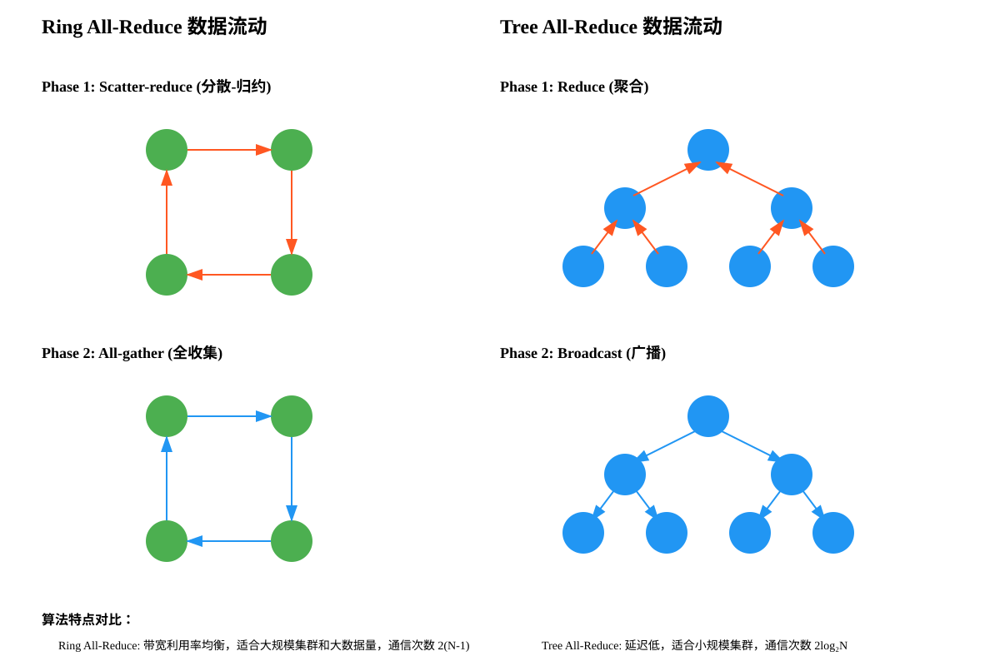
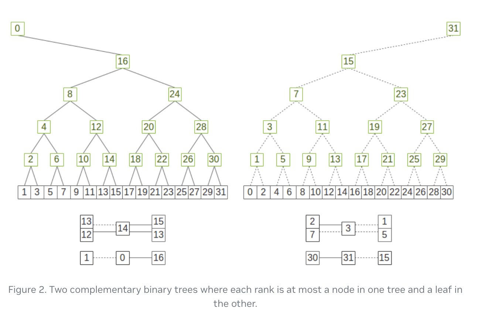

# 学习路径

为了给 OpenRLHF 写一个 `weight_update` 接口，怜悯给我说，”你只需要学习 `torch.dist`。”我当时一听，“我怎么记得有个 torch 的接口是计算距离的，就叫做 `torch.dist` 呢？”然后他说，“实际上是 `torch.distributed`。”哄堂大笑...

无所谓，我确实要学下 `torch.distributed`：

1. Learn torch.distributed https://pytorch.org/docs/stable/distributed.html
2. How to create a communication group.
3. How to broadcast a tensor.  8 GPUs, 1 process per GPU, 8 processes. Broadcast a torch tensor from 1 GPU to the other 7 GPUs with torch.distributed (nccl backend).

看完了学习目标，我又问了问我工位旁边的老哥，如何学习 `torch.distributed`。他说读源码，而我本来想对着源码硬学的，结果看了几眼，直接放弃 😂。网上查了查，也没有很好的教程。无所谓，我会出手！问了问 claude，学！

## `torch.distributed` Learning Thread

1. 基础概念

- 进程组(Process Group) - 分布式训练中的基本通信单位

- 后端(Backend) - 重点关注 NCCL 后端，因为你要用 GPU 通信

- rank - 进程编号，用于标识不同 GPU 上的进程

- world size - 总进程数，在你的场景中是 8

2. 核心 API 学习顺序

- 初始化分布式环境 `init_process_group` 

- 创建自定义通讯组 `new_group`

## 主流通讯接口

1. 点到点通讯 vs 集合通讯
2. `send` and `recv`
3. `all_reduce` and `all_gather`
4. `broadcast`
5. `scatter`

# `torch.distributed`

## torch 中的分布式计算

为什么需要分布式计算，肯定不用我解释 😂。而 `torch.distributed` 是 PyTorch 中专门为分布式训练设计的模块，提供了在多个 GPU 或节点间进行数据和模型参数通信的工具。与传统的 `torch` 函数不同，`torch.distributed` 关注的是如何在多设备上有效协调和共享数据，以便各设备在不同的训练任务中协同工作。`torch.distributed` 提供了通信接口，允许用户在多进程环境中实现参数同步、梯度汇总、广播等操作，保证所有设备在每一轮训练中都保持相同的模型状态。

与此相反，普通的 `torch` 函数默认是基于单进程、单设备设计的，即使是多 GPU 的情形，普通的 PyTorch 也只能控制一个进程在多个设备上训练模型，而无法支持多个进程在多个设备上协作。`torch.distributed` 提供了一种高级抽象，使得用户可以轻松管理多个设备或节点的协同工作。

基于分布式计算可以构造分布式训练以及我正在学习的分布式推理。就训练而言，至少有两个显而易见的类别：

1. **数据并行（Data Parallelism）**：这是分布式训练中最常见的形式，适用于大多数深度学习任务。在每张 GPU 上能够完全容纳整个模型的情况下，数据并行将同一模型的副本分布到多个 GPU 上，每个 GPU 负责处理数据集的不同部分，然后通过 `all_reduce` 等集合通信操作汇总梯度并更新模型参数。
- **优点**：易于实现，尤其在图像分类和 NLP 等领域可以直接应用。
- **实现方法**：通过 `torch.distributed` 的 `init_process_group()`、`all_reduce()` 等函数，可以很方便地同步每个进程的梯度，实现数据并行。

2. **模型并行（Model Parallelism）**：在模型规模极大的情况下，单个设备的显存不足以存放模型参数，这时可以将模型拆分为不同的部分，由多个 GPU 各自负责模型的不同部分。
- **优点**：可以训练显存超出单 GPU 负荷的大模型。
- **实现方法**：`torch.distributed` 通过 `send()`、`recv()` 等点对点通信函数实现模型不同模块之间的数据交换，从而实现模型并行。

## 进程组

在分布式系统中，进程组是一个核心的通信单元。进程组将一组已存在的进程组织在一起，使这些进程之间可以通过特定的通信方式进行数据交换。在每个进程启动时，需要先用 `torch.distributed.init_process_group` 初始化分布式环境并将进程加入到默认的全局进程组 WORLD group 中。之后,可以通过 `torch.distributed.new_group` 来创建新的进程组，将特定的进程组织在一起。不同进程组可以使用不同的通信方式，这样可以实现更灵活的分布式策略。

## `init_process_group`

创建全局进程组并将进程加入其中。这个 API 的名字有点迷惑，因为每个进程里面都会执行一次这个指令，听上去像是启动了 8 个全局默认进程组，实际上这里做的事情是类似于 touch 指令。**第一个执行到这里的进程创建并加入全局进程组，之后执行到的进程只需加入。**

<details>
<summary>init_process_group</summary>

```python
import os
import torch
import torch.distributed as dist
import torch.multiprocessing as mp


def init_process(rank, world_size):
    print(f"进程已启动: 此进程的 rank 是 {rank}")
    
    # 设置当前进程使用的 GPU
    torch.cuda.set_device(rank)
    
    try:
        # 加入进程组
        print(f"进程 {rank} 正在加入进程组...")
        dist.init_process_group(backend="nccl", rank=rank, world_size=world_size)
        print(f"进程 {rank} 已成功加入进程组")
        
        # 验证身份
        assert rank == dist.get_rank()
        assert world_size == dist.get_world_size()
        
        # 准备当前进程的信息
        process_info = (
            f"\n进程 {rank} 信息:\n"
            f"- Device: {torch.cuda.current_device()}\n"
            f"- GPU: {torch.cuda.get_device_name(torch.cuda.current_device())}\n"
        )
        
        # 将字符串转换为固定长度的张量
        max_len = 100  # 确保足够长以容纳信息
        process_info_tensor = torch.zeros(max_len, dtype=torch.int32, device='cuda')
        process_info_bytes = process_info.encode('utf-8')
        process_info_tensor[:len(process_info_bytes)] = torch.tensor([b for b in process_info_bytes], dtype=torch.int32)
        
        # 创建用于收集所有进程信息的张量列表
        gathered_tensors = [torch.zeros(max_len, dtype=torch.int32, device='cuda') for _ in range(world_size)]

        # 使用 all_gather 收集所有进程的信息
        dist.all_gather(gathered_tensors, process_info_tensor)


        if rank == 0:
            print("=============== 所有进程信息 ===============")
            for tensor in gathered_tensors:
                info_bytes = tensor.cpu().numpy().astype('uint8').tobytes() 
                info_str = info_bytes.decode('utf-8', 'ignore').strip('\x00')
                print(info_str)
        
        # 创建张量并进行通信
        tensor = torch.ones(1).cuda() * rank
        print(f"进程 {rank} 的原始张量值: {tensor.item()}")
        
        # 所有进程同步点
        dist.all_reduce(tensor, op=dist.ReduceOp.SUM)
        print(f"进程 {rank} 的最终张量值: {tensor.item()}")
    
    finally:
        dist.destroy_process_group()

def main():
    os.environ['MASTER_ADDR'] = 'localhost'
    os.environ['MASTER_PORT'] = '29500'
    
    world_size = torch.cuda.device_count()
    print(f"准备启动 {world_size} 个进程...")
    
    mp.spawn(
        init_process,
        args=(world_size,),
        nprocs=world_size,
        join=True
    )
    
    #! 等价于通过以下代码启动进程
    # processes = []
    # for rank in range(world_size):
    #     p = mp.Process(target=init_process, args=(rank, world_size))
    #     p.start()
    #     processes.append(p)

    # # 相当于 join=True 的效果
    # for p in processes:
    #     p.join()

if __name__ == "__main__":
    main()
```

</details> 

这段代码的核心是这三个接口：

1. 将进程加入全局进程组

`dist.init_process_group(backend="nccl", rank=rank, world_size=world_size)`


2. 用 `all_gather` 收集所有进程的设备信息

`dist.all_gather(gathered_tensors, process_info_tensor)`

每个进程将自己的信息发送给其他所有进程

3. 用 `all_reduce` 对张量求和

`dist.all_reduce(tensor, op=dist.ReduceOp.SUM)`


## `new_group`

 创建自定义进程组，和 `init_process_group()` 一样，创建 or 加入。


<details>
<summary>new_group</summary>

```python
import os
import torch
import torch.distributed as dist
import torch.multiprocessing as mp


def init_process(rank, world_size):
    try:
        # 1. 加入全局进程组
        torch.cuda.set_device(rank)
        if rank == 0:
            print(f"准备加入全局进程组...")
        dist.init_process_group(backend="nccl", rank=rank, world_size=world_size)
        
        # 2. 创建两个自定义进程组
        group1_ranks = list(range(world_size // 2))
        group2_ranks = list(range(world_size // 2, world_size))
        
        # 初始化累加值为 0
        group1_sum = torch.zeros(1).cuda()
        group2_sum = torch.zeros(1).cuda()
        if rank == 0:
            print(f"组1的初始化累加值: {group1_sum.item()}")
            print(f"组2的初始化累加值: {group2_sum.item()}")
        
        group1 = dist.new_group(group1_ranks)
        group2 = dist.new_group(group2_ranks)
        
        # 3. 在各自的组内进行通信
        tensor = torch.ones(1).cuda() * rank  # 每个进程的输入值为其 rank
        if rank == 0:
            print(f"\n开始进行组内通信...")
        
        if rank == 0:
            print(f"Group1 进行all_reduce操作...")

        # 在对应的组内进行all_reduce，累加结果会更新到 tensor 中
        if rank in group1_ranks:
            dist.all_reduce(tensor, op=dist.ReduceOp.SUM, group=group1)
            group1_sum = tensor.clone()  # 保存 group1 的累加结果
        else:
            dist.all_reduce(tensor, op=dist.ReduceOp.SUM, group=group2)
            group2_sum = tensor.clone()  # 保存 group2 的累加结果
        
        # 确保所有进程都能获得两个组的累加结果
        dist.all_reduce(group1_sum, op=dist.ReduceOp.MAX)
        dist.all_reduce(group2_sum, op=dist.ReduceOp.MAX)
        
        if rank == 0:
            print("\n=============== 通信完成 ===============")
            print(f"Group1 (ranks {group1_ranks}): 累加结果为 {group1_sum.item()}")
            print(f"Group2 (ranks {group2_ranks}): 累加结果为 {group2_sum.item()}")
    
    finally:
        dist.destroy_process_group()

def main():
    os.environ['MASTER_ADDR'] = 'localhost'
    os.environ['MASTER_PORT'] = '29500'
    
    world_size = torch.cuda.device_count()
    print(f"准备启动 {world_size} 个进程...")
    
    mp.spawn(
        init_process,
        args=(world_size,),
        nprocs=world_size,
        join=True
    )

if __name__ == "__main__":
    main()
```

</details>


这些代码都挺简单的，比较有意思的是，rank 0 的代码经过 `dist.all_reduce(tensor, op=dist.ReduceOp.SUM, group=group1)` 后，就已经保留了第一组的累加结果，但是这两行代码仍然是需要的：

```python
# 确保所有进程都能获得两个组的累加结果
dist.all_reduce(group1_sum, op=dist.ReduceOp.MAX)
dist.all_reduce(group2_sum, op=dist.ReduceOp.MAX)
```

因为，rank 0 在 group 1 里面，因此 `all_reduce(group1_sum)` 并且取最大值对 group1_sum 没影响。但是 rank 0 的 group2_sum 还是 0，需要这样一个 all_reduce 接受其他 rank 的 group2_sum。基于此，设想下，简单把 `dist.ReduceOp.MAX` 改为 `dist.ReduceOp.SUM`，结果将是先前的 4 倍。

# 通讯接口

进程间显而易见需要通讯，比较有趣的是，简单的 data parallelism 需要复杂的 `all_reduce, all_gather, broadcast`，而复杂些的 model parallelism 需要直觉上更简单的 `send, recv`。对这些通讯方式做一草草分类：

1. **点对点通信（Point-to-Point Communication）**

点对点通信是最基础的通信模式，指的是一个进程直接向另一个特定的进程发送或接收数据。这种模式非常灵活，适合需要精确控制通信过程的场景。

- **send-receive 模式**：在 `torch.distributed` 中，这种模式可以通过 `send()` 和 `recv()` 接口实现。比如 `send(tensor, dst=1)` 表示进程将数据发送给 rank 为 1 的进程，而 `recv(tensor, src=0)` 表示接收来自 rank 为 0 的进程的数据。毫无疑问，这是阻塞式的。

点对点通信的优点是简单直观，易于理解和控制；缺点是容易导致复杂的代码结构，尤其在需要多进程相互发送数据的情况下，可能会出现死锁或阻塞问题。因此，这种方式更多适用于两个进程之间的信息交换。适合需要精确控制单个进程之间数据交换的场景，通常在系统层通信优化中或模型分片时使用较多。例如在模型并行训练的梯度更新中，点对点通信可以用于梯度的汇总。

2. **集合通信（Collective Communication）**

集合通信是一类高级通信模式，通常用于多个进程之间的数据交换。集合通信操作往往会涉及到所有参与的进程，因此在分布式深度学习中使用频率非常高。

- **广播（Broadcast）**：广播是一种将数据从一个源进程发送到所有其他进程的通信操作。在 `torch.distributed` 中，通过 `broadcast(tensor, src=0)` 可以实现该操作，将 rank 为 0 的进程中的数据广播到所有其他进程。广播操作能够确保所有进程拥有相同的数据，适合需要共享模型参数、初始化权重等场景。比如在分布式训练的初始化阶段，用于将主进程的模型参数广播到所有其他进程，保证训练从同样的初始参数开始。
- **规约（Reduce 和 All-Reduce）**：规约操作是一种将多个进程的数据进行计算（如求和、求最大值等）的操作。常用的规约操作有两种，`reduce()`：一个进程（通常是主进程）收集并合并来自所有进程的数据；`all_reduce()`：所有进程同时得到合并后的数据。比如 `all_reduce(tensor, op=ReduceOp.SUM)` 会在所有进程中求和，并将结果存放在每个进程的 `tensor` 中。规约操作能有效减少通信负担，适用于大规模梯度汇总或模型权重更新。譬如在分布式训练中，`all_reduce` 常用于梯度求和，以确保在多个进程中的梯度保持一致，实现同步更新。
- **收集（Gather 和 All-Gather）**：收集操作是将多个进程的数据收集到一个或多个进程的操作：`gather()`：将多个进程的数据收集到一个进程中。`all_gather()`：所有进程都收集到全部进程的数据。例如 `all_gather(gathered_tensors, tensor)` 会将所有进程中的 `tensor` 收集到每个进程的 `gathered_tensors` 列表中。收集操作方便对所有进程中的数据进行后续分析和处理。譬如做 evaluation 时，可以使用 `all_gather` 来汇总各个进程的中间结果。
- **散发（Scatter）**：`scatter()` 操作是将一个进程的数据分散到多个进程中。例如在 rank 为 0 的进程中有一个包含若干子张量的列表，`scatter()` 可以将列表中的每个子张量分配给其他进程。适用于数据分发，将大型数据集或模型权重在多个进程中分散，以便每个进程可以处理不同的数据块。

3. **点对点和集合通讯对比**

- **灵活性**：点对点通信适合需要高精度控制通信的场景，但不适合大规模通信，因为代码会变得复杂。集合通信更高效，适合多进程协作场景，尤其在深度学习训练中。
- **复杂度**：集合通信简化了数据同步、梯度规约等常见需求，并能提高训练的速度和通信效率。

## `send` and `recv`


<details>
<summary>send and recv</summary>

```python
import os
import torch
import torch.distributed as dist
import torch.multiprocessing as mp

def init_process(rank, world_size):
    try:
        torch.cuda.set_device(rank)
        dist.init_process_group(backend="nccl", rank=rank, world_size=world_size)
        
        # 创建初始数据（只在 rank 0 创建有意义的数据）
        if rank == 0:
            tensor = torch.tensor([100, 200], dtype=torch.float32).cuda()
            print(f"\n=== 初始状态 ===")
            print(f"Rank 0 的初始数据: {tensor}")
            # 发送数据给 rank 1
            dist.send(tensor, dst=1)
            print(f"Rank 0 已发送数据到 Rank 1")
            
        elif rank == 1:
            # rank 1 接收来自 rank 0 的数据
            tensor = torch.zeros(2, dtype=torch.float32).cuda()
            dist.recv(tensor, src=0)
            print(f"Rank 1 收到数据: {tensor}")
            
            # 对数据进行修改后发送给 rank 2
            tensor = tensor * 2  # 将数据翻倍
            print(f"Rank 1 处理后的数据: {tensor}")
            dist.send(tensor, dst=2)
            print(f"Rank 1 已发送数据到 Rank 2")
            
        elif rank == 2:
            # rank 2 接收来自 rank 1 的数据
            tensor = torch.zeros(2, dtype=torch.float32).cuda()
            dist.recv(tensor, src=1)
            print(f"Rank 2 收到数据: {tensor}")
            print("\n=== 传输完成 ===")
            
    finally:
        dist.destroy_process_group()

def main():
    os.environ['MASTER_ADDR'] = 'localhost'
    os.environ['MASTER_PORT'] = '29500'
    
    world_size = 3
    print(f"准备启动 {world_size} 个进程...")
    
    mp.spawn(
        init_process,
        args=(world_size,),
        nprocs=world_size,
        join=True
    )

if __name__ == "__main__":
    main()
```

</details>
用法非常简单。

- `recv` 需要预先分配好接收数据的 tensor，且大小必须匹配。
- `send` 和 `recv` 都是阻塞操作，发送方会等待直到接收方完成接收，接收方会等待直到发送方的数据到达。
- 每个 `send` 必须有对应的 `recv`，如果配对不当会导致死锁。

举个使用不当的例子：

```python
# 错误示例 - 可能导致死锁
if rank == 0:
    dist.send(tensor1, dst=1)  # 等待 rank 1 接收
    dist.recv(tensor2, src=1)  # 永远等不到，因为 rank 1 卡在发送
elif rank == 1:
    dist.send(tensor2, dst=0)  # 等待 rank 0 接收
    dist.recv(tensor1, src=0)  # 永远等不到，因为 rank 0 卡在发送

# 正确示例
if rank == 0:
    dist.send(tensor1, dst=1)
    dist.recv(tensor2, src=1)
elif rank == 1:
    dist.recv(tensor1, src=0)  # 先接收
    dist.send(tensor2, dst=0)  # 再发送
```

- 发送和接收的 tensor 必须在相同类型的设备上（都在 CPU 或都在 GPU）。

- 对于简单的集合通信，建议使用专门的集合通信原语：`all_reduce` 代替多个 `send/recv` 的求和，`all_gather` 代替多个 `send/recv` 的数据收集，`broadcast` 代替一对多的发送。

## `isend` and `irecv`

- 如果需要非阻塞通信，可以使用 `isend/irecv`
- 也可以使用[dist.batch_isend_irecv](https://pytorch.org/docs/stable/distributed.html#torch.distributed.batch_isend_irecv) fuse多个P2P通信操作. 该函数会尝试[fuse多个NCCL kernel来提高throughput](https://github.com/pytorch/pytorch/issues/132852)，并re-order通信顺序以减少deadlock概率。

<details>
<summary>isend and irecv</summary>

```python
import os
import torch
import torch.distributed as dist
import torch.multiprocessing as mp
import time  # 添加 time 用于演示异步效果

def init_process(rank, world_size):
    try:
        torch.cuda.set_device(rank)
        dist.init_process_group(backend="nccl", rank=rank, world_size=world_size)
        
        if rank == 0:
            tensor = torch.tensor([100, 200], dtype=torch.float32).cuda()
            print(f"\n=== 初始状态 ===")
            print(f"Rank 0 的初始数据: {tensor}")
            
            # 异步发送数据给 rank 1
            print(f"Rank 0 准备发送数据...")
            send_req = dist.isend(tensor, dst=1)
            print(f"Rank 0 启动异步发送")
            
            # 模拟在等待发送完成时做其他工作
            print(f"Rank 0 正在处理其他任务...")
            time.sleep(1)  # 模拟其他计算任务
            
            # 等待发送完成
            send_req.wait()
            print(f"Rank 0 确认发送完成")
            
        elif rank == 1:
            tensor = torch.zeros(2, dtype=torch.float32).cuda()
            print(f"Rank 1 准备接收数据...")
            
            # 异步接收来自 rank 0 的数据
            recv_req = dist.irecv(tensor, src=0)
            print(f"Rank 1 启动异步接收")
            
            # 模拟在等待接收完成时做其他工作
            print(f"Rank 1 正在处理其他任务...")
            time.sleep(1)  # 模拟其他计算任务
            
            # 等待接收完成
            recv_req.wait()
            print(f"Rank 1 接收完成，数据为: {tensor}")
            
            # 处理数据并异步发送给 rank 2
            tensor = tensor * 2
            print(f"Rank 1 处理后的数据: {tensor}")
            print(f"Rank 1 准备发送数据给 Rank 2...")
            send_req = dist.isend(tensor, dst=2)
            print(f"Rank 1 启动异步发送")
            
            # 模拟在等待发送完成时做其他工作
            print(f"Rank 1 正在处理其他任务...")
            time.sleep(1)  # 模拟其他计算任务
            
            send_req.wait()
            print(f"Rank 1 确认发送完成")
            
        elif rank == 2:
            tensor = torch.zeros(2, dtype=torch.float32).cuda()
            print(f"Rank 2 准备接收数据...")
            
            # 异步接收来自 rank 1 的数据
            recv_req = dist.irecv(tensor, src=1)
            print(f"Rank 2 启动异步接收")
            
            # 模拟在等待接收完成时做其他工作
            print(f"Rank 2 正在处理其他任务...")
            time.sleep(1)  # 模拟其他计算任务
            
            # 等待接收完成
            recv_req.wait()
            print(f"Rank 2 接收完成，最终数据为: {tensor}")
            print("\n=== 传输完成 ===")
            
    finally:
        dist.destroy_process_group()

def main():
    os.environ['MASTER_ADDR'] = 'localhost'
    os.environ['MASTER_PORT'] = '29500'
    
    world_size = 3
    print(f"准备启动 {world_size} 个进程...")
    
    mp.spawn(
        init_process,
        args=(world_size,),
        nprocs=world_size,
        join=True
    )

if __name__ == "__main__":
    main()
```

</details>

- 在通信完成前不要修改发送缓冲区(buffer)，在通信完成前不要使用接收缓冲区，必须等待 `wait()` 完成后才能安全操作相关数据
- 每个异步操作都会占用系统资源，应及时调用 `wait()` 释放资源
- 避免同时发起过多未完成的异步操作
- 异步操作可能在后台失败，`wait()` 调用会暴露通信过程中的错误，建议使用 `try-finally` 确保资源正确清理

## `all_reduce` and `all_gather`

1. **功能定位**：
- `all_reduce`: 对所有进程的数据进行规约（reduction）操作，如求和、取最大值等
- `all_gather`: 收集所有进程的数据，不进行运算，只是简单合并

2. **输出结果**：
- `all_reduce`: 所有进程得到相同的规约结果
- `all_gather`: 所有进程得到包含所有进程原始数据的完整列表

3. **内存使用**：
- `all_reduce`: 输出张量大小与输入相同
- `all_gather`: 输出张量大小是输入的 `world_size` 倍

4. **适用场景**：
- `all_reduce`：计算分布式损失，梯度同步，计算全局统计信息（如准确率）
- `all_gather`：获取其他进程的原始数据，分布式评估指标计算，汇总不同进程的中间结果

5. **通讯效率**：

- `all_reduce` 通常比 `all_gather` 更高效，如果只需要得到最终的汇总结果，应优先使用 `all_reduce`，传输的数据量更小，可以利用树形结构进行规约。


<details>
<summary>all_reduce and all_gather</summary>

```python
import os
import torch
import torch.distributed as dist
import torch.multiprocessing as mp

def init_process(rank, world_size):
    try:
        torch.cuda.set_device(rank)
        dist.init_process_group(backend="nccl", rank=rank, world_size=world_size)
        
        # 创建测试张量
        tensor = torch.tensor([rank * 10, rank * 10 + 1], dtype=torch.float32).cuda()
        
        # === all_gather 示例 ===
        gathered = [torch.zeros(2, dtype=torch.float32).cuda() for _ in range(world_size)]
        dist.all_gather(gathered, tensor)
        
        if rank == 0:
            print("\n=== all_gather 结果 ===")
            print(f"原始张量 (rank 0): {tensor}")
            print("收集所有进程的张量:")
            for i, t in enumerate(gathered):
                print(f"rank {i} 的数据: {t.tolist()}")
        
        # === all_reduce 示例 ===
        reduced_tensor = tensor.clone()  # 创建副本用于 all_reduce
        if rank == 0:
            print(f"before all_reduce: {reduced_tensor}")

        dist.all_reduce(reduced_tensor, op=dist.ReduceOp.SUM)
        
        if rank == 0:
            print("\n=== all_reduce 结果 ===")
            print(f"原始张量 (rank 0): {tensor}")
            print(f"归约后的张量 (所有 rank 的和): {reduced_tensor}")
            
    finally:
        dist.destroy_process_group()
        
def main():
    os.environ['MASTER_ADDR'] = 'localhost'
    os.environ['MASTER_PORT'] = '29500'
    
    world_size = torch.cuda.device_count()
    print(f"准备启动 {world_size} 个进程...")
    
    mp.spawn(
        init_process,
        args=(world_size,),
        nprocs=world_size,
        join=True
    )

if __name__ == "__main__":
    main()
```

</details>

实际上 `all_reduce` 本身只支持有限的运算，可以通过这些运算的组合实现复杂一些函数，类似于实现分布式的 `softmax`。


<details>
<summary>all_reduce 实现 softmax</summary>

```python
import os
import torch
import torch.distributed as dist
import torch.multiprocessing as mp


def init_process(rank, world_size):
    try:
        torch.cuda.set_device(rank)
        dist.init_process_group(backend="nccl", rank=rank, world_size=world_size)
        
        # 创建更复杂的测试张量
        tensor = torch.tensor([rank + 1, rank + 2, rank + 3], dtype=torch.float32).cuda()
        
        if rank == 0:
            print(f"\n初始张量 (rank {rank}): {tensor}")
            
        # 1. 使用 PREMUL_SUM 实现加权和
        weights = torch.tensor([0.3, 0.3, 0.4]).cuda()
        weighted = tensor * weights
        dist.all_reduce(weighted, op=dist.ReduceOp.SUM)
        
        if rank == 0:
            print(f"\n=== 加权和结果 ===")
            print(f"加权后的张量: {weighted}")
            
        # 2. 实现 softmax 的分布式版本
        # 第一步：计算最大值
        max_tensor = tensor.clone()
        if rank == 0:
            print(f"max_tensor before all_reduce: {max_tensor}")
        dist.all_reduce(max_tensor, op=dist.ReduceOp.MAX)
        
        if rank == 0:
            print(f"max_tensor after all_reduce: {max_tensor}")
        
        # 第二步：计算 exp(x - max(x))
        exp_tensor = torch.exp(tensor - max_tensor)
        
        # 第三步：计算分母（所有exp的和）
        sum_exp = exp_tensor.clone()
        if rank == 0:
            print(f"sum_exp before all_reduce: {sum_exp}")
        dist.all_reduce(sum_exp, op=dist.ReduceOp.SUM)
        
        if rank == 0:
            print(f"sum_exp after all_reduce: {sum_exp}")
        
        # 第四步：计算最终的 softmax
        softmax_result = exp_tensor / sum_exp
        
        if rank == 0:
            print(f"\n=== 分布式 Softmax 结果 ===")
            print(f"Softmax 结果: {softmax_result}")
            
        # 3. 实现 L2 正则化的分布式版本
        # 第一步：计算平方
        squared = tensor ** 2
        
        # 第二步：求所有元素平方和
        sum_squared = squared.clone()
        if rank == 0:
            print(f"sum_squared before all_reduce: {sum_squared}")
        dist.all_reduce(sum_squared, op=dist.ReduceOp.SUM)
        
        if rank == 0:
            print(f"sum_squared after all_reduce: {sum_squared}")
        
        # 第三步：计算平方根
        l2_norm = torch.sqrt(sum_squared)
        
        # 第四步：正则化
        normalized = tensor / l2_norm
        
        if rank == 0:
            print(f"\n=== 分布式 L2 正则化结果 ===")
            print(f"正则化结果: {normalized}")
            
    finally:
        dist.destroy_process_group()
        
def main():
    os.environ['MASTER_ADDR'] = 'localhost'
    os.environ['MASTER_PORT'] = '29500'
    
    world_size = torch.cuda.device_count()
    print(f"准备启动 {world_size} 个进程...")
    
    mp.spawn(
        init_process,
        args=(world_size,),
        nprocs=world_size,
        join=True
    )

if __name__ == "__main__":
    main()
```


</details>

## `broadcast`

<details>
<summary>broadcast</summary>

```python
import os
import torch
import torch.distributed as dist
import torch.multiprocessing as mp

def init_process(rank, world_size):
    try:
        # 初始化进程组
        torch.cuda.set_device(rank)
        dist.init_process_group(backend="nccl", rank=rank, world_size=world_size)

        # 创建数据
        if rank == 0:
            data1 = torch.tensor([1.0, 2.0, 3.0, 4.0, 5.0]).cuda()
            data2 = torch.zeros(3).cuda()  # 用于接收rank 1的广播
            print(f"Rank 0 初始数据: data1={data1}, data2={data2}")
        elif rank == 1:
            data1 = torch.zeros(5).cuda()  # 用于接收rank 0的广播
            data2 = torch.tensor([10.0, 20.0, 30.0]).cuda()
            print(f"Rank 1 初始数据: data1={data1}, data2={data2}")
        else:
            data1 = torch.zeros(5).cuda()
            data2 = torch.zeros(3).cuda()
            print(f"Rank {rank} 初始数据: data1={data1}, data2={data2}")
        
        # 先执行rank 0的广播
        dist.broadcast(data1, src=0)
        print(f"Rank {rank} 第一次广播后: data1={data1}")
        print(f"Rank {rank} 第一次广播后: data2={data2}")
        
        # 再执行rank 1的广播
        dist.broadcast(data2, src=1)
        print(f"Rank {rank} 第二次广播后: data1={data1}")
        print(f"Rank {rank} 第二次广播后: data2={data2}")

    finally:
        dist.destroy_process_group()

def main():
    os.environ['MASTER_ADDR'] = 'localhost'
    os.environ['MASTER_PORT'] = '29500'
    
    world_size = torch.cuda.device_count()
    print(f"准备启动 {world_size} 个进程...\n")
    
    mp.spawn(
        init_process,
        args=(world_size,),
        nprocs=world_size,
        join=True
    )

if __name__ == "__main__":
    main()
```


</details>

例子非常简单：

1. `broadcast` 将源进程 src 的张量数据广播到所有其他进程的同名张量
2. 接收数据的进程必须预先分配好相同大小的张量空间
3. 广播操作是阻塞的，所有进程都需要执行到这行代码才能继续
4. 数据会直接在预分配的内存上进行修改，而不是创建新的张量

## `scatter`


<details>
<summary>scatter</summary>

```python
import os
import torch
import torch.distributed as dist
import torch.multiprocessing as mp


def init_process(rank, world_size):
    try:
        torch.cuda.set_device(rank)
        dist.init_process_group(backend="nccl", rank=rank, world_size=world_size)
        
        # === scatter 示例 ===

        if rank == 0:
            # 在 rank 0 创建要分发的数据
            # 为每个进程准备 2 个数字
            scatter_list = [
                torch.tensor([i * 10, i * 10 + 1], dtype=torch.float32).cuda()
                for i in range(world_size)
            ]
            print("\n=== scatter 前的数据 ===")
            for i, tensor in enumerate(scatter_list):
                print(f"准备发送到 rank {i} 的数据: {tensor.tolist()}")
        else:
            scatter_list = None

        # 准备接收数据的张量
        output_tensor = torch.zeros(2, dtype=torch.float32).cuda()
        print(f"Rank {rank} 初始化接收数据: {output_tensor.tolist()}")
        
        # 执行 scatter 操作
        dist.scatter(output_tensor, scatter_list, src=0)
        
        # 每个进程打印接收到的数据
        print(f"Rank {rank} 收到的数据: {output_tensor.tolist()}")
            
    finally:
        dist.destroy_process_group()
        
def main():
    os.environ['MASTER_ADDR'] = 'localhost'
    os.environ['MASTER_PORT'] = '29500'
    
    world_size = torch.cuda.device_count()
    print(f"准备启动 {world_size} 个进程...")
    
    mp.spawn(
        init_process,
        args=(world_size,),
        nprocs=world_size,
        join=True
    )

if __name__ == "__main__":
    main()
```


</details>

- `scatter` 是一对多的分发操作，只有源进程(这里是 rank 0)需要准备完整数据
- 其他进程的 `scatter_list` 必须设为 None，这是 PyTorch 的规定
- 数据必须事先按进程数量切分好，每个进程获得一份
- `scatter` 操作是同步的，所有进程都会在这里等待，直到通信完成
- 必须指定源进程 (src=0)，表明数据从哪个进程分发出去
- `scatter_list` 中的每个张量大小必须相同
- 总数据量必须能被进程数整除

- `scatter` 适合将大数据集划分给多个进程处理

- 相比 `broadcast`，`scatter` 可以节省其他进程的内存使用

**`scatter` 适合：**

1. 数据并行训练时分发不同的数据批次
2. 将大规模数据集分片到多个节点进行处理
3. 在参数服务器架构中分发模型参数

**为什么说 `scatter` 比起 `broadcast` 节省空间？**

考虑一共 4 个进程，需要从 rank 0 发 `[1000, 250]` 维度的数据给 rank 1, 2, 3，那么用 `broadcast` 则每张卡上都得有 `[1000, 250]` 大小的的数据块，然后各自切片。使用 `scatter` 则只有 rank 0 上会有 `[1000, 1000]`，其他 rank 上是 `[1000, 250]`。

# 后记

这里摘录一些对我蛮有启发的博客的记录。

参考了知乎[[原创][深度][PyTorch] DDP系列第一篇：入门教程](https://zhuanlan.zhihu.com/p/178402798)。

有几个非常重要的概念，我继续问 claude 补充下：

## GIL

众所周知因为 GIL 的存在，Python 的多线程是伪多线程。GIL（Global Interpreter Lock，全局解释器锁）是 Python 解释器 CPython 中的一个互斥锁，它可以确保在任何时候只有一个线程能够执行 Python 字节码。也就是说，即使在多核处理器上，一个 Python 进程同一时刻也只能执行一个线程。

GIL 的设计可以追溯到 1992 年当时是为了解决早期 Python 内存管理的线程安全问题。在那个年代，多核处理器还不普及，单线程执行是主流。GIL 大大简化了 Python 的内存管理，特别是引用计数机制的实现。不需要复杂的锁机制来保护每个对象，一个全局锁就解决了线程安全问题。使得 C 扩展的编写更容易，不需要考虑复杂的线程同步问题。

这种设计的优点:

1. 实现简单且可靠：单线程执行保证了内存管理的安全性，减少了死锁等并发 bug 的可能性，简化了 C 扩展的开发。

2. 对于 I/O 密集型应用影响较小：**Python 在进行 I/O 操作时会释放 GIL，所以对于网络请求、文件读写等场景，多线程仍然可以提供性能提升**，多线程 I/O 是个很实在的需求。

3. 单线程性能更好：没有线程切换开销，不需要复杂的锁机制，内存管理效率更高。


缺点:

1. 无法充分利用多核 CPU：同一时刻只能执行一个线程。

2. 在计算密集型任务中性能受限：即使有多个 CPU 核心也无法实现真正的并行计算，所以**Python 处理计算密集型任务需要用多进程**，比如下例：

```python
# 计算密集型任务在多线程下可能比单线程更慢
def compute_intensive():
    for i in range(10000000):
        x = i * i
        
# 多线程版本可能比单线程更慢
threads = [Thread(target=compute_intensive) for _ in range(4)]
```

解决方案：

1. 在计算密集型任务中使用多进程替代多线程：

```python
from multiprocessing import Process # or use mp.spawn

# 使用多进程可以绕过 GIL 限制
processes = [Process(target=compute_intensive) for _ in range(4)]
```
2. 使用其他 Python 实现，或者更高版本的 [Python 3.12](https://www.reddit.com/r/Python/comments/1bcggx9/disabling_the_gil_option_has_been_merged_into)。
  
3. 将计算密集型任务用 C/C++ 实现：通过扩展模块方式使用，在 C 代码中可以释放 GIL。

需要注意的是，虽然 GIL 有这些限制，但这并不意味着 Python 不适合开发大型应用。在实际应用中：

1. 大多数应用是 I/O 密集型而不是 CPU 密集型，GIL 的影响有限。

2. 可以通过合适的架构设计规避 GIL 的限制：使用多进程架构，使用异步编程，将计算密集型任务交给专门的服务，或调用C/C++接口。


## Ring / Tree Algorithm
- NCCL在启动Collective Communication前会根据网络通信拓扑benchmark不同算法，并选择延迟最低的. Ring和Tree是NCCL中最常见的两种拓扑算法，常应用于，但也会被其他算子(Ring All-Gather, All-to-All)使用。
- 更复杂的算法有[SHARP](https://network.nvidia.com/pdf/solutions/hpc/paperieee_copyright.pdf)，一种multicast的延伸算法（in-network reduction），使用网络swtiches(e.g. [NVSwitch](https://github.com/NVIDIA/nccl/issues/807)) 上的处理器执行reduction来避免offload数据到CPU/GPU上，减少延迟和SM占用。
- 以下分析中, n为参与计算的GPU数量。NVIDIA通常一个节点(node)有8个GPU，由高带宽NVLINK + NVSwitch densely connect成一个complete graph网络拓扑

Claude 画的矢量图属实无敌了...

这张图一目了然能够理解 Ring / Tree 算法。

### Ring Algorithm

**优点:**

- 带宽利用率高: 每个节点同时接收和发送数据,能充分利用硬件带宽
- 负载均衡: 每个节点处理相同数量的数据,网络负载分布均匀
- 实现简单: 容错和同步机制相对直观

**缺点:**

- 延迟与节点数呈线性关系: 完成一次 AllReduce 需要 2(n-1) 步
- 不适合大规模集群: 在数千节点规模下,线性增长的延迟会显著影响性能, 且少数缓慢straggler节点容易成为通信瓶颈.
- 对小数据传输效率不高: 启动开销相对较大

**拓展/应用:**
- NCCL在单节点/节点数少时更容易选择Ring算法，[并不会混用Ring和Tree](https://github.com/NVIDIA/nccl/issues/471)（也许是懒/为了实现和benchmark简单:( .
- 可用Double/2D Ring Topology高效利用节点内（intra-node）带宽，掩盖/缓解节点间（inter-node）通信延迟。NCCL并未采用2D ring, 但论文 [LoongTrain](https://arxiv.org/abs/2406.18485)用了2D ring来加速Ring Attention。

### Tree Algorithm

传统的 Tree Algorithm 的延迟与节点数呈对数关系。参考上图，一目了然。

**优点**

- 延迟低：与节点数呈对数关系: 完成通信只需 O(log n) 步
- 适合大规模集群/节点间通信: 在大规模场景(如 24000+ GPU)下表现优异

**缺点**

- 实现复杂: 需要维护两棵互补的二叉树结构
- 小规模场景优势不明显: 在节点数较少时,额外的树结构维护开销可能得不偿失
- 对网络拓扑结构要求较高: 需要良好的网络互联以支持树形通信
- 带宽利用率不如Ring

**拓展/应用**
- 序列并行算法[Tree Attention](https://arxiv.org/abs/2408.04093) 使用Tree All-Reduce来加速推理时的long-context attention计算，比Ring Attention更scalable, 但由于难以overlap计算和通讯不适用于训练。

### Double Binary Tree Algorithm

从 NCCL 2.4 版本开始，对于node数较多的跨节点通信使用 [Double Binary Tree](https://developer.nvidia.com/blog/massively-scale-deep-learning-training-nccl-2-4) 算法。相比于传统的 Tree Algorithm，构造了两棵互补的二叉树用于平衡通信开销。

1. 互补结构：每个节点在一棵树中是内部节点（参与数据发送和计算），在另一棵树中是叶子节点（只参与数据接收），确保每个节点的工作负载大致相同。


2. 数据分割：将需要传输的数据分成两部分，每棵树负责处理一半的数据，两棵树并行工作。

**优点**

- 解决带宽瓶颈：通过双树结构避免了单点瓶颈
- 负载均衡：每个节点在两棵树中交替角色，保证负载均衡
- 延迟优势：保持了 O(log n) 的通信步数
- 高可扩展性：适合大规模集群（24000+ GPU）
- 容错性好：单个节点故障影响范围小
- 带宽利用率高：通过数据分流充分利用网络带宽

**缺点**

- 实现复杂：需要维护两棵互补二叉树
- 额外开销：结构维护和同步开销较大
- 小规模劣势：节点数少时开销可能得不偿失
- 网络敏感：对网络质量和拓扑结构要求高
- 调试困难：双树结构增加了调试复杂度

### 使用建议

1. **小规模集群 (< 32 GPU)**
   - 推荐：传统 Tree Algorithm
   - 原因：实现简单，开销小，性能足够

2. **中等规模 (32-512 GPU)**
   - 需要根据具体场景选择：
   - 注重简单稳定：传统 Tree
   - 注重性能扩展：Double Binary Tree


3. **大规模集群 (> 512 GPU)**
   - 推荐：Double Binary Tree
   - 原因：更好的可扩展性和负载均衡


### 性能对比

以 NVIDIA 的测试数据为例，在 24756 个 GPU 的集群中：

- Ring Algorithm: 延迟约 180ms
- Tree Algorithm: 延迟约 1ms
- 性能差距接近 180 倍

## 拓展资料
- NCCL拓扑benchmark和选择: 
    - https://zhuanlan.zhihu.com/p/718639633 
    - 设置环境变量查看NCCL init时拓扑benchmark结果（输出一个表格: latency/bandwidth): `NCCL_DEBUG=INFO NCCL_DEBUG_SUBSYS=INIT,ENV,TUNING`
    - 设置环境变量控制NCCL拓扑算法: `NCCL_ALGO=TREE` 或 `NCCL_ALGO=RING`
- All-gather 算法拓扑： https://github.com/NVIDIA/nccl/issues/1123
- 手动跑NCCL性能benchmark: https://github.com/NVIDIA/nccl/issues/569
- SHARP算法的性能优势:
    - https://www.hpcuserforum.com/presentations/swiss/MellanoxHPCTechnology.pdf
    - https://www.youtube.com/watch?v=is7aBZ1_Op0
- 多机环境下，可用 `ibstatus` 查看Infiniband网卡状态
- 设置 `NCCL_MAX_NCHANNELS=1`可限制cpu issue kernel到gpu的通道数为1（GPU端scheduler launch kernel后照不同CUDA stream并行执行）, 以保证kernel launch的顺序和cpu端调度一致，避免通讯kernel先启动，抢占计算kernel SM后delay其运行，无法overlap。
    - https://forums.developer.nvidia.com/t/how-many-streams-maximum-number-of-streams/6571/6
    - https://zhuanlan.zhihu.com/p/706805407
