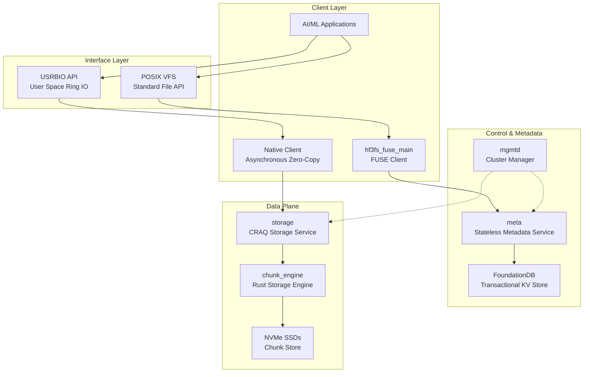
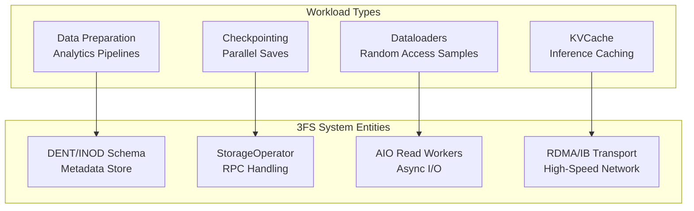

<!-- source: DeepWiki mcp.deepwiki.com · repo deepseek-ai/3FS · page 1 3FS System Overview · fetched 2026-10-30 -->

# 3FS System Overview

<details>
<summary>Relevant source files</summary>

The following files were used as context for generating this wiki page:

- [.clang-tidy](.clang-tidy)
- [README.md](README.md)
- [dockerfile/dev.opencloudos9.dockerfile](dockerfile/dev.opencloudos9.dockerfile)
- [docs/README.md](docs/README.md)
- [docs/design_notes.md](docs/design_notes.md)
- [specs/README.md](specs/README.md)
- [src/lib/api/UsrbIo.md](src/lib/api/UsrbIo.md)
- [src/stubs/CMakeLists.txt](src/stubs/CMakeLists.txt)

</details>


## Purpose and Scope

This document provides a comprehensive overview of the Fire-Flyer File System (3FS), a high-performance distributed file system specifically designed for AI and machine learning workloads. It introduces the system's disaggregated architecture, key design principles, and performance characteristics.

For detailed technical explanations, refer to the following child pages:
- [System Architecture](#1.1) — Detailed explanation of 3FS's disaggregated architecture, CRAQ consistency model, storage layers, and supported workloads.
- [Third-Party Dependencies](#1.2) — Comprehensive overview of external dependencies like RocksDB, FoundationDB, and Folly.

## What is 3FS?

The Fire-Flyer File System (3FS) is a distributed file system designed to address the challenges of AI training and inference workloads [README.md:6-7](). It leverages modern SSDs and RDMA networks to provide a shared storage layer that simplifies the development of distributed applications [README.md:6-9]().

### High-Level System Architecture

3FS consists of four primary components: a cluster manager (`mgmtd`), a metadata service (`meta`), a storage service (`storage`), and a client [docs/design_notes.md:5]().


Sources: [docs/design_notes.md:3-14](), [src/lib/api/UsrbIo.md:3-12]()

### Key Design Principles

3FS is built around several core design principles that optimize for massive AI datasets:

| Principle | Implementation | Benefits |
|-----------|---------------|----------|
| **Disaggregated Architecture** | Combines throughput of thousands of SSDs and network bandwidth of hundreds of storage nodes [README.md:9](). | Locality-oblivious access; elastic scaling of compute and storage. |
| **Strong Consistency** | Chain Replication with Apportioned Queries (CRAQ) [README.md:10](). | Simplifies application logic; "write-all-read-any" approach [docs/design_notes.md:11](). |
| **Stateless Metadata** | Metadata services backed by FoundationDB [README.md:11](). | High availability and horizontal scalability of metadata operations. |
| **Zero-Copy I/O** | USRBIO API using shared memory rings (Ior/Iov) [src/lib/api/UsrbIo.md:3-12](). | Bypasses FUSE bottlenecks and memory copy overhead [docs/design_notes.md:29-32](). |

## Supported Workloads

3FS handles diverse AI/ML workload patterns through its flexible file interface and high-performance data path [README.md:13-17]().

### Workload Architecture


Sources: [README.md:14-17](), [docs/design_notes.md:11-13]()

### Workload Characteristics
- **Data Preparation**: Manages large volumes of intermediate outputs efficiently using hierarchical directory structures [README.md:14]().
- **Dataloaders**: Enables random access to training samples across compute nodes, eliminating the need for prefetching or shuffling [README.md:15]().
- **Checkpointing**: Supports high-throughput parallel checkpointing for large-scale training [README.md:16]().
- **KVCache for Inference**: Provides a cost-effective alternative to DRAM-based caching for LLMs, offering significantly larger capacity [README.md:17]().

## Performance Characteristics

3FS delivers exceptional performance by utilizing RDMA networks and NVMe SSDs.

### Performance Metrics
- **Peak Throughput**: Reached approximately 6.6 TiB/s aggregate read throughput on a 180-node cluster [README.md:30]().
- **GraySort**: Achieved 3.66 TiB/min average throughput when sorting 110.5 TiB of data [README.md:40]().
- **KVCache**: Peak read throughput reaching up to 40 GiB/s for inference clients [README.md:50]().

### Benchmarking Infrastructure
3FS includes specialized tools for performance validation:
- **fio engine for USRBIO**: An FIO plugin located at `benchmarks/fio_usrbio/` for standard benchmarking [README.md:34]().
- **Storage Bench**: A C++ framework for stress testing the storage layer.

## System Components and Technology Stack

3FS uses a polyglot approach, combining C++ for core services and networking with Rust for the storage engine and system utilities.

### Technology Mapping

| Category | Component / Library | Purpose |
|-----------|----------------------|---------|
| **Core Services** | C++17/20 | `mgmtd`, `meta`, `storage`, and `hf3fs_fuse` [docs/design_notes.md:5-13](). |
| **Storage Engine** | Rust (`chunk_engine`) | High-performance local SSD management [README.md:120](). |
| **Metadata Store** | FoundationDB | Transactional persistence for file metadata [README.md:98](). |
| **Networking** | RDMA / InfiniBand | Low-latency, high-bandwidth communication [docs/design_notes.md:5](). |
| **Client Interface** | libfuse 3.16.1+ | POSIX compatibility for standard applications [README.md:97](). |

## Getting Started

To begin working with 3FS, the repository must be cloned with submodules initialized and patches applied [README.md:57-66]().

```bash
git clone https://github.com/deepseek-ai/3fs
cd 3fs
git submodule update --init --recursive
./patches/apply.sh
```

### Build Requirements
- **Compiler**: Clang-14 is required for building the C++ components [README.md:108]().
- **Rust**: Version 1.75.0 (minimal) or 1.85.0 (recommended) [README.md:99]().
- **Build System**: CMake is used to orchestrate both C++ and Rust (via Cargo) builds [README.md:107-111]().

For detailed deployment instructions, see the [Setup Guide](deploy/README.md) [README.md:22]().

---

