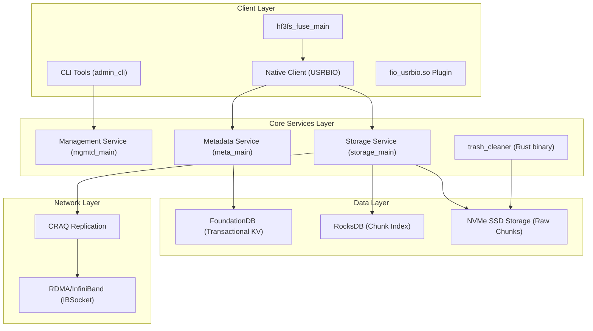
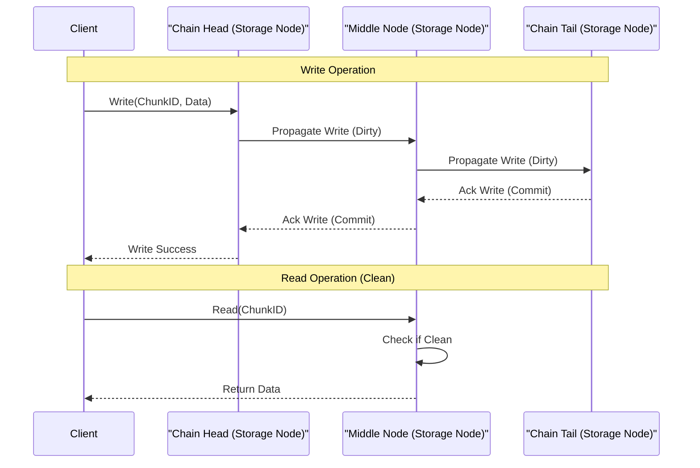

<!-- source: DeepWiki mcp.deepwiki.com · repo deepseek-ai/3FS · page 1.1 System Architecture · fetched 2026-10-30 -->

# System Architecture

Relevant source files

The following files were used as context for generating this wiki page:

- [.clang-tidy](.clang-tidy)
- [CMakeLists.txt](CMakeLists.txt)
- [README.md](README.md)
- [dockerfile/dev.opencloudos9.dockerfile](dockerfile/dev.opencloudos9.dockerfile)
- [docs/design_notes.md](docs/design_notes.md)
- [specs/README.md](specs/README.md)
- [src/common/utils/Shuffle.h](src/common/utils/Shuffle.h)
- [src/fbs/meta/Schema.cc](src/fbs/meta/Schema.cc)
- [src/lib/api/UsrbIo.md](src/lib/api/UsrbIo.md)
- [src/meta/components/ChainAllocator.h](src/meta/components/ChainAllocator.h)
- [src/stubs/CMakeLists.txt](src/stubs/CMakeLists.txt)
- [tests/common/utils/TestShuffle.cc](tests/common/utils/TestShuffle.cc)

## Purpose and Scope

This document provides a detailed explanation of the Fire-Flyer File System (3FS) system architecture, including its disaggregated design, consistency model, storage layers, and workload support. It describes how the major architectural components interact to deliver high-performance distributed storage for AI workloads.

3FS is designed to overcome the performance limitations of traditional FUSE-based systems by providing an asynchronous zero-copy API (USRBIO) and a stateless metadata layer backed by FoundationDB.

**Sources:** [README.md:1-18](), [docs/design_notes.md:1-13]()

## Disaggregated Architecture Overview

3FS implements a disaggregated storage architecture that separates compute, metadata, and storage into independent scaling tiers. This design combines the aggregate throughput of thousands of SSDs and the network bandwidth of hundreds of storage nodes, enabling applications to access storage resources in a locality-oblivious manner.

The architecture consists of four primary components:

1.  **Cluster Manager (mgmtd)**: Handles membership changes, lease-based primary election, and distributes cluster configuration.
2.  **Metadata Service (meta)**: Stateless service implementing file system semantics (open, create, rename) backed by FoundationDB.
3.  **Storage Service (storage)**: Manages local SSDs, provides a chunk store interface, and implements CRAQ for consistency.
4.  **Client**: Includes the FUSE daemon and a native client offering an asynchronous zero-copy API (USRBIO).

**Sources:** [README.md:6-11](), [docs/design_notes.md:5-13]()

## Layered Architecture

### Diagram: 3FS Component Layers

**Sources:** [docs/design_notes.md:5-14](), [src/lib/api/UsrbIo.md:1-12]()

### Client Layer and USRBIO

The client layer provides multiple interfaces, but performance-critical AI workloads primarily use the **USRBIO (User Space Ring Based IO)** API. This API is inspired by Linux `io_uring` and bypasses FUSE limitations like memory copy overhead and lock contention.

| Concept | Implementation | Description |
| :--- | :--- | :--- |
| **Iov** | `struct hf3fs_iov` | A large shared memory region for zero-copy read/write operations [src/lib/api/UsrbIo.md:71-78](). |
| **Ior** | `struct hf3fs_ior` | A shared ring buffer for communication between user processes and the FUSE daemon [src/lib/api/UsrbIo.md:21-30](). |
| **Registration** | `hf3fs_reg_fd` | Maps standard file descriptors to USRBIO-compatible handles [src/lib/api/UsrbIo.md:111-128](). |

**Sources:** [docs/design_notes.md:27-50](), [src/lib/api/UsrbIo.md:1-12]()

### Core Services Layer

#### Management Service (mgmtd)
The cluster manager handles heartbeats from metadata and storage services. It maintains the **RoutingInfo** and **ChainTable**, which define how data is distributed across the cluster. It typically stores configuration in FoundationDB to reduce dependencies.

**Sources:** [docs/design_notes.md:7-8](), [src/meta/components/ChainAllocator.h:130-135]()

#### Metadata Service
The metadata service is **stateless**. It handles operations like `open`, `create`, and `stat`. File metadata is stored in FoundationDB. When a file is created, the metadata service allocates a **Layout**, which defines how chunks are striped across replication chains.

**Sources:** [docs/design_notes.md:9](), [src/fbs/meta/Schema.cc:93-127](), [src/meta/components/ChainAllocator.h:49-65]()

#### Storage Service
The storage service manages physical SSDs. It uses **RocksDB** to index chunk IDs and stores raw data on NVMe drives. It implements the CRAQ protocol to ensure that writes are replicated across a chain before being acknowledged.

**Sources:** [docs/design_notes.md:11](), [README.md:107]()

## CRAQ Consistency Model

3FS implements **Chain Replication with Apportioned Queries (CRAQ)**. This model provides strong consistency (linearizability) while allowing any node in a replication chain to serve read requests, provided the data is "clean".

### Diagram: CRAQ Write and Read Flow

**Sources:** [docs/design_notes.md:11](), [specs/README.md:16]()

## Data Placement and Shuffling

To ensure uniform data distribution, 3FS uses a deterministic shuffling mechanism for chain selection. Because `std::shuffle` behavior can vary between GCC versions, 3FS implements explicit `gcc10_shuffle` and `gcc11_shuffle` algorithms to maintain compatibility across clusters.

- **ChainRange**: Defines a range of chains in a `ChainTable` that a file can use.
- **Shuffle Method**: Configured via the `SHUFFLE_METHOD` CMake option (`g++10`, `g++11`, or `stdshuffle`).
- **Safe Seeds**: The `find_safe_seed` function ensures that the chosen seed produces identical results across different compiler implementations.

**Sources:** [CMakeLists.txt:30-54](), [src/common/utils/Shuffle.h:26-34](), [src/common/utils/Shuffle.h:196-206](), [src/fbs/meta/Schema.cc:122-127]()

## Supported Workloads

### AI Workloads and 3FS Features

| Workload | 3FS Architectural Advantage |
| :--- | :--- |
| **Dataloaders** | Eliminates prefetching by enabling random access to samples across nodes via USRBIO [README.md:15](). |
| **Checkpointing** | Supports high-throughput parallel writes to disaggregated storage nodes [README.md:16](). |
| **KVCache** | Uses SSDs as a cost-effective, high-capacity alternative to DRAM for inference [README.md:17](). |
| **Data Preparation** | Atomic directory manipulations and hard links for snapshotting datasets [docs/design_notes.md:17-24](). |

**Sources:** [README.md:13-17](), [docs/design_notes.md:17-24]()

## Performance Characteristics

The 3FS architecture is optimized for high-bandwidth RDMA networks:

- **Peak Throughput**: Reached ~6.6 TiB/s on a 180-node cluster using 200Gbps InfiniBand.
- **GraySort**: Achieved 3.66 TiB/min using 25 storage nodes and 50 compute nodes.
- **KVCache**: Demonstrated peak read throughput of 40 GiB/s for LLM inference.

**Sources:** [README.md:28-51]()

---

