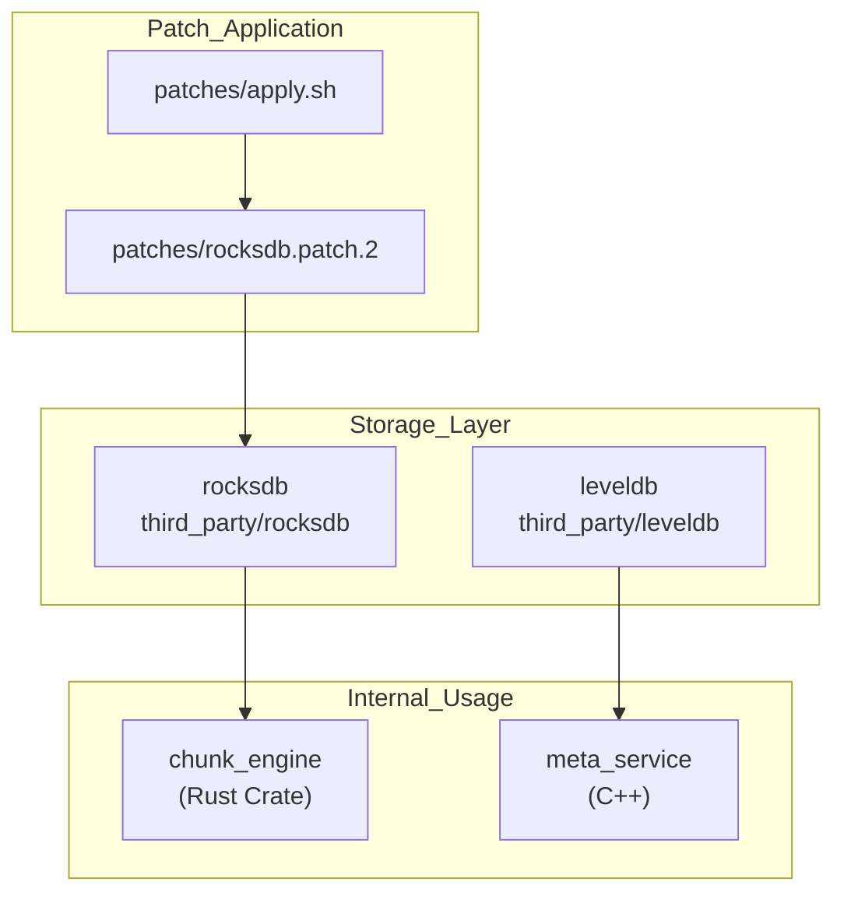
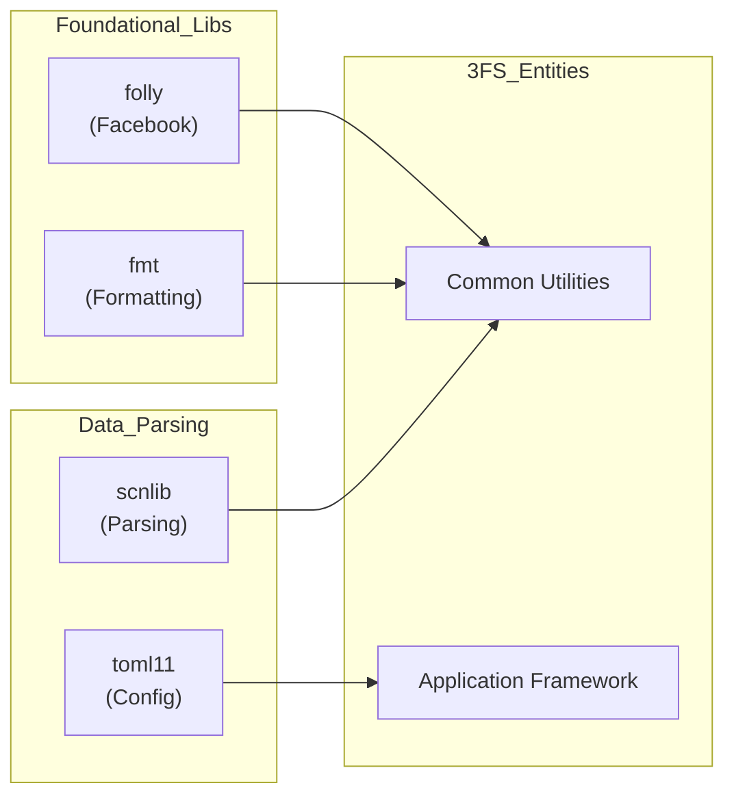
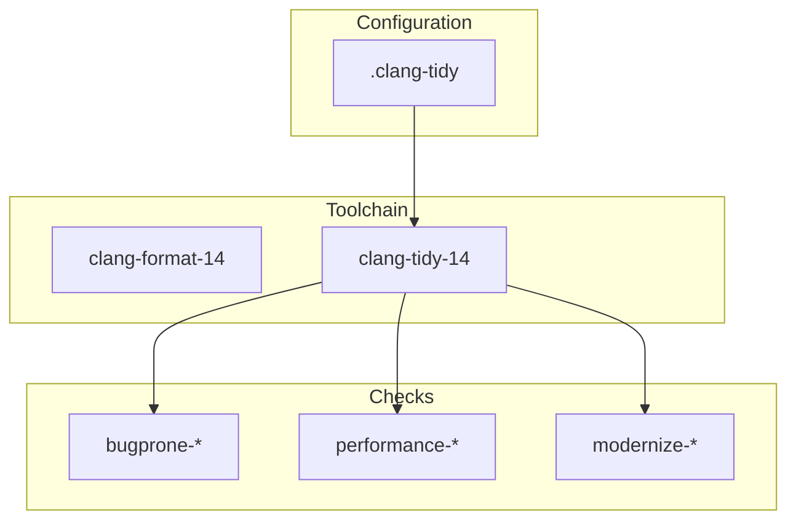

<!-- source: DeepWiki mcp.deepwiki.com · repo deepseek-ai/3FS · page 1.2 Third-Party Dependencies · fetched 2026-10-30 -->

# Third-Party Dependencies

Relevant source files

The following files were used as context for generating this wiki page:

- [.clang-tidy](.clang-tidy)
- [README.md](README.md)
- [dockerfile/dev.opencloudos9.dockerfile](dockerfile/dev.opencloudos9.dockerfile)
- [patches/apply.sh](patches/apply.sh)
- [patches/rocksdb.patch.2](patches/rocksdb.patch.2)

## Purpose and Scope

This page documents the third-party dependencies used by 3FS, including libraries managed as Git submodules and external system dependencies. It covers the purpose of each dependency, version requirements, and how they are integrated into the build system. For information about how these dependencies are built and linked in the CMake configuration, see [C++ Build Configuration](2.3). For Rust crate dependencies managed through Cargo, see [Rust Components](2.2).

---

## Dependency Management Overview

3FS manages third-party dependencies through two primary mechanisms:

1.  **Git Submodules**: C++ libraries included as submodules in the `third_party/` directory.
2.  **External Dependencies**: System libraries and tools installed separately (FoundationDB, Boost, libfuse, etc.).

All submodule dependencies are initialized and updated via the `git submodule update --init --recursive` command [README.md:64]().

### Submodule Patching

Because 3FS requires specific modifications to some external libraries, it includes a patching mechanism. The script `patches/apply.sh` applies custom patches to submodules after they are checked out [README.md:65]().

For example, RocksDB requires symbol renaming for its object registration functions to avoid naming collisions or to fit 3FS's internal namespace requirements. The patch `patches/rocksdb.patch.2` renames `RegisterCassandraObjects` to `RocksDBRegisterCassandraObjects` and `RegisterTtlObjects` to `RocksDBRegisterTtlObjects` [patches/rocksdb.patch.2:9-10,66-67]().

**Sources**: [README.md:64-66](), [patches/apply.sh:1-24](), [patches/rocksdb.patch.2:1-108]()

---

## Git Submodule Dependencies

### Storage Engines

3FS utilizes specialized key-value stores for managing metadata and chunk indexing.

*   **RocksDB** (`third_party/rocksdb`): A high-performance embedded KV store. It is heavily utilized by the Rust-based `chunk_engine` [README.md:111](). 3FS applies specific patches to its internal object registry to prevent symbol conflicts [patches/rocksdb.patch.2:23-32]().
*   **LevelDB** (`third_party/leveldb`): Used for lightweight persistent storage where the advanced features of RocksDB are not required.

**Sources**: [README.md:64-66](), [patches/rocksdb.patch.2:1-108](), [patches/apply.sh:7-17]()

---

### Core C++ Libraries

3FS relies on several high-performance C++ libraries to provide concurrency, formatting, and data structures.

*   **Facebook Folly** (`third_party/folly`): Provides the backbone for 3FS's asynchronous programming model, including specialized executors and concurrent data structures. 3FS applies custom patches to Folly via `patches/folly.patch` [patches/apply.sh:19-23]().
*   **{fmt}** (`third_party/fmt`): Used for modern, type-safe string formatting throughout the C++ codebase.
*   **scnlib** (`third_party/scnlib`): A modern replacement for `scanf`, used for efficient and safe input parsing.
*   **toml11** (`third_party/toml11`): A C++11 header-only library for parsing TOML configurations, used for service configuration files like `mgmtd_main.toml` and `storage_main.toml`.

**Sources**: [README.md:64-66](), [patches/apply.sh:19-23]()

---

### Memory Allocators and I/O

To achieve peak throughput (up to 6.6 TiB/s [README.md:30]()), 3FS utilizes optimized memory management and asynchronous I/O.

*   **jemalloc** (`third_party/jemalloc`): The default high-performance memory allocator used to minimize fragmentation in long-running distributed services.
*   **mimalloc** (`third_party/mimalloc`): A compact, high-performance allocator from Microsoft provided as an alternative.
*   **liburing** (`third_party/liburing`): Provides the userspace interface for Linux `io_uring`, enabling high-performance asynchronous I/O for the storage service and FUSE client.

**Sources**: [README.md:6-17, 28-32]()

---

## External Dependencies (System-Level)

Certain dependencies are expected to be present on the host system or provided via the development Docker images.

| Dependency | Version | Purpose |
| :--- | :--- | :--- |
| **FoundationDB** | 7.1+ | Transactional KV store for the stateless metadata service [README.md:98](). |
| **libfuse** | 3.16.1+ | Interface for the FUSE client [README.md:97](). |
| **Boost** | 1.71+ | Used for filesystem, system utilities, and program options [README.md:76](). |
| **Rust** | 1.85.0+ | Required for building the `chunk_engine` and other Rust components [README.md:99](). |
| **Clang/LLVM** | 14 | Primary compiler toolchain, including `clang-format` and `clang-tidy` [README.md:75, 108](). |

### FoundationDB Integration
3FS uses FoundationDB (FDB) as the persistence layer for its metadata service. The development environment setup requires installing both `foundationdb-clients` and `foundationdb-server` [dockerfile/dev.opencloudos9.dockerfile:32-35]().

### FUSE Integration
The FUSE client requires `libfuse` 3.x. The build process often involves compiling `libfuse` from source to ensure the correct version (3.16.2) is available with both static and shared libraries [dockerfile/dev.opencloudos9.dockerfile:18-27]().

**Sources**: [README.md:73-99](), [dockerfile/dev.opencloudos9.dockerfile:16-37]()

---

## Development and Quality Tools

3FS enforces code quality through third-party static analysis and formatting tools.

*   **Clang-Format**: Used to maintain consistent code style across the C++ codebase [README.md:75]().
*   **Clang-Tidy**: Performs static analysis. The `.clang-tidy` configuration file enables a wide range of checks, including `bugprone-infinite-loop`, `performance-move-const-arg`, and `modernize-use-nullptr` [.clang-tidy:13, 58, 70]().
*   **GoogleTest / GoogleMock**: The standard framework used for C++ unit testing and mocking [README.md:75]().

**Sources**: [README.md:74-81](), [.clang-tidy:1-113]()

---

