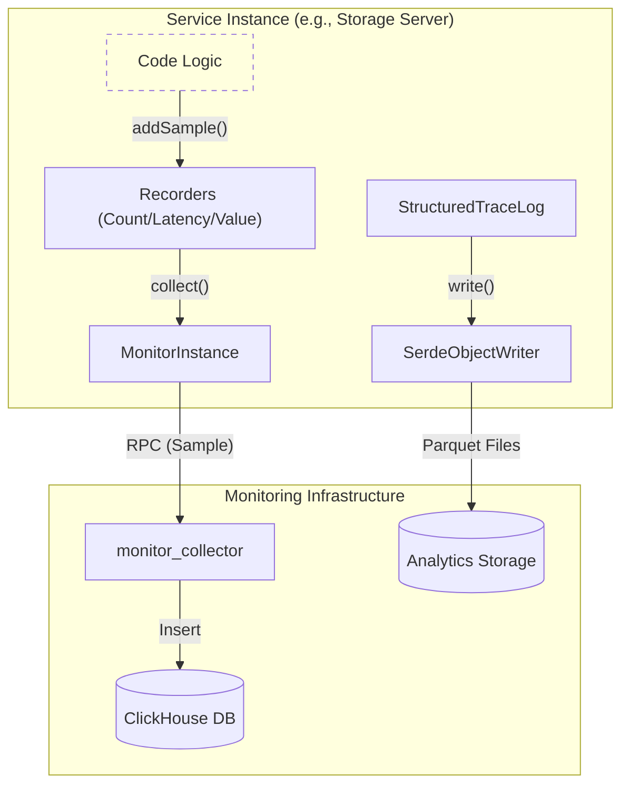
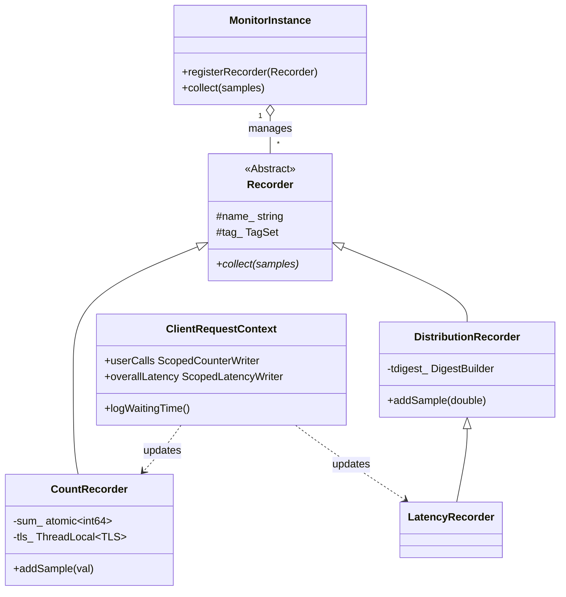

<!-- source: DeepWiki mcp.deepwiki.com · repo deepseek-ai/3FS · page 10 Observability and Monitoring · fetched 2026-10-30 -->

# Observability and Monitoring

Relevant source files

The following files were used as context for generating this wiki page:

- [docs/metrics.md](docs/metrics.md)
- [src/client/storage/StorageClientImpl.cc](src/client/storage/StorageClientImpl.cc)
- [src/common/monitor/Recorder.cc](src/common/monitor/Recorder.cc)
- [src/common/monitor/Recorder.h](src/common/monitor/Recorder.h)

The 3FS monitoring infrastructure provides comprehensive visibility into the health and performance of the distributed file system. It is designed to handle high-frequency metrics collection and structured trace logging across distributed services (mgmtd, meta, storage, and FUSE clients), persisting data into ClickHouse for real-time and historical analysis.

### System Architecture Overview

The observability stack consists of three primary layers:
1.  **Collection Layer**: Embedded `Recorder` objects within services collect metrics (counters, latencies, distributions) and structured traces.
2.  **Aggregation Layer**: The `Monitor` class manages the lifecycle of recorders and periodically flushes samples to a `monitor_collector` service.
3.  **Storage Layer**: Metrics are stored in ClickHouse tables (`3fs.counters`, `3fs.distributions`), while trace logs are written in Parquet format for high-performance analytics.

Sources: [docs/metrics.md:1-15](), [src/common/monitor/Recorder.h:27-94](), [src/common/monitor/Monitor.h:1-50]()

---

### Metrics System

3FS utilizes a multi-type metrics system to track system behavior. Metrics are defined using specialized `Recorder` classes that support thread-local storage (TLS) to minimize contention in high-concurrency scenarios.

| Type | Code Entity | Purpose |
| :--- | :--- | :--- |
| **Value** | `ValueRecorder` | Tracks instantaneous values (e.g., disk capacity, memory usage). |
| **Count** | `CountRecorder` | Tracks cumulative events or throughput (e.g., IOPS, error counts). |
| **Distribution** | `DistributionRecorder` | Calculates statistical quantiles (P50, P90, P99) using `folly::TDigest`. |
| **Latency** | `LatencyRecorder` | Specialized distribution for nanosecond-level timing. |

Recorders are typically defined as static or member variables and updated throughout the request lifecycle. For example, the `StorageClientImpl` uses these to track everything from network latency to bytes processed per user.

**Key Entities:**
- `Recorder`: The base class for all metric collection [src/common/monitor/Recorder.h:32-94]().
- `TagSet`: A map of key-value pairs (e.g., `uid`, `method`) used to partition metrics [src/common/monitor/Recorder.h:55-58]().
- `MonitorInstance`: Manages the registry of all active recorders [src/common/monitor/Monitor.h:20-40]().

For details, see [Metrics System](#10.1).

Sources: [docs/metrics.md:3-15](), [src/common/monitor/Recorder.h:96-204](), [src/client/storage/StorageClientImpl.cc:24-63]()

---

### Structured Trace Logging and Analytics

Beyond simple counters, 3FS implements a `StructuredTraceLog` system for deep operational insights. This system captures complex events—such as detailed RPC metadata or file session transitions—as structured objects.

- **Serde Integration**: Objects are serialized using the 3FS `serde` framework, ensuring consistency between code structures and logged data.
- **Parquet Output**: Data is written in Parquet format, which is optimized for the columnar queries required by large-scale performance debugging.
- **Analytics Module**: Provides a suite of tools for processing these traces to identify bottlenecks in the I/O path or metadata contention.

For details, see [Structured Trace Logging and Analytics](#10.2).

Sources: [src/common/monitor/Recorder.h:20-25](), [src/client/storage/StorageClientImpl.cc:69-131]()

---

### Code-to-System Mapping

The following diagram bridges the gap between high-level observability concepts and the specific C++ classes used in the implementation.

Sources: [src/common/monitor/Recorder.h:32-204](), [src/client/storage/StorageClientImpl.cc:69-131](), [src/common/monitor/Monitor.h:20-40]()

### Operational Metrics Catalog

The system tracks hundreds of metrics across different layers. Notable categories include:
- **FUSE Client**: `fuse.write.latency`, `fuse.piov.bw`, `fuse.dirty_inodes` [docs/metrics.md:22-26]().
- **Metadata Service**: `meta_server.op_latency`, `meta_server.op_failed`, `meta_server.open_write` [docs/metrics.md:27-40]().
- **Storage Service**: `storage.chunk_engine.pwrite_times`, `storage.disk_info.available`, `storage.do_commit.succ_latency` [docs/metrics.md:41-80]().
- **Storage Client**: `storage_client.network_latency`, `storage_client.request_bw`, `storage_client.num_retried_ops` [src/client/storage/StorageClientImpl.cc:24-63]().

Sources: [docs/metrics.md:16-81](), [src/client/storage/StorageClientImpl.cc:24-63]()

---

