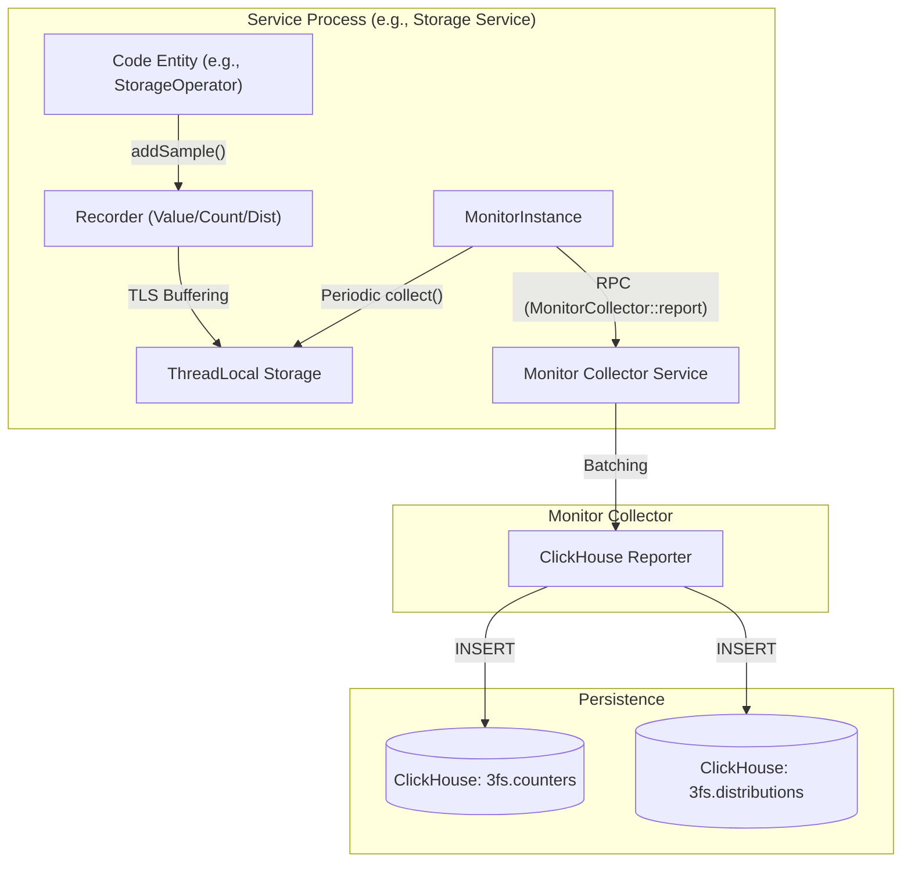
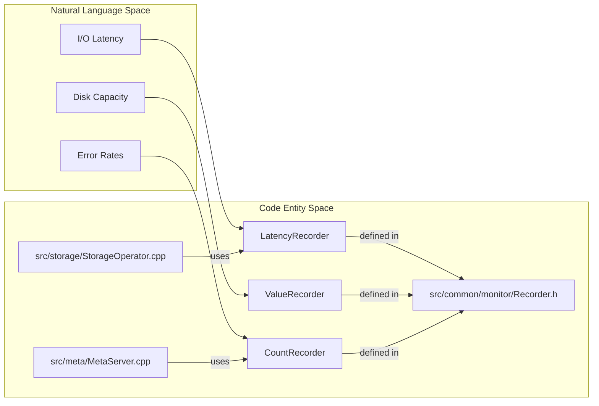

<!-- source: DeepWiki mcp.deepwiki.com · repo deepseek-ai/3FS · page 10.1 Metrics System · fetched 2026-10-30 -->

# Metrics System

Relevant source files

The following files were used as context for generating this wiki page:

- [docs/metrics.md](docs/metrics.md)
- [src/common/monitor/Recorder.h](src/common/monitor/Recorder.h)

The 3FS metrics system provides high-performance observability across all distributed services. It is designed to handle high-frequency events (such as I/O operations and RPC calls) by using thread-local storage and efficient aggregation before reporting data to a centralized monitoring service and eventually to a ClickHouse database for long-term analytics.

## Core Architecture

The metrics system follows a hierarchical collection model. Each service (mgmtd, meta, storage, FUSE) maintains local `Recorder` instances that aggregate data. These are periodically collected by a `MonitorInstance` and sent to the `monitor_collector` service.

### Metrics Data Flow

The following diagram illustrates the path of a metric from a code-level event to the storage backend.

**Diagram: Metrics Data Flow from Code to ClickHouse**

Sources: [docs/metrics.md:3-14](), [src/common/monitor/Recorder.h:32-94](), [src/common/monitor/Recorder.h:136-154]()

## Recorder Types

3FS implements several specialized recorder types to balance performance and data fidelity. All recorders inherit from the base `Recorder` class [src/common/monitor/Recorder.h:32-43]().

### ValueRecorder
Used for instantaneous gauges or cumulative values that are set directly.
* **Behavior**: Set by code and stored directly.
* **Example**: Disk capacity, current memory usage.
* **Storage**: `3fs.counters` table.
Sources: [docs/metrics.md:11-11]()

### CountRecorder
Designed for high-frequency increment operations.
* **Implementation**: Uses `folly::ThreadLocal` to avoid atomic contention across CPU cores [src/common/monitor/Recorder.h:150-151]().
* **Behavior**: Can be configured to reset after each report (to calculate rates like IOPS) or maintain a running total (for in-flight operations) [src/common/monitor/Recorder.h:152-154]().
* **Key Function**: `addSample(int64_t val)` [src/common/monitor/Recorder.h:116-116]().
Sources: [docs/metrics.md:12-12](), [src/common/monitor/Recorder.h:97-154]()

### DistributionRecorder
Used for tracking the statistical distribution of values (e.g., I/O sizes).
* **Implementation**: Utilizes `folly::TDigest` for quantile estimation and `folly::DigestBuilder` for thread-safe buffering [src/common/monitor/Recorder.h:187-189]().
* **Calculations**: Provides P90, P99, and other percentiles between reporting intervals.
* **Storage**: `3fs.distributions` table.
Sources: [docs/metrics.md:13-13](), [src/common/monitor/Recorder.h:161-191]()

### LatencyRecorder
A specialized version of `DistributionRecorder` optimized for time durations.
* **Unit**: Always records in nanoseconds (ns) [docs/metrics.md:14-14]().
* **Key Function**: `addSample(std::chrono::nanoseconds duration)` [src/common/monitor/Recorder.h:202-202]().
Sources: [docs/metrics.md:14-14](), [src/common/monitor/Recorder.h:193-205]()

## Code Entity Mapping

This diagram maps specific system components to the metrics they generate, showing how high-level operations translate into `Recorder` updates.

**Diagram: Code Entity to Metrics Mapping**
| System Area | Code Entity (Class/File) | Metric Examples |
| :--- | :--- | :--- |
| **FUSE Client** | `FuseOps` | `fuse.op`, `fuse.write.latency` |
| **Metadata** | `MetaServer` | `meta_server.op_latency`, `meta_server.op_failed` |
| **Storage** | `StorageOperator` | `storage.do_commit.total`, `storage.do_update.succ_latency` |
| **Disk Engine** | `ChunkEngine` | `storage.chunk_engine.pwrite_times`, `storage.chunk_engine.allocate_times` |

Sources: [docs/metrics.md:20-81](), [src/common/monitor/Recorder.h:1-205]()

## Tagging System

Recorders support dynamic tagging using `TagSet`, allowing metrics to be broken down by dimensions such as `op_code`, `target_id`, or `error_type`.

* **Dynamic Tags**: Recorders can create sub-recorders for specific tags using `getRecorderWithTag(const TagSet &tag)` [src/common/monitor/Recorder.h:119-121]().
* **Storage**: Tags are serialized and stored as columns in ClickHouse, enabling complex filtering and grouping in Grafana or SQL queries.
Sources: [src/common/monitor/Recorder.h:55-74](), [src/common/monitor/Recorder.h:117-121]()

## Key Metrics Catalog

| Metric Name | Type | Description |
| :--- | :--- | :--- |
| `fuse.piov.bw` | Count | Throughput (bytes/sec) written by client via Parallel I/O. |
| `meta_server.op_latency` | Latency | Duration of metadata operations (e.g., stat, rename). |
| `storage.chunk_engine.pwrite_times` | Count | Number of physical write calls to the underlying block device. |
| `storage.disk_info.available` | Value | Remaining capacity on storage targets in bytes. |
| `storage.do_commit.succ_latency` | Latency | Latency of successful CRAQ replication commits. |

Sources: [docs/metrics.md:20-81]()

## Reporting and Collection

The `MonitorInstance` class is responsible for the lifecycle of metrics within a process:
1. **Registration**: Recorders register themselves with the global `MonitorInstance` upon creation [src/common/monitor/Recorder.h:81-81]().
2. **Collection**: The `Collector` iterates through all registered recorders, calling `collect()` to aggregate TLS data into a vector of `Sample` objects [src/common/monitor/Recorder.h:48-50]().
3. **Transmission**: Samples are periodically pushed to the `monitor_collector` service via RPC.
4. **Cleanup**: Inactive recorders (those not updated for a specific period) can be cleaned up to prevent memory leaks in long-running processes [src/common/monitor/Recorder.h:48-48]().

Sources: [src/common/monitor/Recorder.h:29-50](), [src/common/monitor/Recorder.h:81-94]()

---

