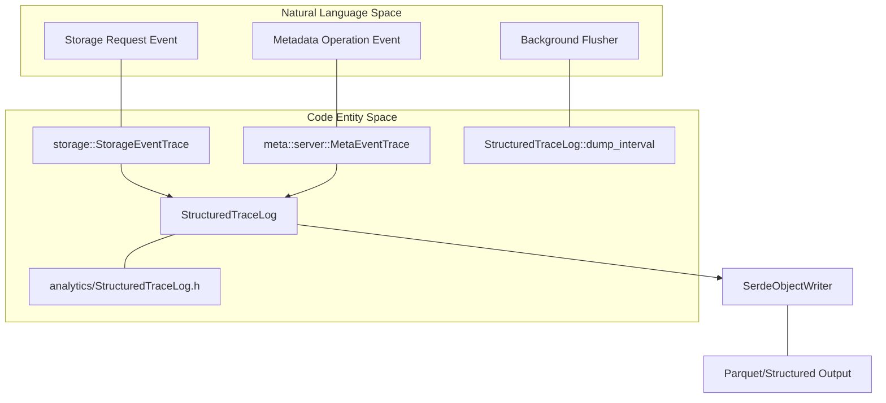
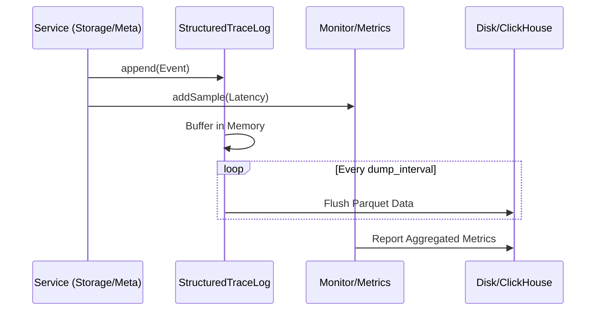

<!-- source: DeepWiki mcp.deepwiki.com · repo deepseek-ai/3FS · page 10.2 Structured Trace Logging and Analytics · fetched 2026-10-30 -->

# Structured Trace Logging and Analytics

<details>
<summary>Relevant source files</summary>

The following files were used as context for generating this wiki page:

- [benchmarks/storage_bench/StorageBench.cc](benchmarks/storage_bench/StorageBench.cc)
- [src/client/storage/UpdateChannelAllocator.cc](src/client/storage/UpdateChannelAllocator.cc)
- [src/fuse/UserConfig.cc](src/fuse/UserConfig.cc)
- [tests/analytics/TestStructuredTraceLog.cc](tests/analytics/TestStructuredTraceLog.cc)
- [tests/lib/UnitTestFabric.cc](tests/lib/UnitTestFabric.cc)

</details>


The Structured Trace Logging system in 3FS provides a high-performance mechanism for recording fine-grained operational events (e.g., storage I/O requests, metadata operations) into a structured format suitable for offline analytics. Unlike standard text-based logs, these traces are serialized using a `SerdeObjectWriter` and typically persisted in Parquet-compatible formats to enable efficient querying and visualization of system behavior.

## System Architecture

The analytics infrastructure is designed to minimize the performance impact on the critical I/O path. It uses an asynchronous dumping mechanism where events are buffered in memory and periodically flushed to disk.

### Data Flow
1.  **Event Generation**: Services (Storage, Metadata) create event objects (e.g., `StorageEventTrace`).
2.  **Append**: Events are passed to `StructuredTraceLog::append`.
3.  **Buffering**: The `StructuredTraceLog` manages multiple internal writers to handle high concurrency.
4.  **Serialization**: Objects are serialized using the `serde` framework.
5.  **Flushing**: A background thread flushes buffers to persistent storage at configured intervals.

### Component Relationship
The following diagram illustrates the relationship between the trace logging entities and the core storage/metadata components.

**Trace Logging Entity Mapping**

Sources: [tests/analytics/TestStructuredTraceLog.cc:3-6](), [tests/analytics/TestStructuredTraceLog.cc:26-30](), [tests/analytics/TestStructuredTraceLog.cc:44-59]()

## StructuredTraceLog Implementation

The `StructuredTraceLog` class is the primary interface for recording events. It is templated on the event type `T`, allowing it to handle diverse data schemas such as storage I/O traces or metadata access patterns.

### Key Configuration Parameters
The system is highly configurable to balance between observability detail and resource consumption:
*   **enabled**: Global toggle for the trace log [tests/analytics/TestStructuredTraceLog.cc:13]().
*   **dump_interval**: Frequency at which buffered events are written to persistent storage [tests/analytics/TestStructuredTraceLog.cc:29]().
*   **max_num_writers**: Maximum number of concurrent writer threads allowed to prevent resource exhaustion [tests/analytics/TestStructuredTraceLog.cc:79]().

### Core Functions
| Function | Description |
| :--- | :--- |
| `open()` | Initializes the log file and background flushing threads [tests/analytics/TestStructuredTraceLog.cc:15](). |
| `append(T event)` | Adds a new event to the trace buffer [tests/analytics/TestStructuredTraceLog.cc:34](). |
| `newEntry(T event)` | Creates a trace entry and returns a handle for manual lifecycle management [tests/analytics/TestStructuredTraceLog.cc:113](). |
| `close()` | Flushes all remaining buffers and shuts down the logging system [tests/analytics/TestStructuredTraceLog.cc:23](). |

Sources: [tests/analytics/TestStructuredTraceLog.cc:11-42](), [tests/analytics/TestStructuredTraceLog.cc:75-96]()

## Event Schemas

Trace events are defined as structured objects, often mirroring the RPC request/response structures to ensure full visibility into the system state.

### Storage Event Trace
The `StorageEventTrace` captures the lifecycle of a storage request, including client identification and request tags.

```cpp
// Example construction of a StorageEventTrace
storage::StorageEventTrace{
    .updateReq = storage::UpdateReq{
        .tag = storage::MessageTag{
            ClientId::zero(),
            storage::RequestId{id},
            storage::UpdateChannel{
                .id = (storage::ChannelId)id,
                .seqnum = storage::ChannelSeqNum{id},
            },
        },
    },
};
```
Sources: [tests/analytics/TestStructuredTraceLog.cc:44-59]()

### Metadata Event Trace
The `MetaEventTrace` tracks operations on the metadata layer, including inode IDs and entry names.

```cpp
meta::server::MetaEventTrace{
    .inodeId = meta::InodeId{loop},
    .entryName = std::to_string(loop),
    .client = ClientId::zero(),
}
```
Sources: [tests/analytics/TestStructuredTraceLog.cc:34-38]()

## Operational Analytics and Metrics

The trace logging system works in tandem with the `monitor` module to provide a complete operational picture. While `StructuredTraceLog` provides granular per-event data, the `monitor` system provides aggregated statistics.

### Integration with Monitoring
Analytics performance is itself monitored using recorders:
*   **LatencyRecorder**: Used to measure the overhead of creating new trace entries [tests/analytics/TestStructuredTraceLog.cc:108]().
*   **CountRecorder**: Tracks the utilization of internal resources, such as update channels [src/client/storage/UpdateChannelAllocator.cc:9-10]().

**Analytics Data Flow**

Sources: [tests/analytics/TestStructuredTraceLog.cc:110-121](), [src/client/storage/UpdateChannelAllocator.cc:60-77]()

## Performance Considerations

To maintain high throughput, the `StructuredTraceLog` employs several optimizations:
1.  **Thread Local Buffering**: Minimizes lock contention when multiple threads append events simultaneously [tests/analytics/TestStructuredTraceLog.cc:75-80]().
2.  **Zero-Copy Serialization**: Leverages the `serde` framework to minimize data movement.
3.  **Asynchronous I/O**: Offloads disk writes to background threads, ensuring that the calling thread (often a critical RPC worker) is not blocked by disk latency [tests/analytics/TestStructuredTraceLog.cc:29]().

Sources: [tests/analytics/TestStructuredTraceLog.cc:75-96](), [tests/analytics/TestStructuredTraceLog.cc:101-121]()

---

