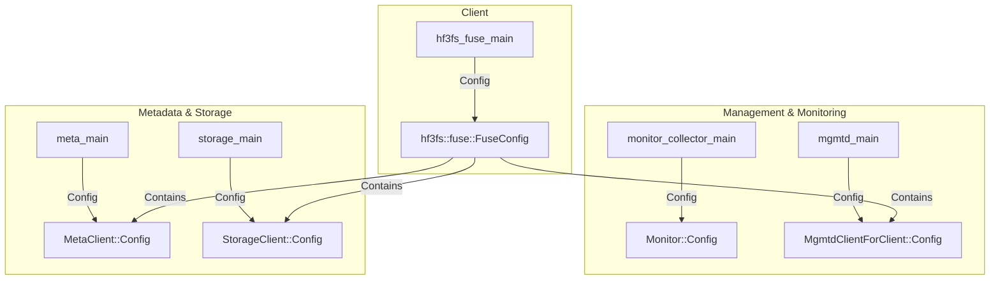
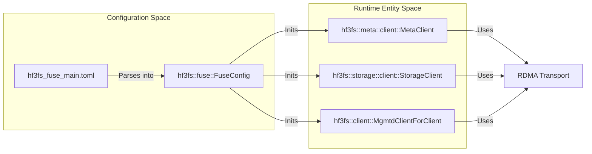

<!-- source: DeepWiki mcp.deepwiki.com · repo deepseek-ai/3FS · page 11.1 Cluster Setup Guide · fetched 2026-10-30 -->

# Cluster Setup Guide

<details>
<summary>Relevant source files</summary>

The following files were used as context for generating this wiki page:

- [configs/hf3fs_fuse_main.toml](configs/hf3fs_fuse_main.toml)
- [deploy/README.md](deploy/README.md)
- [deploy/data_placement/README.md](deploy/data_placement/README.md)
- [src/fuse/FuseConfig.h](src/fuse/FuseConfig.h)
- [tests/fuse/config/hf3fs_fuse_main_launcher.toml](tests/fuse/config/hf3fs_fuse_main_launcher.toml)
- [tests/fuse/config/storage_main.toml](tests/fuse/config/storage_main.toml)

</details>


This guide provides a technical step-by-step procedure for deploying a 3FS cluster. It covers hardware prerequisites, service installation order, and initial cluster configuration using the administration tools.

## 1. Prerequisites and Infrastructure

### 1.1 Hardware Specifications
A standard 3FS deployment requires dedicated nodes for metadata and storage. The following table outlines a recommended six-node configuration (1 meta, 5 storage) `[deploy/README.md:9-16]()`.

| Node | Role | OS | IP | Memory | SSD | RDMA |
| :--- | :--- | :--- | :--- | :--- | :--- | :--- |
| **meta** | mgmtd, meta, monitor | Ubuntu 22.04 | 192.168.1.1 | 128GB | - | RoCE |
| **storage[1-5]** | storage | Ubuntu 22.04 | 192.168.1.2-6 | 512GB | 14TB x 16 | RoCE |

### 1.2 External Dependencies
3FS relies on high-performance external databases for metadata persistence and observability `[deploy/README.md:26-34]()`:
*   **FoundationDB (FDB):** Used by `mgmtd` and `meta` for persistent metadata. The `fdb.cluster` file and `libfdb_c.so` must be present on all nodes running these services `[deploy/README.md:31-33]()`.
*   **ClickHouse:** Used for storing system metrics collected by `monitor_collector`.

### 1.3 Networking Requirement
RDMA connectivity (InfiniBand or RoCE) must be verified between all nodes using tools like `ib_write_bw` before proceeding `[deploy/README.md:18-20]()`.

---

## 2. Deployment Architecture and Service Order

The deployment follows a specific sequence to ensure dependencies are met:
1.  **Monitor:** Collects metrics from all subsequent services.
2.  **Mgmtd:** Management service for cluster state and routing.
3.  **Meta:** Metadata service for file system operations.
4.  **Storage:** Data nodes for chunk storage.
5.  **FUSE:** Client-side mount.

### Service Entity Mapping
The following diagram maps the logical services to their respective configuration classes and main entry points.

**Service-to-Code Mapping**

**Sources:** `[src/fuse/FuseConfig.h:11-42]()`, `[deploy/README.md:45-52]()`.

---

## 3. Step-by-Step Installation

### Step 1: Monitor Service
1.  Initialize ClickHouse tables using the provided SQL schema `[deploy/README.md:57-60]()`.
2.  Configure `monitor_collector_main.toml` with ClickHouse credentials `[deploy/README.md:74-85]()`.
3.  Start the `monitor_collector_main` service via systemd `[deploy/README.md:87-90]()`.

### Step 2: Mgmtd Service
1.  Install `admin_cli` on all nodes to manage cluster state `[deploy/README.md:98-106]()`.
2.  Configure `mgmtd_main_app.toml` with a unique `node_id` (e.g., `1`) `[deploy/README.md:131-131]()`.
3.  **Initialize Cluster:** Use `admin_cli` to set the global chunk size and strip size `[deploy/README.md:144-146]()`.
    ```bash
    admin_cli -cfg admin_cli.toml "init-cluster --mgmtd mgmtd_main.toml 1 1048576 16"
    ```

### Step 3: Meta Service
1.  Configure `meta_main_app.toml` with a unique `node_id` (e.g., `100`) `[deploy/README.md:175-175]()`.
2.  Start the `meta_main` service.

### Step 4: Storage Service
1.  **Data Placement:** Before starting storage nodes, generate the chain table. This uses a Pyomo-based solver to optimize replica distribution `[deploy/data_placement/README.md:11-16]()`.
    ```bash
    python src/model/data_placement.py --num_nodes 5 --replication_factor 3
    python src/setup/gen_chain_table.py --node_id_begin 10001 --node_id_end 10005
    ```
2.  **Target Initialization:** Create storage targets on SSDs as defined in `create_target_cmd.txt` `[deploy/data_placement/README.md:68-71]()`.
3.  **Register Chains:** Upload the generated chain table to `mgmtd` using `admin_cli` `[deploy/README.md:214-216]()`.
    ```bash
    admin_cli upload-chains --chain-table generated_chain_table.csv
    ```

### Step 5: FUSE Client
Mount the file system on client nodes using `hf3fs_fuse_main`. The configuration includes settings for RDMA, timeouts, and I/O worker threads `[src/fuse/FuseConfig.h:34-42]()`.

---

## 4. Configuration Management

3FS uses a hierarchical configuration system. The FUSE client configuration `FuseConfig` encapsulates configurations for all underlying clients (Mgmtd, Meta, Storage) `[src/fuse/FuseConfig.h:40-42]()`.

**Data Flow: Configuration to Client Components**

**Sources:** `[src/fuse/FuseConfig.h:10-42]()`, `[configs/hf3fs_fuse_main.toml:169-221]()`.

### Key Parameters in `hf3fs_fuse_main.toml`:
*   `max_threads`: Maximum number of FUSE threads `[src/fuse/FuseConfig.h:35-35]()`.
*   `iov_limit`: Maximum size of I/O vectors for batching `[src/fuse/FuseConfig.h:44-44]()`.
*   `rdma_buf_pool_size`: Size of the RDMA buffer pool for zero-copy transfers `[src/fuse/FuseConfig.h:47-47]()`.
*   `dynamic_stripe`: Enables flexible file striping based on metadata service hints `[configs/hf3fs_fuse_main.toml:171-171]()`.

**Sources:**
* `deploy/README.md`
* `src/fuse/FuseConfig.h`
* `configs/hf3fs_fuse_main.toml`
* `deploy/data_placement/README.md`
* `tests/fuse/config/storage_main.toml`

---

