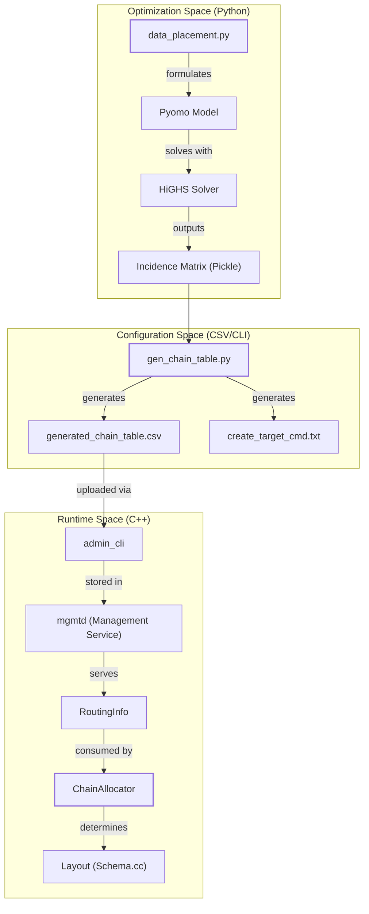
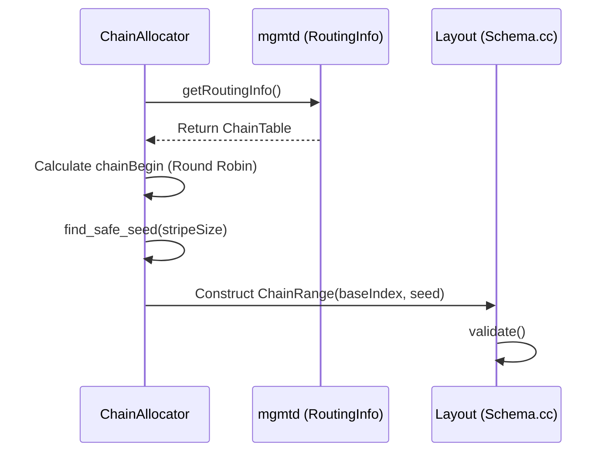

<!-- source: DeepWiki mcp.deepwiki.com · repo deepseek-ai/3FS · page 11.2 Data Placement and Chain Table Generation · fetched 2026-10-30 -->

# Data Placement and Chain Table Generation

Relevant source files

The following files were used as context for generating this wiki page:

- [CMakeLists.txt](CMakeLists.txt)
- [deploy/README.md](deploy/README.md)
- [deploy/data_placement/README.md](deploy/data_placement/README.md)
- [src/common/utils/Shuffle.h](src/common/utils/Shuffle.h)
- [src/fbs/meta/Schema.cc](src/fbs/meta/Schema.cc)
- [src/meta/components/ChainAllocator.h](src/meta/components/ChainAllocator.h)
- [tests/common/utils/TestShuffle.cc](tests/common/utils/TestShuffle.cc)

The 3FS system utilizes a sophisticated data placement strategy to ensure high availability, fault tolerance, and balanced load across a disaggregated storage cluster. This page documents the mathematical optimization model, the generation scripts, and the implementation details for distributing data chains across storage targets.

## Overview

3FS organizes storage into **Chains**, which are sequences of **Storage Targets** providing replicated storage for data chunks. The placement of these chains is a combinatorial optimization problem designed to:
1.  Distribute replicas across different failure domains (nodes/disks).
2.  Balance the "peer traffic" (reconstruction load) between nodes during failures.
3.  Maximize parallel I/O by spreading chains across all available physical SSDs.

### System Architecture to Code Mapping

The following diagram bridges the high-level data placement concepts to the specific code entities used in the generation and runtime phases.

**Data Placement Entity Map**

Sources: `deploy/data_placement/README.md:11-24`(), `src/meta/components/ChainAllocator.h:23-26`(), `src/fbs/meta/Schema.cc:75-91`()

---

## Optimization Model

The data placement problem is formulated as a **Balanced Incomplete Block Design (BIBD)** problem [deploy/data_placement/README.md:11-16]().

### Mathematical Formulation
The model uses `Pyomo` to define constraints that ensure:
*   **Replication Factor**: Each chunk has exactly $k$ replicas (typically 3) [deploy/data_placement/README.md:4-5]().
*   **Target Distribution**: A minimum number of targets per disk are utilized to maximize SSD throughput [deploy/data_placement/README.md:24-25]().
*   **Fault Tolerance**: No two replicas of the same chain are placed on the same node.
*   **Load Balancing**: The intersection of chain placements between any two nodes is minimized and balanced, ensuring that if a node fails, its recovery traffic is distributed equally among all remaining peers [deploy/data_placement/README.md:33-54]().

### Incidence Matrix
The solver produces an **Incidence Matrix** where rows represent storage nodes and columns represent chains. A value of `1` at `(node_i, chain_j)` indicates that `node_i` hosts a replica for `chain_j` [deploy/data_placement/README.md:63-64]().

---

## Chain Table Generation Workflow

Once an optimal incidence matrix is found, the `gen_chain_table.py` script converts the abstract model into physical cluster configurations.

### 1. Model Solving
The script `data_placement.py` is invoked with cluster parameters:
*   `--num_nodes`: Total storage nodes.
*   `--replication_factor`: Replicas per chain.
*   `--min_targets_per_disk`: Number of storage targets per physical SSD.

### 2. Physical Mapping
The script `gen_chain_table.py` maps the logical chains to physical `node_id` ranges and disk layouts [deploy/data_placement/README.md:63-64]().

| Output File | Description |
| :--- | :--- |
| `generated_chain_table.csv` | The final mapping of Chain IDs to Target IDs. |
| `create_target_cmd.txt` | Shell commands for `admin_cli` to initialize targets on storage nodes. |
| `remove_target_cmd.txt` | Commands to decommission the specific targets. |

Sources: `deploy/data_placement/README.md:60-72`()

---

## Runtime Allocation and Layout

In the C++ core, the `ChainAllocator` and `Layout` classes handle the assignment of file chunks to the generated chains.

### Chain Allocation Logic
The `ChainAllocator` selects chains for new files using a round-robin strategy across the available chain table to ensure even wear and load [src/meta/components/ChainAllocator.h:49-65]().

**Allocation Flow**

Sources: `src/meta/components/ChainAllocator.h:82-127`(), `src/fbs/meta/Schema.cc:129-158`()

### Deterministic Shuffling
To avoid hotspots within a single file's stripe, 3FS applies a shuffle to the allocated chain range. Because 3FS is built with various GCC versions, it implements a cross-version compatible shuffle logic to ensure that different clients (compiled with different compilers) calculate the same data placement for the same seed.

*   **Supported Methods**: `stdshuffle`, `g++10`, `g++11` [CMakeLists.txt:30-32]().
*   **Safe Seed Selection**: The system searches for a "safe seed" where different GCC shuffle implementations yield identical results for a given vector size [src/common/utils/Shuffle.h:196-206]().
*   **Implementation**: `hf3fs_shuffle` uses the method defined at compile time via `SHUFFLE_METHOD` [src/common/utils/Shuffle.h:162-172]().

### Code Entities in Shuffling
*   `fast_range`: Lemire's nearly divisionless algorithm for unbiased downscaling [src/common/utils/Shuffle.h:45-60]().
*   `gcc_uniform_int`: Implementation of GCC's internal distribution logic [src/common/utils/Shuffle.h:63-96]().
*   `safe_shuffle_seed`: Validates if a seed produces consistent results across `std`, `gcc10`, and `gcc11` algorithms [src/common/utils/Shuffle.h:174-194]().

Sources: `src/common/utils/Shuffle.h:26-34`(), `tests/common/utils/TestShuffle.cc:39-74`(), `src/fbs/meta/Schema.cc:115-126`()

---

## File Layout and Chain Resolution

The `Layout` class in `Schema.cc` defines how a file's offset maps to a specific `ChainId`.

1.  **Chunk ID Calculation**: The file offset is divided by `layout.chunkSize` [src/fbs/meta/Schema.cc:62-73]().
2.  **Chain Selection**:
    *   For `ChainRange` layouts, the `baseIndex` and `stripeSize` are used.
    *   The index is determined by: `(offset / chunkSize) % stripeSize`.
    *   A `TRACK_OFFSET_FOR_CHAIN` (default 7) is added for different tracks to further decorrelate placements [src/fbs/meta/Schema.cc:18-21](), [src/fbs/meta/Schema.cc:75-91]().
3.  **Routing**: The `RoutingInfo` (provided by `mgmtd`) translates the `ChainRef` (Table ID + Index) into a physical `ChainId` and its associated storage targets [src/fbs/meta/Schema.cc:83-89]().

Sources: `src/fbs/meta/Schema.cc:75-91`(), `src/meta/components/ChainAllocator.h:31-45`()

---

