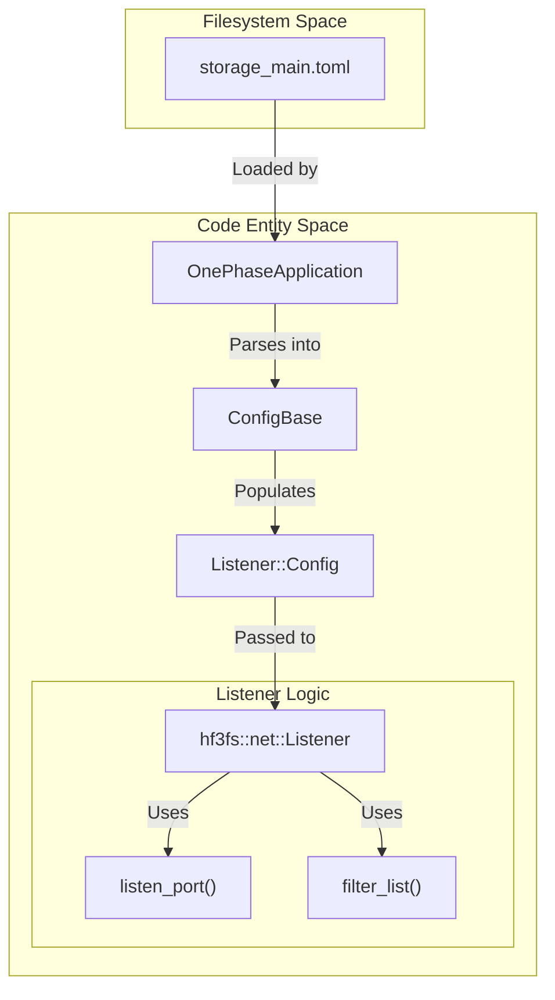
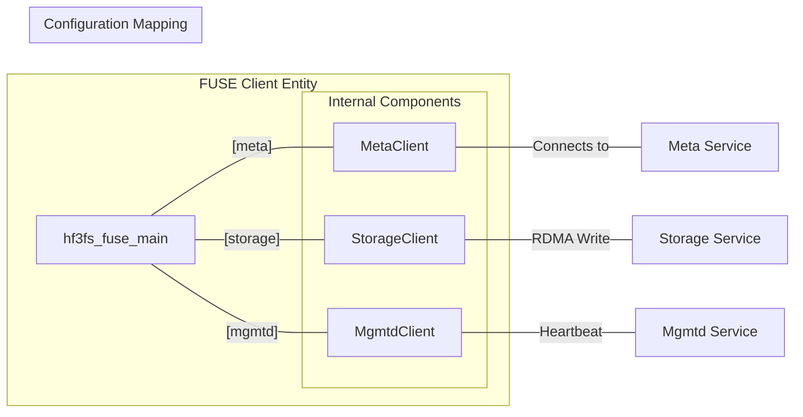

<!-- source: DeepWiki mcp.deepwiki.com · repo deepseek-ai/3FS · page 11.3 Configuration Reference · fetched 2026-10-30 -->

# Configuration Reference

Relevant source files

The following files were used as context for generating this wiki page:

- [configs/hf3fs_fuse_main.toml](configs/hf3fs_fuse_main.toml)
- [configs/storage_main.toml](configs/storage_main.toml)
- [src/common/net/Listener.cc](src/common/net/Listener.cc)
- [src/common/net/Listener.h](src/common/net/Listener.h)
- [src/fuse/FuseConfig.h](src/fuse/FuseConfig.h)
- [tests/fuse/config/admin_cli.toml](tests/fuse/config/admin_cli.toml)
- [tests/fuse/config/hf3fs_fuse_main.toml](tests/fuse/config/hf3fs_fuse_main.toml)
- [tests/fuse/config/hf3fs_fuse_main_launcher.toml](tests/fuse/config/hf3fs_fuse_main_launcher.toml)
- [tests/fuse/config/meta_main.toml](tests/fuse/config/meta_main.toml)
- [tests/fuse/config/storage_main.toml](tests/fuse/config/storage_main.toml)

This page provides a technical reference for the configuration parameters used by the 3FS distributed services: Management Service (`mgmtd`), Metadata Service (`meta`), Storage Service (`storage`), and the FUSE Client (`hf3fs_fuse`).

## Overview of Configuration System

3FS utilizes a TOML-based configuration system built on the `ConfigBase` class [common/utils/ConfigBase.h:12](). This framework supports:
1.  **Static Configuration**: Set at startup via `.toml` files.
2.  **Hot Updates**: Parameters marked with `CONFIG_HOT_UPDATED_ITEM` can be modified at runtime without restarting the service [src/common/net/Listener.h:31]().
3.  **Hierarchical Structs**: Nested sections defined using `CONFIG_OBJ` and `CONFIG_SECT` [src/fuse/FuseConfig.h:13-56]().

### Configuration Flow Diagram

The following diagram illustrates how configuration is loaded and distributed within a service, using the `Listener` as an example of a component that consumes configuration.

**Configuration Consumption Flow**

Sources: [src/common/net/Listener.cc:51-60](), [src/common/net/Listener.h:20-32](), [src/fuse/FuseConfig.h:11-91]()

---

## 1. Common Service Configuration

All services share a common block for logging, monitoring, and memory profiling.

### 1.1 Logging (`common.log`)
Defined via `logging::LogConfig`, this section controls log rotation, levels, and output destinations.

| Parameter | Type | Description |
| :--- | :--- | :--- |
| `categories` | List | Log categories (e.g., `.` for root). |
| `level` | String | Log level: `INFO`, `DEBUG`, `WARN`, `ERR`, `FATAL`. |
| `handlers` | List | Named handlers like `normal` or `err`. |
| `file_path` | Path | Absolute path to the log file. |
| `max_file_size` | Size | Size before rotation (e.g., `100MB`). |
| `async` | Bool | Whether to use asynchronous logging to prevent I/O blocking. |

Sources: [configs/storage_main.toml:1-43](), [configs/hf3fs_fuse_main.toml:99-141]()

### 1.2 Monitoring (`common.monitor`)
Controls the metrics collection system.

| Parameter | Type | Description |
| :--- | :--- | :--- |
| `collect_period` | Duration | Frequency of metrics collection (e.g., `1s`). |
| `reporters` | List | List of sinks (e.g., `monitor_collector`). |
| `remote_ip` | String | IP of the `monitor_collector` service. |

Sources: [configs/storage_main.toml:48-57](), [configs/hf3fs_fuse_main.toml:146-155]()

---

## 2. Storage Service (`storage_main.toml`)

The Storage Service configuration focuses on RDMA performance, AIO engine tuning, and disk management.

### 2.1 Server Threading and Network
The `[server.base]` section defines how the service handles incoming requests.

| Parameter | Path | Description |
| :--- | :--- | :--- |
| `network_type` | `server.base.groups` | `RDMA`, `TCP`, or `IPoIB`. [src/common/net/Listener.cc:38-43]() |
| `listen_port` | `server.base.groups.listener` | Port for the specific service group (e.g., 8000 for StorageSerde). [src/common/net/Listener.h:21]() |
| `num_io_threads` | `server.base.thread_pool` | Number of threads for network I/O operations. [configs/storage_main.toml:98]() |
| `num_proc_threads` | `server.base.thread_pool` | Number of threads for processing storage RPCs. [configs/storage_main.toml:99]() |

### 2.2 AIO Read Worker (`server.aio_read_worker`)
Configures the backend storage I/O engine.

| Parameter | Type | Description |
| :--- | :--- | :--- |
| `ioengine` | String | `libaio` or `io_uring`. [configs/storage_main.toml:66]() |
| `num_threads` | Int | Number of background AIO threads. [configs/storage_main.toml:69]() |
| `queue_size` | Int | Depth of the AIO submission queue. [configs/storage_main.toml:70]() |
| `enable_io_uring` | Bool | Enable Linux io_uring for lower latency. [configs/storage_main.toml:64]() |

### 2.3 Storage Targets (`server.targets`)
Defines physical storage locations.

| Parameter | Description |
| :--- | :--- |
| `target_paths` | List of paths to mount points where chunks are stored. [tests/fuse/config/storage_main.toml:29]() |
| `allow_disk_without_uuid` | Allows usage of disks that haven't been initialized with a 3FS UUID. [tests/fuse/config/storage_main.toml:30]() |

Sources: [configs/storage_main.toml:58-218](), [tests/fuse/config/storage_main.toml:12-39]()

---

## 3. Metadata Service (`meta_main.toml`)

The Metadata Service relies heavily on FoundationDB (FDB) and Mgmtd interactions.

### 3.1 FoundationDB Integration (`server.fdb`)
| Parameter | Description |
| :--- | :--- |
| `clusterFile` | Path to the FDB cluster file (`fdb.cluster`). [tests/fuse/config/meta_main.toml:43]() |
| `externalClientPath` | Path to the FDB C client library (`libfdb_c.so`). [tests/fuse/config/meta_main.toml:44]() |

### 3.2 Metadata Logic (`server.meta`)
| Parameter | Description |
| :--- | :--- |
| `dynamic_stripe` | Enables dynamic striping for large directories to distribute load across FDB. [tests/fuse/config/meta_main.toml:29]() |
| `time_granularity` | Granularity for file timestamps (e.g., `1ms`). [tests/fuse/config/meta_main.toml:28]() |
| `gc_file_delay` | Delay before garbage collecting deleted files. [tests/fuse/config/meta_main.toml:39]() |

Sources: [tests/fuse/config/meta_main.toml:20-44]()

---

## 4. FUSE Client (`hf3fs_fuse_main.toml`)

The FUSE client configuration balances kernel-space FUSE performance with user-space RDMA I/O.

### 4.1 FUSE Kernel Tuning
| Parameter | Code Item | Description |
| :--- | :--- | :--- |
| `attr_timeout` | `attr_timeout` | Cache duration for file attributes in the kernel. [src/fuse/FuseConfig.h:25]() |
| `entry_timeout` | `entry_timeout` | Cache duration for directory entries. [src/fuse/FuseConfig.h:26]() |
| `max_threads` | `max_threads` | Max concurrent FUSE requests handled by the client. [src/fuse/FuseConfig.h:35]() |
| `max_readahead` | `max_readahead` | Kernel readahead size. [src/fuse/FuseConfig.h:36]() |

### 4.2 Client I/O Pipeline (`io_bufs` & `periodic_sync`)
The client uses an internal buffer pool and periodic sync mechanism for writeback.

| Parameter | Path | Description |
| :--- | :--- | :--- |
| `max_buf_size` | `io_bufs.max_buf_size` | Maximum size of a single I/O buffer. [src/fuse/FuseConfig.h:74]() |
| `interval` | `periodic_sync.interval` | How often to flush dirty buffers to storage. [src/fuse/FuseConfig.h:85]() |
| `coroutines_num` | `periodic_sync.worker` | Parallelism for the sync worker. [src/fuse/FuseConfig.h:88]() |

**Client Architecture to Configuration Mapping**

Sources: [src/fuse/FuseConfig.h:39-42](), [configs/hf3fs_fuse_main.toml:169-298]()

---

## 5. Management Service (`mgmtd_main.toml`)

The Mgmtd service manages the cluster state and routing tables.

| Parameter | Description |
| :--- | :--- |
| `mgmtd_server_addresses` | List of Mgmtd node addresses (RDMA/TCP) for bootstrapping. [configs/hf3fs_fuse_main.toml:207]() |
| `auto_refresh_interval` | Frequency for clients/services to pull new routing info. [configs/hf3fs_fuse_main.toml:203]() |
| `auto_heartbeat_interval`| Frequency for nodes to send heartbeats to Mgmtd. [configs/hf3fs_fuse_main.toml:202]() |

Sources: [configs/hf3fs_fuse_main.toml:199-209]()

---

## 6. Network and RDMA (`ib_devices` & `ibsocket`)

Common across all services using RDMA.

| Parameter | Path | Description |
| :--- | :--- | :--- |
| `buf_size` | `ibsocket.buf_size` | Size of the RDMA message buffer (default 16KB). [configs/storage_main.toml:123]() |
| `max_rdma_wr` | `ibsocket.max_rdma_wr` | Maximum outstanding RDMA Work Requests. [configs/storage_main.toml:128]() |
| `retry_cnt` | `ibsocket.retry_cnt` | IB transport retry count (0-7). [configs/storage_main.toml:134]() |
| `sl` | `ibsocket.sl` | Service Level for InfiniBand QoS. [configs/storage_main.toml:137]() |
| `custom_tcp_nic_prefix`| `listener` | Prefix for TCP NICs if not standard (en/eth/bond). [src/common/net/Listener.cc:40-41]() |

Sources: [src/common/net/Listener.h:30](), [configs/storage_main.toml:120-140]()

---

