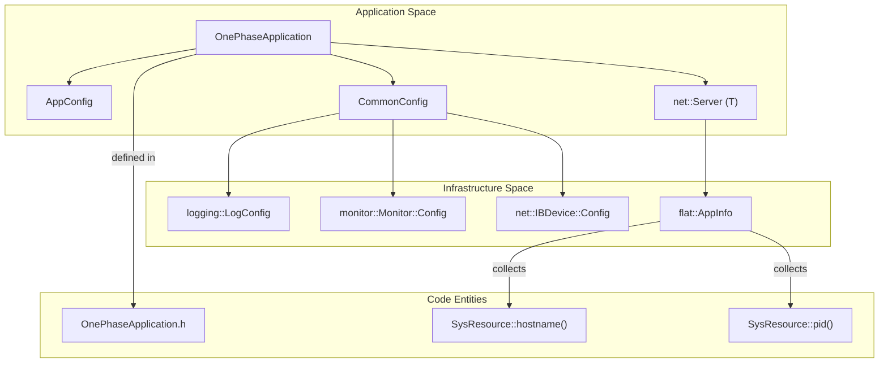
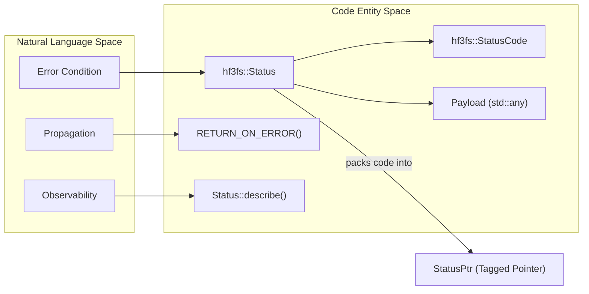

<!-- source: DeepWiki mcp.deepwiki.com · repo deepseek-ai/3FS · page 12 Common Utilities and Infrastructure · fetched 2026-10-30 -->

# Common Utilities and Infrastructure

Relevant source files

The following files were used as context for generating this wiki page:

- [src/common/app/OnePhaseApplication.h](src/common/app/OnePhaseApplication.h)
- [src/common/utils/AtomicSharedPtrTable.h](src/common/utils/AtomicSharedPtrTable.h)
- [src/common/utils/Status.h](src/common/utils/Status.h)

The 3FS codebase relies on a shared C++ utility library that provides the foundational building blocks for high-performance distributed services. This infrastructure covers coroutine-based concurrency, a robust error-handling framework, and a standardized application lifecycle management system.

## Concurrency and Coroutine Primitives

3FS utilizes C++20 coroutines extensively to manage high-concurrency I/O operations without the overhead of traditional thread-per-connection models. The infrastructure provides specialized executors and synchronization primitives designed to work seamlessly within asynchronous contexts.

Key components include:
*   **Coroutines Management**: Utilities like `CoTryTask` and `DynamicCoroutinesPool` manage the execution and lifecycle of asynchronous tasks.
*   **Synchronization**: Custom primitives such as `FairSharedMutex`, `CoLockManager`, and `Semaphore` allow for safe resource sharing across coroutines.
*   **Thread Safety**: The `AtomicSharedPtrTable` provides a thread-safe way to manage shared objects using `folly::atomic_shared_ptr` [src/common/utils/AtomicSharedPtrTable.h:52-75]().

### Atomic Slot Management
The `AvailSlots` utility manages a fixed-capacity set of indices, allowing for efficient allocation and deallocation of slots in shared tables [src/common/utils/AtomicSharedPtrTable.h:10-49]().

For details, see [Concurrency and Coroutine Primitives](#12.1).

**Sources:** [src/common/utils/AtomicSharedPtrTable.h:10-75]()

## Error Handling and Status Codes

3FS implements a unified error-handling pattern using a `Status` class, similar to `abseil::Status`. This ensures that errors are propagated consistently across distributed service boundaries.

### Status and Result
*   **Status**: A container for a `StatusCode`, an optional string message, and an optional arbitrary payload [src/common/utils/Status.h:24-145]().
*   **StatusCode**: A 16-bit identifier representing the specific error type [src/common/utils/Status.h:111]().
*   **Error Propagation**: The system uses macros like `RETURN_ON_ERROR` and `CO_RETURN_ON_ERROR` to streamline error checking and returning [src/common/app/OnePhaseApplication.h:62-63]().

### Memory Optimization
The `Status` class uses a pointer-tagging technique to store the 16-bit status code within the high bits of the `StatusRep` pointer, minimizing the memory footprint of successful (OK) status returns [src/common/utils/Status.h:113-144]().

For details, see [Error Handling and Status Codes](#12.2).

**Sources:** [src/common/utils/Status.h:24-159](), [src/common/app/OnePhaseApplication.h:62-63]()

## Application Framework

All 3FS daemons (such as `mgmtd`, `meta`, and `storage`) are built upon a common application framework. This framework standardizes service initialization, configuration management, and lifecycle control.

### OnePhaseApplication
The `OnePhaseApplication` template class serves as the base for 3FS services. It handles:
*   **Flag Parsing**: Parsing command-line arguments and configuration file paths [src/common/app/OnePhaseApplication.h:58-65]().
*   **Component Initialization**: Starting core infrastructure like the `IBManager` for RDMA networking, logging, and monitoring [src/common/app/OnePhaseApplication.h:83-96]().
*   **Service Lifecycle**: Managing the transition from `setup()` to `start()` and finally `stop()` [src/common/app/OnePhaseApplication.h:99-131]().

### Configuration and Metadata
The framework automatically collects system metadata (hostname, PID, release version) into an `AppInfo` structure [src/common/app/OnePhaseApplication.h:103-118](). It also supports a hierarchical configuration system where common settings (logging, monitor, IB devices) are separated from service-specific logic [src/common/app/OnePhaseApplication.h:29-40]().

For details, see [Application Framework](#12.3).

**Sources:** [src/common/app/OnePhaseApplication.h:27-143]()

## Infrastructure Relationships

The following diagrams illustrate how the utility classes interact and how they map to the physical service structure.

### Service Infrastructure Mapping
This diagram shows how the `OnePhaseApplication` framework organizes the underlying utility components.

**Sources:** [src/common/app/OnePhaseApplication.h:27-118]()

### Error Handling Flow
This diagram maps the `Status` and `StatusCode` logic to the error propagation mechanism.

**Sources:** [src/common/utils/Status.h:24-145](), [src/common/app/OnePhaseApplication.h:62-63]()

---

