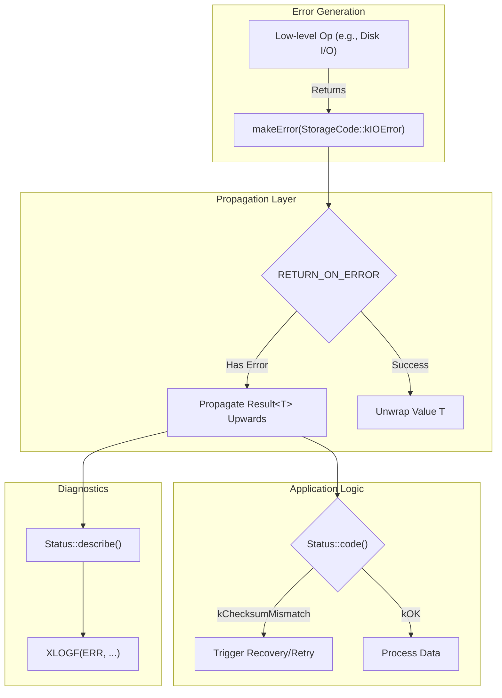
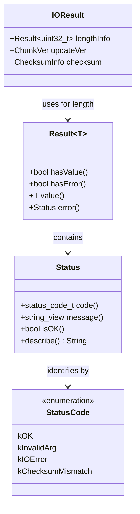

<!-- source: DeepWiki mcp.deepwiki.com · repo deepseek-ai/3FS · page 12.2 Error Handling and Status Codes · fetched 2026-10-30 -->

# Error Handling and Status Codes

Relevant source files

The following files were used as context for generating this wiki page:

- [src/common/net/ib/IBConnect.h](src/common/net/ib/IBConnect.h)
- [src/common/utils/Result.h](src/common/utils/Result.h)
- [src/common/utils/Status.h](src/common/utils/Status.h)
- [src/common/utils/UtcTimeSerde.h](src/common/utils/UtcTimeSerde.h)
- [src/fbs/storage/Common.h](src/fbs/storage/Common.h)
- [src/storage/chunk_engine/src/utils/aligned.rs](src/storage/chunk_engine/src/utils/aligned.rs)

The 3FS codebase employs a robust, unified error handling pattern centered around the `Result<T>` and `Status` types. This system provides type-safe error propagation, hierarchical status codes, and rich diagnostic information (including messages and payloads) while maintaining high performance across both synchronous and asynchronous (coroutine) contexts.

### Core Error Handling Types

The error handling infrastructure is built upon three primary entities: `StatusCode`, `Status`, and `Result<T>`.

#### 1. StatusCode
Status codes are 16-bit unsigned integers represented by the `status_code_t` type [src/common/utils/Status.h:111-111](). These codes are organized into a hierarchy (e.g., `StorageCode`, `MetaCode`) to categorize errors across different services. The value `0` is reserved for `StatusCode::kOK` [src/common/utils/Status.h:110-110]().

#### 2. Status
The `Status` class is a space-optimized container for an error code and optional metadata. It is designed to be small (64 bits when no message is present) by using pointer tagging:
*   **Data Layout**: The `data_` pointer uses the lower 48 bits for a pointer to a `StatusRep` (containing the message and payload) and the upper 16 bits for the `status_code_t` [src/common/utils/Status.h:144-144]().
*   **Payloads**: A `Status` can carry an optional `std::any` payload to provide additional context to callers [src/common/utils/Status.h:118-118]().
*   **Immutability**: While it imitates `abseil::Status`, it is specifically optimized for the 64-bit architecture of 3FS [src/common/utils/Status.h:15-24]().

#### 3. Result<T>
`Result<T>` is a template alias for `folly::Expected<T, Status>` [src/common/utils/Result.h:117-118](). it represents either a successful value of type `T` or a `Status` object describing a failure.

### Error Propagation and Macros

To reduce boilerplate and ensure consistent error handling in coroutines and standard functions, 3FS provides a suite of macros in `src/common/utils/Result.h`.

| Macro | Context | Description |
| :--- | :--- | :--- |
| `RETURN_ON_ERROR(res)` | Synchronous | Checks `res.hasError()`; if true, returns the error immediately [src/common/utils/Result.h:55-61](). |
| `CO_RETURN_ON_ERROR(res)` | Coroutine | Asynchronous version of the above using `co_return` [src/common/utils/Result.h:89-95](). |
| `CHECK_RESULT(name, expr)` | Synchronous | Evaluates `expr`, returns on error, or unwraps the value into `name` [src/common/utils/Result.h:72-77](). |
| `MAKE_ERROR_F(code, ...)` | Any | Creates a `Status` with a formatted message using `fmt::format` [src/common/utils/Result.h:11-11](). |
| `CO_RETURN_ON_ERROR_WRAP` | Coroutine | Wraps an existing error with additional context/messages [src/common/utils/Result.h:13-19](). |

### Status Data Flow and Logic
The following diagram illustrates how a `Result<T>` is generated, propagated through service layers, and eventually handled or converted.

**Status and Result Data Flow**

Sources: [src/common/utils/Result.h:55-110](), [src/common/utils/Status.h:76-83](), [src/fbs/storage/Common.h:181-182]()

### Fault Injection

3FS includes a fault injection mechanism primarily used for testing error handling paths in the storage layer. The `FAULT_INJECTION_POINT` macro allows developers to simulate failures conditionally.

*   **Implementation**: In non-debug builds, the macro is a no-op [src/fbs/storage/Common.h:46-46]().
*   **Behavior**: When enabled, if `injectError` is true, it logs the injected error and returns `injectedRes` instead of executing the actual function logic [src/fbs/storage/Common.h:43-44]().

### Specialized Status Handling in Storage

The storage layer defines specific results like `IOResult`, which embeds a `Result<uint32_t>` for length information alongside metadata like `ChunkVer` and `ChecksumInfo` [src/fbs/storage/Common.h:221-226]().

**Storage Error Handling Entities**

Sources: [src/common/utils/Status.h:24-145](), [src/common/utils/Result.h:117-126](), [src/fbs/storage/Common.h:221-226]()

### Alignment and Data Validation
Errors related to data integrity and alignment are handled via utility functions that return booleans or results. For example, `is_aligned_io` ensures that memory buffers and offsets comply with the `kAIOAlignSize` (4096 bytes) required for direct I/O [src/fbs/storage/Common.h:80-80](), [src/storage/chunk_engine/src/utils/aligned.rs:55-57]().

If an alignment check fails or a checksum mismatch is detected during a `combine` operation, the system returns a `StorageCode::kChecksumMismatch` error [src/fbs/storage/Common.h:181-182]().

Sources:
* `src/common/utils/Status.h`
* `src/common/utils/Result.h`
* `src/fbs/storage/Common.h`
* `src/storage/chunk_engine/src/utils/aligned.rs`

---

