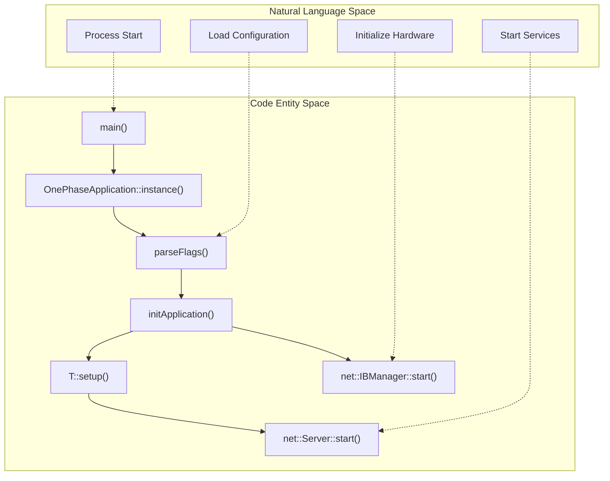
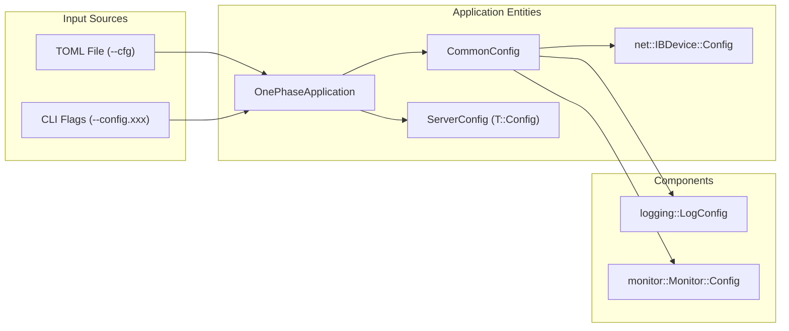

<!-- source: DeepWiki mcp.deepwiki.com · repo deepseek-ai/3FS · page 12.3 Application Framework · fetched 2026-10-30 -->

# Application Framework

Relevant source files

The following files were used as context for generating this wiki page:

- [src/common/app/AppInfo.h](src/common/app/AppInfo.h)
- [src/common/app/ClientId.h](src/common/app/ClientId.h)
- [src/common/app/OnePhaseApplication.h](src/common/app/OnePhaseApplication.h)

The 3FS Application Framework provides a standardized lifecycle management system for all distributed daemons (mgmtd, meta, storage, and FUSE client). It centers around the `OnePhaseApplication` template, which orchestrates configuration loading, hardware abstraction (InfiniBand), logging, monitoring, and RPC server initialization.

## Core Application Lifecycle

The lifecycle of a 3FS daemon is managed by the `OnePhaseApplication` class. It ensures that services are initialized in a deterministic order and provides a unified mechanism for handling command-line flags and configuration files.

### OnePhaseApplication Class
The `OnePhaseApplication` template requires a server class `T` that defines its own `Config` and a static `kName`. It inherits from `ApplicationBase` and implements the primary entry point for daemon logic.

| Phase | Action | Description |
| :--- | :--- | :--- |
| **Flag Parsing** | `parseFlags` | Processes `--app_config.*` and `--config.*` flags to override file-based settings [src/common/app/OnePhaseApplication.h:58-65](). |
| **Config Init** | `initApplication` | Loads TOML configuration files for the application and the specific service [src/common/app/OnePhaseApplication.h:67-75](). |
| **Hardware Init** | `IBManager::start` | Initializes InfiniBand devices and memory pools based on `ib_devices` config [src/common/app/OnePhaseApplication.h:83-84](). |
| **Observability** | `initOrDie` / `Monitor::start` | Sets up the logging backend and metrics collection system [src/common/app/OnePhaseApplication.h:88-96](). |
| **Server Setup** | `server_->setup()` | Instantiates the service-specific logic (e.g., `StorageServer`) [src/common/app/OnePhaseApplication.h:99-101](). |
| **Identity** | `AppInfo` Assembly | Gathers hostname, podname, PID, and versioning info to identify the node [src/common/app/OnePhaseApplication.h:103-114](). |
| **Execution** | `server_->start(info_)` | Starts the RPC listeners and background workers [src/common/app/OnePhaseApplication.h:121-122](). |

**Sources:** [src/common/app/OnePhaseApplication.h:22-143]()

### Application Bootstrapping Diagram
This diagram illustrates the transition from the `main()` function to the operational state of a 3FS daemon.

**Sources:** [src/common/app/OnePhaseApplication.h:58-125]()

---

## Identity and Metadata

The framework defines several structures to uniquely identify nodes and clients within the distributed system.

### AppInfo
`AppInfo` contains the full identity of a running daemon, used by the Management Service (`mgmtd`) to track cluster membership.

*   **NodeId**: A unique numeric identifier for the node [src/common/app/AppInfo.h:110]().
*   **ServiceGroups**: A list of services (e.g., "StorageService", "MgmtService") and their associated network endpoints [src/common/app/AppInfo.h:15-23]().
*   **ReleaseVersion**: Encapsulates build information, including commit hash, pipeline ID, and build time [src/common/app/AppInfo.h:36-53]().
*   **Tags**: Key-value pairs used for traffic zoning (e.g., `TrafficZone`) or administrative status (e.g., `Disable`) [src/common/app/AppInfo.h:122-130]().

### ClientId
`ClientId` is used primarily by clients (like the FUSE client or Python utilities) to identify themselves to the metadata and storage services. It consists of a random UUID and the local hostname [src/common/app/ClientId.h:10-13]().

**Sources:** [src/common/app/AppInfo.h:107-123](), [src/common/app/ClientId.h:10-38]()

---

## Configuration Mechanism

The framework supports a hierarchical configuration model defined using the `ConfigBase` template.

### Configuration Hierarchy
Every application has two primary configuration objects:
1.  **AppConfig**: Internal application settings like `node_id` and whether empty IDs are allowed [src/common/app/OnePhaseApplication.h:42-45]().
2.  **Config**: The main service configuration, which includes:
    *   **CommonConfig**: Shared settings for `cluster_id`, `log` levels, `monitor` (metrics), and `ib_devices` [src/common/app/OnePhaseApplication.h:29-34]().
    *   **ServerConfig**: Service-specific settings (e.g., RocksDB paths for storage nodes) [src/common/app/OnePhaseApplication.h:39]().

### Hot-Update Mechanism
The framework provides an interface for dynamic configuration updates without restarting the daemon.
*   **`getConfig()`**: Returns a pointer to the `IConfig` interface [src/common/app/OnePhaseApplication.h:127]().
*   **`app_detail::initConfigFromFile`**: This utility is used during initialization to merge file-based TOML configurations with command-line overrides [src/common/app/OnePhaseApplication.h:69-74]().

### Configuration Data Flow

**Sources:** [src/common/app/OnePhaseApplication.h:29-45](), [src/common/app/OnePhaseApplication.h:67-75]()

---

## Service Management

The `OnePhaseApplication` manages a `std::unique_ptr<net::Server>`, which represents the actual network-facing service.

### Server Lifecycle Functions
*   **`setup()`**: Called before the server starts. Used for resource allocation and preparing internal state [src/common/app/OnePhaseApplication.h:100]().
*   **`start(AppInfo)`**: Transitions the server to an active state, accepting RPC connections [src/common/app/OnePhaseApplication.h:121]().
*   **`stop()`**: Triggers a graceful shutdown by calling `stopAndJoin` on the server instance [src/common/app/OnePhaseApplication.h:131]().

### System Resource Integration
The framework integrates with `SysResource` to automatically detect environment details:
*   **Hostname**: Fetches the physical machine name or pod name in containerized environments [src/common/app/OnePhaseApplication.h:103-107]().
*   **PID**: Captures the process ID for telemetry [src/common/app/OnePhaseApplication.h:113]().

**Sources:** [src/common/app/OnePhaseApplication.h:99-131](), [src/common/app/AppInfo.h:110-116]()

---

