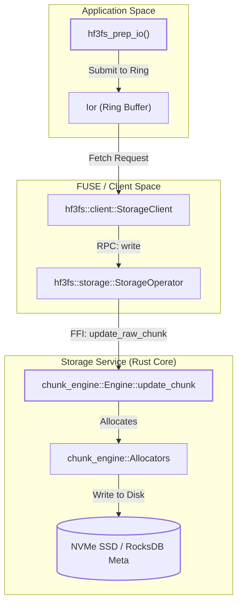
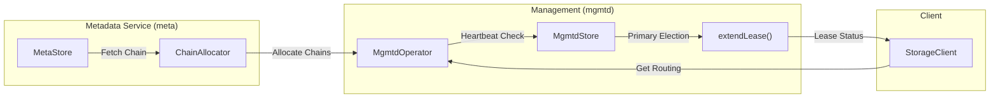

<!-- source: DeepWiki mcp.deepwiki.com · repo deepseek-ai/3FS · page 13 Glossary · fetched 2026-10-30 -->

# Glossary

Relevant source files

The following files were used as context for generating this wiki page:

- [.clang-tidy](.clang-tidy)
- [CMakeLists.txt](CMakeLists.txt)
- [README.md](README.md)
- [dockerfile/dev.opencloudos9.dockerfile](dockerfile/dev.opencloudos9.dockerfile)
- [docs/design_notes.md](docs/design_notes.md)
- [specs/README.md](specs/README.md)
- [src/common/net/ib/IBConnect.cc](src/common/net/ib/IBConnect.cc)
- [src/common/net/ib/IBConnect.h](src/common/net/ib/IBConnect.h)
- [src/common/net/ib/IBSocket.cc](src/common/net/ib/IBSocket.cc)
- [src/common/net/ib/IBSocket.h](src/common/net/ib/IBSocket.h)
- [src/common/utils/Shuffle.h](src/common/utils/Shuffle.h)
- [src/common/utils/SimpleRingBuffer.h](src/common/utils/SimpleRingBuffer.h)
- [src/common/utils/UtcTimeSerde.h](src/common/utils/UtcTimeSerde.h)
- [src/fbs/meta/Schema.cc](src/fbs/meta/Schema.cc)
- [src/fbs/storage/Common.h](src/fbs/storage/Common.h)
- [src/lib/api/UsrbIo.md](src/lib/api/UsrbIo.md)
- [src/meta/components/ChainAllocator.h](src/meta/components/ChainAllocator.h)
- [src/mgmtd/ops/SetChainTableOperation.cc](src/mgmtd/ops/SetChainTableOperation.cc)
- [src/storage/chunk_engine/src/bin/bench.rs](src/storage/chunk_engine/src/bin/bench.rs)
- [src/storage/chunk_engine/src/core/engine.rs](src/storage/chunk_engine/src/core/engine.rs)
- [src/storage/chunk_engine/src/cxx.rs](src/storage/chunk_engine/src/cxx.rs)
- [src/storage/chunk_engine/src/meta/meta_store.rs](src/storage/chunk_engine/src/meta/meta_store.rs)
- [src/storage/chunk_engine/src/utils/aligned.rs](src/storage/chunk_engine/src/utils/aligned.rs)
- [src/storage/store/StorageTargets.cc](src/storage/store/StorageTargets.cc)
- [src/stubs/CMakeLists.txt](src/stubs/CMakeLists.txt)
- [tests/common/utils/TestShuffle.cc](tests/common/utils/TestShuffle.cc)
- [tests/mgmtd/TestMgmtdOperator.cc](tests/mgmtd/TestMgmtdOperator.cc)

This page provides definitions and technical context for 3FS-specific terminology, jargon, and architectural concepts.

## Core Architectural Terms

### Disaggregated Architecture
A design where compute and storage resources are scaled independently. In 3FS, this allows thousands of SSDs and hundreds of storage nodes to be accessed by applications as a single, shared pool of storage [README.md:9-9]().

### CRAQ (Chain Replication with Apportioned Queries)
A consistency model used by the 3FS storage service to ensure strong consistency while maximizing read throughput. It utilizes a "write-all-read-any" approach across a replication chain [README.md:10-11]().
*   **Code Pointer**: `hf3fs::storage::StorageOperator` implements the RPC handling for these replication chains.

### Replication Chain
A sequence of storage targets (usually across different nodes) that store replicas of the same data chunks.
*   **ChainId**: A unique identifier for a replication chain, defined in [src/fbs/storage/Common.h:23-23]().
*   **ChainVer**: A versioning mechanism to handle membership changes within a chain [src/fbs/storage/Common.h:24-24]().

### Chunk
The fundamental unit of data storage in 3FS. Files are split into equally sized chunks (typically 1MB or 4MB) and distributed across replication chains [docs/design_notes.md:11-12]().
*   **ChunkId**: A unique identifier for a data chunk, often represented as a 128-bit ID [src/fbs/storage/Common.h:82-110]().
*   **ChunkEngine**: The underlying storage engine (implemented in Rust) responsible for managing chunks on local SSDs [src/storage/chunk_engine/src/core/engine.rs:19-28]().

---

## Networking and I/O Concepts

### USRBIO (User Space Ring Based I/O)
A high-performance, asynchronous zero-copy I/O interface that allows applications to bypass the Linux kernel's VFS/FUSE overhead [src/lib/api/UsrbIo.md:3-4]().

### Iov (I/O Vector)
A large shared memory region used for zero-copy data transfer between the application process and the 3FS client. It is registered with the RDMA NIC (InfiniBand/RoCE) [src/lib/api/UsrbIo.md:7-7]().

### Ior (I/O Ring)
A shared-memory ring buffer used for request submission and completion between the user process and the 3FS client, similar to Linux `io_uring` [src/lib/api/UsrbIo.md:9-9]().

### RDMA (Remote Direct Memory Access)
The primary transport mechanism for 3FS, supporting both InfiniBand and RoCE.
*   **IBSocket**: The core class managing RDMA Queue Pairs (QP) and data transmission [src/common/net/ib/IBSocket.h:81-81]().
*   **Memory Registration (MR)**: The process of pinning memory and providing the NIC with a translation table for RDMA operations [src/common/net/ib/IBSocket.cc:183-183]().

---

## Storage Engine Jargon

### Target
A logical storage unit managed by a storage service, usually corresponding to a specific directory on an NVMe SSD [src/storage/store/StorageTargets.cc:108-110]().

### MetaStore
A RocksDB-backed metadata store within the `chunk_engine` that tracks the physical location and state of chunks on a local disk [src/storage/chunk_engine/src/core/engine.rs:32-41]().

### WritingList
An in-memory structure in the `chunk_engine` that tracks chunks currently being written or updated before they are committed [src/storage/chunk_engine/src/core/engine.rs:27-28]().

---

## System Mapping: Natural Language to Code Entities

The following diagrams map conceptual system operations to specific code classes and functions.

### Data Path: Application to SSD
This diagram shows how a write request flows from the USRBIO interface down to the physical storage.

**Sources**: [src/lib/api/UsrbIo.md:150-165](), [src/storage/chunk_engine/src/cxx.rs:143-148](), [src/storage/chunk_engine/src/core/engine.rs:41-44]()

### Control Path: Management and Routing
This diagram shows how the Management Service (`mgmtd`) coordinates cluster state.

**Sources**: [tests/mgmtd/TestMgmtdOperator.cc:49-60](), [docs/design_notes.md:7-9](), [src/fbs/storage/Common.h:11-21]()

---

## Technical Terms Table

| Term | Definition | Code Entity |
| :--- | :--- | :--- |
| **ETag** | A version tag for a chunk to prevent stale writes. | `Chunk::raw_etag` [src/storage/chunk_engine/src/cxx.rs:57-59]() |
| **ChainTable** | A table mapping file stripes to specific replication chains. | `flat::ChainTableId` [tests/mgmtd/TestMgmtdOperator.cc:108-112]() |
| **Shuffle Method** | A build-time configuration to ensure deterministic `std::shuffle` behavior across different GCC versions. | `SHUFFLE_METHOD` [CMakeLists.txt:30-32]() |
| **ChecksumInfo** | Metadata used to verify data integrity using CRC32C or CRC32. | `hf3fs::storage::ChecksumInfo` [src/fbs/storage/Common.h:113-115]() |
| **NodeId** | A unique identifier for any service node (storage, meta, mgmtd) in the cluster. | `hf3fs::flat::NodeId` [src/fbs/storage/Common.h:26-26]() |

**Sources**: [src/storage/chunk_engine/src/cxx.rs](), [tests/mgmtd/TestMgmtdOperator.cc](), [CMakeLists.txt](), [src/fbs/storage/Common.h]()