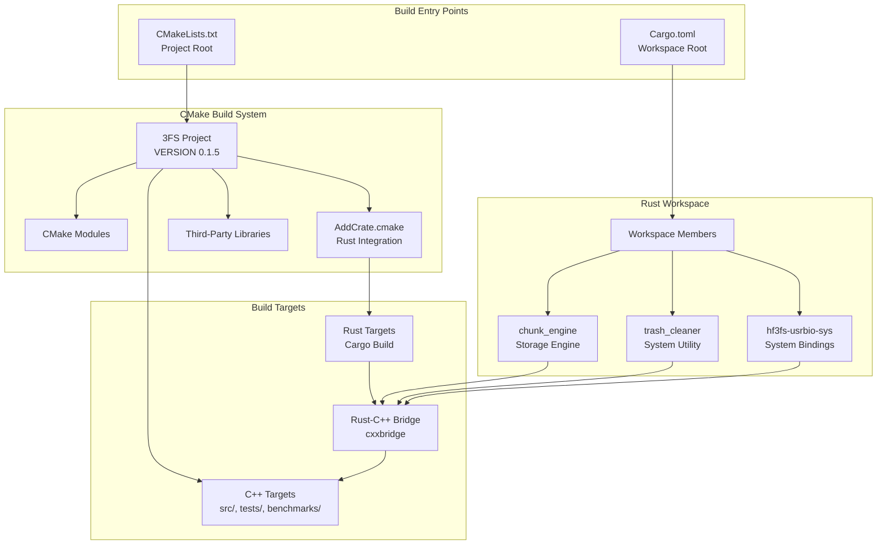
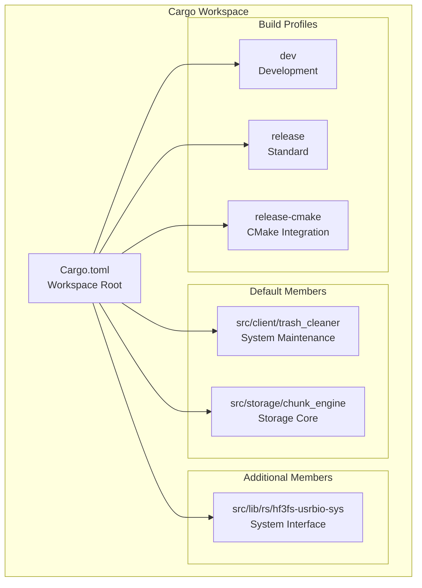
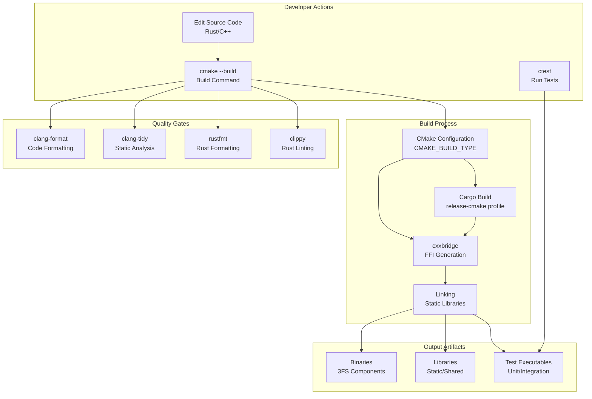

<!-- source: DeepWiki mcp.deepwiki.com · repo deepseek-ai/3FS · page 2 Build System and Development · fetched 2026-10-30 -->

# Build System and Development

<details>
<summary>Relevant source files</summary>

The following files were used as context for generating this wiki page:

- [.github/workflows/build.yml](.github/workflows/build.yml)
- [CMakeLists.txt](CMakeLists.txt)
- [Cargo.lock](Cargo.lock)
- [Cargo.toml](Cargo.toml)
- [src/common/utils/Shuffle.h](src/common/utils/Shuffle.h)
- [src/fbs/meta/Schema.cc](src/fbs/meta/Schema.cc)
- [src/lib/api/CMakeLists.txt](src/lib/api/CMakeLists.txt)
- [src/lib/rs/hf3fs-usrbio-sys/lib/.dummy](src/lib/rs/hf3fs-usrbio-sys/lib/.dummy)
- [src/meta/components/ChainAllocator.h](src/meta/components/ChainAllocator.h)
- [tests/common/utils/TestShuffle.cc](tests/common/utils/TestShuffle.cc)

</details>


This document provides a comprehensive guide to building, developing, and contributing to the 3FS (Fire-Flyer File System) codebase. It covers the multi-language build system, development workflows, code quality tools, and environment setup procedures.

For information about specific Rust components, see [Rust Components](#2.2). For details about C++ build targets and configuration, see [C++ Build Configuration](#2.3). For CI/CD workflows and automation, see [CI/CD Pipeline](#2.5).

## Build System Architecture

The 3FS build system integrates both Rust and C++ components through a sophisticated CMake-based approach with Rust workspace management. The system supports multiple build configurations and cross-language interoperability.

### Multi-Language Build Integration



Sources: [CMakeLists.txt:1-183](), [Cargo.toml:1-23]()

## CMake Configuration

The primary build configuration is managed through CMake with extensive compiler and platform support. The build system supports multiple configurations and cross-platform development.

### Project Configuration

The CMake project is configured with the following key settings:

| Setting | Value | Purpose |
|---------|-------|---------|
| Project Name | `3FS` | Main project identifier |
| Version | `0.1.5` | Current project version |
| Languages | `C CXX` | Supported languages |
| C++ Standard | `20` | Modern C++ features |
| C Standard | `11` | Standard C compatibility |

The build system defines four primary build types configured in [CMakeLists.txt:4]():

- `RelWithDebInfo` (default): Optimized with debug information
- `Debug`: Unoptimized with full debugging support  
- `Release`: Fully optimized production build
- `MinSizeRel`: Size-optimized build

### Compiler Support and Flags

The system supports both Clang and GCC compilers with specific optimizations:

#### Compiler Support and Flag Configuration

```mermaid
graph TB
    subgraph "Compiler Detection"
        DETECT["CMAKE_CXX_COMPILER_ID"]
        CLANG["Clang"]
        GCC["GNU"]
    end
    
    subgraph "Clang Flags"
        CLANG_CORO["-fcoroutines-ts"]
        CLANG_ATOMIC["-latomic"]
        CLANG_LLD["-fuse-ld=lld"]
        CLANG_LIBCXX["USE_LIBCXX OFF"]
    end
    
    subgraph "GCC Flags"
        GCC_CORO["-fcoroutines"]
    end
    
    subgraph "Architecture Detection"
        ARCH["CMAKE_SYSTEM_PROCESSOR"]
        X86["x86_64"]
        ARM["aarch64"]
    end
    
    subgraph "x86_64 Optimizations"
        X86_SSE["-msse4.2"]
        X86_AVX["-mavx2"]
    end
    
    subgraph "ARM Optimizations"
        ARM_MARCH["-march=armv8-a+crc"]
        ARM_RTLIB["-rtlib=compiler-rt"]
        ARM_UNWIND["-unwindlib=libgcc"]
    end
    
    subgraph "Common Configuration"
        COMMON_WARN["-Wall -Wextra -Werror -Wpedantic"]
        COMMON_MACRO["-fmacro-prefix-map"]
        COMMON_PIC["CMAKE_POSITION_INDEPENDENT_CODE ON"]
        COMMON_EXPORT["CMAKE_EXPORT_COMPILE_COMMANDS ON"]
    end
    
    DETECT --> CLANG
    DETECT --> GCC
    
    CLANG --> CLANG_CORO
    CLANG --> CLANG_ATOMIC
    CLANG --> CLANG_LLD
    CLANG --> CLANG_LIBCXX
    
    GCC --> GCC_CORO
    
    ARCH --> X86
    ARCH --> ARM
    
    X86 --> X86_SSE
    X86 --> X86_AVX
    
    ARM --> ARM_MARCH
    ARM --> ARM_RTLIB
    ARM --> ARM_UNWIND
    
    CLANG_CORO --> COMMON_WARN
    GCC_CORO --> COMMON_WARN
    X86_SSE --> COMMON_WARN
    ARM_MARCH --> COMMON_WARN
    
    COMMON_WARN --> COMMON_MACRO
    COMMON_MACRO --> COMMON_PIC
    COMMON_PIC --> COMMON_EXPORT
```



#### Compiler-Specific Configuration

**Clang Configuration** [CMakeLists.txt:83-88]():
- Coroutines support: `-fcoroutines-ts`
- Atomic operations linking: `-latomic` 
- Linker: `-fuse-ld=lld` (LLVM linker)
- FoundationDB compatibility: `USE_LIBCXX OFF` (do not use libc++)

**GCC Configuration** [CMakeLists.txt:89-91]():
- Coroutines support: `-fcoroutines`

#### Platform-Specific Optimizations

**x86_64 Architecture** [CMakeLists.txt:96-97]():
- SSE 4.2 instructions: `-msse4.2`
- AVX2 instructions: `-mavx2`

**ARM Architecture** [CMakeLists.txt:98-106]():
- ARM v8-A with CRC: `-march=armv8-a+crc`
- Compiler runtime library: `-rtlib=compiler-rt` (provides `__muloti4` symbol)
- Exception unwinding: `-unwindlib=libgcc`

#### Common Build Configuration

All builds include [CMakeLists.txt:74-81]():
- C++20 standard enforcement: `CMAKE_CXX_STANDARD 20`, `CMAKE_CXX_STANDARD_REQUIRED ON`
- C11 standard: `CMAKE_C_STANDARD 11`
- Position-independent code: `CMAKE_POSITION_INDEPENDENT_CODE ON`
- Compile commands export: `CMAKE_EXPORT_COMPILE_COMMANDS ON` (for IDE integration)
- Source path mapping: `-fmacro-prefix-map=${CMAKE_SOURCE_DIR}=.` (cleaner `__FILE__` output)

#### Warning Configuration

Strict warning flags [CMakeLists.txt:174]() applied after third-party dependencies:
- All warnings: `-Wall`
- Extra warnings: `-Wextra`
- Warnings as errors: `-Werror`
- Pedantic mode: `-Wpedantic`

Sources: [CMakeLists.txt:74-106](), [CMakeLists.txt:174]()

### Third-Party Dependencies

The build system integrates numerous third-party libraries through CMake subdirectories. All third-party libraries use `EXCLUDE_FROM_ALL` to prevent installation and use the `store_compile_flags()` / `restore_compile_flags()` pattern to isolate their build flags from 3FS strict warnings [CMakeLists.txt:112-172]().

| Library | Location | Purpose | Key Configuration |
|---------|----------|---------|-------------------|
| `fmt` | `third_party/fmt` | String formatting | Standard build |
| `zstd` | `third_party/zstd/build/cmake` | Compression | `ZSTD_BUILD_STATIC ON` |
| `googletest` | `third_party/googletest` | Testing framework | Standard build |
| `folly` | `third_party/folly` | Facebook utilities | `FOLLY_NO_EXCEPTION_TRACER ON` |
| `leveldb` | `third_party/leveldb` | Basic key-value storage | `LEVELDB_BUILD_TESTS OFF`, `LEVELDB_BUILD_BENCHMARKS OFF`, `LEVELDB_INSTALL OFF` |
| `rocksdb` | `third_party/rocksdb` | Advanced storage engine | `WITH_LZ4 ON`, `WITH_ZSTD ON`, `USE_RTTI ON`, tests/tools disabled, `ROCKSDB_NAMESPACE=rocksdb_internal` |
| `scnlib` | `third_party/scnlib` | Input scanning | All optional components disabled |
| `pybind11` | `third_party/pybind11` | Python bindings | Standard build |
| `toml11` | `third_party/toml11` | TOML parsing | Standard build |
| `mimalloc` | `third_party/mimalloc` | Memory allocator | `MI_OVERRIDE OFF` |
| `clickhouse-cpp` | `third_party/clickhouse-cpp` | ClickHouse client | Custom include directories for `clickhouse-cpp-lib` and `absl-lib` |
| `liburing` | `third_party/liburing-cmake` | Async I/O (io_uring) | Linux kernel interface |

#### Dependency Build Isolation

The `store_compile_flags()` and `restore_compile_flags()` macros (defined in [cmake/CompileFlags.cmake]()) are used before and after each third-party dependency to:
1. Save current compiler flags before building third-party code
2. Allow third-party libraries to build without 3FS's strict `-Werror` requirements
3. Restore strict flags for 3FS code

#### RocksDB Configuration

RocksDB receives special namespace isolation [CMakeLists.txt:107]():
```cmake
add_compile_definitions(ROCKSDB_NAMESPACE=rocksdb_internal)
```
This prevents symbol conflicts with other RocksDB installations on the system.

Sources: [CMakeLists.txt:107](), [CMakeLists.txt:112-172]()

## Rust Workspace Configuration

The Rust components are organized as a Cargo workspace with three primary crates and specific build profiles for CMake integration.

### Workspace Structure

The workspace is defined in [Cargo.toml:1-11]() with the following members:



### Build Profile Configuration

The workspace defines a special `release-cmake` profile optimized for CMake integration:

| Setting | Value | Purpose |
|---------|-------|---------|
| `inherits` | `"release"` | Based on release configuration |
| `debug` | `true` | Include debug symbols |
| `lto` | `true` | Enable link-time optimization |

This profile ensures Rust components built through CMake maintain compatibility with C++ debug workflows while preserving optimization.

Sources: [Cargo.toml:13-23]()

## Multi-Language Integration

The integration between Rust and C++ components is facilitated through the `AddCrate.cmake` module and cxxbridge for type-safe interoperability.

### Development Workflow



### Build Configuration Options

The build system provides several configuration options through CMake variables:

| Option | Type | Default | Description |
|--------|------|---------|-------------|
| `SHUFFLE_METHOD` | **Required** | None | Shuffle algorithm selection: `g++10`, `g++11`, or `stdshuffle` |
| `ENABLE_ASSERTIONS` | Optional | `ON` (Debug), `OFF` (others) | Enable runtime assertions with `_DEBUG` definition |
| `OVERRIDE_CXX_NEW_DELETE` | Optional | `OFF` | Override global new/delete operators (disabled with sanitizers) |
| `SAVE_ALLOCATE_SIZE` | Optional | `OFF` | Track allocation sizes (requires `OVERRIDE_CXX_NEW_DELETE`) |
| `ENABLE_FUSE_APPLICATION` | Optional | `ON` | Build FUSE integration components |

#### Required Configuration: SHUFFLE_METHOD

The `SHUFFLE_METHOD` parameter is mandatory and controls the shuffle algorithm used in sorting operations. The build will fail with an error if not specified:

```bash
# Valid build configuration
cmake -DSHUFFLE_METHOD=g++11 -DCMAKE_BUILD_TYPE=RelWithDebInfo ..

# Build fails without SHUFFLE_METHOD
cmake -DCMAKE_BUILD_TYPE=Debug ..
# Error: SHUFFLE_METHOD is not set!
```

The three available methods defined in [CMakeLists.txt:30]() are:
- `g++10`: Uses GCC 10 shuffle implementation with `USE_GCC10_SHUFFLE` definition
- `g++11`: Uses GCC 11 shuffle implementation with `USE_GCC11_SHUFFLE` definition  
- `stdshuffle`: Uses standard C++ `std::shuffle` with `USE_STD_SHUFFLE` definition

The choice of shuffle method is critical because different GCC versions (and `std::shuffle`) can produce different shuffle sequences for the same seed [src/common/utils/Shuffle.h:174-194](). The `safe_shuffle_seed` function [src/common/utils/Shuffle.h:174]() is used to verify that a given seed produces consistent results across `std::shuffle`, `gcc_shuffle<true>` (GCC 11), and `gcc_shuffle<false>` (GCC 10) implementations. This is particularly important for `Layout::ChainRange` [src/fbs/meta/Schema.h:122]() which uses `hf3fs_shuffle` [src/common/utils/Shuffle.h:162]() to determine chain distribution. The `find_safe_seed` function [src/common/utils/Shuffle.h:196]() attempts to find a seed that is safe across these implementations.

Sources: [CMakeLists.txt:30-72](), [src/common/utils/Shuffle.h:174-194](), [src/common/utils/Shuffle.h:174](), [src/common/utils/Shuffle.h:196](), [src/fbs/meta/Schema.h:122](), [src/common/utils/Shuffle.h:162]()

#### Memory Management Options

The `OVERRIDE_CXX_NEW_DELETE` option [CMakeLists.txt:56-71]() enables custom memory allocation tracking:
- Automatically disabled when `SANITIZER` is enabled to prevent conflicts
- When enabled with `SAVE_ALLOCATE_SIZE`, allocates additional memory to track allocation sizes
- Adds `OVERRIDE_CXX_NEW_DELETE` and optionally `SAVE_ALLOCATE_SIZE` preprocessor definitions

Sources: [CMakeLists.txt:30-72]()

## Build Targets and Subdirectories

The build system organizes code into three primary subdirectories, each serving distinct purposes:

| Directory | Purpose | Content |
|-----------|---------|---------|
| `src/` | Core implementation | Main 3FS components and libraries |
| `tests/` | Testing infrastructure | Unit tests and integration tests |
| `benchmarks/` | Performance measurement | Benchmarking tools and frameworks |

The modular CMake structure allows for selective building and testing of individual components while maintaining dependency resolution across the multi-language codebase.

Sources: [CMakeLists.txt:180-182]()

---

