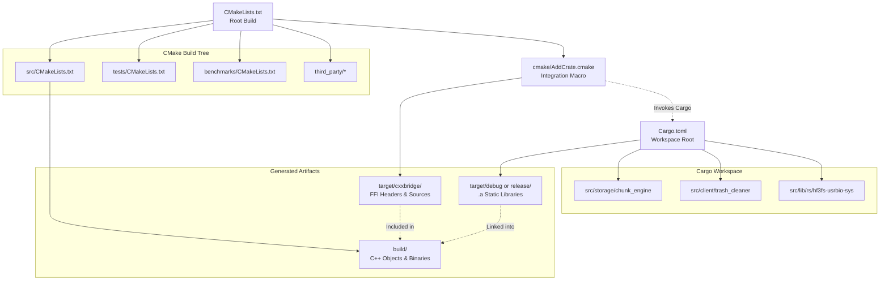
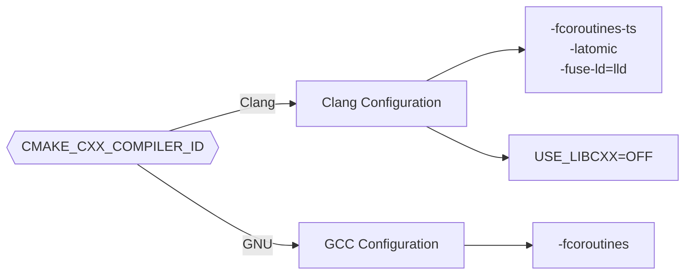
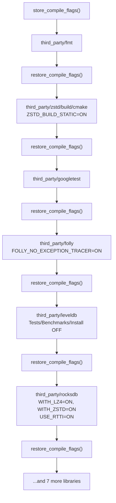
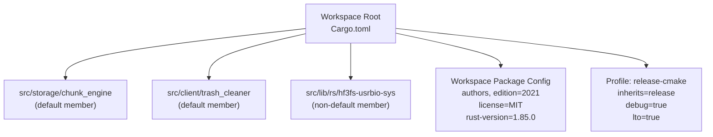
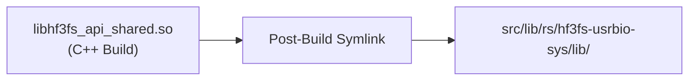

<!-- source: DeepWiki mcp.deepwiki.com · repo deepseek-ai/3FS · page 2.1 Multi-Language Build System · fetched 2026-10-30 -->

# Multi-Language Build System

<details>
<summary>Relevant source files</summary>

The following files were used as context for generating this wiki page:

- [.github/workflows/build.yml](.github/workflows/build.yml)
- [CMakeLists.txt](CMakeLists.txt)
- [Cargo.lock](Cargo.lock)
- [Cargo.toml](Cargo.toml)
- [src/common/utils/Shuffle.h](src/common/utils/Shuffle.h)
- [src/fbs/meta/Schema.cc](src/fbs/meta/Schema.cc)
- [src/lib/api/CMakeLists.txt](src/lib/api/CMakeLists.txt)
- [src/lib/rs/hf3fs-usrbio-sys/lib/.dummy](src/lib/rs/hf3fs-usrbio-sys/lib/.dummy)
- [src/meta/components/ChainAllocator.h](src/meta/components/ChainAllocator.h)
- [tests/common/utils/TestShuffle.cc](tests/common/utils/TestShuffle.cc)

</details>


## Purpose and Scope

This document describes the polyglot build system architecture for 3FS, which coordinates C++ and Rust compilation through CMake and Cargo. The build system integrates multiple language toolchains, manages third-party dependencies, and generates both native libraries and FFI bindings. For details on specific Rust components, see [Rust Components](#2.2). For C++ build configuration details, see [C++ Build Configuration](#2.3).

## Build System Architecture

3FS employs a hybrid build system where CMake serves as the primary orchestrator while delegating Rust compilation to Cargo. This architecture enables independent development in each language while maintaining build coherence.

### Build System Overview Diagram



**Sources:** [CMakeLists.txt:1-209](), [Cargo.toml:1-23](), [cmake/AddCrate.cmake:1-34]()

## CMake Root Configuration

The root `CMakeLists.txt` establishes the build environment for the entire project. It defines project metadata, compiler requirements, and orchestrates all build components.

### Project Configuration

| Setting | Value | Description |
|---------|-------|-------------|
| CMake Version | 3.12+ | Minimum required version |
| Project Name | `3FS` | Project identifier |
| Version | 0.1.5 | Semantic version |
| Languages | C, CXX | C11 and C++20 |
| C++ Standard | C++20 | Required, no extensions |
| C Standard | C11 | Not required, extensions allowed |

**Sources:** [CMakeLists.txt:1-2](), [CMakeLists.txt:74-79]()

### Build Types and Configuration

The build system supports four configuration types defined at [CMakeLists.txt:4]():

```
RelWithDebInfo | Debug | Release | MinSizeRel
```

Default build type is `RelWithDebInfo` when not specified [CMakeLists.txt:5-8](). The system automatically handles assertion control based on build type [CMakeLists.txt:13-28]().

### Compiler-Specific Configuration



**Sources:** [CMakeLists.txt:83-91]()

The build system configures coroutine support differently based on compiler: Clang uses `-fcoroutines-ts` and links with the `lld` linker [CMakeLists.txt:84-86](), while GCC uses the standardized `-fcoroutines` flag [CMakeLists.txt:90-91]().

### Architecture-Specific Settings

| Architecture | Flags | Linker Configuration |
|--------------|-------|---------------------|
| x86_64 | `-msse4.2 -mavx2` | Default |
| aarch64 | `-march=armv8-a+crc` | `-rtlib=compiler-rt -unwindlib=libgcc` |

**Sources:** [CMakeLists.txt:96-106]()

The ARM configuration explicitly specifies `compiler-rt` to provide symbols like `__muloti4` and uses `libgcc` for exception unwinding compatibility [CMakeLists.txt:100-105]().

## Build Options and Customization

### Required Build Options: SHUFFLE_METHOD

The `SHUFFLE_METHOD` option is mandatory and must be specified at configuration time [CMakeLists.txt:31-35]():

```cmake
cmake -DSHUFFLE_METHOD=<value>
```

Valid values: `g++10`, `g++11`, `stdshuffle` [CMakeLists.txt:30](). This option controls data shuffling algorithms through compile-time definitions (`USE_STD_SHUFFLE`, `USE_GCC10_SHUFFLE`, `USE_GCC11_SHUFFLE`) [CMakeLists.txt:48-54](). This configuration is critical for consistent data placement across different compiler environments [src/common/utils/Shuffle.h:26-34]().

### Optional Build Flags

| Option | Default | Description |
|--------|---------|-------------|
| `OVERRIDE_CXX_NEW_DELETE` | OFF | Override global new/delete operators |
| `SAVE_ALLOCATE_SIZE` | OFF | Track allocation sizes (requires more memory) |
| `ENABLE_FUSE_APPLICATION` | ON | Build FUSE filesystem components |
| `ENABLE_ASSERTIONS` | ON (Debug)<br/>OFF (Release) | Enable runtime assertions |

**Sources:** [CMakeLists.txt:14-17](), [CMakeLists.txt:56-72]()

Note: `OVERRIDE_CXX_NEW_DELETE` is automatically disabled when sanitizers are enabled [CMakeLists.txt:61-63]().

## Third-Party Dependency Integration

The root CMakeLists orchestrates 13 third-party dependencies using `add_subdirectory()` with custom configuration. Each dependency is wrapped with compile flag management to prevent flag pollution [CMakeLists.txt:112-172]():



**Sources:** [CMakeLists.txt:112-172]()

### Key Dependency Configurations

**RocksDB** [CMakeLists.txt:134-143]():
- `WITH_LZ4=ON`, `WITH_ZSTD=ON`: Enable compression
- `USE_RTTI=ON`: Enable runtime type information
- `WITH_TESTS=OFF`, `WITH_BENCHMARK_TOOLS=OFF`: Disable unnecessary components
- Namespace redefined: `ROCKSDB_NAMESPACE=rocksdb_internal` [CMakeLists.txt:107]()

**Folly** [CMakeLists.txt:126-127]():
- `FOLLY_NO_EXCEPTION_TRACER=ON`: Disable exception tracing overhead

**ClickHouse C++** [CMakeLists.txt:160-169]():
- Custom include directory configuration for both static and shared libraries
- Includes `absl-lib` from contrib directory

## Cargo Workspace Structure

The Rust workspace is defined in `Cargo.toml` with three member crates [Cargo.toml:1-6]():



**Sources:** [Cargo.toml:1-23]()

### Workspace Configuration Details

**Members** [Cargo.toml:2-6]():
- `src/client/trash_cleaner`: Cleanup utility (default member)
- `src/storage/chunk_engine`: Core storage engine (default member)
- `src/lib/rs/hf3fs-usrbio-sys`: FFI bindings (non-default member, built only when needed)

**Package Metadata** [Cargo.toml:13-17]():
- **Edition**: 2021
- **MSRV**: Rust 1.85.0
- **License**: MIT
- **Resolver**: Version 2 (new feature resolver)

**Custom Build Profile** [Cargo.toml:19-22]():
The `release-cmake` profile is specifically designed for CMake integration, enabling full LTO and debug symbols for the final binary.

## Rust-C++ Integration via AddCrate.cmake

The `AddCrate.cmake` module provides the core integration mechanism between CMake and Cargo. It defines the `add_crate()` macro that wraps Rust crates as CMake targets.

### Build Command Selection

The build system chooses the Cargo profile based on the CMake build type [cmake/AddCrate.cmake:1-7]():

| CMake Build Type | Cargo Command | Target Directory |
|------------------|---------------|------------------|
| `Debug` | `cargo build` | `debug` |
| Other (Release, etc.) | `cargo build --release` | `release` |

**Sources:** [cmake/AddCrate.cmake:1-7]()

### add_crate() Macro Implementation

The `add_crate(NAME)` macro performs several critical operations to bridge the two languages [cmake/AddCrate.cmake:15-33]():

1. **Path Mapping**: Defines paths for the expected `.a` static library and the generated `cxxbridge` sources [cmake/AddCrate.cmake:16-20]().
2. **Custom Command**: Hooks into the build graph to invoke Cargo for specific crates, generating the `cxxbridge` FFI headers and implementation [cmake/AddCrate.cmake:22-26]().
3. **Library Creation**: Creates a CMake static library target that includes both the generated C++ FFI code and the Rust static library [cmake/AddCrate.cmake:28-29]().
4. **FFI Header Exposure**: Adds `target/cxxbridge` to the public include path so C++ code can include generated headers like `cxx.rs.h` [cmake/AddCrate.cmake:30]().
5. **Dependency Management**: Ensures all crates depend on a global `cargo_build_all` target to maintain correct build order [cmake/AddCrate.cmake:32]().

## Build Process Flow

### CI and Manual Build Execution

The standard build sequence is reflected in the CI workflow [build.yml:27-30]():
1. `cargo build --release`: Pre-builds Rust components.
2. `cmake -S . -B build ...`: Configures the C++ environment with the required `SHUFFLE_METHOD`.
3. `cmake --build build -j 32`: Compiles C++ code and links against Rust artifacts.

### USRBIO Shared Library Integration

For the `hf3fs-usrbio-sys` crate, a special integration exists where a C++ shared library `hf3fs_api_shared` is symlinked into the Rust crate's library directory post-build [src/lib/api/CMakeLists.txt:4-9](). This allows the Rust FFI bindings to find the necessary C++ symbols during its own build or runtime.



**Sources:** [src/lib/api/CMakeLists.txt:4-9]()

## Build System Extension Points

The build system includes several extension points for specialized functionality:

| Module | Purpose | Location |
|--------|---------|----------|
| `Sanitizers.cmake` | AddressSanitizer, UBSan configuration | [CMakeLists.txt:108]() |
| `CompileFlags.cmake` | Compiler flag management | [CMakeLists.txt:109]() |
| `CodeCoverage.cmake` | Code coverage instrumentation | [CMakeLists.txt:196]() |
| `CLangFormat.cmake` | Code formatting integration | [CMakeLists.txt:197]() |
| `CLangTidy.cmake` | Static analysis integration | [CMakeLists.txt:198]() |
| `Target.cmake` | Target utility functions | [CMakeLists.txt:199]() |
| `DumpConfig.cmake` | Configuration diagnostics | [CMakeLists.txt:200]() |
| `Jemalloc.cmake` | Memory allocator integration | [CMakeLists.txt:201]() |
| `ApacheArrow.cmake` | Arrow ExternalProject setup | [CMakeLists.txt:202]() |

**Sources:** [CMakeLists.txt:196-203]()

## Summary

The 3FS multi-language build system achieves seamless integration between CMake and Cargo through unified orchestration, automatic FFI generation via `cxxbridge`, and careful management of architecture-specific compiler flags. This ensures that the high-performance C++ core and the safety-critical Rust components (like the `chunk_engine`) can be built and linked into a single cohesive distributed file system.

---

