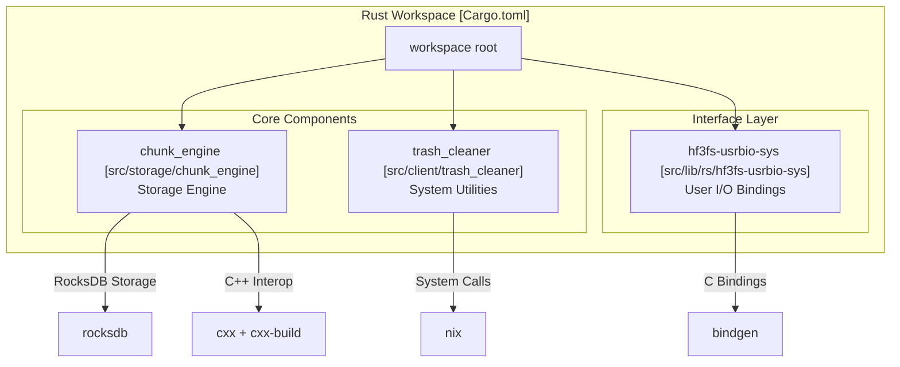
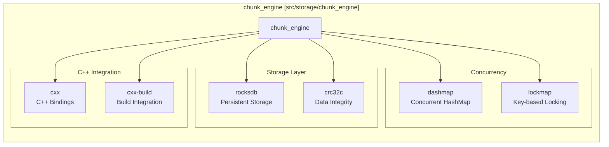
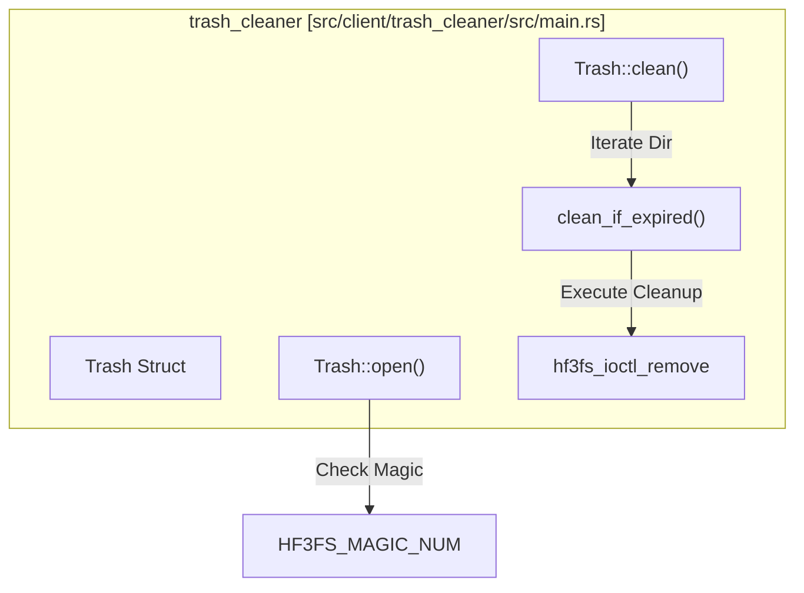
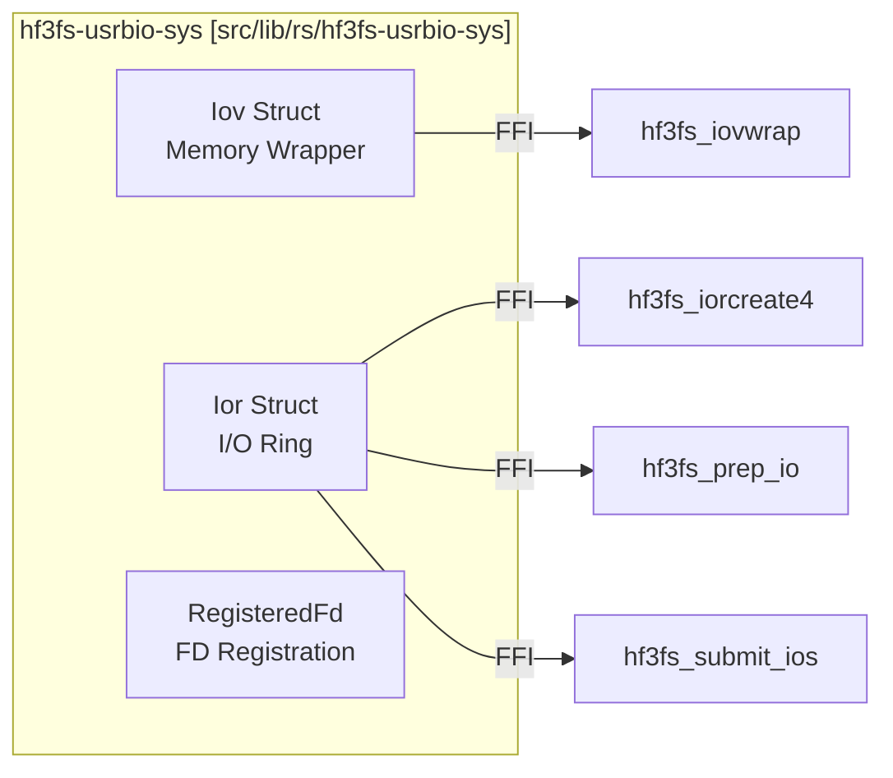

<!-- source: DeepWiki mcp.deepwiki.com · repo deepseek-ai/3FS · page 2.2 Rust Components · fetched 2026-10-30 -->

# Rust Components

Relevant source files

The following files were used as context for generating this wiki page:

- [Cargo.lock](Cargo.lock)
- [Cargo.toml](Cargo.toml)
- [src/client/trash_cleaner/Cargo.toml](src/client/trash_cleaner/Cargo.toml)
- [src/client/trash_cleaner/src/main.rs](src/client/trash_cleaner/src/main.rs)
- [src/lib/api/hf3fs_usrbio.h](src/lib/api/hf3fs_usrbio.h)
- [src/lib/rs/hf3fs-usrbio-sys/Cargo.toml](src/lib/rs/hf3fs-usrbio-sys/Cargo.toml)
- [src/lib/rs/hf3fs-usrbio-sys/README](src/lib/rs/hf3fs-usrbio-sys/README)
- [src/lib/rs/hf3fs-usrbio-sys/build.rs](src/lib/rs/hf3fs-usrbio-sys/build.rs)
- [src/lib/rs/hf3fs-usrbio-sys/lib/.dummy](src/lib/rs/hf3fs-usrbio-sys/lib/.dummy)
- [src/lib/rs/hf3fs-usrbio-sys/src/lib.rs](src/lib/rs/hf3fs-usrbio-sys/src/lib.rs)
- [src/storage/chunk_engine/Cargo.toml](src/storage/chunk_engine/Cargo.toml)

The Rust components in 3FS provide core storage functionality, system utilities, and user interface bindings within a hybrid C++/Rust architecture. This document covers the Rust workspace structure, component implementations, dependencies, and integration mechanisms.

## Workspace Structure

The 3FS Rust ecosystem is organized as a workspace containing three main components: a storage engine, system utilities, and user interface bindings.

**Workspace Configuration Details**

| Field | Value | Purpose |
|-------|-------|---------|
| `members` | 3 components | All workspace crates [Cargo.toml:2-6]() |
| `default-members` | 2 components | Built by default [Cargo.toml:7-10]() |
| `edition` | `"2021"` | Rust edition [Cargo.toml:15]() |
| `rust-version` | `"1.85.0"` | Minimum supported Rust version [Cargo.toml:17]() |

The workspace is defined in [Cargo.toml:1-11]() with workspace-wide package metadata in [Cargo.toml:13-17](). The minimum supported Rust version (MSRV) is declared as `"1.85.0"` in [Cargo.toml:17]().

Sources: [Cargo.toml:1-23]()

## Storage Engine Component

The `chunk_engine` crate implements the core storage functionality for 3FS, providing data chunk management and persistence through RocksDB integration.

**Key Technical Features:**

- **Storage Backend**: Uses `rocksdb` for persistent key-value storage with `crc32c` for data integrity verification [src/storage/chunk_engine/Cargo.toml:14-22]().
- **Concurrency**: Implements `dashmap` for concurrent access and `lockmap` for fine-grained key-based locking [src/storage/chunk_engine/Cargo.toml:16-20]().
- **C++ Interoperability**: Uses `cxx` and `cxx-build` for seamless integration with the C++ storage layer [src/storage/chunk_engine/Cargo.toml:15-38]().
- **Serialization**: Utilizes `derse` with `tinyvec` features for high-performance serialization [src/storage/chunk_engine/Cargo.toml:17-26]().

Sources: [src/storage/chunk_engine/Cargo.toml:1-43]()

## System Utilities Component  

The `trash_cleaner` crate provides system-level utilities for maintenance and cleanup operations, specifically managing expired files in the 3FS trash directory.

**Operational Capabilities:**

- **Trash Management**: The `Trash` struct handles opening and validating trash directories [src/client/trash_cleaner/src/main.rs:62-135]().
- **Safety Checks**: Validates the filesystem using `ioctl_get_magic` to ensure it is operating on a 3FS instance (`0x8f3f5fff`) [src/client/trash_cleaner/src/main.rs:15-111]().
- **Cleanup Logic**: Iterates through directory entries and removes expired items using a specialized `hf3fs_ioctl_remove` [src/client/trash_cleaner/src/main.rs:30-173]().
- **Time Parsing**: Supports custom datetime formats (e.g., `%Y%m%d_%H%M`) to determine expiration [src/client/trash_cleaner/src/main.rs:32-39]().

Sources: [src/client/trash_cleaner/src/main.rs:1-216](), [src/client/trash_cleaner/Cargo.toml:1-25]()

## User I/O Interface Component

The `hf3fs-usrbio-sys` crate provides low-level system bindings for high-performance user-space I/O operations via FFI to the C++ API.

**Interface Implementation:**

- **Binding Generation**: Uses `bindgen` during build time to generate Rust types from `hf3fs_usrbio.h` [src/lib/rs/hf3fs-usrbio-sys/build.rs:9-14]().
- **I/O Ring (IOR)**: Encapsulates the `hf3fs_ior` structure, providing methods for creation, I/O preparation, and submission [src/lib/rs/hf3fs-usrbio-sys/src/lib.rs:70-152]().
- **Memory Mapping (IOV)**: The `Iov` struct wraps shared memory segments and creates symlinks in the 3FS virtual directory `/3fs-virt/iovs/` for FUSE visibility [src/lib/rs/hf3fs-usrbio-sys/src/lib.rs:31-67]().
- **FD Registration**: The `RegisteredFd` struct handles registering file descriptors with the 3FS driver to enable zero-copy I/O [src/lib/rs/hf3fs-usrbio-sys/src/lib.rs:210-230]().
- **Polling**: Supports asynchronous completion reaping via `hf3fs_wait_for_ios` with timeout handling [src/lib/rs/hf3fs-usrbio-sys/src/lib.rs:153-188]().

Sources: [src/lib/rs/hf3fs-usrbio-sys/src/lib.rs:1-236](), [src/lib/rs/hf3fs-usrbio-sys/build.rs:1-20](), [src/lib/api/hf3fs_usrbio.h:1-171]()

## Build System Integration

The Rust components integrate with the overall 3FS build system through Cargo profiles and CMake-linked libraries.

**Build Configuration:**

- **Custom Profile**: A `release-cmake` profile is defined with `lto = true` and `debug = true` to facilitate optimized builds that remain debuggable when linked into C++ binaries [Cargo.toml:19-23]().
- **Linkage**: `hf3fs-usrbio-sys` explicitly links against `hf3fs_api_shared`, which must be built by CMake prior to the Rust build [src/lib/rs/hf3fs-usrbio-sys/build.rs:7](), [src/lib/rs/hf3fs-usrbio-sys/README:1]().

Sources: [Cargo.toml:19-23](), [src/lib/rs/hf3fs-usrbio-sys/build.rs:1-8]()

---

