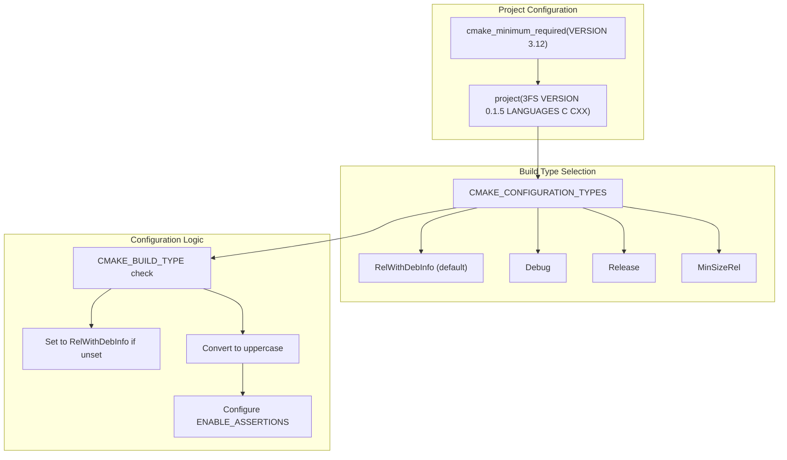
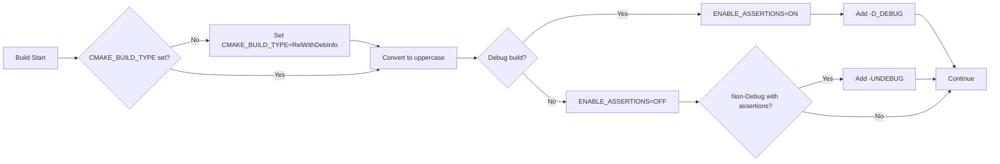
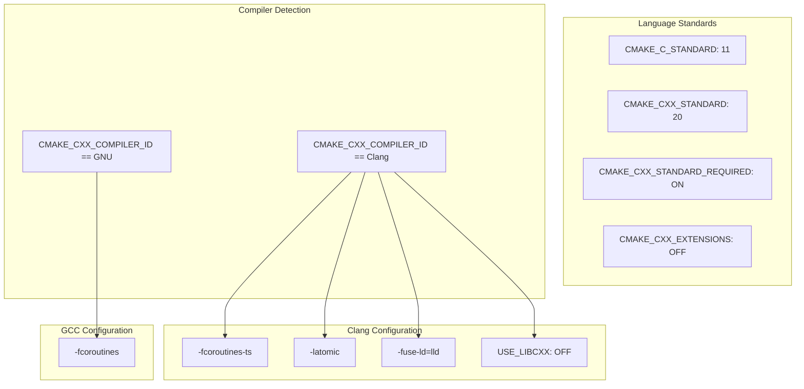
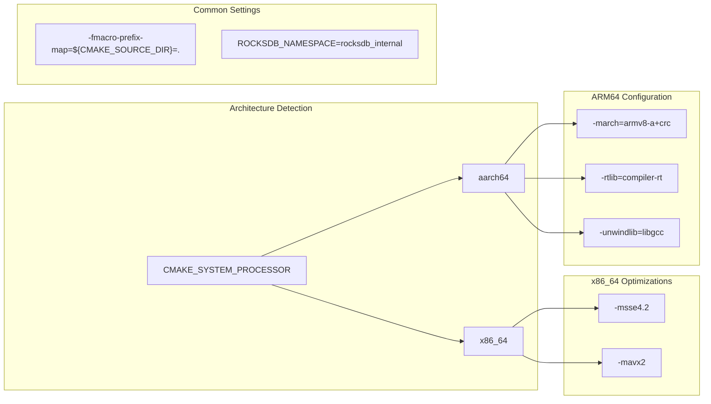
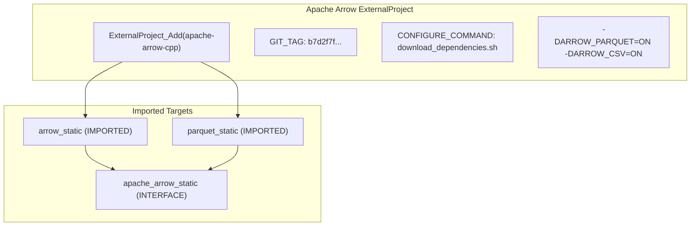
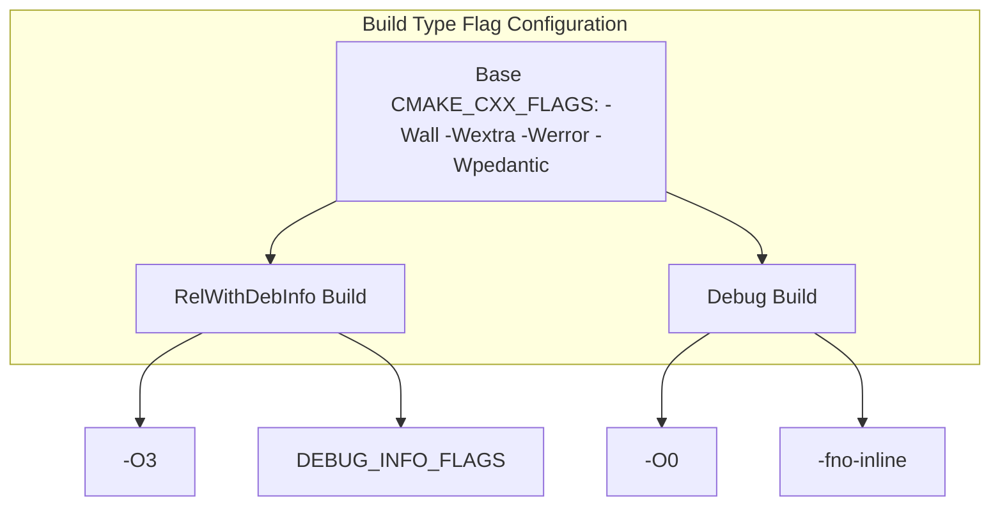

<!-- source: DeepWiki mcp.deepwiki.com · repo deepseek-ai/3FS · page 2.3 C++ Build Configuration · fetched 2026-10-30 -->

# C++ Build Configuration

Relevant source files

The following files were used as context for generating this wiki page:

- [CMakeLists.txt](CMakeLists.txt)
- [cmake/ApacheArrow.cmake](cmake/ApacheArrow.cmake)
- [src/common/utils/Shuffle.h](src/common/utils/Shuffle.h)
- [src/fbs/meta/Schema.cc](src/fbs/meta/Schema.cc)
- [src/meta/components/ChainAllocator.h](src/meta/components/ChainAllocator.h)
- [tests/common/utils/TestShuffle.cc](tests/common/utils/TestShuffle.cc)

This document covers the CMake-based C++ build configuration for the 3FS project, including compiler settings, build types, language standards, and third-party dependency integration. For information about Rust component integration with the C++ build system, see [2.1 Multi-Language Build System]().

## Project Configuration and Build Types

The 3FS project uses CMake 3.12+ and defines itself as a C/C++ project with version 0.1.5 [CMakeLists.txt:1-2](). The build system supports four standard build configurations with `RelWithDebInfo` as the default [CMakeLists.txt:4-9]().

**Build Type Configuration Flow**

Sources: [CMakeLists.txt:1-28]()

## Compiler Configuration and Language Standards

The build system enforces the C++20 standard with specific compiler optimizations and platform-specific settings [CMakeLists.txt:74-79]().

| Configuration | Value | Description |
|---------------|-------|-------------|
| `CMAKE_C_STANDARD` | 11 | C11 standard [CMakeLists.txt:74]() |
| `CMAKE_CXX_STANDARD` | 20 | C++20 standard required [CMakeLists.txt:77]() |
| `CMAKE_CXX_STANDARD_REQUIRED` | ON | C++20 strictly enforced [CMakeLists.txt:78]() |
| `CMAKE_CXX_EXTENSIONS` | OFF | Disable compiler extensions [CMakeLists.txt:79]() |
| `CMAKE_POSITION_INDEPENDENT_CODE` | ON | Enable PIC for shared libraries [CMakeLists.txt:80]() |

Sources: [CMakeLists.txt:83-91]()

## Platform-Specific Optimizations

The build system includes architecture-specific optimizations for x86_64 and ARM64 platforms.

Sources: [CMakeLists.txt:93-107]()

## Custom Build Options

3FS introduces specific build options for shuffle consistency and memory management.

### Shuffle Method Selection
To ensure consistency across different GCC versions when generating file layouts, 3FS requires a specific `SHUFFLE_METHOD` [CMakeLists.txt:30-45](). This is critical for the `ChainAllocator` when picking chains for file layouts [src/meta/components/ChainAllocator.h:115-120]().

| Option | Implementation |
|--------|----------------|
| `stdshuffle` | Uses `std::shuffle` with `std::mt19937_64` [src/common/utils/Shuffle.h:156-159]() |
| `g++10` | Replicates GCC 10's `std::shuffle` behavior [src/common/utils/Shuffle.h:151-153]() |
| `g++11` | Replicates GCC 11's `std::shuffle` behavior [src/common/utils/Shuffle.h:146-148]() |

### Memory Management Options
| Option | Default | Purpose |
|--------|---------|---------|
| `OVERRIDE_CXX_NEW_DELETE` | OFF | Override C++ new/delete operators for custom allocation tracking [CMakeLists.txt:56]() |
| `SAVE_ALLOCATE_SIZE` | OFF | Use more memory to save allocation sizes [CMakeLists.txt:57]() |

Sources: [CMakeLists.txt:30-72](), [src/common/utils/Shuffle.h:145-172](), [src/meta/components/ChainAllocator.h:115-120]()

## Third-Party Dependencies Integration

3FS integrates a large number of dependencies. A common pattern used is `store_compile_flags()` and `restore_compile_flags()` to prevent project-wide flags (like `-Werror`) from breaking external code [CMakeLists.txt:112-114]().

### Core Libraries
- **folly**: Integrated with `FOLLY_NO_EXCEPTION_TRACER` enabled [CMakeLists.txt:126-127]().
- **rocksdb**: Built with LZ4 and ZSTD support [CMakeLists.txt:135-143]().
- **clickhouse-cpp**: Static linking with specific include directory overrides for bundled `absl` [CMakeLists.txt:160-170]().

### Apache Arrow Integration
Arrow is integrated as an `ExternalProject` because of its complex build requirements and dependencies [cmake/ApacheArrow.cmake:21]().

Sources: [CMakeLists.txt:112-173](), [cmake/ApacheArrow.cmake:1-61]()

## Compiler Flags and Build Optimization

The build system applies comprehensive warning flags and build-type-specific optimizations [CMakeLists.txt:174-181]().

### Build Type Optimizations

| Build Type | Optimization | Flags |
|------------|--------------|-------|
| `RelWithDebInfo` | `-O3` | `${DEBUG_INFO_FLAGS} ${CMAKE_CXX_FLAGS_ADD}` [CMakeLists.txt:177]() |
| `Debug` | `-O0` | `-fno-inline ${DEBUG_INFO_FLAGS} ${CMAKE_CXX_FLAGS_ADD}` [CMakeLists.txt:178]() |

Sources: [CMakeLists.txt:174-181]()

---

