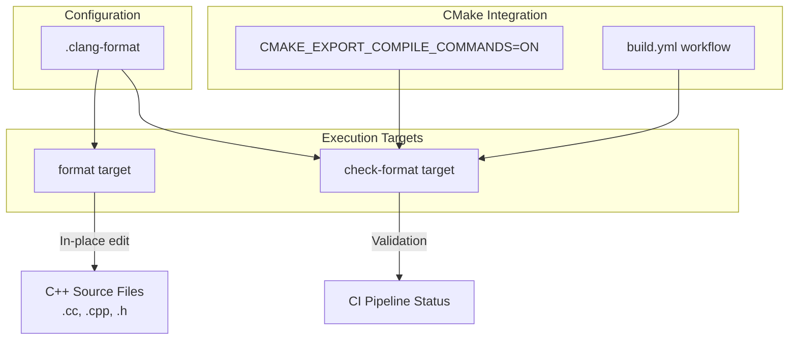
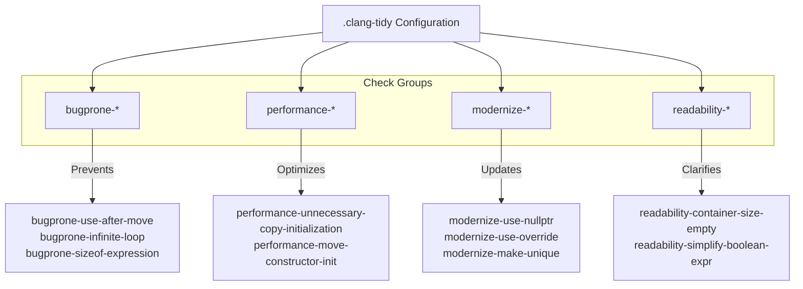
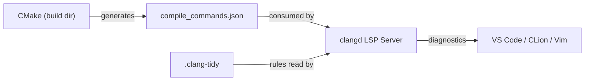

<!-- source: DeepWiki mcp.deepwiki.com · repo deepseek-ai/3FS · page 2.4 Development Tools and Code Quality · fetched 2026-10-30 -->

# Development Tools and Code Quality

<details>
<summary>Relevant source files</summary>

The following files were used as context for generating this wiki page:

- [.clang-tidy](.clang-tidy)
- [.github/workflows/build.yml](.github/workflows/build.yml)
- [README.md](README.md)
- [dockerfile/dev.opencloudos9.dockerfile](dockerfile/dev.opencloudos9.dockerfile)
- [src/lib/api/CMakeLists.txt](src/lib/api/CMakeLists.txt)

</details>


## Purpose and Scope

This page documents the code quality tools and development utilities integrated into the 3FS build system to maintain consistent code style, catch bugs early, and enhance developer productivity. The focus is on C++ tooling for the codebase's C++ components. For information about the overall build system architecture, see [Multi-Language Build System](#2.1). For CI/CD automation that enforces these quality checks, see [CI/CD Pipeline](#2.5).

The 3FS project uses three primary code quality tools:
- **clang-format-14** for automated code formatting
- **clang-tidy-14** for static analysis and bug detection  
- **clangd** for IDE language server support

All tools are configured to work with C++20 standards and integrate seamlessly with the CMake build system.

---

## Code Formatting with clang-format

### Configuration

The project uses `clang-format-14` with a customized Google-based style. The configuration enforces strict formatting rules to maintain consistency across the codebase.

**Key Configuration Settings:**

| Setting | Value | Purpose |
|---------|-------|---------|
| `BasedOnStyle` | Google | Foundation style guide |
| `Standard` | c++20 | Target language standard |
| `ColumnLimit` | 120 | Maximum line width |
| `IndentWidth` | 2 | Spaces per indentation level |
| `PointerAlignment` | Right | `Type *ptr` style |
| `AllowAllArgumentsOnNextLine` | false | Prevents argument cramming |
| `AllowAllParametersOfDeclarationOnNextLine` | false | Forces parameter splitting |
| `BinPackArguments` | false | One argument per line for clarity |
| `BinPackParameters` | false | One parameter per line for clarity |

**Template and Constructor Formatting:**

The configuration enforces specific rules for complex C++ constructs:
- `AlwaysBreakTemplateDeclarations: true` ensures template parameters are readable.
- `BreakConstructorInitializers: BeforeColon` places member initializers on new lines.
- `PackConstructorInitializers: Never` prevents packing of initializers.

**Include Ordering:**

Custom include categories prioritize generated headers, specifically those generated by FlatBuffers (`Flat_generated.h`) or internal fbs macros.

### Build System Integration

The build system integrates formatting into the development process by defining custom targets. The infrastructure expects `clang-format-14` to be installed at `/usr/bin/clang-format-14` [README.md:75-81]().

**Formatting Tooling Flow:**



**Sources:** README.md:75-81, .github/workflows/build.yml:19-29

#### Format Target

Developers use the `format` target to apply formatting to all source files. The process typically involves:
1. Searching `src/`, `tests/`, and `benchmarks/` directories.
2. Finding all `.cc`, `.cpp`, and `.h` files.
3. Excluding generated headers matching `*_generated.h` patterns.
4. Applying formatting in-place.

#### Check-Format Target

The `check-format` target validates formatting without modification. This is a critical component of the CI pipeline [ .github/workflows/build.yml:19-29]().

**Operation:**
- Uses dry-run modes to check without modifying files.
- Uses warning-as-error flags to exit with error code on formatting violations.
- Integrated into the GitHub Actions `build` job [ .github/workflows/build.yml:10-31]().

**Sources:** .github/workflows/build.yml:19-31

---

## Static Analysis with clang-tidy

### Configuration and Check Categories

The `.clang-tidy` configuration enables 80+ static analysis checks across multiple categories, focusing on bug prevention, performance, and modern C++ practices. The configuration uses an explicit opt-in approach, disabling all checks by default (`-*`) and selectively enabling specific ones [.clang-tidy:1-2]().

**Checks to Logic Mapping:**



**Sources:** .clang-tidy:1-117

### Bugprone Checks (39 Checks)

The `bugprone-*` category focuses on catching programming errors that may compile but produce incorrect behavior:

| Check Category | Examples | Description |
|----------------|----------|-------------|
| Memory Safety | `bugprone-dangling-handle`<br/>`bugprone-use-after-move` | Detects lifetime issues and unsafe memory access [.clang-tidy:8,43]() |
| Logic Errors | `bugprone-infinite-loop`<br/>`bugprone-terminating-continue` | Identifies control flow problems [.clang-tidy:13,36]() |
| Constructor Issues | `bugprone-undelegated-constructor`<br/>`bugprone-copy-constructor-init` | Validates constructor delegation and initialization [.clang-tidy:3,7]() |
| String Handling | `bugprone-string-constructor`<br/>`bugprone-string-literal-with-embedded-nul` | Catches string construction errors [.clang-tidy:27,29]() |

**Sources:** .clang-tidy:3-47

### Performance Checks (10 Checks)

The `performance-*` category identifies optimization opportunities:

| Check | Purpose | Line Reference |
|-------|---------|----------------|
| `performance-unnecessary-copy-initialization` | Eliminates redundant copies | [.clang-tidy:57]() |
| `performance-move-constructor-init` | Enforces move semantics in constructors | [.clang-tidy:54]() |
| `performance-for-range-copy` | Detects unnecessary copies in range loops | [.clang-tidy:50]() |
| `performance-inefficient-vector-operation` | Optimizes vector operations | [.clang-tidy:53]() |

**Custom Configuration:**
The project explicitly disables `CheckTriviallyCopyableMove` for `performance-move-const-arg` [.clang-tidy:116-117]().

**Sources:** .clang-tidy:49-58, 116-117

### Modernize Checks (14 Checks)

The `modernize-*` category encourages modern C++11/14/17/20 idioms:

| Modern Feature | Checks | Replacement |
|----------------|--------|-------------|
| Smart Pointers | `modernize-make-shared`<br/>`modernize-make-unique` | `std::make_shared/unique` over `new` [.clang-tidy:62-63]() |
| Null Pointers | `modernize-use-nullptr` | `nullptr` over `NULL` [.clang-tidy:70]() |
| Override Specifier | `modernize-use-override` | Explicit `override` keywords [.clang-tidy:72]() |
| Special Members | `modernize-use-equals-default` | Use `= default` [.clang-tidy:73]() |

**Sources:** .clang-tidy:60-75

---

## IDE Integration with clangd

### Language Server Configuration

The project supports the clangd language server protocol (LSP) implementation for C++ IDEs. This enables features like code completion and error highlighting.

**Compiler Flag Adjustments:**
To ensure correct indexing of the codebase, specific flags are adjusted:
- **Coroutines Support**: The technical specification flag for coroutines is often added to support 3FS's heavy use of asynchronous programming.
- **IntelliSense Compatibility**: Flags like `-DNO_INTELLISENSE` may be removed to ensure clangd correctly parses the source.

### Integration with Development Workflow

The clangd configuration works in conjunction with the compilation database generated by CMake. By running `cmake` with `-DCMAKE_EXPORT_COMPILE_COMMANDS=ON` [README.md:109](), a `compile_commands.json` file is produced in the build directory.

**IDE Data Flow:**



**Sources:** README.md:107-112

---

## Development Workflow Integration

### Local Development Phase

**Real-time IDE Feedback:**
1. Developer configures the build with `CMAKE_EXPORT_COMPILE_COMMANDS=ON` [README.md:109]().
2. clangd provides real-time diagnostics using `.clang-tidy` checks [.clang-tidy:1-117]().
3. The IDE applies formatting based on the `.clang-format` configuration.

**Pre-commit Workflow:**
Before pushing, developers are encouraged to run the formatting targets defined in the CMake environment to ensure compliance with the project's style standards.

### Continuous Integration Phase

**Automated Quality Gates:**

The `build.yml` workflow enforces quality checks on every pull request [.github/workflows/build.yml:6-7]().

1. **Environment Setup**: Installs `clang-format-14` and `clang-tidy-14` [.github/workflows/build.yml:19]().
2. **Build Execution**: Compiles the project using `clang-14` [.github/workflows/build.yml:29]().
3. **Quality Checks**: Validation of formatting and static analysis results.

**Sources:** .github/workflows/build.yml:1-31

### Tooling Installation

For consistent results, the project specifies specific versions of the LLVM toolchain. On Ubuntu systems, these are installed via `apt`:
```bash
sudo apt install clang-format-14 clang-14 clang-tidy-14 lld-14
```
[README.md:75, 79](), [.github/workflows/build.yml:19]()

For OpenCloudOS/TencentOS environments, the `dev.opencloudos9.dockerfile` provides a standardized setup by downloading and symlinking the LLVM 14.0.6 release [dockerfile/dev.opencloudos9.dockerfile:40-52]().

**Sources:** README.md:73-82, dockerfile/dev.opencloudos9.dockerfile:40-52, .github/workflows/build.yml:18-20

---

