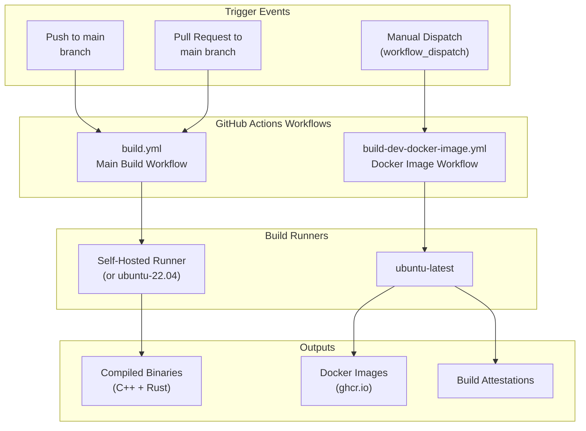
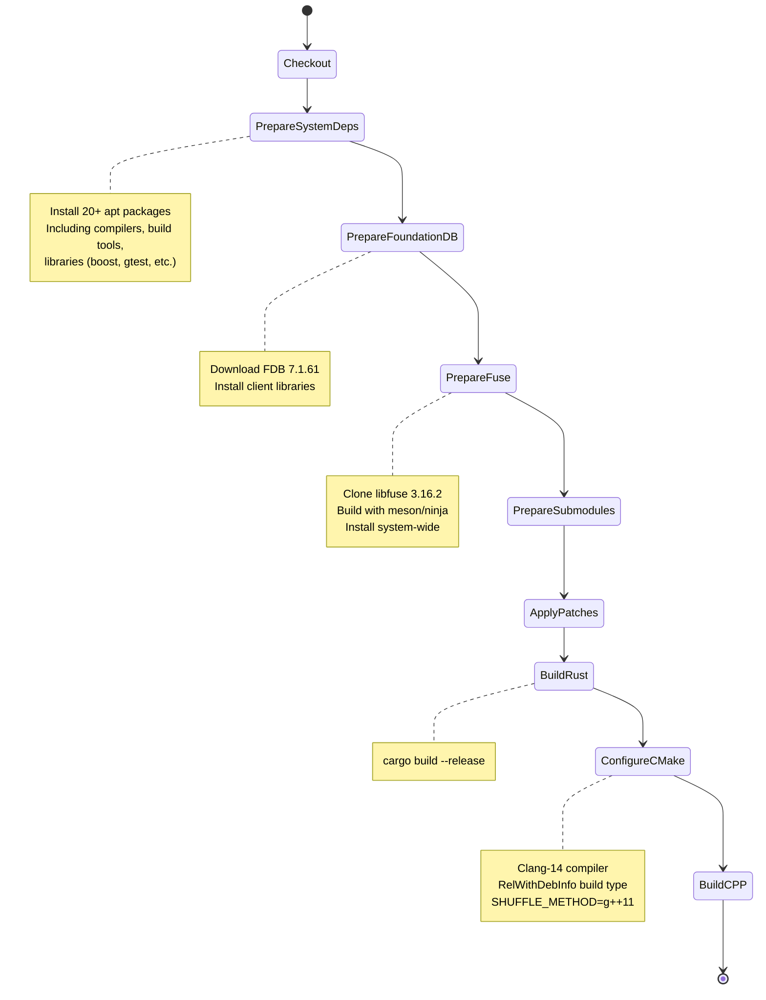
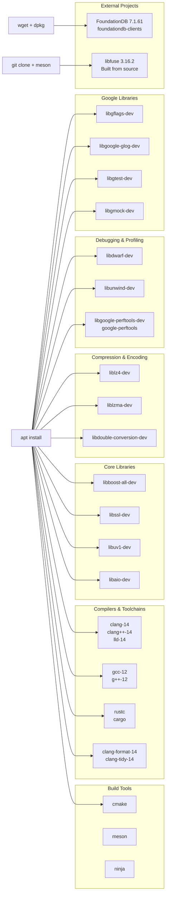
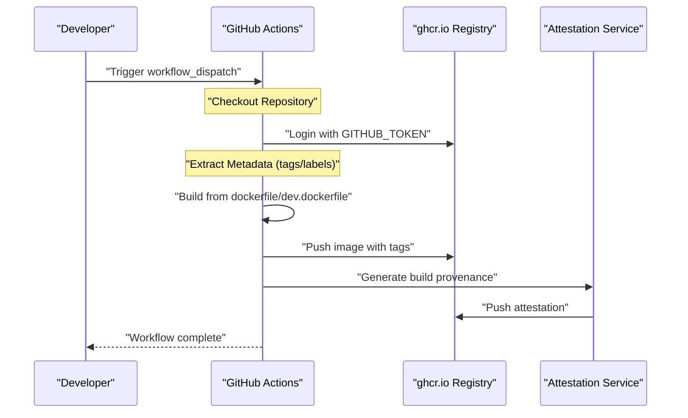

<!-- source: DeepWiki mcp.deepwiki.com · repo deepseek-ai/3FS · page 2.5 CI/CD Pipeline · fetched 2026-10-30 -->

# CI/CD Pipeline

<details>
<summary>Relevant source files</summary>

The following files were used as context for generating this wiki page:

- [.github/workflows/build-dev-docker-image.yml](.github/workflows/build-dev-docker-image.yml)
- [.github/workflows/build.yml](.github/workflows/build.yml)
- [dockerfile/dev.dockerfile](dockerfile/dev.dockerfile)
- [dockerfile/dev.ubuntu2004.dockerfile](dockerfile/dev.ubuntu2004.dockerfile)
- [src/lib/api/CMakeLists.txt](src/lib/api/CMakeLists.txt)

</details>


## Purpose and Scope

This document describes the GitHub Actions-based continuous integration and continuous deployment (CI/CD) infrastructure for 3FS. The pipeline automates builds for both C++ and Rust components, manages dependency installation, and publishes development Docker images to GitHub Container Registry.

The pipeline ensures that every change to the `main` branch is validated through a rigorous build process that includes complex multi-language linking and external system dependency setup.

---

## Workflow Architecture

3FS uses two primary GitHub Actions workflows that handle different aspects of the build and deployment process.

### Workflow Trigger Matrix



**Sources:** [.github/workflows/build.yml:3-7](), [.github/workflows/build-dev-docker-image.yml:3-4]()

---

## Main Build Workflow

The `build.yml` workflow executes on every push or pull request to the `main` branch and performs a complete build of both Rust and C++ components.

### Trigger Configuration

| Property | Value |
|----------|-------|
| Workflow Name | `Build` |
| Trigger Events | `push`, `pull_request` on branch `main` |
| Runner | `self-hosted` (fallback: `ubuntu-22.04`) |
| Parallelization | 32 build jobs |

**Sources:** [.github/workflows/build.yml:1-11]()

### Build Pipeline Stages



**Sources:** [.github/workflows/build.yml:13-30]()

### Dependency Installation Process

The preparation step installs an extensive set of dependencies across multiple categories:



**Sources:** [.github/workflows/build.yml:16-22]()

#### Dependency Installation Commands

The prepare step executes the following sequence:

1. **System libraries** (line 18):
   ```bash
   sudo apt install -y cmake libuv1-dev liblz4-dev liblzma-dev \
     libdouble-conversion-dev libdwarf-dev libunwind-dev
   ```

2. **Build toolchain** (line 19):
   ```bash
   sudo apt install -y libaio-dev libgflags-dev libgoogle-glog-dev \
     libgtest-dev libgmock-dev clang-format-14 clang-14 \
     clang-tidy-14 lld-14
   ```

3. **Performance and compiler tools** (line 20):
   ```bash
   sudo apt install -y libgoogle-perftools-dev google-perftools \
     libssl-dev gcc-12 g++-12 libboost-all-dev meson rustc cargo
   ```

4. **FoundationDB client** (line 21):
   - Downloads version 7.1.61 from GitHub releases.
   - Installs via `dpkg`.

5. **libfuse from source** (line 22):
   - Clones `fuse-3.16.2` branch.
   - Builds with `meson` and `ninja`.
   - Installs system-wide.

6. **Git submodules** (line 23):
   ```bash
   git submodule update --init --recursive
   ```

7. **Apply patches** (line 24):
   ```bash
   ./patches/apply.sh
   ```

**Sources:** [.github/workflows/build.yml:16-24]()

### Build Execution

The build step compiles both Rust and C++ components in sequence:

#### Rust Component Build
```bash
cargo build --release
```
**Sources:** [.github/workflows/build.yml:28]()

#### C++ Component Build
```bash
cmake -S . -B build -DCMAKE_CXX_COMPILER=clang++-14 -DCMAKE_C_COMPILER=clang-14 -DCMAKE_BUILD_TYPE=RelWithDebInfo -DCMAKE_EXPORT_COMPILE_COMMANDS=ON -DSHUFFLE_METHOD=g++11
cmake --build build -j 32
```

| CMake Option | Value | Purpose |
|--------------|-------|---------|
| `CMAKE_CXX_COMPILER` | `clang++-14` | C++ compiler |
| `CMAKE_C_COMPILER` | `clang-14` | C compiler |
| `CMAKE_BUILD_TYPE` | `RelWithDebInfo` | Optimized with debug symbols |
| `CMAKE_EXPORT_COMPILE_COMMANDS` | `ON` | Generate compile_commands.json for tooling |
| `SHUFFLE_METHOD` | `g++11` | Shuffle implementation variant |
| Parallel Jobs | `32` | Build parallelization factor |

**Sources:** [.github/workflows/build.yml:29-30]()

---

## Docker Image Workflow

The `build-dev-docker-image.yml` workflow creates containerized development environments and publishes them to GitHub Container Registry (ghcr.io).

### Workflow Configuration

| Property | Value |
|----------|-------|
| Workflow Name | `Build development Docker image` |
| Trigger | `workflow_dispatch` (manual) |
| Runner | `ubuntu-latest` |
| Registry | `ghcr.io` |
| Image Name | `${{ github.repository }}-dev` |

**Sources:** [.github/workflows/build-dev-docker-image.yml:1-9]()

### Docker Build and Publish Pipeline



**Sources:** [.github/workflows/build-dev-docker-image.yml:21-52]()

---

## Dockerfile Implementation

3FS provides Dockerfiles for creating consistent development environments on Ubuntu 22.04 and 20.04.

### dev.dockerfile (Ubuntu 22.04)

The primary development image includes:
- **Compilers**: `clang-14`, `gcc-12`, `rustc`, `cargo`. [dockerfile/dev.dockerfile:7-8,50]()
- **FDB Client**: Version `7.3.63` (configurable via `ARG`). [dockerfile/dev.dockerfile:27-37]()
- **libfuse**: Version `3.16.2` built from source. [dockerfile/dev.dockerfile:39-47]()
- **Build Tools**: `cmake`, `meson`, `ninja`. [dockerfile/dev.dockerfile:8,46]()

### Architecture Support
The Dockerfiles dynamically detect the architecture (`amd64` vs `arm64`) to download the correct FoundationDB client package. [dockerfile/dev.dockerfile:28-34](), [dockerfile/dev.ubuntu2004.dockerfile:35-41]()

**Sources:** [dockerfile/dev.dockerfile:1-51](), [dockerfile/dev.ubuntu2004.dockerfile:1-58]()

---

## Integration Points

### Rust-C++ Shared Libraries
A critical post-build step in the CMake configuration involves creating symlinks for shared libraries to facilitate Rust FFI bindings.

```cmake
add_custom_command(
    TARGET hf3fs_api_shared
    POST_BUILD
    COMMAND ${CMAKE_COMMAND} -E create_symlink "${CMAKE_CURRENT_BINARY_DIR}/libhf3fs_api_shared.so" "${CMAKE_SOURCE_DIR}/src/lib/rs/hf3fs-usrbio-sys/lib/libhf3fs_api_shared.so"
    COMMENT "linking usrbio library to rust binding lib dir"
)
```
This ensures that the `hf3fs-usrbio-sys` crate can find the compiled C++ `hf3fs_api_shared` library during the build or test process.

**Sources:** [src/lib/api/CMakeLists.txt:4-9]()

### Build Attestation
The Docker workflow uses `actions/attest-build-provenance` to generate a cryptographically signed attestation of the build. This provides a secure chain of custody for the development images.

**Sources:** [.github/workflows/build-dev-docker-image.yml:47-52]()

---

