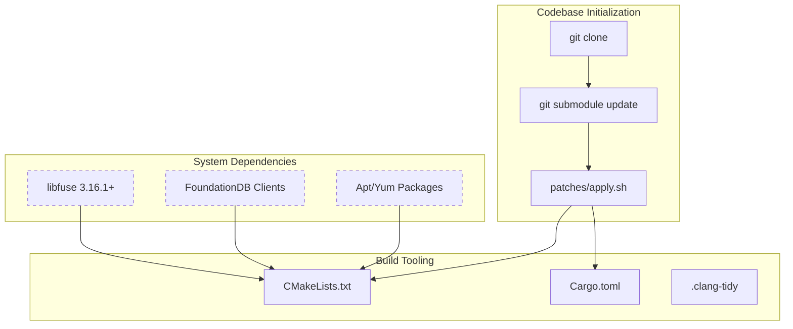
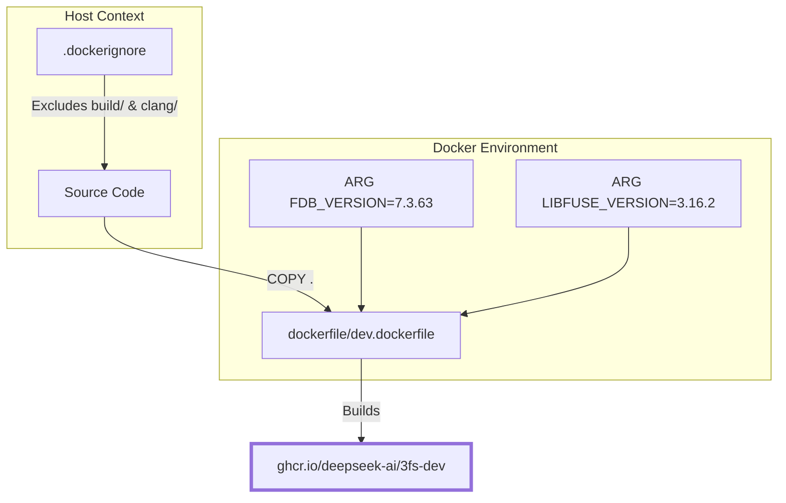

<!-- source: DeepWiki mcp.deepwiki.com · repo deepseek-ai/3FS · page 2.6 Development Environment Setup · fetched 2026-10-30 -->

# Development Environment Setup

<details>
<summary>Relevant source files</summary>

The following files were used as context for generating this wiki page:

- [.clang-tidy](.clang-tidy)
- [.github/workflows/build-dev-docker-image.yml](.github/workflows/build-dev-docker-image.yml)
- [README.md](README.md)
- [dockerfile/dev.centos9.dockerfile](dockerfile/dev.centos9.dockerfile)
- [dockerfile/dev.dockerfile](dockerfile/dev.dockerfile)
- [dockerfile/dev.opencloudos9.dockerfile](dockerfile/dev.opencloudos9.dockerfile)
- [src/fuse/CMakeLists.txt](src/fuse/CMakeLists.txt)

</details>


This document provides step-by-step instructions for setting up a development environment for 3FS. It covers system requirements, dependency installation, repository initialization, build configuration, and environment optimization using `.gitignore` and `.dockerignore`.

For information about the CI/CD pipeline, see page 2.5. For build system internals, see pages 2.1 (Multi-Language Build System) and 2.3 (C++ Build Configuration). For code quality tools, see page 2.4.

## System Requirements

3FS development requires a Linux environment with specific compiler versions and system libraries. The following configurations are tested and supported:

| Platform | Compiler | CMake | Notes |
|----------|----------|-------|-------|
| Ubuntu 20.04 | `clang-14`, `gcc-10` | 3.20+ | Requires `libboost1.71-all-dev` [README.md:73-76]() |
| Ubuntu 22.04 | `clang-14`, `gcc-12` | 3.20+ | Requires `libboost-all-dev` [README.md:78-81]() |
| openEuler 2403sp1 | `clang`, `gcc` | 3.20+ | RPM-based dependencies [README.md:83-86]() |
| OpenCloudOS 9 | `gcc`, `clang` | 3.20+ | EPOL repository required [README.md:88-92]() |
| TencentOS 4 | `gcc`, `clang` | 3.20+ | EPOL repository required [README.md:88-92]() |

**Minimum Hardware**: 32GB RAM, 100GB disk space for build artifacts and dependencies.

**Sources:** [README.md:73-93](), [dockerfile/dev.dockerfile:1-25]()

## Dependency Installation

### Ubuntu 20.04 / 22.04

Install required system packages using `apt`:

```bash
# Ubuntu 22.04 example
apt install cmake libuv1-dev liblz4-dev liblzma-dev libdouble-conversion-dev \
  libdwarf-dev libunwind-dev libaio-dev libgflags-dev libgoogle-glog-dev \
  libgtest-dev libgmock-dev clang-format-14 clang-14 clang-tidy-14 lld-14 \
  libgoogle-perftools-dev google-perftools libssl-dev gcc-12 g++-12 \
  libboost-all-dev build-essential
```

**Sources:** [README.md:78-81](), [dockerfile/dev.dockerfile:4-25]()

### OpenCloudOS 9 / TencentOS 4

These distributions require the `epol-release` for extended packages:

```bash
dnf install epol-release wget git meson cmake perl lld gcc gcc-c++ autoconf \
    lz4 lz4-devel xz xz-devel double-conversion-devel libdwarf-devel \
    libunwind-devel libaio-devel gflags-devel glog-devel libuv-devel \
    gmock-devel gperftools gperftools-devel openssl-devel boost-static \
    boost-devel mono-devel libevent-devel libibverbs-devel numactl-devel \
    python3-devel
```

**Sources:** [README.md:88-92](), [dockerfile/dev.opencloudos9.dockerfile:2-8]()

### Additional Build Prerequisites

The following components must be installed manually or via specific repositories:

#### libfuse 3.16.1+
3FS requires a modern `libfuse` version for the FUSE client [src/fuse/CMakeLists.txt:7](). It is typically built from source using `meson` and `ninja`.

```bash
# Example from dev.dockerfile
wget https://github.com/libfuse/libfuse/releases/download/fuse-3.16.2/fuse-3.16.2.tar.gz
tar -xzvf fuse-3.16.2.tar.gz && cd fuse-3.16.2
mkdir build && cd build
meson setup .. && meson configure -D default_library=both
ninja && ninja install
```

**Sources:** [README.md:97](), [dockerfile/dev.dockerfile:39-47](), [dockerfile/dev.opencloudos9.dockerfile:16-29]()

#### FoundationDB 7.1+
Required for the metadata service persistence layer. Both client and server packages are recommended for development.

```bash
# Ubuntu example
wget https://github.com/apple/foundationdb/releases/download/7.3.63/foundationdb-clients_7.3.63-1_amd64.deb
dpkg -i foundationdb-clients_7.3.63-1_amd64.deb
```

**Sources:** [README.md:98](), [dockerfile/dev.dockerfile:27-37](), [dockerfile/dev.centos9.dockerfile:26-33]()

#### Rust Toolchain
Minimum version 1.75.0, recommended 1.85.0 or newer.

```bash
curl --proto '=https' --tlsv1.2 -sSf https://sh.rustup.rs | sh -s -- -y
```

**Sources:** [README.md:99](), [dockerfile/dev.dockerfile:49-51](), [dockerfile/dev.opencloudos9.dockerfile:12-14]()

## Repository Setup

### Cloning and Submodule Initialization

3FS relies heavily on third-party libraries managed as Git submodules. These must be initialized and patched before building.

```bash
git clone https://github.com/deepseek-ai/3fs
cd 3fs
git submodule update --init --recursive
./patches/apply.sh
```

**Sources:** [README.md:55-66]()

### Repository Structure and Entities

The following diagram maps high-level setup tasks to the specific entities and files involved in the environment configuration.

**Environment Setup Entity Mapping**

**Sources:** [README.md:55-101](), [.clang-tidy:1-117]()

## Build Configuration

### CMake and SHUFFLE_METHOD
Due to historical usage of `std::shuffle`, binaries compiled with different compiler versions (e.g., `g++10` vs `g++11`) may be incompatible. The `-DSHUFFLE_METHOD` flag is mandatory.

```bash
cmake -S . -B build \
      -DCMAKE_CXX_COMPILER=clang++-14 -DCMAKE_C_COMPILER=clang-14 \
      -DCMAKE_BUILD_TYPE=RelWithDebInfo -DCMAKE_EXPORT_COMPILE_COMMANDS=ON \
      -DSHUFFLE_METHOD=g++11
cmake --build build -j 32
```

**Sources:** [README.md:103-117]()

### Static Analysis Configuration
The project includes a comprehensive `.clang-tidy` configuration to enforce code quality during development. It includes checks for `bugprone-*`, `performance-*`, `modernize-*`, and `google-*` coding standards.

**Sources:** [.clang-tidy:1-117]()

## Environment Optimization

### Git Ignore Patterns
The `.gitignore` file is configured to exclude various build artifacts, IDE settings, and language-specific caches to maintain a clean repository state.

| Category | Patterns |
|----------|----------|
| Build Directories | `build/`, `debug/`, `release/`, `clang/`, `clangdbg/`, `target/` |
| Compiled Objects | `*.o`, `*.a`, `*.so` |
| Generated Code | `*_generated.h` (cxxbridge outputs) |
| Tooling | `compile_commands.json`, `.cache/`, `__pycache__/` |

**Sources:** [.gitignore:1-18]()

### Dockerized Development
For a consistent environment, use the provided Dockerfiles. The `dev.dockerfile` (Ubuntu 22.04 based) installs all dependencies, including FDB clients and Rust.

**Build Workflow in Docker**

**Sources:** [dockerfile/dev.dockerfile:1-51](), [.dockerignore:1-4](), [.github/workflows/build-dev-docker-image.yml:7-8]()

### Docker Context Management
The `.dockerignore` file prevents large, unnecessary directories from being sent to the Docker daemon during the image build process:
* `clang/` and `build/`: Local build artifacts.
* `deploy/*/Dockerfile`: Recursive Dockerfile definitions.

**Sources:** [.dockerignore:1-4]()

## Development Workflow Verification

To verify the setup, ensure the following commands succeed in order:
1. `git submodule update --init --recursive` [README.md:64]()
2. `./patches/apply.sh` [README.md:65]()
3. `cmake -S . -B build -DSHUFFLE_METHOD=g++11` (or g++10) [README.md:107-110]()
4. `cmake --build build -j $(nproc)` [README.md:111]()

If building the FUSE client, verify that `hf3fs_fuse_main` is linked against `fuse3` [src/fuse/CMakeLists.txt:7-8]().

---

