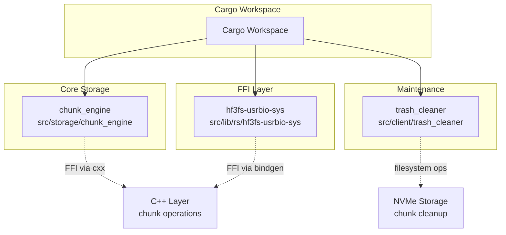
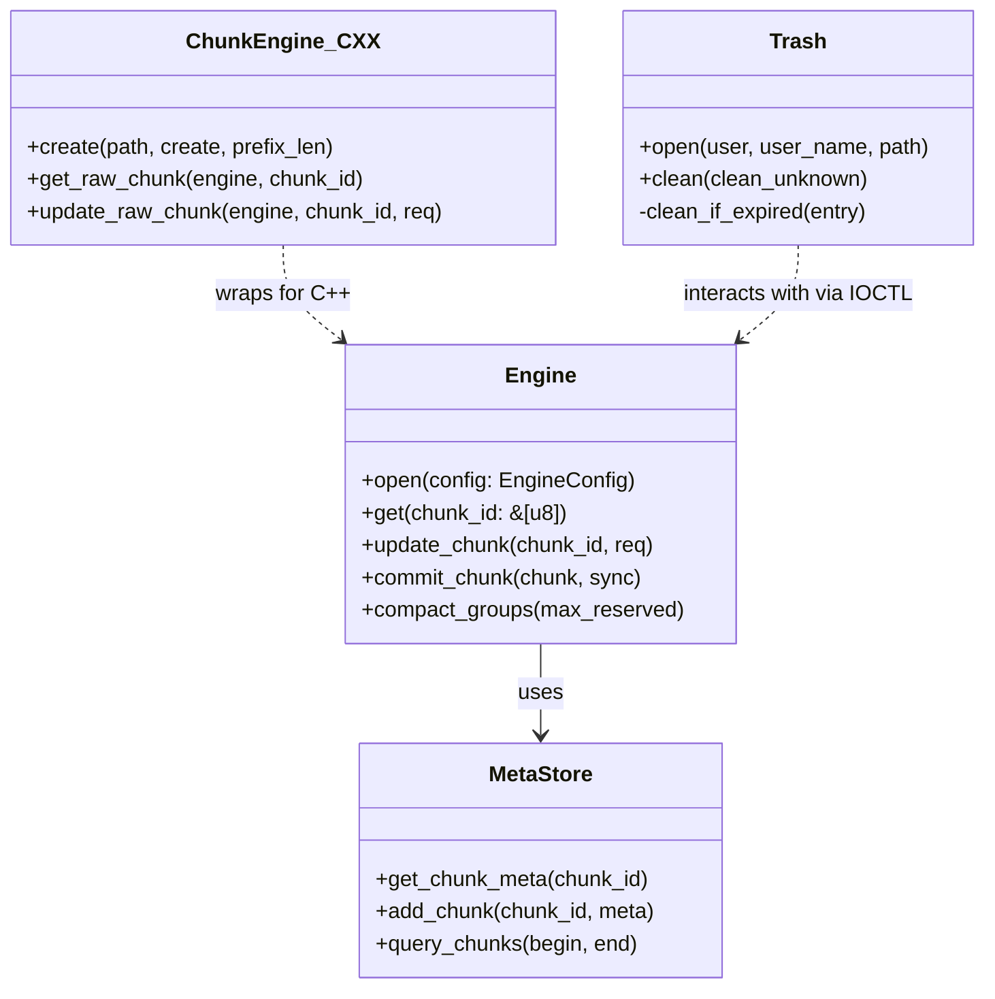
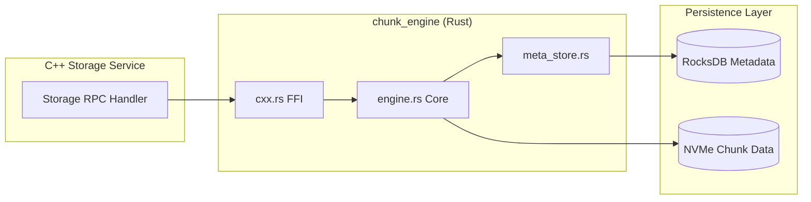

<!-- source: DeepWiki mcp.deepwiki.com · repo deepseek-ai/3FS · page 3 Core Components · fetched 2026-10-30 -->

# Core Components

Relevant source files

The following files were used as context for generating this wiki page:

- [src/client/trash_cleaner/Cargo.toml](src/client/trash_cleaner/Cargo.toml)
- [src/client/trash_cleaner/src/main.rs](src/client/trash_cleaner/src/main.rs)
- [src/storage/chunk_engine/Cargo.toml](src/storage/chunk_engine/Cargo.toml)
- [src/storage/chunk_engine/src/bin/bench.rs](src/storage/chunk_engine/src/bin/bench.rs)
- [src/storage/chunk_engine/src/core/engine.rs](src/storage/chunk_engine/src/core/engine.rs)
- [src/storage/chunk_engine/src/cxx.rs](src/storage/chunk_engine/src/cxx.rs)
- [src/storage/chunk_engine/src/meta/meta_store.rs](src/storage/chunk_engine/src/meta/meta_store.rs)

This document provides an overview of the primary Rust-based components that form the core functionality of 3FS. These components implement the storage engine, maintenance utilities, and user-space I/O interfaces. The 3FS Rust workspace consists of crates that handle chunk-based storage operations, cleanup tasks, and FFI bindings for interoperability with the C++ layer.

For detailed information about individual components, see:
- Chunk storage engine implementation: [Chunk Engine](#3.1)
- Cleanup utilities and maintenance: [System Utilities](#3.2)  
- User I/O FFI bindings: [User I/O Interface (USRBIO)](#3.3)

For information about how these components integrate with the C++ build system, see [Multi-Language Build System](#2.1) and [Rust-C++ Integration](#5.1).

## Workspace Architecture

The Rust components are organized as a Cargo workspace. The workspace contains member crates with distinct responsibilities within the 3FS architecture.

### Workspace Structure

**Sources**: [src/storage/chunk_engine/Cargo.toml:1-10](), [src/client/trash_cleaner/Cargo.toml:1-8]()

## Component Overview

The core Rust components provide complementary functionality for the 3FS storage system.

| Component | Path | Primary Purpose | Key Technologies |
|-----------|------|-----------------|------------------|
| `chunk_engine` | `src/storage/chunk_engine` | Chunk-based storage engine with RocksDB indexing | RocksDB, cxx, lockmap, derse |
| `trash_cleaner` | `src/client/trash_cleaner` | Time-based cleanup utility for removing stale data | chrono, nix, structopt |
| `hf3fs-usrbio-sys` | `src/lib/rs/hf3fs-usrbio-sys` | FFI bindings for user-space I/O operations | bindgen, shared_memory |

**Sources**: [src/storage/chunk_engine/Cargo.toml:2-15](), [src/client/trash_cleaner/Cargo.toml:2-21]()

## Key Code Entities

The following diagram bridges the natural language concepts to the specific Rust structures and functions used in the codebase.

**Sources**: [src/storage/chunk_engine/src/core/engine.rs:19-30](), [src/storage/chunk_engine/src/meta/meta_store.rs:13-34](), [src/client/trash_cleaner/src/main.rs:62-135](), [src/storage/chunk_engine/src/cxx.rs:10-23]()

## Component Interaction Model

The storage engine (`chunk_engine`) serves as the primary data management layer, while `trash_cleaner` provides out-of-band maintenance.

### chunk_engine
The `Engine` struct is the central entry point for storage operations [src/storage/chunk_engine/src/core/engine.rs:19-28](). It manages a `MetaStore` backed by RocksDB [src/storage/chunk_engine/src/meta/meta_store.rs:13-16]() and coordinates chunk allocation across physical storage via `Allocators` [src/storage/chunk_engine/src/core/engine.rs:44-49](). It exposes a C++ interface via `cxx` to allow the main 3FS storage service to perform chunk operations [src/storage/chunk_engine/src/cxx.rs:88-108]().

For details, see [Chunk Engine](#3.1).

### trash_cleaner
This utility manages the lifecycle of deleted data. It uses `nix` to perform low-level filesystem operations and `ioctl` to communicate with the 3FS FUSE client [src/client/trash_cleaner/src/main.rs:15-30](). It identifies expired items based on timestamps in their filenames [src/client/trash_cleaner/src/main.rs:175-187]() and removes them to reclaim space.

For details, see [System Utilities](#3.2).

### hf3fs-usrbio-sys
This component provides the low-level FFI glue between the C++ user-space I/O implementation and Rust. It facilitates zero-copy data transfer and shared memory communication required for high-performance I/O paths.

For details, see [User I/O Interface (USRBIO)](#3.3).

## Data Flow and Persistence

The following diagram illustrates how data flows through the Rust components into the underlying storage.

**Sources**: [src/storage/chunk_engine/src/cxx.rs:93-108](), [src/storage/chunk_engine/src/core/engine.rs:184-206](), [src/storage/chunk_engine/src/meta/meta_store.rs:36-47]()

## Build Integration

The Rust components are integrated into the CMake-based C++ build system. The `chunk_engine` crate is compiled as a static library [src/storage/chunk_engine/Cargo.toml:9]() and linked into the 3FS storage daemon. A specialized benchmark tool `bench.rs` is also provided for standalone performance validation of the engine [src/storage/chunk_engine/src/bin/bench.rs:18-39]().

**Sources**: [src/storage/chunk_engine/Cargo.toml:8-15](), [src/storage/chunk_engine/src/bin/bench.rs:1-16]()

---

