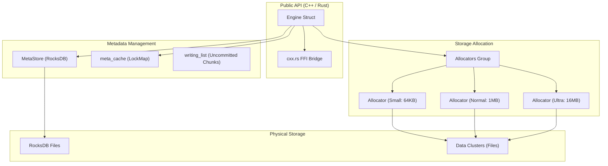
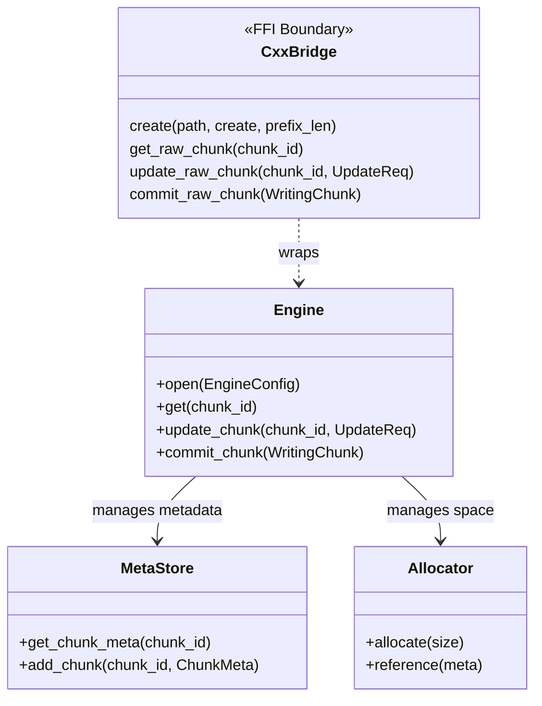

<!-- source: DeepWiki mcp.deepwiki.com · repo deepseek-ai/3FS · page 3.1 Chunk Engine · fetched 2026-10-30 -->

# Chunk Engine

Relevant source files

The following files were used as context for generating this wiki page:

- [src/storage/chunk_engine/src/alloc/allocator.rs](src/storage/chunk_engine/src/alloc/allocator.rs)
- [src/storage/chunk_engine/src/alloc/allocators.rs](src/storage/chunk_engine/src/alloc/allocators.rs)
- [src/storage/chunk_engine/src/alloc/chunk.rs](src/storage/chunk_engine/src/alloc/chunk.rs)
- [src/storage/chunk_engine/src/bin/bench.rs](src/storage/chunk_engine/src/bin/bench.rs)
- [src/storage/chunk_engine/src/core/engine.rs](src/storage/chunk_engine/src/core/engine.rs)
- [src/storage/chunk_engine/src/cxx.rs](src/storage/chunk_engine/src/cxx.rs)
- [src/storage/chunk_engine/src/meta/meta_store.rs](src/storage/chunk_engine/src/meta/meta_store.rs)
- [src/storage/chunk_engine/src/meta/rocksdb.rs](src/storage/chunk_engine/src/meta/rocksdb.rs)

## Purpose and Scope

The `chunk_engine` crate is a high-performance Rust component responsible for managing the lifecycle of data chunks within the 3FS distributed file system. It implements the core storage logic, handling chunk persistence, indexing, space allocation, and data integrity verification. It serves as the bridge between the high-level C++ storage service (via `cxx`) and the physical storage media, utilizing RocksDB for metadata and a custom allocator for raw data blocks.

**Sources:** [src/storage/chunk_engine/src/core/engine.rs:19-28](), [src/storage/chunk_engine/src/cxx.rs:10-23]()

---

## Architecture and Data Flow

The `chunk_engine` follows a disaggregated storage model where metadata (chunk IDs, versions, positions) is stored in RocksDB, while the actual data resides in pre-allocated "clusters" on disk.

### System Architecture

**Sources:** [src/storage/chunk_engine/src/core/engine.rs:19-28](), [src/storage/chunk_engine/src/alloc/allocators.rs:6-24](), [src/storage/chunk_engine/src/meta/meta_store.rs:13-16]()

### Write Data Flow

When a write request is initiated, the engine performs a "copy-on-write" (CoW) or a "safe-write" depending on the alignment and commit status.

1.  **Request:** `Engine::update_chunk` is called via the C++ `update_raw_chunk` wrapper [src/storage/chunk_engine/src/cxx.rs:143-170]().
2.  **Allocation:** The `Allocators` select an appropriate `Allocator` based on the requested size [src/storage/chunk_engine/src/alloc/allocators.rs:57-67]().
3.  **CoW:** If the chunk exists and is committed, `Chunk::copy_on_write` allocates a new position and copies existing data [src/storage/chunk_engine/src/alloc/chunk.rs:89-174]().
4.  **Checksum:** `crc32c` is used to verify or re-calculate data integrity [src/storage/chunk_engine/src/alloc/chunk.rs:157-158]().
5.  **Staging:** The new `WritingChunk` is added to the `writing_list` and tracked in the `MetaStore` as an uncommitted log [src/storage/chunk_engine/src/core/engine.rs:64-67]().
6.  **Commit:** `Engine::commit_chunk` persists the metadata to RocksDB and removes the uncommitted log [src/storage/chunk_engine/src/meta/meta_store.rs:188-190]().

**Sources:** [src/storage/chunk_engine/src/core/engine.rs:184-207](), [src/storage/chunk_engine/src/alloc/chunk.rs:89-174]()

---

## Key Components

### Engine
The central coordinator [src/storage/chunk_engine/src/core/engine.rs:19-28](). It manages the `MetaStore`, the `Allocators` for different chunk sizes, and a `LockMap`-based `meta_cache` for high-concurrency access to chunk metadata.

### MetaStore
An abstraction over RocksDB [src/storage/chunk_engine/src/meta/meta_store.rs:13-16](). It handles:
*   **Chunk Metadata:** Mapping `chunk_id` to `ChunkMeta` [src/storage/chunk_engine/src/meta/meta_store.rs:36-47]().
*   **Reverse Index:** Mapping physical `Position` back to `chunk_id` [src/storage/chunk_engine/src/meta/meta_store.rs:166-167]().
*   **Space Management:** Tracking `group_bits` to identify free/used slots within storage groups [src/storage/chunk_engine/src/meta/meta_store.rs:170-177]().

### Allocators
A collection of size-specific allocators [src/storage/chunk_engine/src/alloc/allocators.rs:6-9](). 3FS supports multiple chunk sizes ranging from `CHUNK_SIZE_SMALL` (64KB) to `CHUNK_SIZE_ULTRA` (16MB). Each size class has its own `Allocator` and set of physical `Clusters`.

### Chunk and WritingChunk
*   `Chunk`: Represents a persisted or allocated data block [src/storage/chunk_engine/src/alloc/chunk.rs:9-12]().
*   `WritingChunk`: A wrapper for a chunk that is currently being modified but not yet committed [src/storage/chunk_engine/src/cxx.rs:66-86]().

---

## Storage Allocation Strategy

The engine uses a tiered allocation system to handle different I/O patterns efficiently.

| Chunk Class | Size | Index in `Allocators` |
| :--- | :--- | :--- |
| Small | 64 KB | 0 |
| Normal | 1 MB | 4 |
| Ultra | 16 MB | 8 |

**Sources:** [src/storage/chunk_engine/src/alloc/allocators.rs:14-21](), [src/storage/chunk_engine/src/alloc/allocators.rs:57-67]()

### Background Workers
The engine spawns background workers to pre-allocate storage groups, ensuring that write requests do not block on disk allocation.
*   `start_allocate_workers(num)`: Spawns threads that call `allocators.allocate_groups` [src/storage/chunk_engine/src/core/engine.rs:140-158]().
*   `compact_groups(max_reserved)`: Identifies sparsely populated groups and moves chunks to compact storage [src/storage/chunk_engine/src/core/engine.rs:117-138]().

---

## Rust-C++ Interop (cxx)

The `chunk_engine` is exposed to the C++ Storage Service via the `cxx` crate. The file `src/cxx.rs` defines the FFI boundary.

### Mapping Code Entities

**Sources:** [src/storage/chunk_engine/src/cxx.rs:10-23](), [src/storage/chunk_engine/src/cxx.rs:93-108](), [src/storage/chunk_engine/src/cxx.rs:143-170]()

---

## Performance Characteristics

*   **Fine-grained Locking:** Uses `LockMap<Bytes, ChunkArc>` for the `meta_cache`, allowing concurrent access to different chunks without global lock contention [src/storage/chunk_engine/src/core/engine.rs:45]().
*   **Zero-Copy Path:** Utilizes `AlignedBuffer` and `pread`/`pwrite` for direct I/O, minimizing memory copies [src/storage/chunk_engine/src/alloc/chunk.rs:77-84]().
*   **Batching:** Supports `batch_get` and `commit_chunks` to reduce the overhead of metadata operations [src/storage/chunk_engine/src/cxx.rs:110-129](), [src/storage/chunk_engine/src/cxx.rs:185-196]().
*   **Atomic Allocation:** Pre-allocation of groups avoids synchronous file system metadata updates during the critical write path [src/storage/chunk_engine/src/core/engine.rs:81-97]().

### Benchmarking
A dedicated benchmark tool `src/bin/bench.rs` is provided to measure throughput and latency. It simulates high-concurrency write workloads and reports throughput and allocation stats [src/storage/chunk_engine/src/bin/bench.rs:39-80]().

**Sources:** [src/storage/chunk_engine/src/bin/bench.rs:1-90](), [src/storage/chunk_engine/src/core/engine.rs:171-182]()

---

