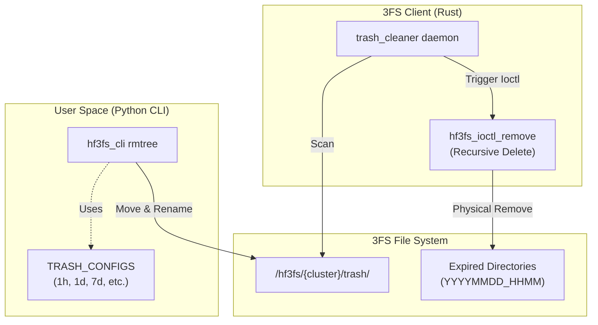
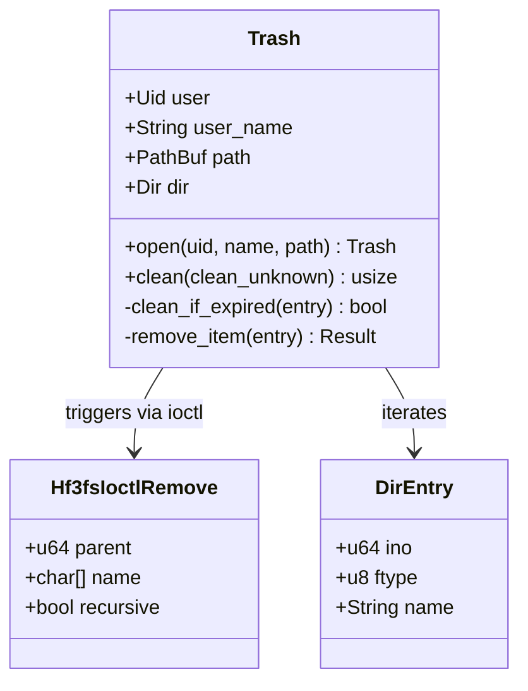

<!-- source: DeepWiki mcp.deepwiki.com · repo deepseek-ai/3FS · page 3.2 System Utilities · fetched 2026-10-30 -->

# System Utilities

<details>
<summary>Relevant source files</summary>

The following files were used as context for generating this wiki page:

- [hf3fs_utils/cli.py](hf3fs_utils/cli.py)
- [src/client/trash_cleaner/Cargo.toml](src/client/trash_cleaner/Cargo.toml)
- [src/client/trash_cleaner/src/main.rs](src/client/trash_cleaner/src/main.rs)
- [src/storage/chunk_engine/Cargo.toml](src/storage/chunk_engine/Cargo.toml)

</details>


## Purpose and Scope

The `trash_cleaner` utility is a specialized maintenance component of the Fire-Flyer File System (3FS) designed to manage the lifecycle of deleted data. It provides an automated mechanism for cleaning up the 3FS trash directory by identifying and removing expired items based on their deletion timestamps. This ensures efficient space reclamation while allowing a configurable window for data recovery.

The utility interacts directly with the 3FS FUSE interface via `ioctl` and provides a command-line interface (`hf3fs_cli`) for users to move directories to the trash with specific expiration policies.

---

## System Overview

The trash system consists of three main parts: the Python-based CLI for user interaction, the Rust-based `trash_cleaner` daemon for background cleanup, and the kernel/FUSE interface for physical deletion.



**Sources:** [hf3fs_utils/cli.py:104-125](), [src/client/trash_cleaner/src/main.rs:22-30](), [src/client/trash_cleaner/src/main.rs:62-68]()

---

## Command-Line Interface (`hf3fs_cli`)

Users interact with the trash system primarily through the `rmtree` command. Instead of immediate deletion, this command moves data to a hidden trash directory and appends a timestamp.

### Expiration Policies
The system supports predefined expiration windows defined in `TRASH_CONFIGS`. Users specify these via the `--expire` flag.

| Flag Value | Internal Mapping | Description |
|:---|:---|:---|
| `1h`, `1hour` | `1h` | Deleted after 1 hour |
| `1d`, `1day` | `1d` | Deleted after 1 day |
| `7d`, `7days` | `7d` | Deleted after 7 days |

**Sources:** [hf3fs_utils/cli.py:83-101](), [hf3fs_utils/cli.py:112-125]()

### Data Flow: Moving to Trash
When a user executes `hf3fs_cli rmtree <path> --expire 1d`:
1. The path is validated to ensure it resides on a 3FS mount [hf3fs_utils/cli.py:13-27]().
2. The utility calculates a target path within the cluster's `.trash` directory [hf3fs_utils/cli.py:132-134]().
3. The directory is renamed (moved) to the trash location, with the expiration timestamp encoded in the name [hf3fs_utils/cli.py:177]().

---

## Trash Cleaner Implementation

The `trash_cleaner` is a Rust utility that performs the actual reclamation. It is designed to run with specific user privileges to safely clean user-owned trash directories.

### Implementation Entities



**Sources:** [src/client/trash_cleaner/src/main.rs:22-27](), [src/client/trash_cleaner/src/main.rs:42-46](), [src/client/trash_cleaner/src/main.rs:62-68]()

### Key Functions and Logic

#### 1. Directory Validation
The `Trash::open` function ensures the utility is operating on a valid 3FS filesystem by checking the magic number `0x8f3f5fff` via `ioctl_get_magic` [src/client/trash_cleaner/src/main.rs:15-16](), [src/client/trash_cleaner/src/main.rs:105-120](). It also verifies that the process `euid` matches the owner of the trash directory [src/client/trash_cleaner/src/main.rs:93-103]().

#### 2. Time-Based Filtering
The cleaner parses directory names using the format `%Y%m%d_%H%M` [src/client/trash_cleaner/src/main.rs:32-39]().
- **Logic**: If the current system time is past the timestamp encoded in the directory name, the item is marked as expired.
- **Implementation**: `clean_if_expired` calls `check_item` to validate the format and then invokes the removal [src/client/trash_cleaner/src/main.rs:175-216]().

#### 3. Recursive Removal via Ioctl
To efficiently delete large directory trees, `trash_cleaner` does not perform standard recursive unlinking. Instead, it uses a custom 3FS `ioctl` called `hf3fs_ioctl_remove` [src/client/trash_cleaner/src/main.rs:30]().

```rust
// Defined in src/client/trash_cleaner/src/main.rs:22-27
#[repr(C)]
struct Hf3fsIoctlRemove {
    parent: u64,                     // Inode of the trash directory
    name: [libc::c_char; NAME_MAX + 1], // Name of the expired entry
    recursive: bool,                 // Always true for rmtree
}
```

This `ioctl` offloads the recursive deletion logic to the 3FS metadata and storage services, significantly reducing client-side I/O overhead.

---

## Safety and Interaction Mechanisms

### Permissions and Identity
The utility strictly enforces user isolation. It uses `nix::unistd::seteuid` and `setegid` to drop or switch privileges, ensuring it can only delete files the target user owns [src/client/trash_cleaner/src/main.rs:4]().

### 3FS Magic Number Verification
Before performing any deletions, the utility issues an `ioctl` to verify the filesystem type:
- **Magic Number**: `0x8f3f5fff` [src/client/trash_cleaner/src/main.rs:15]().
- **Action**: If the magic number does not match, the process calls `abort()` to prevent accidental data loss on non-3FS filesystems [src/client/trash_cleaner/src/main.rs:111-119]().

### Logging and Observability
The utility uses the `tracing` ecosystem for structured logging:
- **Trace**: Detailed scanning of trash entries [src/client/trash_cleaner/src/main.rs:155-160]().
- **Info**: Successful removal of expired items [src/client/trash_cleaner/src/main.rs:190-194]().
- **Error**: Failures in `ioctl` calls or permission issues [src/client/trash_cleaner/src/main.rs:197-201]().

**Sources:** [src/client/trash_cleaner/src/main.rs:12](), [src/client/trash_cleaner/Cargo.toml:12-14]()

---

## Dependencies

The `trash_cleaner` crate relies on several low-level Rust libraries for system interaction:

| Dependency | Purpose |
|:---|:---|
| `nix` | Safe wrappers for `ioctl`, `stat`, and directory operations [src/client/trash_cleaner/Cargo.toml:17]() |
| `chrono` | Time parsing for expiration logic [src/client/trash_cleaner/Cargo.toml:18]() |
| `structopt` | CLI argument parsing [src/client/trash_cleaner/Cargo.toml:21]() |
| `libc` | Raw C types for `ioctl` structures [src/client/trash_cleaner/Cargo.toml:15]() |

**Sources:** [src/client/trash_cleaner/Cargo.toml:11-21]()

---

