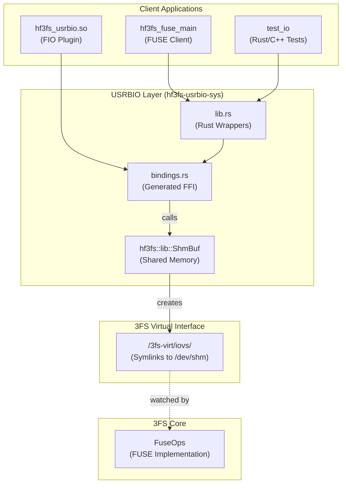
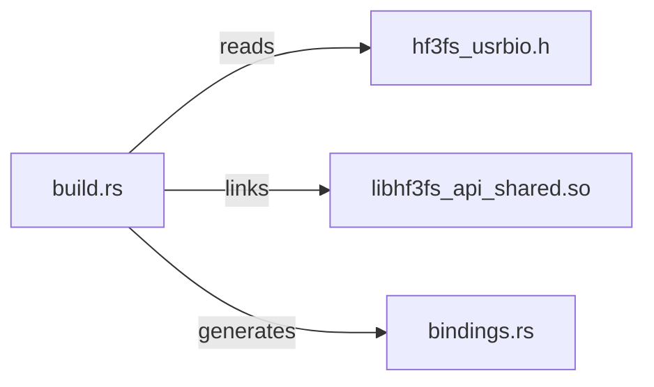
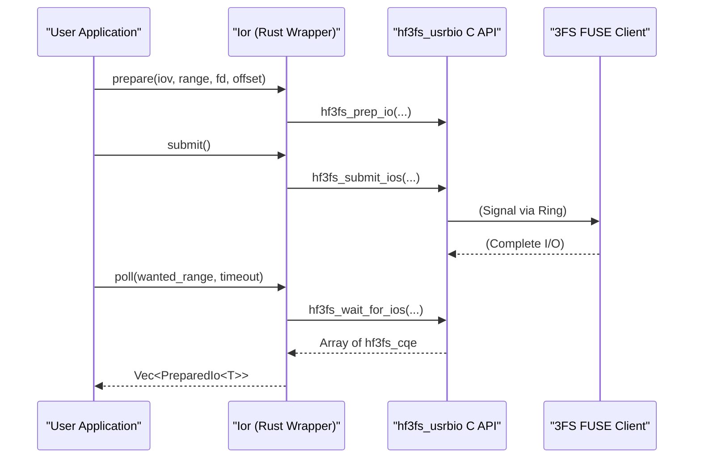

<!-- source: DeepWiki mcp.deepwiki.com · repo deepseek-ai/3FS · page 3.3 User I/O Interface (USRBIO) · fetched 2026-10-30 -->

# User I/O Interface (USRBIO)

Relevant source files

The following files were used as context for generating this wiki page:

- [.github/workflows/build.yml](.github/workflows/build.yml)
- [src/lib/api/CMakeLists.txt](src/lib/api/CMakeLists.txt)
- [src/lib/api/UsrbIo.cc](src/lib/api/UsrbIo.cc)
- [src/lib/api/hf3fs_usrbio.h](src/lib/api/hf3fs_usrbio.h)
- [src/lib/rs/hf3fs-usrbio-sys/Cargo.toml](src/lib/rs/hf3fs-usrbio-sys/Cargo.toml)
- [src/lib/rs/hf3fs-usrbio-sys/README](src/lib/rs/hf3fs-usrbio-sys/README)
- [src/lib/rs/hf3fs-usrbio-sys/build.rs](src/lib/rs/hf3fs-usrbio-sys/build.rs)
- [src/lib/rs/hf3fs-usrbio-sys/src/lib.rs](src/lib/rs/hf3fs-usrbio-sys/src/lib.rs)

The User I/O Interface (USRBIO) provides FFI (Foreign Function Interface) bindings for user-space I/O operations in 3FS. Implemented as the `hf3fs-usrbio-sys` Rust crate, it serves as the primary interface layer between client applications and 3FS core services, enabling C-compatible access to distributed storage operations through shared memory communication.

This document covers the FFI binding architecture, shared memory IPC mechanisms, and UUID generation for resource identification. For information about client-side tooling that uses USRBIO, see the FIO USRBIO Plugin page. For details on the storage backend that USRBIO communicates with, see Chunk Engine.

**Sources:** [src/lib/rs/hf3fs-usrbio-sys/Cargo.toml:1-12](), [src/lib/rs/hf3fs-usrbio-sys/README:1-2]()

---

## Overview

### Purpose and Scope

The `hf3fs-usrbio-sys` crate provides low-level FFI bindings that enable C/C++ applications to perform I/O operations against 3FS storage. The crate uses `bindgen` to automatically generate Rust-to-C++ bindings from the `hf3fs_usrbio.h` header, implements shared memory for high-performance IPC, and provides UUID generation for resource identification.

Key responsibilities:
- Generate FFI bindings from C++ headers using `bindgen` [src/lib/rs/hf3fs-usrbio-sys/build.rs:9-14]()
- Manage shared memory regions (`hf3fs_iov`) for zero-copy data transfer [src/lib/api/UsrbIo.cc:109-137]()
- Register file descriptors for user-space I/O [src/lib/rs/hf3fs-usrbio-sys/src/lib.rs:212-222]()
- Expose a C-compatible API surface for client applications [src/lib/api/hf3fs_usrbio.h:1-174]()

**Sources:** [src/lib/rs/hf3fs-usrbio-sys/build.rs:1-20](), [src/lib/api/hf3fs_usrbio.h:1-174]()

### Position in System Architecture

**Diagram: USRBIO Component Architecture**

The USRBIO layer sits between client applications and core 3FS services, providing a stable C-compatible interface while internally using Rust for memory safety and C++ for performance-critical shared memory management.

**Sources:** [src/lib/rs/hf3fs-usrbio-sys/src/lib.rs:1-208](), [src/lib/api/UsrbIo.cc:147-159](), [src/lib/api/hf3fs_usrbio.h:32-49]()

---

## Core Data Structures

### I/O Vector (hf3fs_iov)

The `hf3fs_iov` structure represents a memory region used for data transfer. It is backed by a shared memory segment created in `/dev/shm` and registered with the 3FS client via a symlink in the `3fs-virt/iovs` directory.

| Field | Type | Description |
|-------|------|-------------|
| `base` | `uint8_t*` | Virtual address of the buffer in the user process |
| `iovh` | `void*` | Internal handle to `hf3fs::lib::ShmBuf` |
| `id` | `char[16]` | 128-bit unique identifier for the buffer |
| `mount_point`| `char[256]`| Path to the 3FS mount point |

**Sources:** [src/lib/api/hf3fs_usrbio.h:18-27](), [src/lib/api/UsrbIo.cc:164-172]()

### I/O Ring (hf3fs_ior)

The `hf3fs_ior` structure manages a ring of I/O operations, similar to `io_uring`. It facilitates asynchronous submission and completion of I/O requests.

| Field | Type | Description |
|-------|------|-------------|
| `iov` | `hf3fs_iov` | The underlying buffer ring |
| `for_read` | `bool` | Direction of the ring (Read or Write) |
| `io_depth` | `int` | Batch size for the I/O worker |
| `flags` | `uint64_t` | Control flags (e.g., `HF3FS_IOR_FORBID_READ_HOLES`) |

**Sources:** [src/lib/api/hf3fs_usrbio.h:32-49](), [src/lib/rs/hf3fs-usrbio-sys/src/lib.rs:70-72]()

---

## FFI Binding Generation

### Bindgen Pipeline

The crate uses a `build.rs` script to invoke `bindgen` during the compilation phase. It parses `hf3fs_usrbio.h` and generates Rust equivalents for C structs and functions.

**Diagram: FFI Binding Generation Pipeline**

**Sources:** [src/lib/rs/hf3fs-usrbio-sys/build.rs:4-20](), [src/lib/api/CMakeLists.txt:4-9]()

### Linking Requirements
The Rust crate requires the C++ shared library `hf3fs_api_shared`. The CMake build system creates a symlink from the build directory to the Rust crate's `lib` directory to satisfy this requirement.

**Sources:** [src/lib/api/CMakeLists.txt:4-9](), [src/lib/rs/hf3fs-usrbio-sys/README:1-2]()

---

## Shared Memory and Virtual Filesystem

The USRBIO interface communicates with the 3FS FUSE client through a "virtual" directory interface. When an I/O vector is created, it establishes a link between the process's shared memory and the 3FS filesystem.

### Registration Flow

1.  **UUID Generation**: A random UUID is generated for the buffer [src/lib/api/UsrbIo.cc:129]().
2.  **SHM Creation**: A shared memory segment is created at `/dev/shm/hf3fs-iov-<UUID>` [src/lib/api/UsrbIo.cc:129-133]().
3.  **Symlink Registration**: A symlink is created at `<mount_point>/3fs-virt/iovs/<UUID>.<params>` pointing to the SHM file [src/lib/api/UsrbIo.cc:147-155]().
4.  **FUSE Detection**: The 3FS FUSE client detects the new entry in its virtual directory and maps the shared memory to its own address space.

**Sources:** [src/lib/api/UsrbIo.cc:109-183](), [src/lib/rs/hf3fs-usrbio-sys/src/lib.rs:37-45]()

---

## I/O Operation Lifecycle

### Submission and Polling

The `Ior` (I/O Ring) implementation in Rust provides a high-level wrapper around the C API for preparing and reaping I/O.

**Diagram: I/O Submission and Completion Flow**

**Sources:** [src/lib/rs/hf3fs-usrbio-sys/src/lib.rs:117-188](), [src/lib/api/hf3fs_usrbio.h:152-167]()

### Key Functions

| Function | Source | Description |
|----------|--------|-------------|
| `hf3fs_prep_io` | [src/lib/api/hf3fs_usrbio.h:152-159]() | Places an I/O request into the ring buffer. Not thread-safe. |
| `hf3fs_submit_ios` | [src/lib/api/hf3fs_usrbio.h:161]() | Hints to the storage worker to process prepared requests. |
| `hf3fs_wait_for_ios`| [src/lib/api/hf3fs_usrbio.h:163-167]()| Blocks until the specified number of completions are available. |
| `hf3fs_reg_fd` | [src/lib/api/hf3fs_usrbio.h:141]() | Registers a file descriptor for use with USRBIO. |

---

## Error Handling and Safety

The USRBIO interface uses standard POSIX error codes (returned as negative integers).

- **Thread Safety**: `hf3fs_prep_io` is explicitly documented as **NOT** thread-safe. Callers must synchronize access to a single `hf3fs_ior` across threads [src/lib/api/hf3fs_usrbio.h:148-151]().
- **Memory Safety**: The Rust wrapper `Iov` and `Ior` implement `Send` and `Sync` (where appropriate) and handle cleanup via the `Drop` trait, which calls `hf3fs_iordestroy` and `hf3fs_dereg_fd` [src/lib/rs/hf3fs-usrbio-sys/src/lib.rs:33-34](), [src/lib/rs/hf3fs-usrbio-sys/src/lib.rs:191-197](), [src/lib/rs/hf3fs-usrbio-sys/src/lib.rs:224-230]().

**Sources:** [src/lib/rs/hf3fs-usrbio-sys/src/lib.rs:1-240](), [src/lib/api/hf3fs_usrbio.h:148-151]()

---

