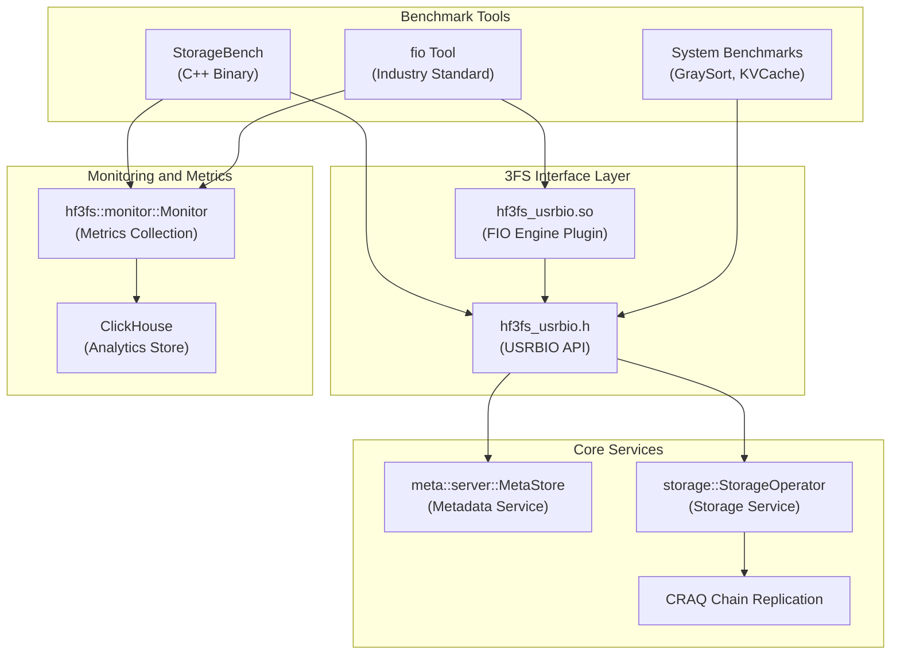
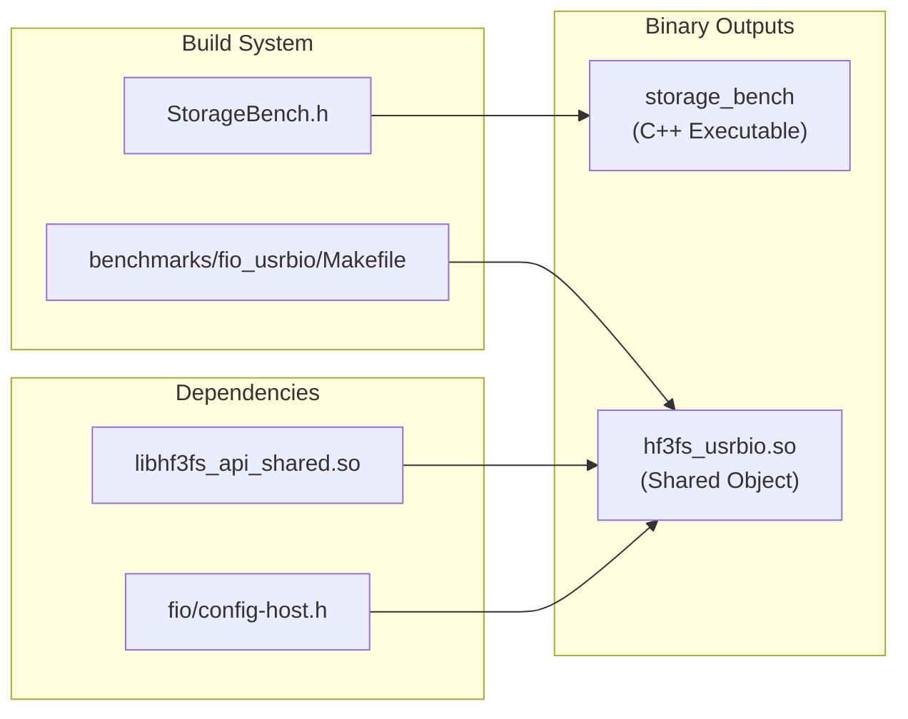

<!-- source: DeepWiki mcp.deepwiki.com · repo deepseek-ai/3FS · page 4 Performance and Benchmarking · fetched 2026-10-30 -->

# Performance and Benchmarking

Relevant source files

The following files were used as context for generating this wiki page:

- [benchmarks/fio_usrbio/Makefile](benchmarks/fio_usrbio/Makefile)
- [benchmarks/fio_usrbio/README.md](benchmarks/fio_usrbio/README.md)
- [benchmarks/fio_usrbio/hf3fs_usrbio.cpp](benchmarks/fio_usrbio/hf3fs_usrbio.cpp)
- [benchmarks/storage_bench/StorageBench.h](benchmarks/storage_bench/StorageBench.h)
- [src/common/utils/FileUtils.cc](src/common/utils/FileUtils.cc)
- [tests/meta/TestCommon.cc](tests/meta/TestCommon.cc)
- [tests/meta/store/ops/TestResolve.cc](tests/meta/store/ops/TestResolve.cc)

## Purpose and Scope

This document provides an overview of the performance validation and benchmarking infrastructure for 3FS. It describes the available benchmarking tools, their architecture, and the monitoring systems used to measure and track performance metrics. For detailed documentation of specific components, see:

- [Storage Benchmarking Framework](#4.1) — `storage_bench` tool implementation and configuration
- [FIO USRBIO Plugin](#4.2) — Industry-standard FIO integration via custom engine
- [Benchmark Configuration](#4.3) — Running benchmarks and interpreting results

For information about unit testing infrastructure, see [Build System and Development](#2).

## Benchmarking Infrastructure Overview

3FS provides a multi-layered benchmarking infrastructure designed to validate performance at different levels of the system stack, from low-level storage operations to complete workload simulations.

### Architecture

The following diagram illustrates how benchmarking tools interact with the 3FS service stack and monitoring infrastructure.

**3FS Benchmarking Stack Architecture**

**Sources:** [benchmarks/fio_usrbio/hf3fs_usrbio.cpp:9-25](), [benchmarks/storage_bench/StorageBench.h:26-67](), [benchmarks/fio_usrbio/README.md:1-23]()

The benchmarking infrastructure consists of three primary tool categories:

1.  **StorageBench**: A specialized C++ class `hf3fs::storage::benchmark::StorageBench` [benchmarks/storage_bench/StorageBench.h:26-26]() for targeted testing of the storage client and network layers.
2.  **FIO Integration**: A custom shared library `hf3fs_usrbio.so` [benchmarks/fio_usrbio/Makefile:6-6]() that implements the FIO external engine interface.
3.  **System Benchmarks**: High-level workloads like GraySort and KVCache that stress the end-to-end file system.

### Build and Binary Relationships

The benchmarking tools are integrated into the main build system but maintained as distinct components.

**Benchmark Component Relationships**

**Sources:** [benchmarks/fio_usrbio/Makefile:1-12](), [benchmarks/fio_usrbio/README.md:10-19]()

The `fio_usrbio` plugin specifically requires the `libhf3fs_api_shared.so` library [benchmarks/fio_usrbio/Makefile:12-12]() and FIO source headers [benchmarks/fio_usrbio/README.md:12-12]() to compile.

## Benchmark Categories

### 1. Storage Benchmarks

The `StorageBench` tool provides comprehensive testing of 3FS storage operations with extensive configuration options defined in the `StorageBench::Options` struct [benchmarks/storage_bench/StorageBench.h:28-67]():

*   **Network vs. Storage**: Can isolate testing to network only (`benchmarkNetwork`) or include the full storage stack (`benchmarkStorage`) [benchmarks/storage_bench/StorageBench.h:40-41]().
*   **Error Injection**: Supports injecting random server-side (`injectRandomServerError`) or client-side errors to test system resilience [benchmarks/storage_bench/StorageBench.h:43-44]().
*   **Data Integrity**: Options for verifying read data (`verifyReadData`) and checksums for both reads and writes [benchmarks/storage_bench/StorageBench.h:46-48]().
*   **Concurrency**: Uses a `folly::CPUThreadPoolExecutor` [benchmarks/storage_bench/StorageBench.h:81-81]() to manage multiple coroutines [benchmarks/storage_bench/StorageBench.h:36-36]() for high-concurrency testing.

### 2. FIO Integration

FIO (Flexible I/O Tester) is the industry-standard benchmarking tool. 3FS provides a custom FIO engine plugin `hf3fs_usrbio.so` [benchmarks/fio_usrbio/Makefile:6-6]() that enables FIO workloads to run directly against 3FS via the USRBIO interface.

Key implementation details include:
*   **Engine Options**: Custom FIO options like `mountpoint`, `ior_depth`, and `ior_timeout` [benchmarks/fio_usrbio/hf3fs_usrbio.cpp:27-61]().
*   **I/O Lifecycle**: Implements `hf3fs_usrbio_queue` [benchmarks/fio_usrbio/hf3fs_usrbio.cpp:122-122]() for queuing requests and `hf3fs_usrbio_commit` [benchmarks/fio_usrbio/hf3fs_usrbio.cpp:143-143]() for batch submission using `hf3fs_submit_ios` [benchmarks/fio_usrbio/hf3fs_usrbio.cpp:166-166]().
*   **Standard FIO Compatibility**: To use the plugin, the `ioengine` argument in FIO is set to `external:hf3fs_usrbio.so` [benchmarks/fio_usrbio/README.md:23-23]().

### 3. System Benchmarks

3FS has been validated against several high-scale real-world workloads:

*   **GraySort**: A sorting benchmark involving a partitioning phase and an in-partition sorting phase, achieving throughputs of approximately 3.66 TiB/min on 25 storage nodes.
*   **Read Stress Test**: Demonstrated aggregate read throughput of 6.6 TiB/s on a cluster of 180 storage nodes.
*   **KVCache Benchmark**: Evaluated performance for LLM inference workloads, reaching 40 GiB/s read throughput.

## Performance Monitoring System

The benchmarking infrastructure utilizes the internal monitoring system to record and analyze performance data.

### Metrics Collection
The system uses specialized recorders to capture data during benchmark runs:
*   **Latency Distribution**: `StorageBench` uses `folly::TDigest` [benchmarks/storage_bench/StorageBench.h:79-80]() to track write and read latency distributions across coroutines.
*   **Throughput Tracking**: Atomic counters `numWriteBytes_` and `numReadBytes_` [benchmarks/storage_bench/StorageBench.h:82-83]() track total data transferred.
*   **Statistics Output**: Results can be exported to a CSV file defined by `statsFilePath` [benchmarks/storage_bench/StorageBench.h:52-52]().

### Storage and Analysis
Metrics are typically persisted to a ClickHouse database for long-term analysis and visualization. This allows engineers to compare performance across different code versions and hardware configurations.

## Usage Summary

| Tool | Primary Use Case | Key Files |
| :--- | :--- | :--- |
| **StorageBench** | Low-level storage/network performance and error injection | `StorageBench.h` |
| **FIO Plugin** | Industry-standard block I/O benchmarking | `hf3fs_usrbio.cpp`, `Makefile` |
| **System Benchmarks** | End-to-end file system validation (GraySort, KVCache) | `README.md` |

For detailed instructions on running these benchmarks, refer to the child pages: [Storage Benchmarking Framework](#4.1), [FIO USRBIO Plugin](#4.2), and [Benchmark Configuration](#4.3).

---

