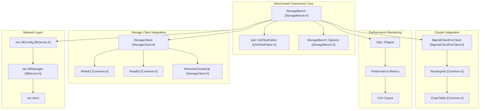
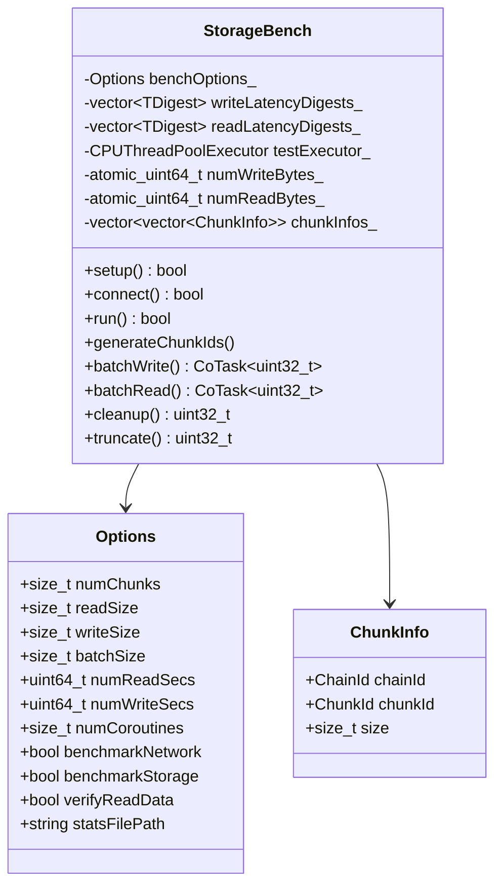
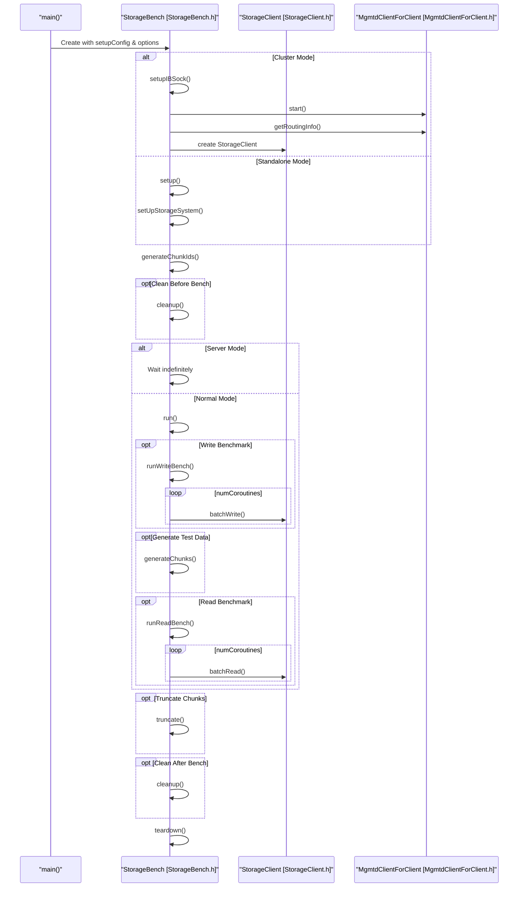
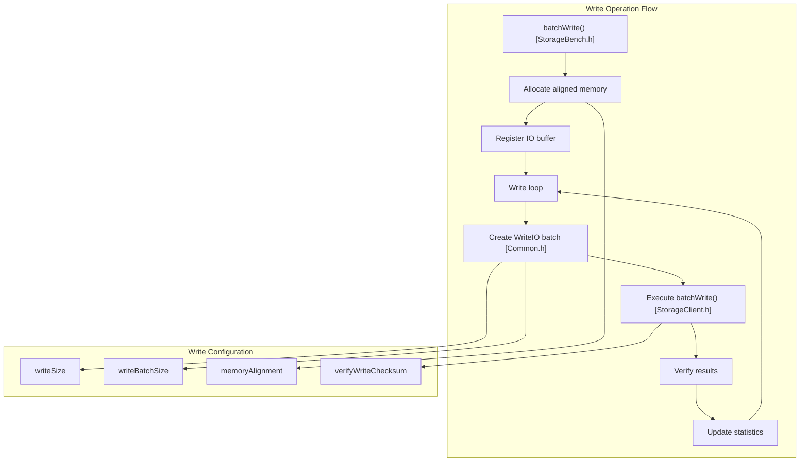
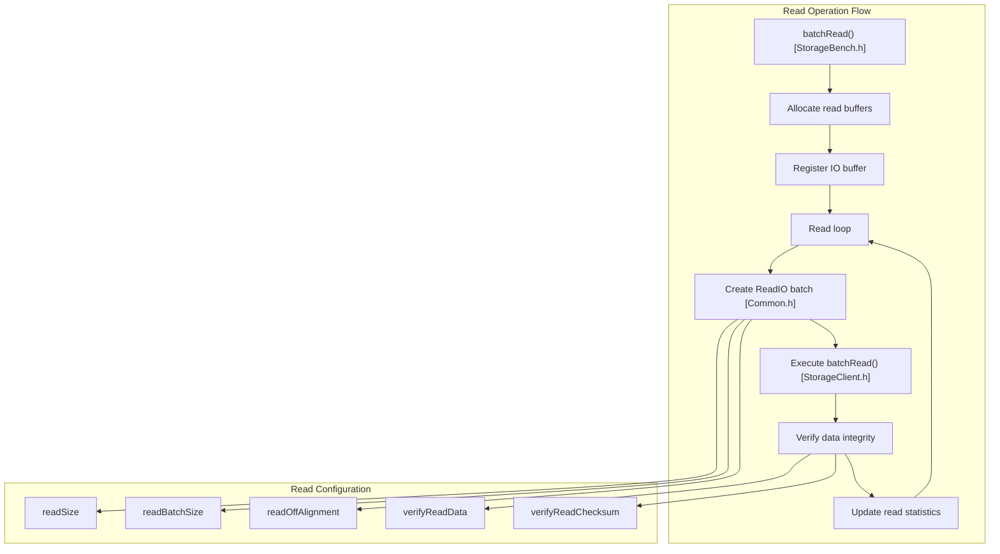
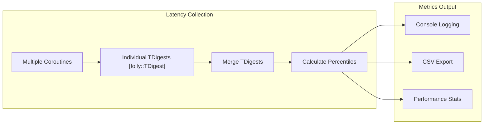
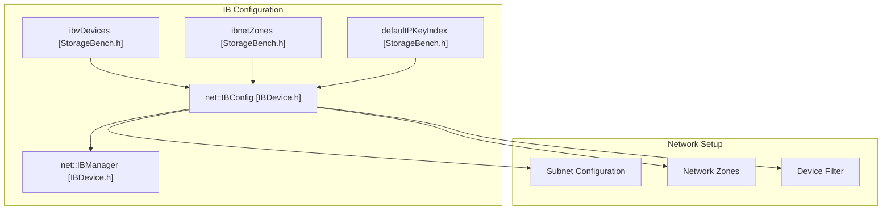

<!-- source: DeepWiki mcp.deepwiki.com · repo deepseek-ai/3FS · page 4.1 Storage Benchmarking Framework · fetched 2026-10-30 -->

# Storage Benchmarking Framework

<details>
<summary>Relevant source files</summary>

The following files were used as context for generating this wiki page:

- [benchmarks/storage_bench/StorageBench.cc](benchmarks/storage_bench/StorageBench.cc)
- [benchmarks/storage_bench/StorageBench.h](benchmarks/storage_bench/StorageBench.h)
- [src/client/storage/UpdateChannelAllocator.cc](src/client/storage/UpdateChannelAllocator.cc)
- [src/common/utils/FileUtils.cc](src/common/utils/FileUtils.cc)
- [src/fuse/UserConfig.cc](src/fuse/UserConfig.cc)
- [tests/analytics/TestStructuredTraceLog.cc](tests/analytics/TestStructuredTraceLog.cc)
- [tests/lib/UnitTestFabric.cc](tests/lib/UnitTestFabric.cc)
- [tests/meta/TestCommon.cc](tests/meta/TestCommon.cc)
- [tests/meta/store/ops/TestResolve.cc](tests/meta/store/ops/TestResolve.cc)

</details>


This document covers the C++ benchmarking framework for testing 3FS storage performance, measuring throughput, latency, and I/O operations across different workload patterns. The framework provides comprehensive testing capabilities for both storage and network subsystems.

For information about FIO-based benchmarking with the USRBIO plugin, see [FIO USRBIO Plugin](#4.2). For general benchmark configuration and setup, see [Benchmark Configuration](#4.3).

## Overview and Architecture

The Storage Benchmarking Framework is built around the `StorageBench` class, which provides a comprehensive testing environment for evaluating 3FS storage performance. The framework supports multiple operation modes including standalone testing, client-server configurations, and cluster-wide benchmarking through mgmtd integration.

### System Architecture



Sources: [benchmarks/storage_bench/StorageBench.h:26-106](), [benchmarks/storage_bench/StorageBench.cc:73-266](), [tests/lib/UnitTestFabric.cc:13-138]()

### Command-Line Configuration System

The framework provides extensive configuration through command-line flags, organized into several categories:

| Category | Key Flags | Purpose |
|----------|-----------|---------|
| **Operation Mode** | `benchmarkNetwork`, `benchmarkStorage`, `serverMode`, `clientMode`, `clusterMode` | Controls test execution mode |
| **Storage Config** | `chunkSizeKB`, `numChunks`, `numChains`, `numReplicas`, `metaStoreType` | Storage system parameters |
| **I/O Parameters** | `readSize`, `writeSize`, `batchSize`, `memoryAlignment`, `readOffAlignment` | I/O operation configuration |
| **Concurrency** | `numCoroutines`, `numTestThreads`, `numReadSecs`, `numWriteSecs` | Concurrency and duration control |
| **Error Handling** | `ignoreIOError`, `injectRandomServerError`, `retryPermanentError` | Error injection and handling |
| **Data Verification** | `verifyReadData`, `verifyReadChecksum`, `verifyWriteChecksum` | Data integrity validation |

Sources: [benchmarks/storage_bench/StorageBench.cc:8-71]()

## Core Components

### StorageBench Class Structure



Sources: [benchmarks/storage_bench/StorageBench.h:26-106]()

### Benchmark Execution Flow



Sources: [benchmarks/storage_bench/StorageBench.cc:222-263](), [benchmarks/storage_bench/StorageBench.h:891-899](), [tests/lib/UnitTestFabric.cc:140-175]()

## Benchmark Operations

### Write Operations

The framework implements batched write operations through the `batchWrite` coroutine. It utilizes the `StorageClient` to issue `WriteIO` requests to the storage service.



Key aspects of write operations:
- **Memory Alignment**: Control via `memoryAlignment` flag [benchmarks/storage_bench/StorageBench.h:61]().
- **Traffic Control**: Batch size optimization based on traffic control settings [benchmarks/storage_bench/StorageBench.h:480-495]().
- **Integrity**: Checksum verification when `verifyWriteChecksum` is enabled [benchmarks/storage_bench/StorageBench.h:48]().
- **Resilience**: Error injection capabilities via `injectRandomServerError` and `injectRandomClientError` [benchmarks/storage_bench/StorageBench.h:43-44]().

Sources: [benchmarks/storage_bench/StorageBench.h:454-561]()

### Read Operations

Read operations follow a similar batched approach with additional data verification using `ReadIO`.



Read operations include:
- **Access Patterns**: Random chunk selection for realistic patterns [benchmarks/storage_bench/StorageBench.h:589-600]().
- **Alignment**: Configurable offset alignment via `readOffAlignment` [benchmarks/storage_bench/StorageBench.h:62]().
- **Validation**: Byte-level data verification when `verifyReadData` is enabled [benchmarks/storage_bench/StorageBench.h:46]().
- **Checksum**: Validation support for end-to-end integrity [benchmarks/storage_bench/StorageBench.h:47]().

Sources: [benchmarks/storage_bench/StorageBench.h:563-673]()

## Performance Monitoring and Metrics

### Latency Measurement

The framework uses `folly::TDigest` for accurate latency distribution tracking [benchmarks/storage_bench/StorageBench.h:79-80]().



The system tracks:
- Per-coroutine latency distributions.
- Min, max, average latencies.
- Percentile distributions (10%, 20%, 50%, 90%, 95%, 99%) [benchmarks/storage_bench/StorageBench.h:425-442]().
- Throughput calculations (GiB/s, IOPS, QPS).

Sources: [benchmarks/storage_bench/StorageBench.h:381-452]()

### Statistics Export

Performance data is exported to CSV format defined by `statsFilePath` [benchmarks/storage_bench/StorageBench.h:52]().

| Metric | Description |
|--------|-------------|
| `QPS` | Queries per second (batch-level) |
| `IOPS` | I/O operations per second |
| `bandwidth (MB/s)` | Data transfer rate |
| `latency P50/P75/P90/P95/P99` | Latency percentiles in microseconds |
| `effective batch size` | Batch size normalized by replica count |

Sources: [benchmarks/storage_bench/StorageBench.h:407-451]()

## Network and Cluster Integration

### InfiniBand Configuration

The framework includes comprehensive InfiniBand networking support via `IBDevice` and `IBConfig`.



Key networking features:
- Multi-device InfiniBand support via `ibvDevices` flag [benchmarks/storage_bench/StorageBench.h:53]().
- Network zone configuration through `ibnetZones` [benchmarks/storage_bench/StorageBench.h:54]().
- Partition key management with `defaultPKeyIndex` [benchmarks/storage_bench/StorageBench.h:63]().
- Automatic device discovery and filtering in `setupIBSock()` [benchmarks/storage_bench/StorageBench.h:310-352]().

### Cluster Mode Integration

When operating in cluster mode, the framework integrates with `MgmtdClientForClient` to fetch `RoutingInfo` [benchmarks/storage_bench/StorageBench.h:167-169]().

```mermaid
sequenceDiagram
    participant SB as "StorageBench"
    participant MGMTD as "MgmtdClientForClient [MgmtdClientForClient.h]"
    participant ROUTING as "RoutingInfo [Common.h]"
    
    SB->>MGMTD: start() with clusterId
    SB->>MGMTD: setClientSessionPayload()
    
    loop Retry up to 15 times
        SB->>MGMTD: getRoutingInfo()
        MGMTD->>ROUTING: Fetch chain tables
        
        alt Chain table found
            ROUTING->>SB: Return chain information
            break
        else Empty routing info
            SB->>SB: Wait 1 second, retry
        end
    end
    
    SB->>SB: Filter chains by storageNodeIds/chainIds
    SB->>SB: Create StorageClient with routing
```

The cluster integration supports:
- Automatic routing table discovery via `chainTableId` and `chainTableVersion` [benchmarks/storage_bench/StorageBench.h:57-58]().
- Chain filtering by storage node IDs or specific chain IDs [benchmarks/storage_bench/StorageBench.h:59-60]().
- Retry logic for routing information retrieval [benchmarks/storage_bench/StorageBench.h:207-224]().
- Client session management with hostname identification [benchmarks/storage_bench/StorageBench.h:183-195]().

Sources: [benchmarks/storage_bench/StorageBench.h:142-308]()

## Build Integration

The framework is integrated into the 3FS build system through CMake.

```cmake
target_add_bin(storage_bench "StorageBench.cc" test-fabric-lib storage-client storage memory-common follybenchmark gmock fdb mgmtd)
```

Dependencies include:
- `test-fabric-lib`: Infrastructure for cluster simulation [tests/lib/UnitTestFabric.cc:1]().
- `storage-client`: Core client logic for I/O operations [benchmarks/storage_bench/StorageBench.h:24]().
- `fdb` and `mgmtd`: Required for metadata and cluster management integration.

Sources: [benchmarks/storage_bench/CMakeLists.txt:1-2]()

---

