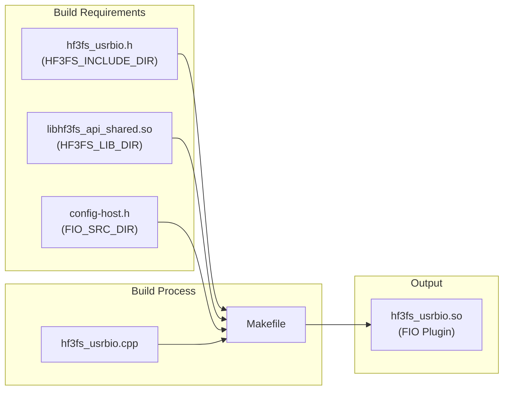
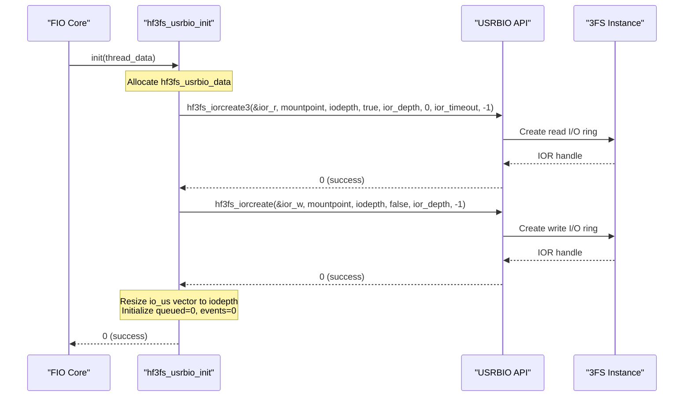
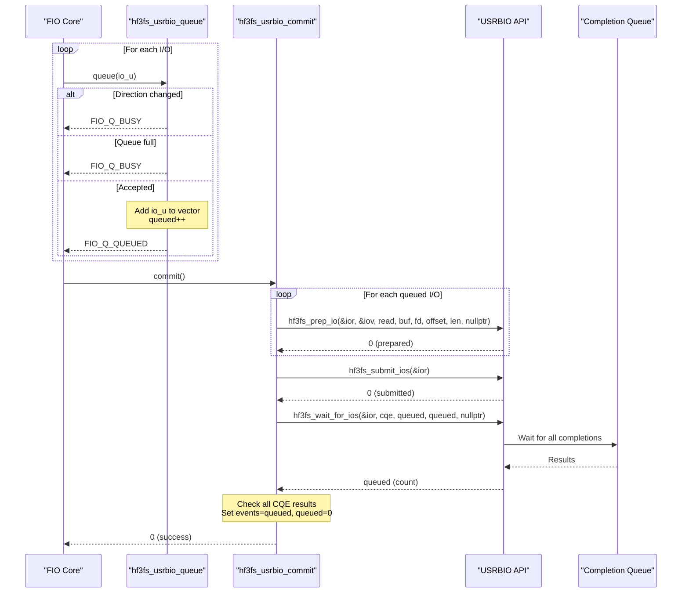
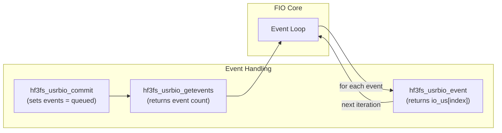
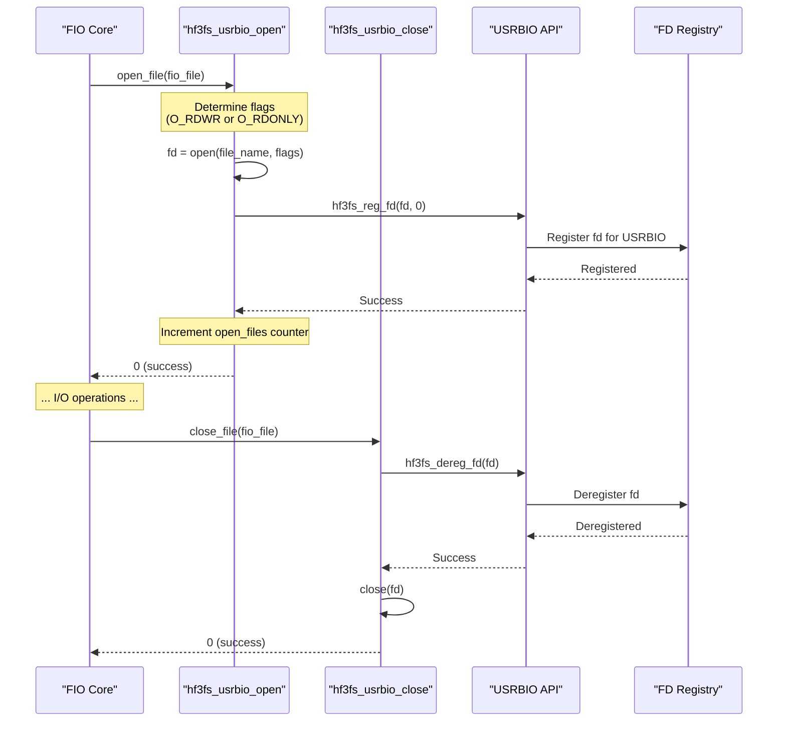
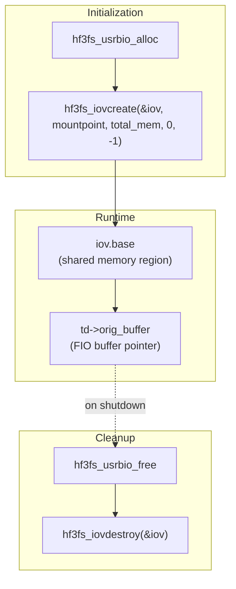

<!-- source: DeepWiki mcp.deepwiki.com · repo deepseek-ai/3FS · page 4.2 FIO USRBIO Plugin · fetched 2026-10-30 -->

# FIO USRBIO Plugin

<details>
<summary>Relevant source files</summary>

The following files were used as context for generating this wiki page:

- [benchmarks/fio_usrbio/Makefile](benchmarks/fio_usrbio/Makefile)
- [benchmarks/fio_usrbio/README.md](benchmarks/fio_usrbio/README.md)
- [benchmarks/fio_usrbio/hf3fs_usrbio.cpp](benchmarks/fio_usrbio/hf3fs_usrbio.cpp)

</details>


## Purpose and Scope

This document describes the `hf3fs_usrbio.so` FIO plugin, which enables benchmarking of 3FS using the industry-standard [FIO (Flexible I/O Tester)](https://github.com/axboe/fio) tool. The plugin implements a custom FIO I/O engine that interfaces with 3FS's USRBIO API, allowing FIO workloads to execute against 3FS storage with support for batched operations and asynchronous I/O.

For general storage benchmarking framework documentation, see [Storage Benchmarking Framework](#4.1). For benchmark configuration and results, see [Benchmark Configuration](#4.3). For details on the USRBIO API itself, see [User I/O Interface (USRBIO)](#3.3).

**Sources:** [benchmarks/fio_usrbio/README.md:1-40](), [benchmarks/fio_usrbio/hf3fs_usrbio.cpp:1-287]()

---

## Overview

The FIO USRBIO plugin is an external FIO I/O engine implemented in C++ that bridges FIO's benchmarking capabilities with 3FS's user-space I/O interface. The plugin enables users to run standard FIO test configurations (`.fio` files) against 3FS filesystems without modifying existing FIO workloads.

### Key Features

| Feature | Description |
|---------|-------------|
| **Asynchronous I/O** | Supports batched I/O operations with configurable queue depth |
| **Multiple Mount Points** | Can target specific 3FS instances via `mountpoint` parameter |
| **Shared Memory I/O** | Uses 3FS IOV (I/O vector) for zero-copy data transfers |
| **Separate Read/Write Queues** | Maintains independent I/O rings for read and write operations |
| **FIO-Native Integration** | Implements FIO's `ioengine_ops` interface for seamless integration |

**Sources:** [benchmarks/fio_usrbio/README.md:1-40](), [benchmarks/fio_usrbio/hf3fs_usrbio.cpp:263-284]()

---

## Build System

The plugin is built using a standalone Makefile that compiles a shared library loadable by FIO at runtime.

### Build Configuration



### Build Variables

| Variable | Default | Purpose |
|----------|---------|---------|
| `HF3FS_INCLUDE_DIR` | `/usr/include` | Directory containing `hf3fs_usrbio.h` (typically `3FS/src/lib/api`) |
| `HF3FS_LIB_DIR` | `/usr/lib` | Directory containing `libhf3fs_api_shared.so` (typically `3FS/build/src/lib/api`) |
| `FIO_SRC_DIR` | `/usr/include` | FIO source directory with `config-host.h` (FIO build root) |

### Compiler Flags

[benchmarks/fio_usrbio/Makefile:11-12]() specifies the compilation flags:

```makefile
CXXFLAGS = -fPIC -fpermissive -O3 -D_GNU_SOURCE -shared -rdynamic -I${HF3FS_INCLUDE_DIR} -I${FIO_SRC_DIR} -include config-host.h
LDFLAGS = -L${HF3FS_LIB_DIR} -lhf3fs_api_shared -Wl,-rpath=${HF3FS_LIB_DIR}
```

- **`-fPIC`**: Position-independent code for shared library
- **`-shared`**: Build as shared object
- **`-rdynamic`**: Export symbols for dynamic loading
- **`-rpath`**: Embed runtime library search path

**Sources:** [benchmarks/fio_usrbio/Makefile:1-24](), [benchmarks/fio_usrbio/README.md:5-19]()

---

## Plugin Architecture

### Data Structures

The plugin defines two primary structures that manage per-thread I/O state:

#### Configuration Options: `hf3fs_usrbio_options`

[benchmarks/fio_usrbio/hf3fs_usrbio.cpp:20-25]() defines user-configurable parameters:

```cpp
struct hf3fs_usrbio_options {
    int dummy;
    char *mountpoint;      // 3FS mount point path
    int ior_depth;         // I/O ring depth
    int ior_timeout;       // Timeout in milliseconds
};
```

#### Runtime State: `hf3fs_usrbio_data`

[benchmarks/fio_usrbio/hf3fs_usrbio.cpp:65-73]() defines per-thread I/O context:

```cpp
struct hf3fs_usrbio_data {
    struct hf3fs_iov iov;              // Shared memory buffer
    struct hf3fs_ior ior_r;            // Read I/O ring
    struct hf3fs_ior ior_w;            // Write I/O ring
    std::vector<struct io_u *> io_us;  // Queued I/O units
    int queued;                        // Number of queued operations
    int events;                        // Number of completed events
    enum fio_ddir last_ddir;           // Last I/O direction (read/write)
};
```

**Key Design Elements:**
- **Separate I/O Rings**: `ior_r` and `ior_w` handle reads and writes independently to avoid cross-operation interference
- **Shared Memory**: `iov` provides zero-copy buffer space allocated from 3FS
- **Direction Tracking**: `last_ddir` enforces that batches contain only one I/O direction (read or write)

**Sources:** [benchmarks/fio_usrbio/hf3fs_usrbio.cpp:20-73]()

---

## FIO Engine Interface

The plugin implements FIO's `ioengine_ops` structure, defining callbacks for the I/O engine lifecycle.

### FIO Callback Mapping

```mermaid
graph TB
    subgraph "FIO Core"
        FIO_INIT["fio_init()"]
        FIO_QUEUE["fio_queue()"]
        FIO_COMMIT["fio_commit()"]
        FIO_GETEVENTS["fio_getevents()"]
        FIO_EVENT["fio_event()"]
        FIO_CLEANUP["fio_cleanup()"]
    end
    
    subgraph "Plugin Callbacks"
        INIT["hf3fs_usrbio_init<br/>(create IORs)"]
        QUEUE["hf3fs_usrbio_queue<br/>(buffer I/O units)"]
        COMMIT["hf3fs_usrbio_commit<br/>(submit & wait)"]
        GETEVENTS["hf3fs_usrbio_getevents<br/>(return count)"]
        EVENT["hf3fs_usrbio_event<br/>(return io_u)"]
        CLEANUP["hf3fs_usrbio_cleanup<br/>(free memory)"]
    end
    
    subgraph "File Operations"
        OPEN["hf3fs_usrbio_open<br/>(register fd)"]
        CLOSE["hf3fs_usrbio_close<br/>(deregister fd)"]
    end
    
    subgraph "Memory Management"
        ALLOC["hf3fs_usrbio_alloc<br/>(create IOV)"]
        FREE["hf3fs_usrbio_free<br/>(destroy IOV)"]
    end
    
    FIO_INIT --> INIT
    FIO_QUEUE --> QUEUE
    FIO_COMMIT --> COMMIT
    FIO_GETEVENTS --> GETEVENTS
    FIO_EVENT --> EVENT
    FIO_CLEANUP --> CLEANUP
    
    FIO_INIT -.->|per-file| OPEN
    FIO_CLEANUP -.->|per-file| CLOSE
    FIO_INIT -.->|memory setup| ALLOC
    FIO_CLEANUP -.->|memory teardown| FREE
```



### Engine Registration

[benchmarks/fio_usrbio/hf3fs_usrbio.cpp:261-284]() exports the `get_ioengine()` function that FIO calls to load the plugin:

```cpp
void get_ioengine(struct ioengine_ops **ioengine_ptr) {
    *ioengine_ptr = &ioengine;
    
    ioengine.name = "hf3fs_usrbio";
    ioengine.version = FIO_IOOPS_VERSION;
    ioengine.flags = FIO_NODISKUTIL;
    ioengine.init = hf3fs_usrbio_init;
    ioengine.queue = hf3fs_usrbio_queue;
    ioengine.commit = hf3fs_usrbio_commit;
    // ... (additional callbacks)
}
```

**Sources:** [benchmarks/fio_usrbio/hf3fs_usrbio.cpp:261-284]()

---

## I/O Operation Lifecycle

### Initialization Phase



[benchmarks/fio_usrbio/hf3fs_usrbio.cpp:75-97]() creates separate I/O rings for reads and writes:

- **Read IOR** ([line 80]()): Created with `hf3fs_iorcreate3()` enabling read operations
- **Write IOR** ([line 86]()): Created with `hf3fs_iorcreate()` for write operations
- **I/O Unit Buffer** ([line 92]()): Pre-allocates vector to hold queued I/O units

**Sources:** [benchmarks/fio_usrbio/hf3fs_usrbio.cpp:75-97]()

### I/O Submission Flow



#### Queue Phase

[benchmarks/fio_usrbio/hf3fs_usrbio.cpp:122-141]() implements the queuing logic with two key constraints:

1. **Direction Consistency** ([lines 126-133]()): If the I/O direction changes (read→write or write→read) and the queue is non-empty, return `FIO_Q_BUSY` to force a commit
2. **Queue Depth Limit** ([lines 135-137]()): If the queue reaches `iodepth`, return `FIO_Q_BUSY`

This ensures each batch contains only operations of the same type, matching 3FS's IOR model.

#### Commit Phase

[benchmarks/fio_usrbio/hf3fs_usrbio.cpp:143-190]() performs the actual I/O submission:

1. **Preparation** ([lines 159-165]()): Call `hf3fs_prep_io()` for each queued operation
2. **Submission** ([line 166]()): Submit the entire batch with `hf3fs_submit_ios()`
3. **Synchronous Wait** ([line 173]()): Block until all I/Os complete via `hf3fs_wait_for_ios()`
4. **Error Checking** ([lines 179-184]()): Verify all completion queue entries (CQEs) succeeded

**Sources:** [benchmarks/fio_usrbio/hf3fs_usrbio.cpp:122-190]()

### Event Retrieval



[benchmarks/fio_usrbio/hf3fs_usrbio.cpp:192-206]() implements event retrieval:

- **`hf3fs_usrbio_getevents`** ([lines 192-201]()): Returns the count of completed events and resets the counter
- **`hf3fs_usrbio_event`** ([lines 203-206]()): Returns the `io_u` structure at the specified index

FIO calls `getevents()` to determine how many I/Os completed, then calls `event(i)` for each index to retrieve the individual `io_u` structures for statistics and verification.

**Sources:** [benchmarks/fio_usrbio/hf3fs_usrbio.cpp:192-206]()

---

## File Operations

### File Descriptor Management

The plugin integrates with 3FS's file descriptor registration system to enable USRBIO operations on files.



[benchmarks/fio_usrbio/hf3fs_usrbio.cpp:212-237]() implements file lifecycle:

- **Open** ([lines 212-230]()): Opens the file with standard POSIX `open()`, then registers the fd with `hf3fs_reg_fd()`
- **Close** ([lines 232-237]()): Deregisters with `hf3fs_dereg_fd()`, then closes the fd with standard `close()`

The registration/deregistration allows 3FS to associate the file descriptor with its internal chunk mapping and metadata.

**Sources:** [benchmarks/fio_usrbio/hf3fs_usrbio.cpp:212-237]()

---

## Memory Management

### Shared Memory Buffer Allocation

The plugin uses 3FS's IOV (I/O Vector) mechanism for zero-copy data transfers through shared memory.



[benchmarks/fio_usrbio/hf3fs_usrbio.cpp:239-255]() manages memory:

- **Allocation** ([lines 239-250]()): Calls `hf3fs_iovcreate()` with `total_mem` size, then assigns `iov.base` to FIO's `orig_buffer`
- **Deallocation** ([lines 252-255]()): Calls `hf3fs_iovdestroy()` to release shared memory

FIO allocates I/O buffers from `orig_buffer`, which points to 3FS-managed shared memory. This enables zero-copy I/O where data doesn't need to cross the kernel boundary.

**Sources:** [benchmarks/fio_usrbio/hf3fs_usrbio.cpp:239-255]()

---

## Configuration Parameters

### FIO Options

[benchmarks/fio_usrbio/hf3fs_usrbio.cpp:27-61]() defines three custom FIO options:

| Option | Type | Default | Description |
|--------|------|---------|-------------|
| `mountpoint` | String | `""` | Path to 3FS mount point (e.g., `/hf3fs/mount/point`) |
| `ior_depth` | Integer | `0` | I/O ring depth for advanced configuration |
| `ior_timeout` | Integer | `1` | I/O operation timeout in milliseconds |

### Batched I/O Configuration

[benchmarks/fio_usrbio/README.md:30-36]() specifies parameters for batched small I/O operations:

```ini
[job]
ioengine=external:hf3fs_usrbio.so
mountpoint=/hf3fs/mount/point

# Batched I/O settings
iodepth=1024
iodepth_batch_submit=1024
iodepth_batch_complete_min=1024
iodepth_batch_complete_max=1024
```

All four `iodepth` parameters must be set to the same `batch_size` value to ensure FIO queues, submits, and waits for the entire batch synchronously. This matches the plugin's synchronous commit model where all queued I/Os are submitted and waited for together.

**Sources:** [benchmarks/fio_usrbio/hf3fs_usrbio.cpp:27-61](), [benchmarks/fio_usrbio/README.md:22-40]()

---

## Usage

### Build Process

```bash
# Set paths to 3FS and FIO
export HF3FS_LIB_DIR=/path/to/3FS/build/src/lib/api
export HF3FS_INCLUDE_DIR=/path/to/3FS/src/lib/api
export FIO_SRC_DIR=/path/to/fio

# Build plugin
cd benchmarks/fio_usrbio
make HF3FS_LIB_DIR=${HF3FS_LIB_DIR} \
     HF3FS_INCLUDE_DIR=${HF3FS_INCLUDE_DIR} \
     FIO_SRC_DIR=${FIO_SRC_DIR}
```

This produces `hf3fs_usrbio.so` which can be loaded by FIO.

### Running Benchmarks

Create a `.fio` job file:

```ini
[global]
ioengine=external:/path/to/hf3fs_usrbio.so
mountpoint=/hf3fs/instance1
ior_depth=0
ior_timeout=1000

# Batched configuration
iodepth=256
iodepth_batch_submit=256
iodepth_batch_complete_min=256
iodepth_batch_complete_max=256

bs=4k
size=1G
numjobs=4
direct=1

[read-test]
rw=randread
filename=/hf3fs/instance1/testfile

[write-test]
rw=randwrite
filename=/hf3fs/instance1/testfile
```

Execute the benchmark:

```bash
fio benchmark.fio
```

FIO will load the plugin and execute the defined workloads against 3FS using the USRBIO interface.

**Sources:** [benchmarks/fio_usrbio/README.md:14-40]()

---

## Technical Considerations

### Synchronous Commit Model

The plugin uses a **synchronous commit model** where [benchmarks/fio_usrbio/hf3fs_usrbio.cpp:173]() blocks on `hf3fs_wait_for_ios()` until all queued I/Os complete. This differs from truly asynchronous I/O engines but provides:

- **Simplified Error Handling**: All errors are detected during commit
- **Batch Optimization**: Groups multiple small I/Os into a single USRBIO submission
- **Predictable Latency**: Each batch completes atomically

### Direction Segregation

The plugin enforces **direction segregation** at [benchmarks/fio_usrbio/hf3fs_usrbio.cpp:126-133](), requiring all operations in a batch to be either reads or writes. This matches 3FS's I/O ring design where:

- `ior_r` handles read operations
- `ior_w` handles write operations
- Mixing directions would require multiple submissions

When FIO attempts to queue an I/O with a different direction, the plugin returns `FIO_Q_BUSY`, forcing FIO to commit the current batch before starting a new one.

### Memory Buffer Management

The plugin allocates shared memory via `hf3fs_iovcreate()` at [benchmarks/fio_usrbio/hf3fs_usrbio.cpp:243](), then assigns it to FIO's `orig_buffer`. FIO's internal buffer allocation then uses this shared region, ensuring all I/O buffers referenced by `io_u->xfer_buf` point into the shared memory space accessible to 3FS without copying.

**Sources:** [benchmarks/fio_usrbio/hf3fs_usrbio.cpp:122-190](), [benchmarks/fio_usrbio/hf3fs_usrbio.cpp:239-255]()

---

