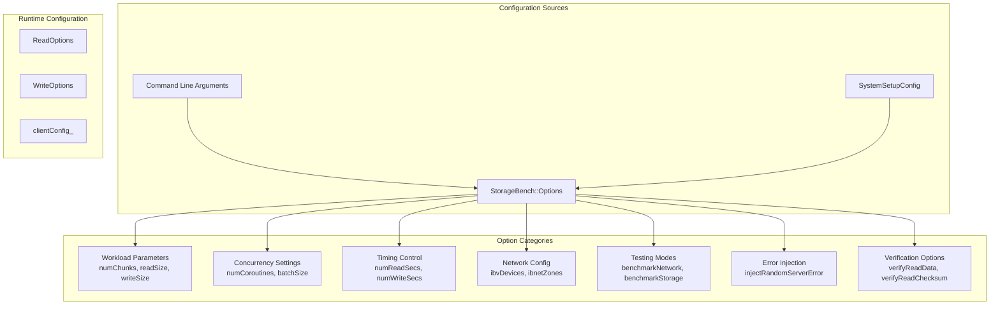
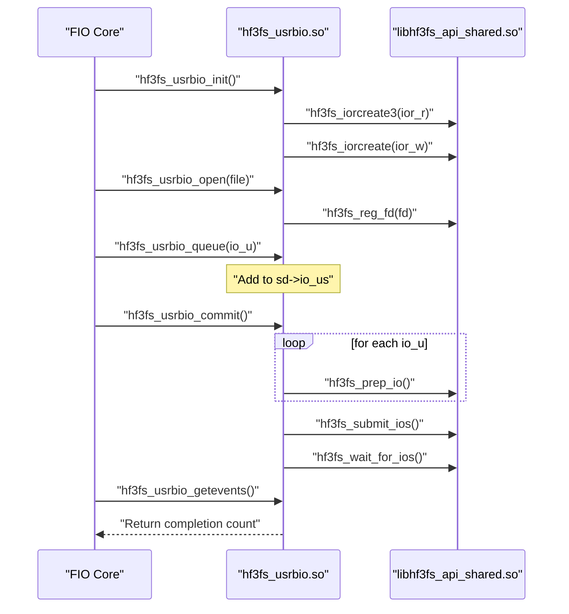

<!-- source: DeepWiki mcp.deepwiki.com · repo deepseek-ai/3FS · page 4.3 Benchmark Configuration · fetched 2026-10-30 -->

# Benchmark Configuration

<details>
<summary>Relevant source files</summary>

The following files were used as context for generating this wiki page:

- [.clang-tidy](.clang-tidy)
- [README.md](README.md)
- [benchmarks/fio_usrbio/Makefile](benchmarks/fio_usrbio/Makefile)
- [benchmarks/fio_usrbio/README.md](benchmarks/fio_usrbio/README.md)
- [benchmarks/fio_usrbio/hf3fs_usrbio.cpp](benchmarks/fio_usrbio/hf3fs_usrbio.cpp)
- [benchmarks/storage_bench/StorageBench.h](benchmarks/storage_bench/StorageBench.h)
- [dockerfile/dev.opencloudos9.dockerfile](dockerfile/dev.opencloudos9.dockerfile)
- [src/common/utils/FileUtils.cc](src/common/utils/FileUtils.cc)
- [tests/meta/TestCommon.cc](tests/meta/TestCommon.cc)
- [tests/meta/store/ops/TestResolve.cc](tests/meta/store/ops/TestResolve.cc)

</details>


This page provides a comprehensive guide to configuring and running performance benchmarks for 3FS, including the `storage_bench` tool, FIO integration, and standard benchmark scenarios like GraySort, read stress tests, and KVCache benchmarks.

## Configuration Architecture

The 3FS benchmark infrastructure uses a hierarchical configuration system with options controlling network behavior, storage operations, error injection, and performance measurement. The `StorageBench` class inherits from `test::UnitTestFabric` [benchmarks/storage_bench/StorageBench.h:26]() and utilizes a nested `Options` struct [benchmarks/storage_bench/StorageBench.h:28-67]() to manage test parameters.



**Sources**: [benchmarks/storage_bench/StorageBench.h:26-67](), [benchmarks/storage_bench/StorageBench.h:91-105]()

## StorageBench Configuration Options

The `StorageBench::Options` structure defines all configurable parameters for the storage benchmark.

### Workload Parameters

| Option | Type | Description |
|--------|------|-------------|
| `numChunks` | `size_t` | Number of chunks to create per chain [benchmarks/storage_bench/StorageBench.h:29]() |
| `readSize` | `size_t` | Size of each read operation in bytes [benchmarks/storage_bench/StorageBench.h:30]() |
| `writeSize` | `size_t` | Size of each write operation in bytes [benchmarks/storage_bench/StorageBench.h:31]() |
| `batchSize` | `size_t` | Default batch size for operations [benchmarks/storage_bench/StorageBench.h:32]() |
| `readBatchSize` | `size_t` | Batch size for read operations [benchmarks/storage_bench/StorageBench.h:64]() |
| `writeBatchSize` | `size_t` | Batch size for write operations [benchmarks/storage_bench/StorageBench.h:65]() |
| `removeBatchSize` | `size_t` | Batch size for remove operations [benchmarks/storage_bench/StorageBench.h:66]() |

**Sources**: [benchmarks/storage_bench/StorageBench.h:29-32](), [benchmarks/storage_bench/StorageBench.h:64-66](), [benchmarks/storage_bench/StorageBench.h:102-104]()

### Concurrency and Timing

| Option | Type | Description |
|--------|------|-------------|
| `numCoroutines` | `size_t` | Number of concurrent coroutines [benchmarks/storage_bench/StorageBench.h:36]() |
| `numTestThreads` | `size_t` | Threads in the test executor pool [benchmarks/storage_bench/StorageBench.h:37]() |
| `numReadSecs` | `uint64_t` | Duration of read benchmark in seconds [benchmarks/storage_bench/StorageBench.h:33]() |
| `numWriteSecs` | `uint64_t` | Duration of write benchmark in seconds [benchmarks/storage_bench/StorageBench.h:34]() |
| `clientTimeoutMS` | `uint64_t` | Client-side timeout in milliseconds [benchmarks/storage_bench/StorageBench.h:35]() |

**Sources**: [benchmarks/storage_bench/StorageBench.h:33-37]()

### Testing and Debug Modes

| Option | Type | Default | Description |
|--------|------|---------|-------------|
| `benchmarkNetwork` | `bool` | `false` | Bypass disk I/O to test network [benchmarks/storage_bench/StorageBench.h:40]() |
| `benchmarkStorage` | `bool` | `false` | Bypass RDMA to test storage [benchmarks/storage_bench/StorageBench.h:41]() |
| `ignoreIOError` | `bool` | `false` | Continue on I/O errors [benchmarks/storage_bench/StorageBench.h:42]() |
| `injectRandomServerError` | `bool` | `false` | Inject server-side errors [benchmarks/storage_bench/StorageBench.h:43]() |
| `verifyReadData` | `bool` | `false` | Verify read data matches pattern [benchmarks/storage_bench/StorageBench.h:46]() |

**Sources**: [benchmarks/storage_bench/StorageBench.h:40-48]()

## FIO Configuration

The FIO USRBIO engine is an external plugin (`hf3fs_usrbio.so`) used for benchmarking 3FS USRBIO [benchmarks/fio_usrbio/README.md:1-3](). It is implemented in C++ and interacts with the 3FS API [benchmarks/fio_usrbio/hf3fs_usrbio.cpp:9]().

### Plugin Options
The engine defines custom FIO options in a `fio_option` array [benchmarks/fio_usrbio/hf3fs_usrbio.cpp:27-61]():

| Option | Type | Default | Description |
|--------|------|---------|-------------|
| `mountpoint` | `STR` | `""` | 3FS mount point (e.g., `/hf3fs/mount/point`) [benchmarks/fio_usrbio/hf3fs_usrbio.cpp:29-37]() |
| `ior_depth` | `INT` | `0` | I/O Ring depth [benchmarks/fio_usrbio/hf3fs_usrbio.cpp:39-47]() |
| `ior_timeout` | `INT` | `1` | I/O Ring timeout in ms [benchmarks/fio_usrbio/hf3fs_usrbio.cpp:49-57]() |

### Execution Flow in FIO
The engine implements standard FIO hooks:
- `hf3fs_usrbio_init`: Initializes `hf3fs_usrbio_data` and creates I/O rings (`hf3fs_iorcreate3`) [benchmarks/fio_usrbio/hf3fs_usrbio.cpp:75-97]().
- `hf3fs_usrbio_queue`: Queues I/O units into the engine's internal vector [benchmarks/fio_usrbio/hf3fs_usrbio.cpp:122-141]().
- `hf3fs_usrbio_commit`: Prepares and submits I/Os using `hf3fs_prep_io` and `hf3fs_submit_ios`, then waits for completion [benchmarks/fio_usrbio/hf3fs_usrbio.cpp:143-190]().
- `hf3fs_usrbio_open`: Opens files and registers file descriptors via `hf3fs_reg_fd` [benchmarks/fio_usrbio/hf3fs_usrbio.cpp:212-230]().



**Sources**: [benchmarks/fio_usrbio/hf3fs_usrbio.cpp:75-230](), [benchmarks/fio_usrbio/README.md:21-36]()

## Performance Metrics and Results

### 1. Peak Throughput (Read Stress Test)
Measured on a cluster of 180 storage nodes (2x200Gbps IB NICs, 16x14TiB NVMe SSDs) using 500+ client nodes [README.md:30]().
- **Aggregate Throughput**: ~6.6 TiB/s [README.md:30-31]().

### 2. GraySort
Evaluated using the `smallpond` framework on 25 storage nodes and 50 compute nodes [README.md:40]().
- **Data Size**: 110.5 TiB across 8,192 partitions [README.md:40]().
- **Result**: Completed in 30m 14s, achieving **3.66 TiB/min** [README.md:40]().

### 3. KVCache
Optimizes LLM inference by caching key/value vectors in 3FS instead of DRAM [README.md:47-48]().
- **Peak Throughput**: Up to 40 GiB/s per client [README.md:48-50]().

**Sources**: [README.md:28-51]()

## Build Instructions

### Building the FIO Plugin
The plugin requires `HF3FS_LIB_DIR`, `HF3FS_INCLUDE_DIR`, and `FIO_SRC_DIR` to be set [benchmarks/fio_usrbio/README.md:9-12]().
```bash
make HF3FS_LIB_DIR=${HF3FS_LIB_DIR} \
     HF3FS_INCLUDE_DIR=${HF3FS_INCLUDE_DIR} \
     FIO_SRC_DIR=${FIO_SRC_DIR}
```
The resulting `hf3fs_usrbio.so` is loaded as an external engine [benchmarks/fio_usrbio/README.md:19-23]().

### Building StorageBench
Standard CMake build process applies:
```bash
cmake -S . -B build \
      -DCMAKE_CXX_COMPILER=clang++-14 -DCMAKE_C_COMPILER=clang-14 \
      -DCMAKE_BUILD_TYPE=RelWithDebInfo \
      -DSHUFFLE_METHOD=g++11
cmake --build build -j 32
```
**Sources**: [README.md:107-111](), [benchmarks/fio_usrbio/Makefile:1-12](), [benchmarks/fio_usrbio/README.md:14-17]()

---

