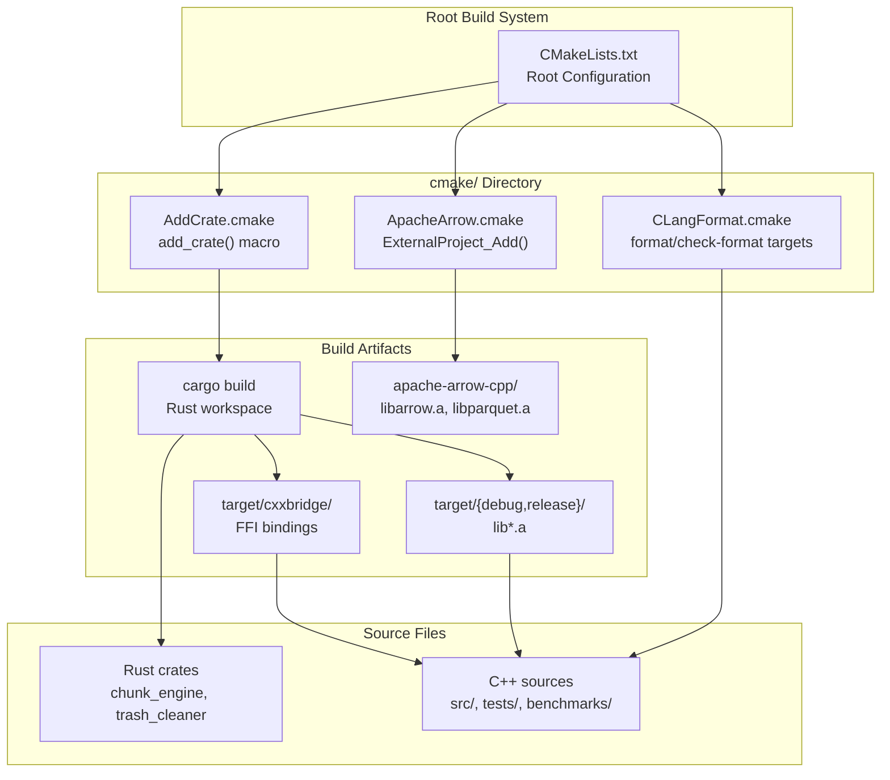
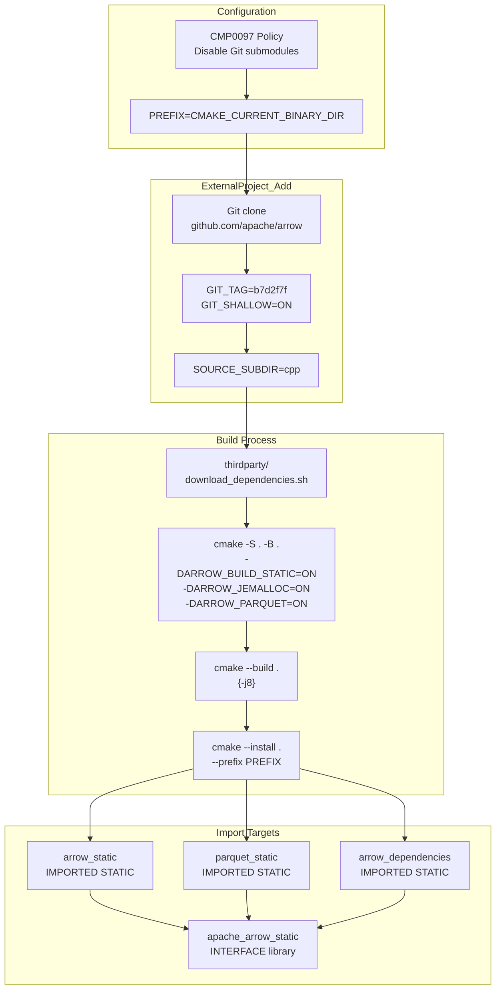

<!-- source: DeepWiki mcp.deepwiki.com · repo deepseek-ai/3FS · page 5 Build System Utilities · fetched 2026-10-30 -->

# Build System Utilities

Relevant source files

The following files were used as context for generating this wiki page:

- [.github/workflows/build.yml](.github/workflows/build.yml)
- [cmake/ApacheArrow.cmake](cmake/ApacheArrow.cmake)
- [src/lib/api/CMakeLists.txt](src/lib/api/CMakeLists.txt)

## Purpose and Scope

This document covers the specialized CMake modules located in the `cmake/` directory that extend the base build system with custom functionality. These utilities handle polyglot integration (Rust-C++ interop), external project management (Apache Arrow), and development tooling (code formatting). This page provides an overview of all build system utilities; detailed documentation for individual utilities is available in child pages [Rust-C++ Integration](#5.1), [External Project Integration](#5.2), and [Development Utilities](#5.3).

For information about the core CMake build configuration and compiler settings, see [C++ Build Configuration](#2.3). For the overall multi-language build architecture, see [Multi-Language Build System](#2.1).

**Sources**: [cmake/ApacheArrow.cmake:1-62](), [.github/workflows/build.yml:26-31]()

## Overview

The build system utilizes specialized CMake modules to address distinct challenges in the 3FS polyglot environment:

| Module | Purpose | Integration Point |
|--------|---------|-------------------|
| `AddCrate.cmake` | Rust crate integration via `add_crate()` macro | Enables C++ targets to link against Rust libraries with cxxbridge FFI |
| `ApacheArrow.cmake` | External project configuration for Apache Arrow | Builds Arrow/Parquet static libraries via `ExternalProject_Add()` |
| `CLangFormat.cmake` | Code formatting automation | Provides `format` and `check-format` CMake targets |

These utilities are integrated into the main build workflow. For example, the CI pipeline invokes CMake with specific compilers and flags that these modules consume [ .github/workflows/build.yml:29-30]().

**Sources**: [cmake/ApacheArrow.cmake:1-62](), [.github/workflows/build.yml:26-31]()

## Build System Utilities Architecture

The following diagram shows how the CMake utilities integrate into the overall build pipeline:

**Diagram**: Build System Utilities Integration

The utilities form a dependency chain: `AddCrate.cmake` triggers Cargo builds, which generate cxxbridge bindings that C++ code consumes. `ApacheArrow.cmake` independently builds Arrow libraries. `CLangFormat.cmake` operates on source files without affecting the compilation pipeline.

**Sources**: [cmake/ApacheArrow.cmake:1-62](), [.github/workflows/build.yml:26-31]()

## Rust-C++ Integration (AddCrate.cmake)

The 3FS build system uses a custom macro to bridge the gap between Cargo and CMake. This integration allows C++ components to depend on Rust logic (such as the `chunk_engine`) by treating Rust crates as standard CMake static libraries.

For details, see [Rust-C++ Integration](#5.1).

**Key Features:**
- **Build Mode Synchronization**: Automatically maps `CMAKE_BUILD_TYPE` to Cargo's `--release` or debug flags.
- **FFI Generation**: Orchestrates `cxxbridge` to generate C++ headers and source files from Rust `cxx::bridge` definitions.
- **Library Wrapping**: Creates a `STATIC` CMake target that wraps the Rust `.a` archive and handles necessary linkage (e.g., `pthread`, `dl`).

**Sources**: [src/lib/api/CMakeLists.txt:4-9]()

## External Project Integration (Apache Arrow)

The `ApacheArrow.cmake` module manages the complex build process for Apache Arrow and Parquet, which are used for structured trace logging and analytics. It utilizes CMake's `ExternalProject` module to isolate the Arrow build from the main 3FS build.

For details, see [External Project Integration](#5.2).

**Diagram**: Apache Arrow External Project Build Pipeline

**Configuration Summary:**
- **Source Management**: Pins to a specific Git commit and uses `GIT_SHALLOW` to minimize overhead [cmake/ApacheArrow.cmake:24-26]().
- **Dependency Handling**: Uses Arrow's bundled dependency source and a custom download script [cmake/ApacheArrow.cmake:33-38]().
- **Target Export**: Defines `apache_arrow_static` as an `INTERFACE` library that aggregates `arrow_static`, `parquet_static`, and `arrow_dependencies` [cmake/ApacheArrow.cmake:60-61]().

**Sources**: [cmake/ApacheArrow.cmake:1-62]()

## Development Utilities (CLangFormat.cmake)

To maintain code quality across the large C++ codebase, the build system includes utilities for automated formatting and linting.

For details, see [Development Utilities](#5.3).

**Primary Utilities:**
- **Code Formatting**: Provides a `format` target to apply `clang-format-14` across `src/`, `tests/`, and `benchmarks/` directories.
- **Format Verification**: Provides a `check-format` target used in CI to ensure all submitted code adheres to the project's style guide.
- **Shared Library Symlinking**: Post-build commands in specific directories (e.g., `src/lib/api`) create symlinks for Rust bindings to find compiled C++ shared libraries [src/lib/api/CMakeLists.txt:4-9]().

**Sources**: [src/lib/api/CMakeLists.txt:4-9](), [.github/workflows/build.yml:19]()

---

