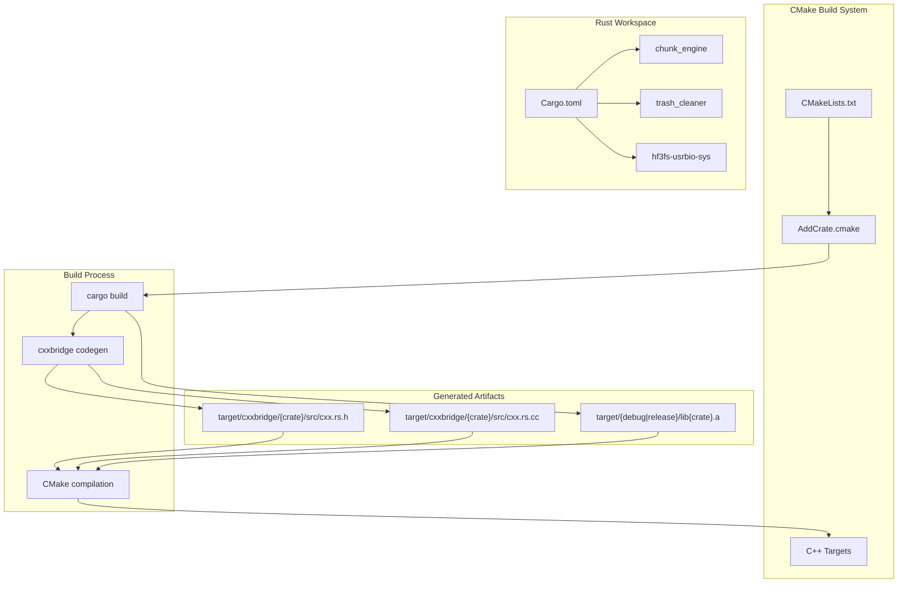
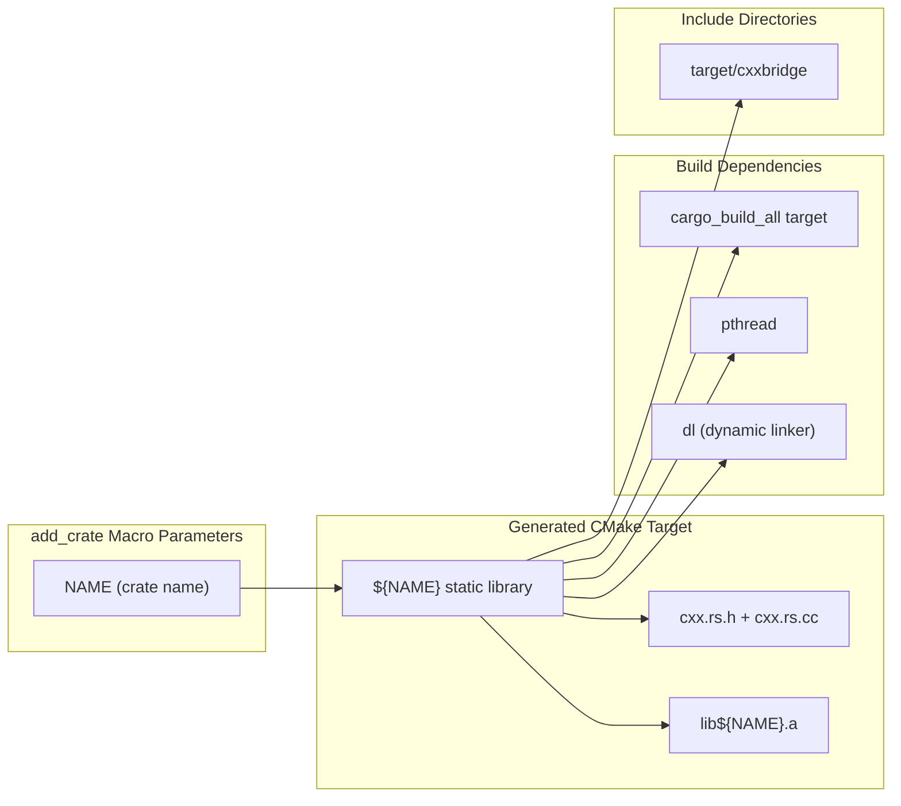
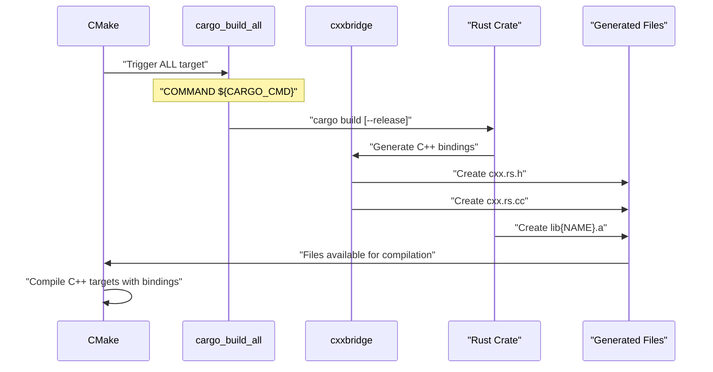
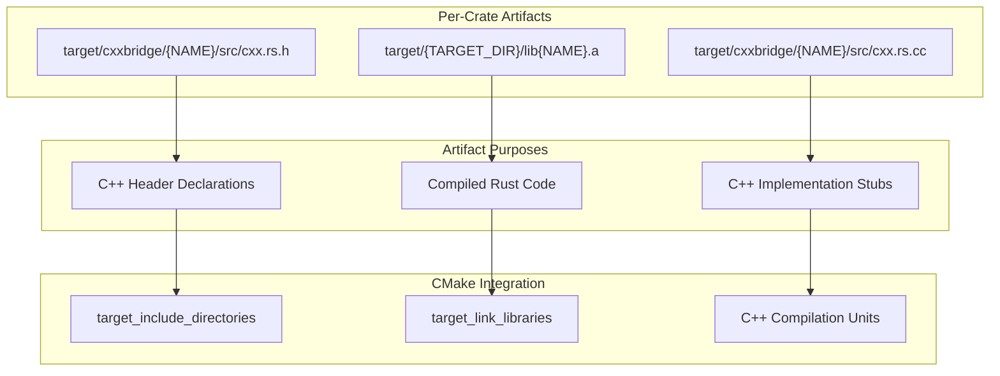
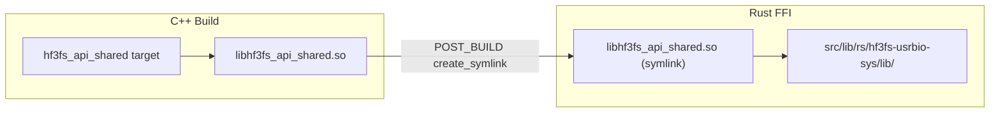

<!-- source: DeepWiki mcp.deepwiki.com · repo deepseek-ai/3FS · page 5.1 Rust-C++ Integration · fetched 2026-10-30 -->

# Rust-C++ Integration

Relevant source files

The following files were used as context for generating this wiki page:

- [.github/workflows/build.yml](.github/workflows/build.yml)
- [Cargo.lock](Cargo.lock)
- [Cargo.toml](Cargo.toml)
- [src/lib/api/CMakeLists.txt](src/lib/api/CMakeLists.txt)
- [src/lib/rs/hf3fs-usrbio-sys/lib/.dummy](src/lib/rs/hf3fs-usrbio-sys/lib/.dummy)

This document covers the CMake macros and utilities that enable seamless integration of Rust crates with the C++ build system in 3FS. The integration leverages `cxxbridge` to generate C++ bindings for Rust code and provides a unified build process for the multi-language codebase.

For information about the broader multi-language build system architecture, see [Multi-Language Build System](2.1). For details about individual Rust components, see [Rust Components](2.2).

## Integration Architecture Overview

The Rust-C++ integration in 3FS creates a bridge between Rust crates and CMake targets, enabling C++ code to call Rust functions and vice versa through generated bindings. The system orchestrates `cargo` builds and `cxxbridge` code generation to produce artifacts that CMake can consume.

**Integration Architecture**

Sources: [Cargo.toml:1-11](), [cmake/AddCrate.cmake:1-34]()

## The `add_crate` CMake Macro

The core integration functionality is provided by the `add_crate` macro defined in `AddCrate.cmake`. This macro creates CMake targets for Rust crates and handles the build dependencies. It translates Rust's build output into a form that the C++ linker and compiler understand.

**Macro Definition and Usage**

The macro performs several key operations:

| Operation | Purpose | Implementation |
|-----------|---------|----------------|
| **Library Path Resolution** | Determines the target directory based on build type | `TARGET_DIR` set to "debug" or "release" [cmake/AddCrate.cmake:1-7]() |
| **Source Generation** | Defines paths for cxxbridge-generated C++ files | `SOURCES` variable with `.h` and `.cc` files [cmake/AddCrate.cmake:17-20]() |
| **Custom Command** | Triggers Rust compilation when needed | `add_custom_command` with `OUTPUT` dependencies [cmake/AddCrate.cmake:22-26]() |
| **Library Creation** | Creates CMake static library target | `add_library` with generated sources [cmake/AddCrate.cmake:28]() |
| **Dependency Linking** | Links required system libraries | `pthread` and `dl` libraries [cmake/AddCrate.cmake:29]() |

Sources: [cmake/AddCrate.cmake:1-33]()

## Build Process Flow

The integration follows a specific build sequence to ensure proper dependency resolution and artifact generation. This is critical for 3FS because crates like `chunk_engine` are used by the C++ storage service.

**Build Sequence Flow**

### Build Configuration

The build system adapts to the CMake build type. For release builds, it uses the `release-cmake` profile defined in the workspace [Cargo.toml:19-23]().

| Build Type | Cargo Command | Target Directory | Purpose |
|------------|---------------|------------------|---------|
| **Debug** | `cargo build` | `target/debug/` | Development builds with debug symbols |
| **Release** | `cargo build --release` | `target/release/` | Optimized production builds |

The `CARGO_CMD` and `TARGET_DIR` variables are set based on `CMAKE_BUILD_TYPE` [cmake/AddCrate.cmake:1-7](). In CI environments, `cargo build --release` is explicitly called before CMake orchestration [build.yml:28-30]().

Sources: [cmake/AddCrate.cmake:1-7](), [cmake/AddCrate.cmake:22-26](), [Cargo.toml:19-23](), [build.yml:28-30]()

## Generated Artifacts

The integration process generates three types of artifacts for each Rust crate:

**Generated Artifact Structure**

### Artifact Details

- **Header File (`cxx.rs.h`)**: Contains C++ declarations for Rust functions and types exposed through `cxxbridge`.
- **Source File (`cxx.rs.cc`)**: Contains C++ implementation stubs that bridge to the Rust code.
- **Static Library (`lib{NAME}.a`)**: The compiled Rust crate as a static archive.

The macro ensures these files are properly included in the CMake target through:
- Include directories pointing to `target/cxxbridge` [cmake/AddCrate.cmake:30]()
- Source files added to the static library target [cmake/AddCrate.cmake:28]()
- Static archive linked to the target [cmake/AddCrate.cmake:29]()

Sources: [cmake/AddCrate.cmake:16-20](), [cmake/AddCrate.cmake:28-32]()

## Special Integration: USRBIO Binding

The `hf3fs-usrbio-sys` crate requires a specific integration where the C++ shared library `libhf3fs_api_shared.so` is linked back into the Rust binding directory. This is handled via a `POST_BUILD` custom command in the API's `CMakeLists.txt`.

**USRBIO Linking Logic**

Sources: [src/lib/api/CMakeLists.txt:4-9]()

## Dependencies and Linking

The integration handles several categories of dependencies to ensure proper linking and runtime behavior.

### System Libraries

| Library | Purpose | Reason |
|---------|---------|---------|
| **pthread** | POSIX threads | Required by Rust's threading runtime |
| **dl** | Dynamic linker | Required for dynamic symbol resolution |

These are linked automatically by the `add_crate` macro [cmake/AddCrate.cmake:29]().

### Compiler Configuration

The macro applies specific compiler options to handle cxxbridge-generated code:
- **`-Wno-dollar-in-identifier-extension`**: Suppresses warnings about dollar signs in generated identifiers [cmake/AddCrate.cmake:31]().

### Build Dependencies

Each crate target depends on the `cargo_build_all` target to ensure:
1. All Rust crates are built before C++ compilation begins [cmake/AddCrate.cmake:32]().
2. Cargo workspace dependencies (defined in `Cargo.toml`) are properly resolved.
3. Generated bindings are available when needed.

The `cargo_build_all` target is defined as an `ALL` target, meaning it runs by default during the build process [cmake/AddCrate.cmake:9-13]().

Sources: [cmake/AddCrate.cmake:9-13](), [cmake/AddCrate.cmake:29-32](), [Cargo.toml:1-6]()

---

