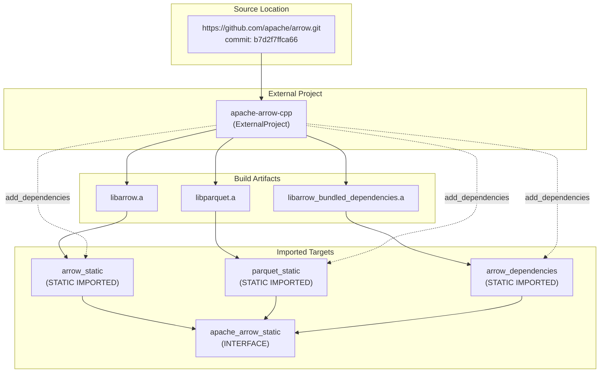
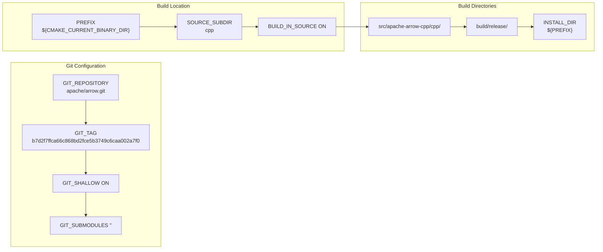
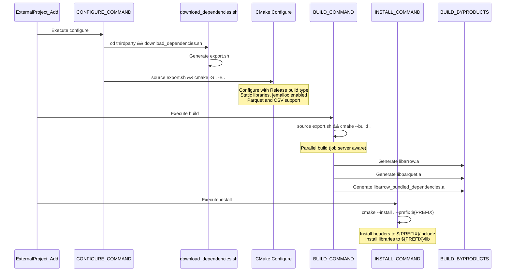
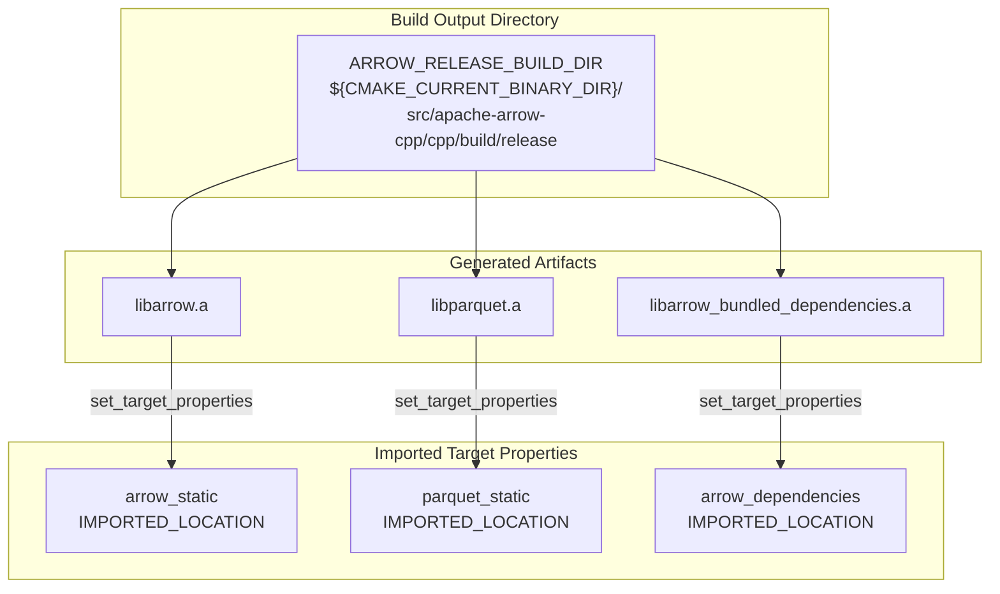
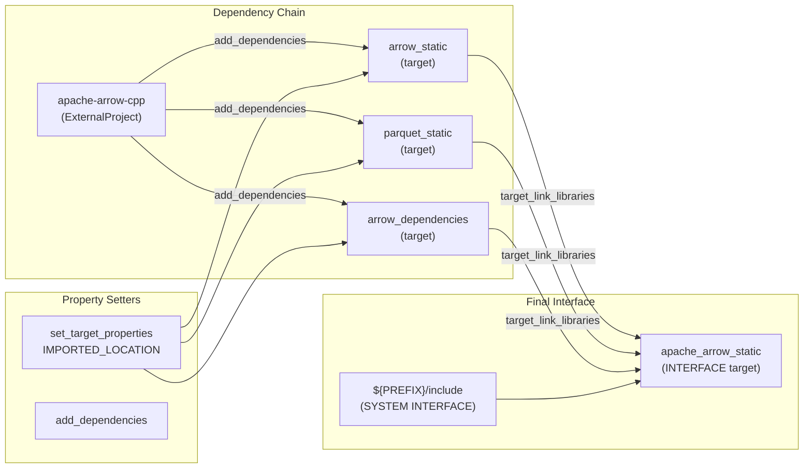

<!-- source: DeepWiki mcp.deepwiki.com · repo deepseek-ai/3FS · page 5.2 External Project Integration · fetched 2026-10-30 -->

# External Project Integration

<details>
<summary>Relevant source files</summary>

The following files were used as context for generating this wiki page:

- [cmake/ApacheArrow.cmake](cmake/ApacheArrow.cmake)

</details>


## Purpose and Scope

This document covers the integration of external projects into the 3FS build system using CMake's `ExternalProject` module. Specifically, this page documents how Apache Arrow is fetched, configured, and built as part of the 3FS compilation process. For documentation on integrating Rust crates into the CMake build, see [5.1 Rust-C++ Integration](). For general development utilities, see [5.3 Development Utilities]().

The external project integration mechanism allows 3FS to build complex third-party libraries with custom configuration options while maintaining isolation from the main build tree. This approach provides fine-grained control over dependency compilation and ensures consistent build artifacts across different environments.

**Sources**: [cmake/ApacheArrow.cmake:1-62]()

## Apache Arrow Integration Architecture

Apache Arrow is integrated as an external project to provide columnar data processing capabilities for 3FS. The integration creates three imported static library targets and manages the complete build lifecycle from source fetching to installation.

### Library Target Structure



The integration creates four library targets:

| Target | Type | Purpose | Location |
|--------|------|---------|----------|
| `apache_arrow_static` | INTERFACE | Top-level target linking all Arrow components | N/A |
| `arrow_static` | STATIC IMPORTED | Core Arrow columnar library | `${ARROW_RELEASE_BUILD_DIR}/libarrow.a` |
| `parquet_static` | STATIC IMPORTED | Parquet file format support | `${ARROW_RELEASE_BUILD_DIR}/libparquet.a` |
| `arrow_dependencies` | STATIC IMPORTED | Bundled third-party dependencies | `${ARROW_RELEASE_BUILD_DIR}/libarrow_bundled_dependencies.a` |

**Sources**: [cmake/ApacheArrow.cmake:1-4](), [cmake/ApacheArrow.cmake:54-59]()

## ExternalProject Configuration

The Apache Arrow external project is configured using CMake's `ExternalProject_Add` command with a multi-stage build process. The project is fetched from the official Apache Arrow GitHub repository and built from a specific commit to ensure reproducibility.

### Source Configuration



The source configuration includes:

- **Repository**: Fetches from `https://github.com/apache/arrow.git` [cmake/ApacheArrow.cmake:24]()
- **Version**: Pinned to commit `b7d2f7ffca66c868bd2fce5b3749c6caa002a7f0` [cmake/ApacheArrow.cmake:25]()
- **Shallow Clone**: Enabled for faster downloads [cmake/ApacheArrow.cmake:26]()
- **Submodules**: Explicitly disabled (empty string) per CMake policy `CMP0097` [cmake/ApacheArrow.cmake:28]()
- **Source Subdirectory**: Uses the `cpp` subdirectory of the Arrow repository [cmake/ApacheArrow.cmake:29]()

**Sources**: [cmake/ApacheArrow.cmake:21-29](), [cmake/ApacheArrow.cmake:9-12]()

## Build Process Flow

The Apache Arrow build process involves three custom commands: configure, build, and install. Each command is executed within a Bash shell with Arrow's third-party dependency environment properly sourced.

### Build Command Sequence



**Sources**: [cmake/ApacheArrow.cmake:32-52]()

### Configure Command

The configure step is implemented as a Bash script that handles dependency management and CMake configuration [cmake/ApacheArrow.cmake:32-44]():

```bash
( cd thirdparty && [[ -f export.sh ]] || ./download_dependencies.sh | tee export.sh ) && \
source thirdparty/export.sh && cmake -S . -B . \
    -DCMAKE_BUILD_TYPE=Release \
    -DARROW_USE_CCACHE=OFF \
    -DARROW_USE_SCCACHE=OFF \
    -DARROW_DEPENDENCY_SOURCE=BUNDLED \
    -DARROW_BUILD_STATIC=ON \
    -DARROW_JEMALLOC=ON \
    -DARROW_SIMD_LEVEL=DEFAULT \
    -DARROW_BUILD_EXAMPLES=OFF \
    -DARROW_PARQUET=ON -DARROW_CSV=ON \
    -DARROW_WITH_ZSTD=ON -DARROW_WITH_LZ4=ON -DARROW_WITH_ZLIB=ON
```

Key configuration decisions:

1. **Dependency Management**: Downloads bundled dependencies via `download_dependencies.sh` and sources environment variables from `export.sh` [cmake/ApacheArrow.cmake:33-34]()
2. **Build Type**: Uses Release configuration for optimized performance [cmake/ApacheArrow.cmake:35]()
3. **Cache Disabled**: `ARROW_USE_CCACHE` and `ARROW_USE_SCCACHE` are explicitly disabled [cmake/ApacheArrow.cmake:36-37]()
4. **Static Linking**: Builds static libraries (`ARROW_BUILD_STATIC=ON`) [cmake/ApacheArrow.cmake:39]()
5. **Memory Allocator**: Enables jemalloc integration (`ARROW_JEMALLOC=ON`) [cmake/ApacheArrow.cmake:40]()
6. **SIMD Support**: Uses default SIMD level [cmake/ApacheArrow.cmake:41]()
7. **Feature Flags**: Enables Parquet, CSV, ZSTD, LZ4, and ZLIB support [cmake/ApacheArrow.cmake:43-44]()

### Build Command

The build step sources the dependency environment and invokes CMake's build command [cmake/ApacheArrow.cmake:45-46]():

```bash
source thirdparty/export.sh && cmake --build . ${ARROW_BUILD_PARALLEL}
```

The `ARROW_BUILD_PARALLEL` variable is conditionally set based on CMake version:
- CMake ≥ 3.28: Empty string (relies on `BUILD_JOB_SERVER_AWARE`) [cmake/ApacheArrow.cmake:15]()
- CMake < 3.28: Uses `-j8` for explicit parallelism [cmake/ApacheArrow.cmake:17]()

The `BUILD_JOB_SERVER_AWARE` property is set to `1` [cmake/ApacheArrow.cmake:46](), allowing the build to integrate with GNU Make's job server for coordinated parallel builds across multiple external projects.

**Sources**: [cmake/ApacheArrow.cmake:14-18](), [cmake/ApacheArrow.cmake:45-46]()

### Install Command

The install step copies headers and libraries to the prefix directory [cmake/ApacheArrow.cmake:47]():

```bash
cmake --install . --prefix "${PREFIX}"
```

Where `PREFIX` is set to `${CMAKE_CURRENT_BINARY_DIR}` [cmake/ApacheArrow.cmake:6]().

## Build Artifacts and Target Properties

The external project produces three static libraries that are declared as build byproducts. These byproducts inform CMake's dependency tracking system about files that will be generated by the external project.

### Build Byproducts



The `BUILD_BYPRODUCTS` property lists the expected output files [cmake/ApacheArrow.cmake:48-52]():

| Artifact | Full Path | Target |
|----------|-----------|--------|
| `libarrow.a` | `${ARROW_RELEASE_BUILD_DIR}/libarrow.a` | `arrow_static` |
| `libparquet.a` | `${ARROW_RELEASE_BUILD_DIR}/libparquet.a` | `parquet_static` |
| `libarrow_bundled_dependencies.a` | `${ARROW_RELEASE_BUILD_DIR}/libarrow_bundled_dependencies.a` | `arrow_dependencies` |

Where `ARROW_RELEASE_BUILD_DIR` is defined as [cmake/ApacheArrow.cmake:7]():
```
${CMAKE_CURRENT_BINARY_DIR}/src/apache-arrow-cpp/cpp/build/release
```

**Sources**: [cmake/ApacheArrow.cmake:6-7](), [cmake/ApacheArrow.cmake:48-52]()

### Target Property Configuration

After declaring the external project, imported targets are configured with their locations and dependencies:



The configuration establishes proper dependency relationships [cmake/ApacheArrow.cmake:54-61]():

1. **Build Dependencies**: Each imported target depends on the `apache-arrow-cpp` external project completing [cmake/ApacheArrow.cmake:54-56]()
   ```cmake
   add_dependencies(arrow_static apache-arrow-cpp)
   add_dependencies(parquet_static apache-arrow-cpp)
   add_dependencies(arrow_dependencies apache-arrow-cpp)
   ```

2. **Library Locations**: Sets the `IMPORTED_LOCATION` property for each target to its respective byproduct path [cmake/ApacheArrow.cmake:57-59]()
   ```cmake
   set_target_properties(arrow_static PROPERTIES IMPORTED_LOCATION "${ARROW_RELEASE_BUILD_DIR}/libarrow.a")
   set_target_properties(parquet_static PROPERTIES IMPORTED_LOCATION "${ARROW_RELEASE_BUILD_DIR}/libparquet.a")
   set_target_properties(arrow_dependencies PROPERTIES IMPORTED_LOCATION "${ARROW_RELEASE_BUILD_DIR}/libarrow_bundled_dependencies.a")
   ```

3. **Include Directories**: Adds Arrow's header directory as a system include for the interface target [cmake/ApacheArrow.cmake:60]()
   ```cmake
   target_include_directories(apache_arrow_static SYSTEM INTERFACE "${PREFIX}/include")
   ```

4. **Link Interface**: Aggregates all three static libraries into the `apache_arrow_static` interface target [cmake/ApacheArrow.cmake:61]()
   ```cmake
   target_link_libraries(apache_arrow_static INTERFACE parquet_static arrow_static arrow_dependencies)
   ```

**Sources**: [cmake/ApacheArrow.cmake:54-61]()

## Usage in Build System

Other CMake targets in the 3FS build system can consume Apache Arrow by linking against the `apache_arrow_static` interface target. This provides access to Arrow's columnar data structures, Parquet file I/O, and compression libraries (ZSTD, LZ4, ZLIB).

### Integration Example

```cmake
target_link_libraries(my_target PRIVATE apache_arrow_static)
```

This single link command transitively provides:
- Arrow core library (`libarrow.a`)
- Parquet format library (`libparquet.a`)
- Bundled dependencies (`libarrow_bundled_dependencies.a`)
- Include directories (`${PREFIX}/include`)

The interface target abstracts the complexity of the three-library structure, allowing consuming targets to treat Arrow as a single dependency.

**Sources**: [cmake/ApacheArrow.cmake:60-61]()

## CMake Policy Configuration

The integration sets CMake policy `CMP0097` to `NEW` [cmake/ApacheArrow.cmake:9-12]():

```cmake
# https://cmake.org/cmake/help/latest/policy/CMP0097.html
# Starting with CMake 3.16, explicitly setting GIT_SUBMODULES to an empty string
# means no submodules will be initialized or updated.
cmake_policy(SET CMP0097 NEW)
```

This policy change enables explicit control over Git submodule initialization. By setting `GIT_SUBMODULES ""` in the `ExternalProject_Add` call [cmake/ApacheArrow.cmake:28](), the build ensures that Arrow's submodules are not automatically cloned, as Arrow's dependency management is handled through its own `download_dependencies.sh` script instead [cmake/ApacheArrow.cmake:33]().

**Sources**: [cmake/ApacheArrow.cmake:9-12](), [cmake/ApacheArrow.cmake:28](), [cmake/ApacheArrow.cmake:33]()

---

