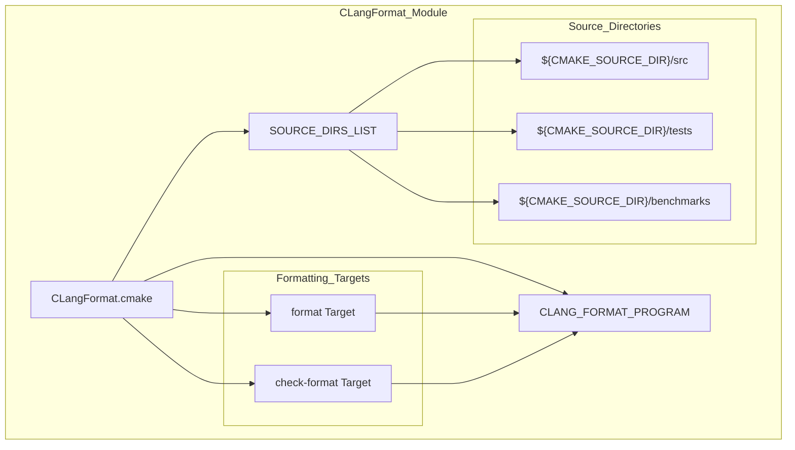
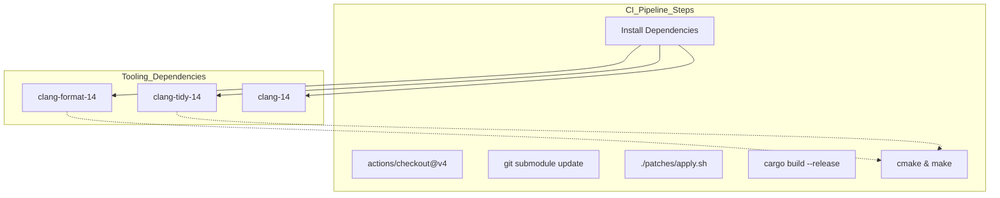

<!-- source: DeepWiki mcp.deepwiki.com · repo deepseek-ai/3FS · page 5.3 Development Utilities · fetched 2026-10-30 -->

# Development Utilities

Relevant source files

The following files were used as context for generating this wiki page:

- [.clang-tidy](.clang-tidy)
- [.github/workflows/build.yml](.github/workflows/build.yml)
- [README.md](README.md)
- [dockerfile/dev.opencloudos9.dockerfile](dockerfile/dev.opencloudos9.dockerfile)
- [src/lib/api/CMakeLists.txt](src/lib/api/CMakeLists.txt)

This page documents the CMake development utilities that support code quality, analysis, and development workflow in the 3FS build system. These utilities provide targets and configurations for code formatting, static analysis, test coverage, and compile flag management.

For information about Rust-C++ build integration, see [5.1 Rust-C++ Integration](). For external project integration utilities, see [5.2 External Project Integration]().

## Code Formatting Utilities

The 3FS build system includes automated code formatting through `clang-format-14` to maintain consistent code style across the C++ codebase.

### CLangFormat Module

The `CLangFormat.cmake` module provides two main targets for code formatting:

The build system requires `clang-format-14` as a prerequisite for Ubuntu and other supported distributions [README.md:75,80](). The `CLangFormat.cmake` module defines the formatting logic:

- **`format` target**: Applies formatting in-place to all C++ source files.
- **`check-format` target**: Validates formatting without modifying files, using `--Werror --dry-run` flags.

Both targets scan for `.cc`, `.cpp`, and `.h` files in the source directories while excluding auto-generated files with `_generated.h` suffix.

**Sources:** `README.md`, `dockerfile/dev.opencloudos9.dockerfile`

## Static Analysis Utilities

Static analysis is provided through `clang-tidy-14` with a comprehensive set of checks defined in the project root.

### CLangTidy Configuration

The project uses a `.clang-tidy` configuration file that enables a wide array of checks to ensure code robustness and performance [/.clang-tidy:1-113]().

| Check Category | Purpose |
|----------------|---------|
| `bugprone-*` | Detects code constructs that often lead to bugs (e.g., `infinite-loop`, `use-after-move`) [/.clang-tidy:3-44]() |
| `performance-*` | Identifies inefficient patterns (e.g., `unnecessary-copy-initialization`, `inefficient-vector-operation`) [/.clang-tidy:49-58]() |
| `modernize-*` | Encourages modern C++ practices (e.g., `use-nullptr`, `use-auto`, `make-unique`) [/.clang-tidy:60-75]() |
| `readability-*` | Enforces style and clarity (e.g., `container-size-empty`, `redundant-smartptr-get`) [/.clang-tidy:87-104]() |
| `google-*` | Enforces specific Google C++ style guide rules [/.clang-tidy:110-111]() |

### Workflow Integration

The build system integrates `clang-tidy` through CMake variables. Developers are encouraged to generate a compilation database by setting `-DCMAKE_EXPORT_COMPILE_COMMANDS=ON` during the CMake configuration phase [README.md:109](). This database allows `clang-tidy` and LSP servers like `clangd` to understand the include paths and compiler flags used for each file.

**Sources:** `.clang-tidy`, `README.md`, `.github/workflows/build.yml`

## Continuous Integration Quality Enforcement

The CI pipeline defined in `.github/workflows/build.yml` ensures that development utilities are utilized before code is merged.

The CI environment installs the necessary toolchain [/.github/workflows/build.yml:18-20]():
- `clang-format-14`
- `clang-tidy-14`
- `clang-14` / `clang++-14`

The build command explicitly sets the compiler to `clang` to ensure consistency across environments [/.github/workflows/build.yml:29]().

**Sources:** `.github/workflows/build.yml`, `README.md`

## Development Environment Setup

To support these utilities, 3FS provides Dockerfiles for various distributions (Ubuntu, OpenCloudOS, TencentOS) that pre-configure the paths for `clang-format` and `clang-tidy`.

### OpenCloudOS 9 Dev Environment
The `dev.opencloudos9.dockerfile` performs the following setup for development utilities:
1. Downloads and installs LLVM 14.0.6 [dockerfile/dev.opencloudos9.dockerfile:40-42]().
2. Creates symlinks for versioned tools to match the expected names in the build scripts [dockerfile/dev.opencloudos9.dockerfile:43-46]():
   - `/usr/bin/clang-format-14` -> `/usr/local/clang-llvm-14/bin/clang-format`
   - `/usr/local/clang-llvm-14/bin/clang-tidy-14` -> `/usr/local/clang-llvm-14/bin/clang-tidy`

**Sources:** `dockerfile/dev.opencloudos9.dockerfile`

## Library Linking Utilities

While not a quality tool, the build system includes utilities for linking C++ libraries to Rust components. For example, `src/lib/api/CMakeLists.txt` uses a post-build command to create a symlink of the shared library `libhf3fs_api_shared.so` into the Rust crate's library directory [src/lib/api/CMakeLists.txt:4-9](). This ensures that the `hf3fs-usrbio-sys` Rust crate can find the required C++ symbols during its own build or test phases.

**Sources:** `src/lib/api/CMakeLists.txt`

---

