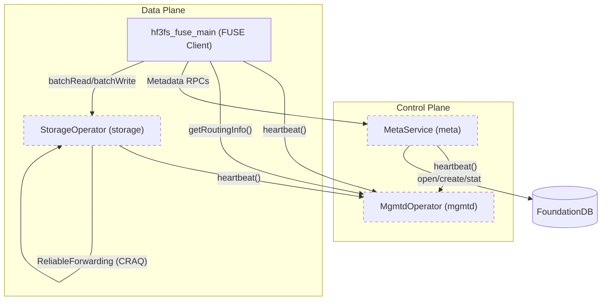
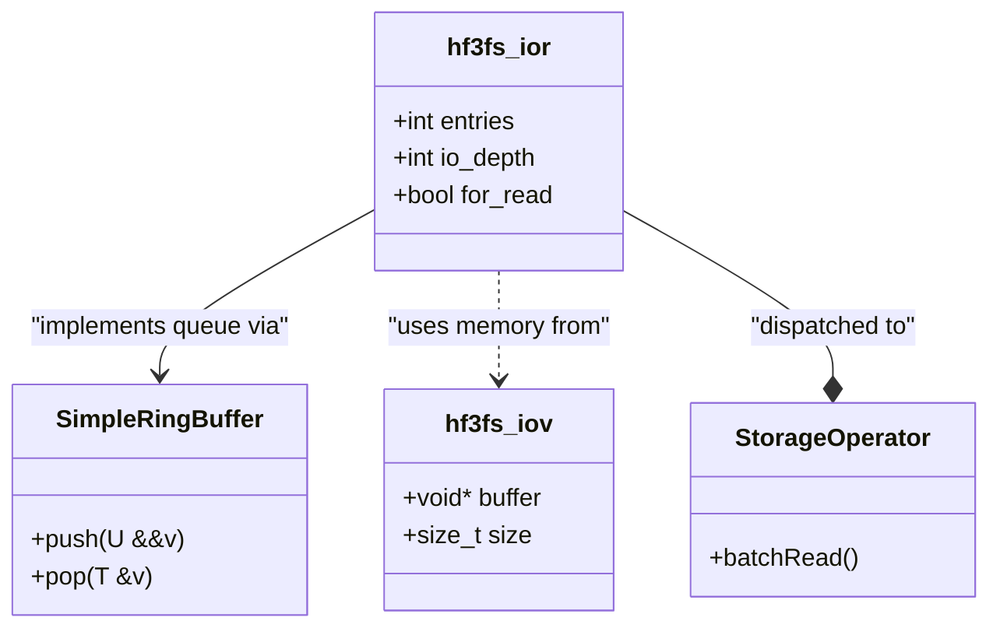

<!-- source: DeepWiki mcp.deepwiki.com · repo deepseek-ai/3FS · page 6 Distributed Services · fetched 2026-10-30 -->

# Distributed Services

Relevant source files

The following files were used as context for generating this wiki page:

- [docs/design_notes.md](docs/design_notes.md)
- [specs/README.md](specs/README.md)
- [src/common/utils/SimpleRingBuffer.h](src/common/utils/SimpleRingBuffer.h)
- [src/lib/api/UsrbIo.md](src/lib/api/UsrbIo.md)
- [src/mgmtd/ops/SetChainTableOperation.cc](src/mgmtd/ops/SetChainTableOperation.cc)
- [src/storage/service/ReliableForwarding.cc](src/storage/service/ReliableForwarding.cc)
- [src/storage/service/StorageOperator.cc](src/storage/service/StorageOperator.cc)
- [src/stubs/CMakeLists.txt](src/stubs/CMakeLists.txt)
- [tests/mgmtd/TestMgmtdOperator.cc](tests/mgmtd/TestMgmtdOperator.cc)

The 3FS distributed file system is composed of four primary services that communicate over an RDMA-capable network (InfiniBand or RoCE) to provide a high-performance, POSIX-like file system. The architecture is disaggregated, separating cluster management, metadata persistence, and data storage.

## System Architecture Overview

The interaction between these services follows a control-plane and data-plane split. The **Management Service (mgmtd)** and **Metadata Service (meta)** handle the control plane (cluster state and file hierarchy), while the **Storage Service** and **FUSE Client** handle the data plane (high-throughput I/O).

### Service Interaction Diagram
This diagram maps the high-level service interactions to the specific RPC operations and classes found in the codebase.

**Sources:** [docs/design_notes.md:5-13](), [src/mgmtd/service/MgmtdOperator.h:1-100](), [src/storage/service/StorageOperator.cc:82-85]()

---

## 6.1 Management Service (mgmtd)

The Management Service (`mgmtd`) acts as the central coordinator for the 3FS cluster. It is responsible for maintaining the cluster's membership through heartbeats and distributing routing information (chain tables) to all other components.

- **Primary Election:** Uses a lease-based mechanism to elect a primary mgmtd node from a set of replicas [docs/design_notes.md:7-7]().
- **Heartbeats:** Collects `HeartbeatReq` from storage and metadata nodes to monitor health [tests/mgmtd/TestMgmtdOperator.cc:72-77]().
- **Routing Distribution:** Manages the `RoutingInfo`, which includes the mapping of `ChainId` to physical `StorageTarget` nodes [src/mgmtd/ops/SetChainTableOperation.cc:7-32]().

For details, see [Management Service (mgmtd)](#6.1).

**Sources:** [docs/design_notes.md:7-7](), [tests/mgmtd/TestMgmtdOperator.cc:140-165](), [src/mgmtd/ops/SetChainTableOperation.cc:35-87]()

---

## 6.2 Metadata Service (meta)

The Metadata Service provides the file system namespace and implements POSIX semantics (e.g., atomic renames, hard links). It is designed to be stateless, delegating persistence to FoundationDB.

- **Stateless Design:** Clients can connect to any metadata node, as all state is stored in the transactional KV store [docs/design_notes.md:9-9]().
- **Namespace Management:** Handles directory operations and inode management using a key schema optimized for FoundationDB [docs/design_notes.md:19-23]().
- **Chain Allocation:** Assigns storage chains to files during creation or expansion.

For details, see [Metadata Service (meta)](#6.2).

**Sources:** [docs/design_notes.md:9-11](), [src/stubs/CMakeLists.txt:2-2]()

---

## 6.3 Storage Service

The Storage Service manages local SSDs and provides a chunk-based interface for data I/O. It implements the **CRAQ (Chain Replication with Apportioned Queries)** protocol to ensure strong consistency while maximizing read throughput.

- **CRAQ Implementation:** Uses a "write-all-read-any" approach. Writes are forwarded along a chain via `ReliableForwarding`, while reads can be satisfied by any node in the chain if the data is committed [docs/design_notes.md:11-11](), [src/storage/service/ReliableForwarding.cc:33-58]().
- **High Performance I/O:** Utilizes `StorageOperator` to handle `batchRead` and `batchWrite` RPCs, leveraging RDMA for zero-copy data transfer [src/storage/service/StorageOperator.cc:82-95]().
- **Background Workers:** Includes `AllocateWorker` for disk space management and `CheckWorker` for data integrity.

For details, see [Storage Service](#6.3).

**Sources:** [docs/design_notes.md:11-11](), [src/storage/service/StorageOperator.cc:1-15](), [src/storage/service/ReliableForwarding.cc:113-136]()

---

## 6.4 FUSE Client

The FUSE Client (`hf3fs_fuse_main`) provides the primary interface for applications to access 3FS. While it supports standard POSIX access via the FUSE kernel module, it also includes a high-performance **USRBIO** interface.

- **USRBIO API:** A user-space ring-based I/O interface that bypasses FUSE kernel bottlenecks by using shared memory (`Iov`) and submission/completion queues (`Ior`) [src/lib/api/UsrbIo.md:3-11]().
- **Parallel I/O:** Supports `PioV` for parallelized I/O operations across multiple storage chains [docs/design_notes.md:49-50]().
- **Zero-Copy:** Integrated with RDMA to allow direct data transfer between application memory and the storage service [docs/design_notes.md:45-48]().

For details, see [FUSE Client](#6.4).

### USRBIO Code Entity Mapping
The following diagram shows how the USRBIO API structures relate to the internal communication rings.

**Sources:** [src/lib/api/UsrbIo.md:15-30](), [src/lib/api/UsrbIo.md:71-85](), [src/common/utils/SimpleRingBuffer.h:11-20]()

---

