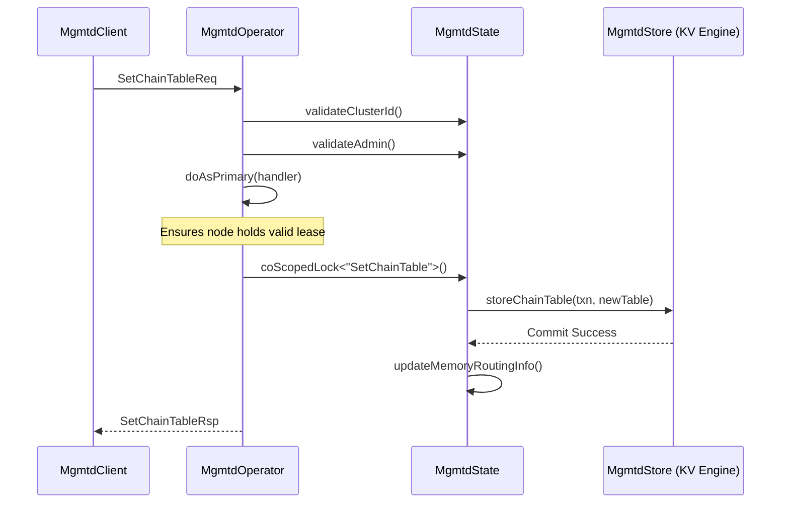
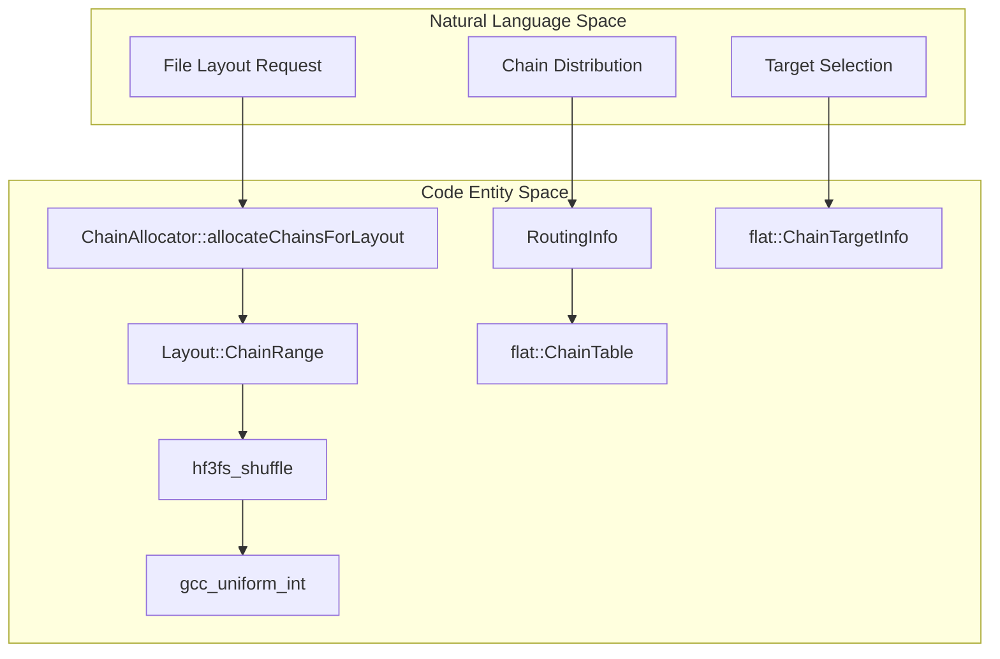

<!-- source: DeepWiki mcp.deepwiki.com · repo deepseek-ai/3FS · page 6.1 Management Service (mgmtd) · fetched 2026-10-30 -->

# Management Service (mgmtd)

Relevant source files

The following files were used as context for generating this wiki page:

- [CMakeLists.txt](CMakeLists.txt)
- [src/common/utils/Shuffle.h](src/common/utils/Shuffle.h)
- [src/common/utils/SimpleRingBuffer.h](src/common/utils/SimpleRingBuffer.h)
- [src/fbs/meta/Schema.cc](src/fbs/meta/Schema.cc)
- [src/meta/components/ChainAllocator.h](src/meta/components/ChainAllocator.h)
- [src/mgmtd/ops/SetChainTableOperation.cc](src/mgmtd/ops/SetChainTableOperation.cc)
- [src/mgmtd/ops/SetChainsOperation.cc](src/mgmtd/ops/SetChainsOperation.cc)
- [tests/common/utils/TestShuffle.cc](tests/common/utils/TestShuffle.cc)
- [tests/mgmtd/TestMgmtdOperator.cc](tests/mgmtd/TestMgmtdOperator.cc)

The Management Service (`mgmtd`) is the central control plane of a 3FS cluster. It is responsible for maintaining the global cluster state, including node membership, routing information (chain tables), and configuration management. It uses a lease-based primary election mechanism to ensure high availability and consistency of the cluster metadata.

## Service Architecture

The `mgmtd` service is built upon the `OnePhaseApplication` framework and consists of several key components:

*   **`MgmtdOperator`**: The primary RPC handler that implements the `MgmtdService` interface. It coordinates requests between the network layer and the internal state. [tests/mgmtd/TestMgmtdOperator.cc:7-7]()
*   **`MgmtdState`**: An in-memory representation of the cluster state, including the routing info and active node heartbeats. [src/mgmtd/ops/SetChainTableOperation.cc:35-35]()
*   **`MgmtdStore`**: The persistence layer that interacts with the underlying KV engine (e.g., FoundationDB or MemKV for testing) to store persistent cluster metadata. [tests/mgmtd/TestMgmtdOperator.cc:50-50]()
*   **Background Workers**: Periodically perform tasks such as lease extension, heartbeat cleanup, and routing info synchronization.

### Data Flow: Request Handling
The following diagram illustrates how a management request (e.g., `SetChainTable`) is processed by the service.

**Management Request Flow**

**Sources:** [src/mgmtd/ops/SetChainTableOperation.cc:35-87](), [tests/mgmtd/TestMgmtdOperator.cc:108-113]()

---

## Primary Election and Leases

The `mgmtd` cluster operates with a primary-backup model. Only the primary node is allowed to perform write operations on the cluster state.

### Lease Mechanism
1.  **Lease Acquisition**: A node attempts to become primary by writing its `PersistentNodeInfo` to a specific key in the KV store with a lease expiration time. [tests/mgmtd/TestMgmtdOperator.cc:50-60]()
2.  **Lease Extension**: The current primary must periodically extend its lease. The interval is configurable via `extend_lease_interval`. [tests/mgmtd/TestMgmtdOperator.cc:25-27]()
3.  **Primary Validation**: Every operation that modifies state (like `SetChainTable` or `RegisterNode`) calls `doAsPrimary`, which checks if the local node still holds the valid lease according to the `MgmtdStore`. [src/mgmtd/ops/SetChainTableOperation.cc:86-86]()

---

## Routing Info and Chain Management

One of the most critical roles of `mgmtd` is managing the `RoutingInfo`. This structure maps `ChainId`s to specific storage targets and organizes them into `ChainTable`s.

### Chain Table Management
A `ChainTable` is a collection of chains used for data placement. When a client or the Metadata Service (`meta`) needs to allocate space for a file, it requests a layout from `mgmtd`.

*   **`SetChainTable`**: Defines a new version of a chain table. It validates that all provided `ChainId`s exist and have consistent target counts. [src/mgmtd/ops/SetChainTableOperation.cc:7-32]()
*   **`SetChains`**: Registers new chains or updates existing ones. It ensures that target IDs are not duplicated and that existing chains are not modified in an incompatible way. [src/mgmtd/ops/SetChainsOperation.cc:60-98]()

### Deterministic Shuffle
To ensure balanced data distribution, 3FS uses a deterministic shuffle algorithm when selecting chains from a table. Because different versions of `libstdc++` (GCC 10 vs GCC 11) produce different results for `std::shuffle`, 3FS implements `hf3fs_shuffle` to guarantee consistency across the cluster regardless of the compiler version used to build individual nodes. [src/common/utils/Shuffle.h:162-172]()

**Chain Allocation Entity Map**

**Sources:** [src/meta/components/ChainAllocator.h:49-65](), [src/common/utils/Shuffle.h:63-96](), [src/fbs/meta/Schema.cc:160-178]()

---

## Node Management and Heartbeats

The `mgmtd` service tracks the liveness of all nodes in the cluster (Storage, Metadata, and Clients).

*   **Registration**: Nodes must call `registerNode` before they can participate in the cluster. [tests/mgmtd/TestMgmtdOperator.cc:87-92]()
*   **Heartbeats**: Nodes periodically send `heartbeat` requests to `mgmtd`. If a node fails to send a heartbeat within the `heartbeat_timestamp_valid_window`, it may be marked as offline. [tests/mgmtd/TestMgmtdOperator.cc:28-29](), [tests/mgmtd/TestMgmtdOperator.cc:72-77]()
*   **Routing Updates**: The `RoutingInfo` version is incremented whenever node states or chain configurations change. Clients use the version to determine if they need to fetch an updated routing table. [src/mgmtd/ops/SetChainTableOperation.cc:40-41]()

---

## Internal Components Reference

### Key Classes and Functions

| Class/Function | File Path | Description |
| :--- | :--- | :--- |
| `MgmtdOperator` | [mgmtd/service/MgmtdOperator.h]() | Main RPC service implementation. |
| `MgmtdStore` | [mgmtd/store/MgmtdStore.h]() | Persistence logic for cluster metadata. |
| `ChainAllocator` | [src/meta/components/ChainAllocator.h:23-23]() | Logic for selecting chains from `RoutingInfo` for new files. |
| `hf3fs_shuffle` | [src/common/utils/Shuffle.h:162-162]() | Cross-compiler compatible deterministic shuffle. |
| `checkChains` | [src/mgmtd/ops/SetChainTableOperation.cc:7-7]() | Validates chain integrity during table updates. |

### Configuration Parameters
The `MgmtdConfig` struct controls the behavior of the management service:
*   `lease_length`: Duration for which a primary lease is valid. [tests/mgmtd/TestMgmtdOperator.cc:25-25]()
*   `extend_lease_interval`: How often the primary attempts to renew its lease. [tests/mgmtd/TestMgmtdOperator.cc:26-26]()
*   `heartbeat_timestamp_valid_window`: Threshold for considering a node heartbeat as stale. [tests/mgmtd/TestMgmtdOperator.cc:28-28]()

**Sources:** [tests/mgmtd/TestMgmtdOperator.cc:25-30](), [src/mgmtd/ops/SetChainTableOperation.cc:1-89](), [src/common/utils/Shuffle.h:1-172]()

---

