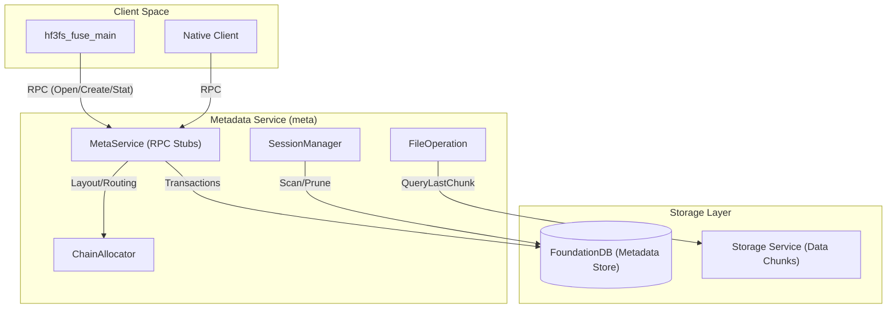
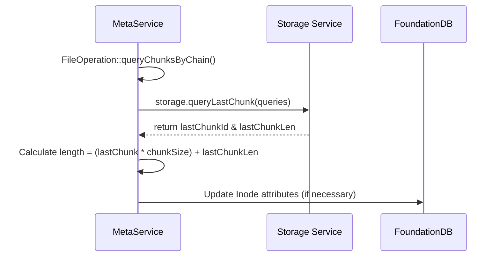

<!-- source: DeepWiki mcp.deepwiki.com · repo deepseek-ai/3FS · page 6.2 Metadata Service (meta) · fetched 2026-10-30 -->

# Metadata Service (meta)

Relevant source files

The following files were used as context for generating this wiki page:

- [CMakeLists.txt](CMakeLists.txt)
- [docs/design_notes.md](docs/design_notes.md)
- [specs/README.md](specs/README.md)
- [src/common/utils/Shuffle.h](src/common/utils/Shuffle.h)
- [src/fbs/meta/FileOperation.cc](src/fbs/meta/FileOperation.cc)
- [src/fbs/meta/Schema.cc](src/fbs/meta/Schema.cc)
- [src/lib/api/UsrbIo.md](src/lib/api/UsrbIo.md)
- [src/meta/components/ChainAllocator.h](src/meta/components/ChainAllocator.h)
- [src/meta/components/SessionManager.h](src/meta/components/SessionManager.h)
- [src/stubs/CMakeLists.txt](src/stubs/CMakeLists.txt)
- [tests/common/utils/TestShuffle.cc](tests/common/utils/TestShuffle.cc)
- [tests/meta/event/TestEventLogger.cc](tests/meta/event/TestEventLogger.cc)

The Metadata Service (meta) is a critical component of 3FS responsible for implementing file system semantics. It provides a stateless service layer that manages inodes, directory entries, and file sessions, using FoundationDB (FDB) as its transactional persistent back-end.

## 1. Overview and Architecture

The metadata service acts as the bridge between client FUSE/native requests and the persistent metadata stored in FoundationDB. Because all state is persisted in FDB, the metadata service itself is stateless, allowing clients to connect to any available metadata node.

### Key Responsibilities
*   **Inode Management**: Creation, deletion, and attribute updates for files and directories.
*   **Directory Operations**: Atomic directory manipulation (move, recursive delete) and directory entry (dentry) management.
*   **Session Management**: Tracking open file sessions and handling lease-based cleanups.
*   **Chain Allocation**: Determining which storage chains should host a file's data chunks based on layout policies.
*   **ACL Enforcement**: Validating user permissions (UID/GID) against stored Access Control Lists.

### Metadata Service Interaction
The following diagram illustrates how the `MetaService` interacts with other system components:

**Metadata Service Interaction Diagram**

Sources: [docs/design_notes.md:9-11](), [src/meta/components/SessionManager.h:44-71](), [src/meta/components/ChainAllocator.h:23-26]()

---

## 2. Inode and File Management

3FS metadata is organized into Inodes. Files are split into equally sized chunks, which are striped across multiple replication chains.

### File Layout and Chaining
The `Layout` class defines how a file's data is distributed. It includes the `ChainTableId`, `chunkSize`, and `stripeSize` [src/fbs/meta/Schema.cc:93-127]().

*   **Chunk Identification**: The `getChunkId` function calculates the specific `ChunkId` for a given file offset [src/fbs/meta/Schema.cc:62-73]().
*   **Chain Mapping**: The `getChainId` function maps a file offset to a specific `ChainId` by consulting the `RoutingInfo` provided by the Management Service (mgmtd) [src/fbs/meta/Schema.cc:75-91]().

### Chain Allocation
The `ChainAllocator` is responsible for selecting storage chains for new files. It ensures that data placement follows the cluster's routing logic.

| Function | Description |
| :--- | :--- |
| `checkLayoutValid` | Validates that the requested layout (stripe/chunk size) is supported by the current routing table [src/meta/components/ChainAllocator.h:28-47](). |
| `allocateChainsForLayout` | Performs a round-robin allocation of chains for a new file to balance load across the storage cluster [src/meta/components/ChainAllocator.h:49-80](). |

Sources: [src/fbs/meta/Schema.cc:62-127](), [src/meta/components/ChainAllocator.h:23-127]()

---

## 3. File Operations and Storage Interaction

While the metadata service primarily talks to FDB, it occasionally interacts with the Storage Service to synchronize file states, specifically for determining the actual length of a file.

### Querying File Length
Because writes are handled directly between clients and storage nodes (CRAQ), the metadata service may not always have the most up-to-date file length. The `FileOperation::queryChunks` and `queryChunksByChain` functions are used to query storage nodes for the `lastChunkId` to calculate the current file size [src/fbs/meta/FileOperation.cc:45-79]().

**File Length Discovery Flow**

Sources: [src/fbs/meta/FileOperation.cc:45-124](), [docs/design_notes.md:53-55]()

---

## 4. Session Management

The `SessionManager` tracks active file sessions to handle multi-client coordination and cleanup.

### Session Lifecycle
*   **Creation**: When a client opens a file, a session is created and persisted in FDB.
*   **Heartbeats**: Clients must maintain sessions; otherwise, they are considered stale.
*   **Pruning**: The `SessionManager` runs background `ScanTask` workers that identify timed-out sessions [src/meta/components/SessionManager.h:91-102]().
*   **Cleanup**: Stale sessions are processed by `CloseTask` workers, which perform necessary metadata cleanups and synchronization [src/meta/components/SessionManager.h:105-113]().

### Configuration
Session behavior is controlled via hot-updatable parameters:
*   `scan_interval`: Default 5 minutes [src/meta/components/SessionManager.h:48]().
*   `session_timeout`: Default 5 minutes [src/meta/components/SessionManager.h:51]().

Sources: [src/meta/components/SessionManager.h:44-60](), [src/meta/components/SessionManager.h:105-126]()

---

## 5. Security and ACL Enforcement

3FS implements POSIX-style permissions via the `Acl` class.

### Permission Logic
The `checkPermission` function validates a `UserInfo` object against the Inode's `uid`, `gid`, and `perm` bits:
1.  **Root**: UID 0 is always granted access [src/fbs/meta/Schema.cc:27-28]().
2.  **Owner**: If `user.uid == acl.uid`, owner bits are checked [src/fbs/meta/Schema.cc:29-30]().
3.  **Group**: If the user is in the Inode's group, group bits are checked [src/fbs/meta/Schema.cc:31-32]().
4.  **Other**: Otherwise, the "other" bits are used [src/fbs/meta/Schema.cc:33-34]().

### Recursive Operations
For operations like `rm -rf`, the `checkRecursiveRmPerm` function ensures the user has write/execute permissions on the directory and handles the "sticky bit" (S_ISVTX) correctly [src/fbs/meta/Schema.cc:48-60]().

Sources: [src/fbs/meta/Schema.cc:25-60]()

---

## 6. Implementation Details

### Shuffle Methods
To ensure uniform data distribution, 3FS uses various shuffle algorithms when selecting chains. The system supports `stdshuffle`, `g++10`, and `g++11` shuffle implementations to maintain compatibility across different compiler versions [CMakeLists.txt:30-32]().

The `hf3fs_shuffle` utility wraps these implementations, and the `find_safe_seed` function is used to find seeds that produce consistent results across different GCC versions [src/common/utils/Shuffle.h:162-206]().

### Performance Instrumentation
Metadata operations are heavily instrumented using recorders to track latency for:
*   `queryLastChunkLatency`
*   `queryTotalChunkLatency`
*   Failed operation counts [src/fbs/meta/FileOperation.cc:14-30]().

Sources: [CMakeLists.txt:30-54](), [src/common/utils/Shuffle.h:162-206](), [src/fbs/meta/FileOperation.cc:114-123]()

---

