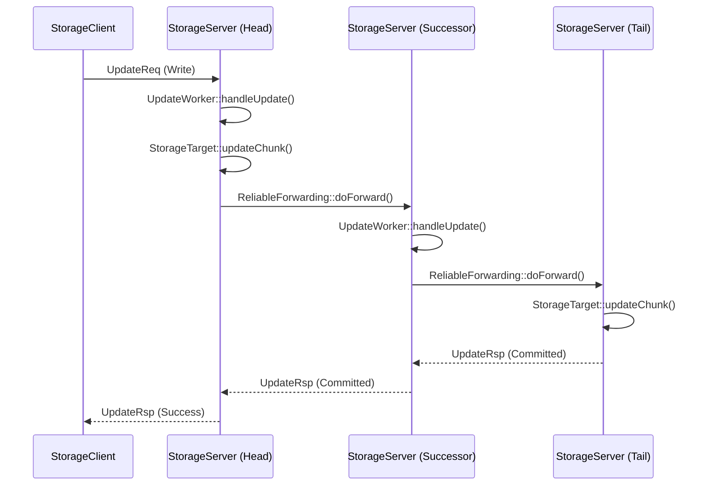
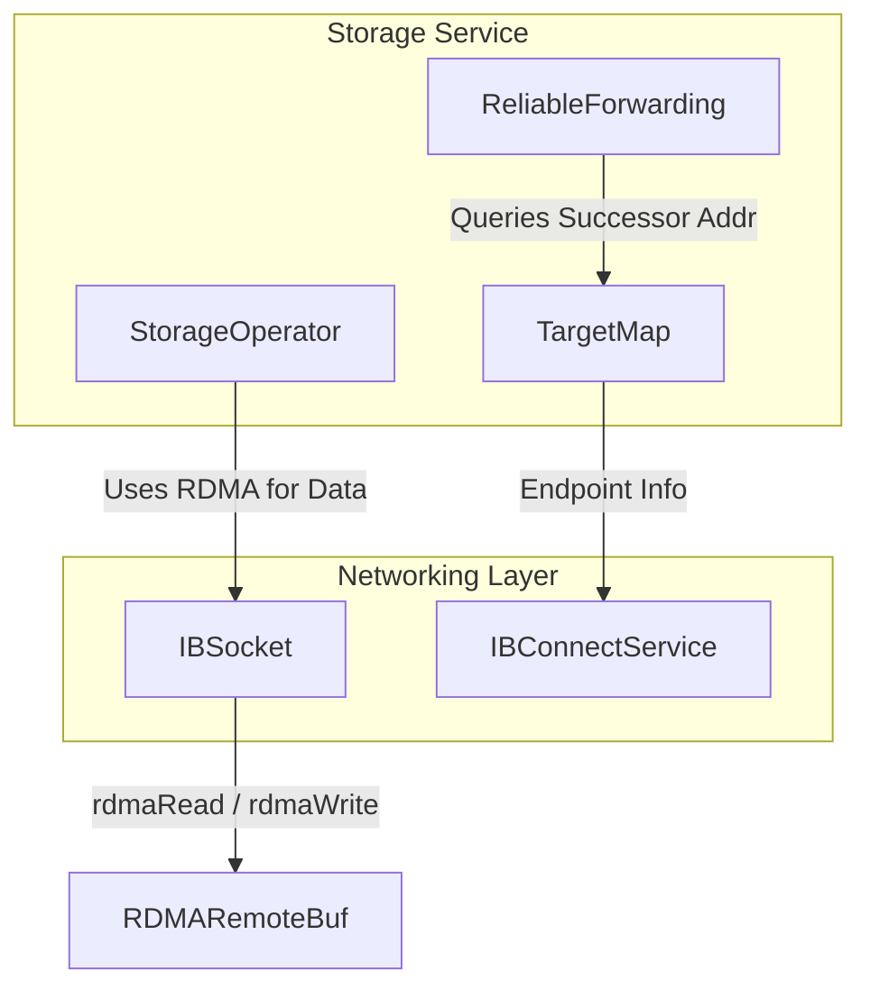
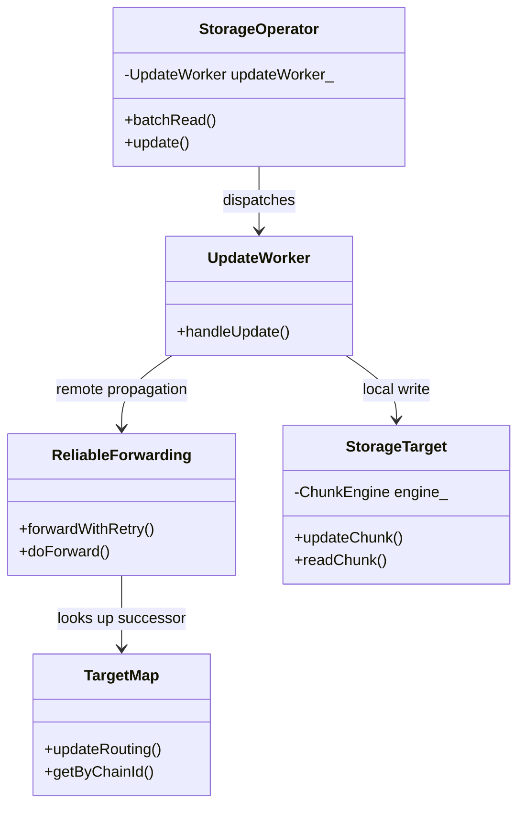

<!-- source: DeepWiki mcp.deepwiki.com · repo deepseek-ai/3FS · page 6.3 Storage Service · fetched 2026-10-30 -->

# Storage Service

Relevant source files

The following files were used as context for generating this wiki page:

- [src/common/net/ib/IBConnect.cc](src/common/net/ib/IBConnect.cc)
- [src/common/net/ib/IBSocket.cc](src/common/net/ib/IBSocket.cc)
- [src/common/net/ib/IBSocket.h](src/common/net/ib/IBSocket.h)
- [src/storage/service/ReliableForwarding.cc](src/storage/service/ReliableForwarding.cc)
- [src/storage/service/StorageOperator.cc](src/storage/service/StorageOperator.cc)
- [src/storage/service/TargetMap.cc](src/storage/service/TargetMap.cc)
- [src/storage/store/StorageTarget.cc](src/storage/store/StorageTarget.cc)
- [src/storage/store/StorageTargets.cc](src/storage/store/StorageTargets.cc)
- [src/storage/sync/ResyncWorker.cc](src/storage/sync/ResyncWorker.cc)
- [src/storage/worker/CheckWorker.cc](src/storage/worker/CheckWorker.cc)
- [src/storage/worker/DumpWorker.cc](src/storage/worker/DumpWorker.cc)

The Storage Service is a core component of 3FS responsible for the persistent storage of data chunks, replication management via the CRAQ (Chain Replication with Apportioned Queries) model, and high-performance I/O handling using RDMA and asynchronous I/O (AIO).

## Architecture Overview

The Storage Service operates as a distributed system where data is organized into "chains". Each chain consists of multiple storage targets (replicas) distributed across different physical nodes.

### Key Responsibilities
*   **Data Persistence**: Storing data chunks using the `ChunkEngine` or a file-based `ChunkStore`.
*   **CRAQ Replication**: Implementing the chain replication protocol where writes flow from the Head to the Tail, and reads can be serviced by any node in the chain (with version checks).
*   **High-Performance I/O**: Utilizing RDMA for zero-copy data transfer and AIO read workers for non-blocking disk access.
*   **Background Maintenance**: Continuous health checking, data resynchronization, and metadata dumping.

### Data Flow: Write Path (CRAQ)
The following diagram illustrates how a write request flows through the storage service using `ReliableForwarding` and `UpdateJob`.

Sources: [src/storage/service/ReliableForwarding.cc:106-136](), [src/storage/service/StorageOperator.cc:36-53]()

---

## Core Components

### StorageOperator
The `StorageOperator` is the primary RPC handler for storage operations. It dispatches requests to specialized workers and manages the lifecycle of I/O operations.

*   **`batchRead`**: Handles multiple read requests by enqueuing them to AIO workers. It prepares RDMA buffers and validates target states [src/storage/service/StorageOperator.cc:82-150]().
*   **`update`**: Handles write, truncate, and remove operations. It utilizes `UpdateWorker` to manage concurrency and `ReliableForwarding` to propagate changes down the replication chain [src/storage/service/StorageOperator.cc:14-15]().

### ReliableForwarding
`ReliableForwarding` ensures that updates are correctly propagated through the chain. It includes retry logic with exponential backoff [src/storage/service/ReliableForwarding.cc:45-47]().

*   **`forwardWithRetry`**: The entry point for sending updates to the next node in the chain [src/storage/service/ReliableForwarding.cc:33-39]().
*   **`doForward`**: Performs the actual RPC call to the successor. If the successor is in a `SYNCING` state, it adjusts the request options to ensure consistency [src/storage/service/ReliableForwarding.cc:138-156]().

### Target Management
Targets represent the physical storage units on a node. They are managed via `StorageTargets` and `TargetMap`.

| Class | Description |
| :--- | :--- |
| `StorageTarget` | Represents a single replica of a chain on a specific disk [src/storage/store/StorageTarget.h:1-10](). |
| `TargetMap` | Maintains a snapshot of all local targets and their roles (Head/Tail) in the routing table [src/storage/service/TargetMap.h:1-10](). |
| `StorageTargets` | Handles the initialization of physical disks and the creation of `ChunkEngine` instances [src/storage/store/StorageTargets.cc:27-74](). |

Sources: [src/storage/store/StorageTarget.cc:60-77](), [src/storage/service/TargetMap.cc:124-161]()

---

## Networking and RDMA Integration

The storage service relies heavily on `IBSocket` for RDMA-based data transfers. This allows the service to read data directly from disk into RDMA-registered memory and then transfer it to the client without CPU intervention for the data payload.

### RDMA Data Path Entity Mapping
The diagram below bridges the networking abstractions to the storage logic.

Sources: [src/common/net/ib/IBSocket.h:81-125](), [src/storage/service/ReliableForwarding.cc:106-112](), [src/storage/service/TargetMap.cc:16-33]()

---

## Background Workers

The Storage Service runs several background threads to maintain system health and performance.

### CheckWorker
`CheckWorker` monitors physical disk health and capacity.
*   **Disk Monitoring**: Periodically calls `boost::filesystem::space` to check for low space or read-only filesystems [src/storage/worker/CheckWorker.cc:151-160]().
*   **Target Recovery**: Attempts to reload targets that have gone offline [src/storage/worker/CheckWorker.cc:126-145]().

### ResyncWorker
`ResyncWorker` is responsible for synchronizing data when a new node joins a chain or a node recovers from failure.
*   **`handleSync`**: Compares local chunk metadata with the successor's metadata and fetches missing or outdated chunks [src/storage/sync/ResyncWorker.cc:101-165]().
*   **Full Sync**: Supports different levels of synchronization (NONE, LIGHT, HEAVY) to balance recovery speed and system load [src/storage/sync/ResyncWorker.cc:102-105]().

### DumpWorker
`DumpWorker` provides observability and persistence for storage metadata.
*   **Metadata Dumping**: Periodically serializes all `ChunkMetadata` for all local targets to a specified root path [src/storage/worker/DumpWorker.cc:100-140]().
*   **CPU Profiling**: Automatically starts a gperftools profiler if CPU usage exceeds a configured threshold [src/storage/worker/DumpWorker.cc:63-74]().

---

## Implementation Details: StorageTarget Lifecycle

A `StorageTarget` undergoes a specific initialization and creation sequence.

1.  **Creation**: When a new target is requested, `StorageTarget::create` is called. It verifies if a `target.toml` sentinel file exists [src/storage/store/StorageTarget.cc:89-113]().
2.  **Engine Init**: It initializes the underlying `ChunkEngine` (Rust-based) or `ChunkStore` [src/storage/store/StorageTarget.cc:123-133]().
3.  **UUID Verification**: To prevent data corruption, it verifies the block device UUID against the one stored in the configuration [src/storage/store/StorageTarget.cc:135-142]().
4.  **Registration**: Once created, the target is added to the `TargetMap` for routing [src/storage/store/StorageTargets.cc:118-119]().

### Code Entity Relationship Diagram

Sources: [src/storage/service/StorageOperator.cc:60-73](), [src/storage/service/ReliableForwarding.cc:51-55](), [src/storage/service/TargetMap.cc:55-77]()

---

