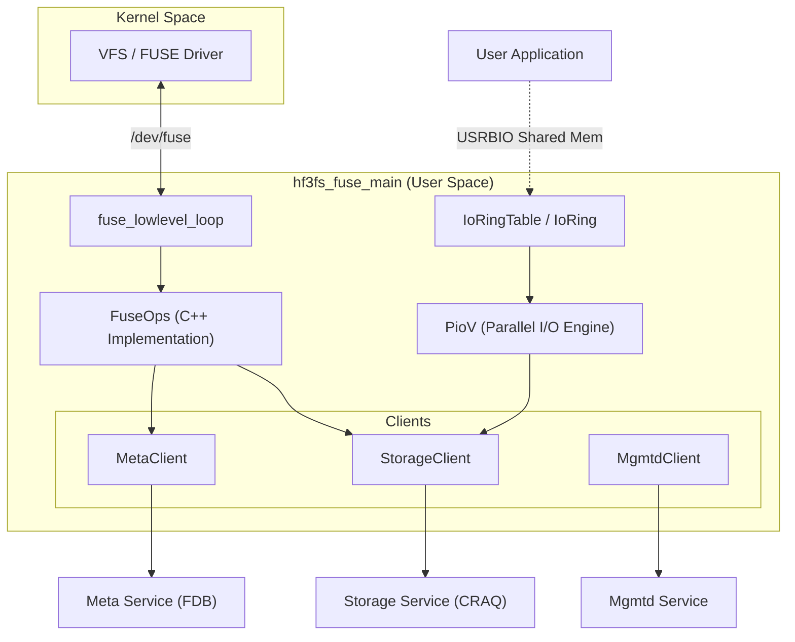
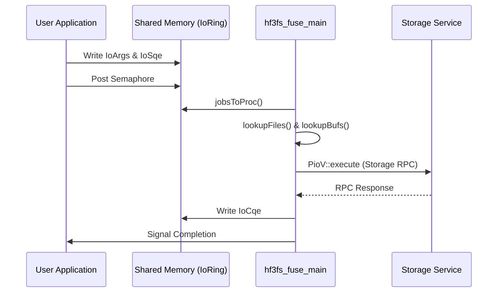

<!-- source: DeepWiki mcp.deepwiki.com · repo deepseek-ai/3FS · page 6.4 FUSE Client · fetched 2026-10-30 -->

# FUSE Client

<details>
<summary>Relevant source files</summary>

The following files were used as context for generating this wiki page:

- [configs/hf3fs_fuse_main.toml](configs/hf3fs_fuse_main.toml)
- [src/fuse/FuseConfig.h](src/fuse/FuseConfig.h)
- [src/fuse/FuseOps.cc](src/fuse/FuseOps.cc)
- [src/fuse/IoRing.cc](src/fuse/IoRing.cc)
- [src/fuse/IoRing.h](src/fuse/IoRing.h)
- [tests/fuse/config/admin_cli.toml](tests/fuse/config/admin_cli.toml)
- [tests/fuse/config/hf3fs_fuse_main.toml](tests/fuse/config/hf3fs_fuse_main.toml)
- [tests/fuse/config/hf3fs_fuse_main_launcher.toml](tests/fuse/config/hf3fs_fuse_main_launcher.toml)
- [tests/fuse/config/meta_main.toml](tests/fuse/config/meta_main.toml)
- [tests/fuse/config/mgmtd_main.toml](tests/fuse/config/mgmtd_main.toml)
- [tests/fuse/config/mgmtd_main_launcher.toml](tests/fuse/config/mgmtd_main_launcher.toml)
- [tests/fuse/config/storage_main.toml](tests/fuse/config/storage_main.toml)
- [tests/fuse/run.sh](tests/fuse/run.sh)

</details>


The 3FS FUSE Client (`hf3fs_fuse_main`) is the primary user-space interface for accessing the distributed file system. It translates standard POSIX file operations into distributed RPC calls to the Metadata (Meta) and Storage services. Beyond standard FUSE operations, it implements a high-performance **USRBIO** (User-space I/O) interface that bypasses the kernel FUSE overhead using shared memory rings and parallel I/O engines.

## Architecture and Data Flow

The FUSE client acts as a bridge between the Linux kernel FUSE driver and the 3FS distributed services. It utilizes `libfuse3` for the low-level FUSE loop while providing a custom asynchronous implementation for I/O operations.

### Component Interaction Diagram
This diagram shows how the `hf3fs_fuse_main` process coordinates between kernel requests and the distributed backend.


**Sources:** [src/fuse/FuseOps.cc:54-61](), [src/fuse/IoRing.h:217-228](), [src/fuse/FuseConfig.h:39-42]()

---

## FUSE Operations (FuseOps)

The client implements the `fuse_lowlevel_ops` interface defined in `libfuse3`. These operations are mostly stateless, relying on the `MetaClient` to resolve inodes and `StorageClient` for data transfer.

### Key Mappings and Logic
*   **Inode Translation:** Internal 3FS `InodeId` values are mapped to FUSE `fuse_ino_t`. The root inode is mapped via `real_ino` and `linux_ino` functions [src/fuse/FuseOps.cc:175-193]().
*   **Stat Filling:** The `fillLinuxStat` function populates the `struct stat` structure, mapping 3FS metadata (ACLs, timestamps, file sizes) to POSIX-compliant fields [src/fuse/FuseOps.cc:201-223]().
*   **Request Context:** Every FUSE request is wrapped in a `RequestInfo` object to support cancellation and tracking [src/fuse/FuseOps.cc:64-83]().

**Sources:** [src/fuse/FuseOps.cc:1-223]()

---

## USRBIO: Shared Memory I/O Interface

To overcome the performance bottlenecks of the kernel FUSE driver (context switching and data copying), 3FS provides **USRBIO**. This interface allows applications to submit I/O requests directly to the FUSE client process via shared memory.

### IoRing and IovTable
The USRBIO system uses an `IoRing` structure, modeled after Linux's `io_uring`, to manage submission and completion queues in shared memory.

*   **IoRing:** Contains `IoArgs` (submission entries), `IoSqe` (submission queue entries), and `IoCqe` (completion queue entries) [src/fuse/IoRing.h:17-39]().
*   **Shared Memory:** Memory is allocated and managed using `lib::ShmBuf`. The ring is initialized with a marker size and specific entry counts based on the buffer size [src/fuse/IoRing.h:55-71]().
*   **Synchronization:** Uses a `sem_t` (semaphore) stored within the shared memory region to notify the client of new work [src/fuse/IoRing.h:115-119]().

### IoRing Data Structures
| Structure | Purpose |
| :--- | :--- |
| `IoArgs` | Contains `fileIid`, `fileOff`, `ioLen`, and `bufId` for the I/O operation [src/fuse/IoRing.h:17-27](). |
| `IoSqe` | A pointer to an index in the `ringSection` (IoArgs array) [src/fuse/IoRing.h:29-32](). |
| `IoCqe` | Stores the `result` (bytes read/written or error code) of the operation [src/fuse/IoRing.h:34-39](). |

**Sources:** [src/fuse/IoRing.h:1-130]()

---

## PioV: Parallel I/O Execution

When `IoRing` jobs are harvested by the FUSE client's background workers, they are processed using `PioV` (Parallel I/O Vector).

### Execution Flow
1.  **Job Harvesting:** `IoRing::jobsToProc` identifies available SQEs in the shared memory ring [src/fuse/IoRing.cc:15-65]().
2.  **Preparation:** The client looks up the internal `RcInode` and validates the shared memory buffers (`ShmBufForIO`) [src/fuse/IoRing.cc:105-118]().
3.  **Submission:** `PioV::addRead` or `PioV::addWrite` is called for each entry. These methods batch requests to the `StorageClient` [src/fuse/IoRing.cc:171-177]().
4.  **Completion:** Once the storage RPC returns, results are written back to the `IoCqe` section of the shared memory, and the application is notified via the semaphore [src/fuse/IoRing.cc:190-203]().


**Sources:** [src/fuse/IoRing.cc:15-180](), [src/fuse/IoRing.h:43-53]()

---

## Configuration

The FUSE client is configured via a TOML file (usually `hf3fs_fuse_main.toml`). Key parameters control performance, caching, and connection behavior.

### Critical Parameters
*   **`max_threads`**: Maximum number of FUSE worker threads (default: 256) [src/fuse/FuseConfig.h:35]().
*   **`max_readahead`**: Kernel readahead limit (default: 16MB) [src/fuse/FuseConfig.h:36]().
*   **`enable_read_cache`**: Enables client-side caching of read data [src/fuse/FuseConfig.h:31]().
*   **`io_jobq_size`**: Size of the queue for USRBIO jobs [src/fuse/FuseConfig.h:45]().
*   **`periodic_sync`**: Configures background synchronization of dirty data [src/fuse/FuseConfig.h:83-90]().

**Sources:** [src/fuse/FuseConfig.h:11-91](), [configs/hf3fs_fuse_main.toml:1-32]()

## Deployment and Lifecycle

The FUSE client is typically launched via a launcher configuration that specifies the mountpoint and management service addresses.

### Mounting Process
In a test or CI environment, the FUSE client is started after the `mgmtd`, `meta`, and `storage` services are ready. The `hf3fs_fuse_main` binary is executed with `--launcher_config.mountpoint`.

```bash
# Example from CI test script
"${BINARY}/hf3fs_fuse_main" \
    --launcher_cfg "${CONFIG}/hf3fs_fuse_main_launcher.toml" \
    --launcher_config.mountpoint="${MOUNT}" &
```
**Sources:** [tests/fuse/run.sh:207-210](), [tests/fuse/config/hf3fs_fuse_main_launcher.toml:1-10]()

---

