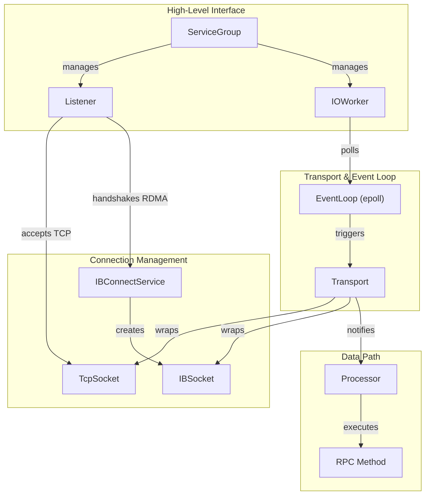
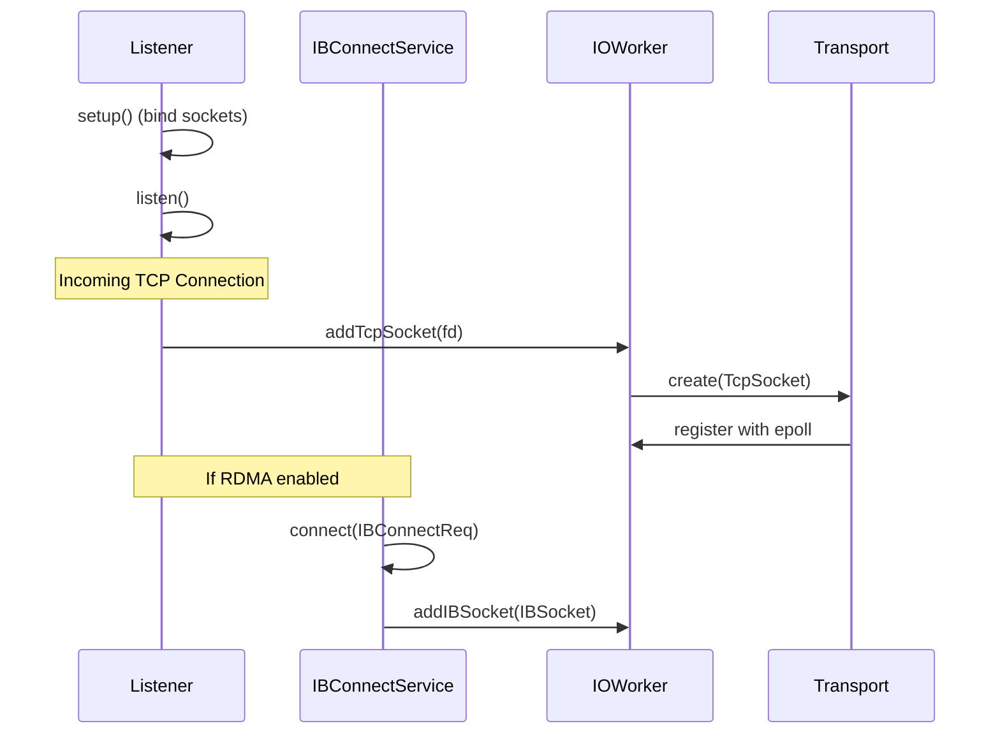

<!-- source: DeepWiki mcp.deepwiki.com · repo deepseek-ai/3FS · page 7 Networking Layer · fetched 2026-10-30 -->

# Networking Layer

Relevant source files

The following files were used as context for generating this wiki page:

- [configs/storage_main.toml](configs/storage_main.toml)
- [src/common/net/IOWorker.cc](src/common/net/IOWorker.cc)
- [src/common/net/Listener.cc](src/common/net/Listener.cc)
- [src/common/net/Listener.h](src/common/net/Listener.h)
- [src/common/net/ib/IBConnect.cc](src/common/net/ib/IBConnect.cc)
- [src/common/net/ib/IBSocket.cc](src/common/net/ib/IBSocket.cc)
- [src/common/net/ib/IBSocket.h](src/common/net/ib/IBSocket.h)
- [src/storage/store/StorageTargets.cc](src/storage/store/StorageTargets.cc)

The 3FS Networking Layer provides a high-performance, multi-protocol communication infrastructure designed specifically for distributed storage workloads. It leverages RDMA (Remote Direct Memory Access) via InfiniBand or RoCE for low-latency data transfers, while maintaining a robust TCP fallback for control plane operations and environments without RDMA hardware.

The layer is architected around an asynchronous event-driven model using `folly::coro` and a dedicated `IOWorker` pool to ensure high throughput and efficient CPU utilization.

### Architecture Overview

The networking stack is organized into several functional components that bridge high-level RPC requests to low-level hardware transports.

#### Code Entity Map
The following diagram maps high-level networking concepts to their primary C++ implementation classes.

**Networking Entity Mapping**

**Sources:** [src/common/net/Listener.h:18-78](), [src/common/net/IOWorker.h:1-58](), [src/common/net/ib/IBSocket.h:81-152]()

---

### RDMA and InfiniBand Transport

3FS implements a custom RDMA transport layer optimized for storage. Unlike standard socket-based RDMA (RSockets), 3FS uses Verbs directly to implement a credit-based flow control system and zero-copy data transfers.

*   **IBSocket**: The core abstraction for an RDMA connection, managing Queue Pairs (QP), Completion Queues (CQ), and memory registration (MR) [src/common/net/ib/IBSocket.h:81-122]().
*   **RDMA Operations**: Supports standard `rdmaRead` and `rdmaWrite` operations, as well as `RDMAReqBatch` for combining multiple RDMA requests into a single hardware post to reduce CPU overhead [src/common/net/ib/IBSocket.h:155-200]().
*   **Connection Handshake**: RDMA connections are established via a TCP-based handshake managed by `IBConnectService`. This service exchanges GIDs, QPNs, and PSNs between peers before transitioning the RDMA QP to the Ready-to-Send (RTS) state [src/common/net/ib/IBConnect.cc:134-177]().

For details, see [RDMA and InfiniBand Transport](#7.1).

**Sources:** [src/common/net/ib/IBSocket.cc:169-190](), [src/common/net/ib/IBConnect.cc:95-132]()

---

### Network Listener and IOWorker

The lifecycle of network connections and the execution of I/O events are managed by the `Listener` and `IOWorker` classes.

*   **Listener**: Responsible for binding to local interfaces and accepting incoming connections. It automatically detects available NICs and can filter by prefix (e.g., `eth`, `ib`, `bond`) [src/common/net/Listener.cc:33-49](). It handles both standard TCP `ServerSocket` and the complex RDMA handshake initiation [src/common/net/Listener.cc:119-127]().
*   **IOWorker**: Acts as the engine for the networking layer. It maintains a pool of `Transport` objects and runs an `epoll`-based event loop [src/common/net/IOWorker.cc:28-44]().
*   **Event Loop**: I/O events (EPOLLIN/EPOLLOUT) trigger callbacks on the `Transport`. Depending on configuration, the actual read/write operations can be performed directly in the event thread or offloaded to a thread pool to prevent blocking the loop [src/common/net/IOWorker.cc:118-136]().

**Connection Flow**

**Sources:** [src/common/net/Listener.cc:94-116](), [src/common/net/IOWorker.cc:46-58]()

For details, see [Network Listener and IOWorker](#7.2).

---

### RPC and Serialization Framework

The networking layer serves as the transport for the 3FS RPC framework. This framework uses a `serde`-based approach for efficient serialization of request and response objects.

*   **Service Definitions**: Services like `StorageSerde` or `MgmtdService` define their RPC interfaces, which are then bound to a `ServiceGroup` for dispatching [configs/storage_main.toml:106,165]().
*   **Protocol Support**: The RPC layer is transport-agnostic, allowing the same service logic to run over TCP (for control messages) or RDMA (for data-heavy operations).
*   **Serialization**: High-performance serialization is critical for 3FS. The framework supports compression for large responses and integrates with the `RDMABuf` pool for zero-copy data transmission in storage operations [configs/storage_main.toml:158-159, 219-223]().

For details, see [RPC and Serialization Framework](#7.3).

**Sources:** [src/common/net/ib/IBSocket.h:73-79](), [configs/storage_main.toml:102-110]()

---

