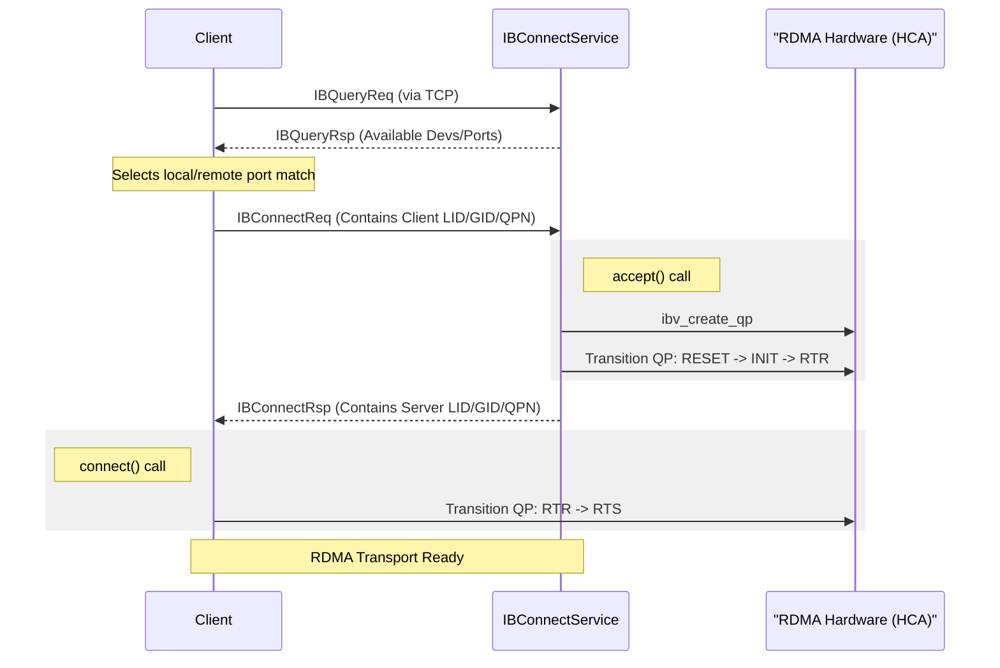
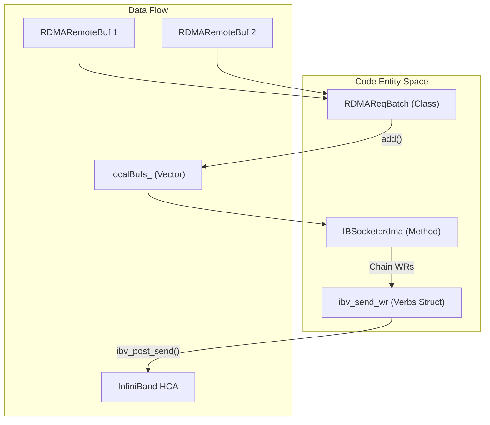

<!-- source: DeepWiki mcp.deepwiki.com · repo deepseek-ai/3FS · page 7.1 RDMA and InfiniBand Transport · fetched 2026-10-30 -->

# RDMA and InfiniBand Transport

Relevant source files

The following files were used as context for generating this wiki page:

- [src/common/net/ib/IBConnect.cc](src/common/net/ib/IBConnect.cc)
- [src/common/net/ib/IBConnect.h](src/common/net/ib/IBConnect.h)
- [src/common/net/ib/IBDevice.cc](src/common/net/ib/IBDevice.cc)
- [src/common/net/ib/IBSocket.cc](src/common/net/ib/IBSocket.cc)
- [src/common/net/ib/IBSocket.h](src/common/net/ib/IBSocket.h)
- [src/common/utils/UtcTimeSerde.h](src/common/utils/UtcTimeSerde.h)
- [src/fbs/storage/Common.h](src/fbs/storage/Common.h)
- [src/storage/chunk_engine/src/utils/aligned.rs](src/storage/chunk_engine/src/utils/aligned.rs)
- [src/storage/store/StorageTargets.cc](src/storage/store/StorageTargets.cc)

This page documents the high-performance networking transport layer in 3FS, focusing on RDMA (Remote Direct Memory Access) over InfiniBand and RoCE (RDMA over Converged Ethernet). The transport layer provides zero-copy data transfer, credit-based flow control, and efficient connection management.

## Architecture Overview

The networking layer is built around `IBSocket`, which abstracts a Verbs-based Queue Pair (QP). Connection establishment is handled by `IBConnectService` via a side-channel (typically TCP), allowing nodes to exchange hardware capabilities and connection parameters before transitioning the QP to the Ready-to-Send (RTS) state.

### Core Transport Components

| Component | Description |
| :--- | :--- |
| `IBDevice` | Manages physical RDMA hardware, memory registration (MR), and port attributes. |
| `IBSocket` | A socket-like abstraction for an RDMA Queue Pair, managing Send/Recv and RDMA Read/Write. |
| `IBConnectService` | An RPC service used to exchange connection metadata (LID, GID, QP Number). |
| `RDMABuf` | Abstraction for memory regions registered with the HCA for RDMA operations. |

Sources: `[src/common/net/ib/IBSocket.h:77-81]()`, `[src/common/net/ib/IBConnect.h:94-96]()`, `[src/common/net/ib/IBDevice.h:1-2]()`

## Connection Lifecycle and Setup

Establishing an RDMA connection involves a handshake over a management transport (TCP) to exchange InfiniBand-specific identifiers.

### Connection Handshake Data Flow
The diagram below illustrates how `IBConnectService` and `IBConnectReq` facilitate the transition from a standard TCP connection to a functional RDMA Queue Pair.

Sources: `[src/common/net/ib/IBConnect.cc:95-132]()`, `[src/common/net/ib/IBConnect.cc:134-177]()`, `[src/common/net/ib/IBSocket.cc:413-460]()`

## IBSocket Implementation

`IBSocket` implements the `Socket` interface but uses InfiniBand Verbs for the data path. It maintains internal buffers for control messages and uses a credit-based system to prevent receiver buffer overflow.

### Credit-Based Flow Control
To avoid `RNR` (Receiver Not Ready) errors, `IBSocket` manages `send_buf_cnt` and `buf_ack_batch`.
- **Send Buffers**: Pre-allocated and registered memory for outgoing messages `[src/common/net/ib/IBSocket.h:109-111]()`.
- **Flow Control**: The sender tracks available credits on the remote side. Credits are replenished via immediate data or explicit ACK messages bundled with data transfers `[src/common/net/ib/IBConnect.h:101-106]()`.

### Key Functions
- `IBSocket::connect`: Initiates the RDMA handshake `[src/common/net/ib/IBSocket.cc:328-360]()`.
- `IBSocket::rdma`: The underlying implementation for `rdmaRead` and `rdmaWrite` using `ibv_post_send` `[src/common/net/ib/IBSocket.cc:837-880]()`.
- `IBSocket::poll`: Checks the Completion Queue (CQ) for work completions (`ibv_wc`) and handles flow control updates `[src/common/net/ib/IBSocket.cc:535-600]()`.

Sources: `[src/common/net/ib/IBSocket.h:122-168]()`, `[src/common/net/ib/IBSocket.cc:169-190]()`

## RDMA Operations and Batching

3FS optimizes high-throughput workloads by batching RDMA requests. This reduces the number of doorbells rung on the HCA.

### RDMA Batching Logic
The `RDMAReqBatch` class allows multiple RDMA Read or Write operations to be queued and sent in a single `ibv_post_send` call.

Sources: `[src/common/net/ib/IBSocket.h:186-210]()`, `[src/common/net/ib/IBSocket.cc:918-950]()`

## RoCE Support

3FS supports RoCE v2 (RDMA over Converged Ethernet) by identifying GID (Global Identifier) types in sysfs and configuring the transport for Layer 3 routing.

- **GID Selection**: `IBDevice` scans `/sys/class/infiniband` to find RoCE v2 GIDs (Type "RoCE v2") `[src/common/net/ib/IBDevice.cc:94-138]()`.
- **PCI Mapping**: To correlate IB devices with Ethernet interfaces, 3FS implements a custom `ibdev2netdev` logic that parses PCI bus IDs from `/sys/class/net` `[src/common/net/ib/IBDevice.cc:189-210]()`.
- **Configuration**: RoCE specific parameters like `traffic_class` and `roce_pkey_index` (usually 0) are managed in `IBSocket::Config` `[src/common/net/ib/IBSocket.h:83-93]()`.

Sources: `[src/common/net/ib/IBDevice.cc:71-74]()`, `[src/common/net/ib/IBConnect.h:116-122]()`

## Performance Monitoring

The RDMA transport layer integrates with the 3FS metrics system to track throughput and latency at the Verbs level.

| Metric | Code Entity | Description |
| :--- | :--- | :--- |
| `common.ib.rdma_read_bytes` | `rdmaReadBytes` | Total bytes read via RDMA Read `[src/common/net/ib/IBSocket.cc:134]()` |
| `common.ib.rdma_write_bytes` | `rdmaWriteBytes` | Total bytes written via RDMA Write `[src/common/net/ib/IBSocket.cc:135]()` |
| `common.ib.rdma_read_latency` | `rdmaReadLatency` | Latency of RDMA Read completions `[src/common/net/ib/IBSocket.cc:137]()` |
| `common.ib.poll_cq_failed` | `pollCqFailed` | Count of `ibv_poll_cq` errors `[src/common/net/ib/IBSocket.cc:131]()` |

Sources: `[src/common/net/ib/IBSocket.cc:117-140]()`

---

