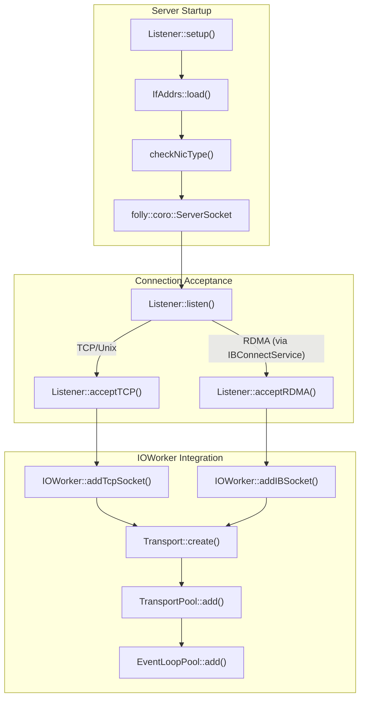
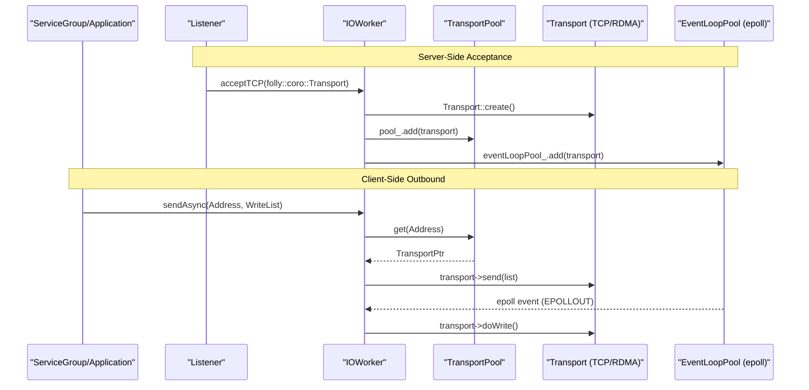

<!-- source: DeepWiki mcp.deepwiki.com · repo deepseek-ai/3FS · page 7.2 Network Listener and IOWorker · fetched 2026-10-30 -->

# Network Listener and IOWorker

<details>
<summary>Relevant source files</summary>

The following files were used as context for generating this wiki page:

- [configs/storage_main.toml](configs/storage_main.toml)
- [src/common/net/IOWorker.cc](src/common/net/IOWorker.cc)
- [src/common/net/IfAddrs.h](src/common/net/IfAddrs.h)
- [src/common/net/Listener.cc](src/common/net/Listener.cc)
- [src/common/net/Listener.h](src/common/net/Listener.h)
- [src/common/net/TransportPool.cc](src/common/net/TransportPool.cc)

</details>


The 3FS networking layer utilizes a high-performance, multi-protocol architecture designed to handle both RDMA (InfiniBand/RoCE) and TCP connections. The core of this system resides in the `Listener` class, which manages server-side connection acceptance, and the `IOWorker`, which drives the event loop for I/O operations and manages the lifecycle of `Transport` objects.

## Listener and Connection Management

The `Listener` class is responsible for monitoring network interfaces and accepting incoming connection requests across multiple protocols (TCP, RDMA, Unix Domain Sockets). It uses `folly::coro::ServerSocket` for asynchronous socket operations and integrates with `IBConnectService` to handle RDMA-specific handshaking over a TCP side-channel.

### Interface Selection Logic
During `setup()`, the `Listener` scans available Network Interface Cards (NICs) using `IfAddrs::load()` [src/common/net/Listener.cc:63-63](). It filters interfaces based on the configured `networkType_` and a `filter_list` [src/common/net/Listener.cc:69-72]().
*   **TCP/RDMA**: Accepts interfaces starting with "en", "eth", "bond", or "xgbe" [src/common/net/Listener.cc:38-41]().
*   **IPoIB**: Accepts interfaces starting with "ib" [src/common/net/Listener.cc:42-43]().
*   **LOCAL**: Accepts "lo" interfaces [src/common/net/Listener.cc:44-45]().

### Connection Handshake Flow
When a connection is accepted, the `Listener` hands the raw socket off to an `IOWorker` to create a `Transport`. For RDMA, the system first establishes a TCP connection to exchange InfiniBand Queue Pair (QP) information via `IBConnectService` before upgrading to an RDMA transport [src/common/net/Listener.cc:119-127]().

| Function | Description |
| :--- | :--- |
| `setup()` | Scans NICs, filters by type, and binds `ServerSocket` to addresses [src/common/net/Listener.cc:62-116](). |
| `start()` | Begins the asynchronous `listen` loop for each bound socket [src/common/net/Listener.cc:118-145](). |
| `listen()` | Continuous loop calling `socket.accept()` and dispatching to `acceptTCP` [src/common/net/Listener.cc:170-186](). |
| `acceptTCP()` | Converts a raw Folly transport into a 3FS `Transport` via `ioWorker_.addTcpSocket` [src/common/net/Listener.cc:188-195](). |
| `acceptRDMA()` | Wraps an `IBSocket` and registers it with the `IOWorker` [src/common/net/Listener.cc:197-205](). |

**Sources:** [src/common/net/Listener.h:18-78](), [src/common/net/Listener.cc:33-205](), [src/common/net/IfAddrs.h:20-109]()

## IOWorker Event Loop

The `IOWorker` acts as the engine for all network I/O. It manages an `EventLoopPool` (wrapping `epoll`) and a `TransportPool` for connection reuse.

### Data Flow and Task Scheduling
`IOWorker` supports two modes for processing I/O:
1.  **Event Thread Processing**: If `read_write_tcp_in_event_thread` is true, I/O is performed directly on the epoll thread [src/common/net/IOWorker.cc:119-121]().
2.  **Executor Processing**: Otherwise, I/O tasks are dispatched to a `CPUExecutorGroup` (`executor_`) to avoid blocking the event loop [src/common/net/IOWorker.cc:123-125]().

### Key Methods
*   **`addTcpSocket`/`addIBSocket`**: Initializes a `TcpSocket` or `IBSocket`, creates a `Transport`, and registers it with the epoll event loop (`EPOLLIN | EPOLLOUT | EPOLLET`) [src/common/net/IOWorker.cc:28-58]().
*   **`sendAsync`**: Retrieves a transport from the pool and initiates an asynchronous write [src/common/net/IOWorker.cc:60-69]().
*   **`startConnect`**: An asynchronous task that performs the physical connection (TCP connect or RDMA handshake) with concurrency limiting [src/common/net/IOWorker.cc:94-109]().

**Sources:** [src/common/net/IOWorker.cc:13-136](), [configs/storage_main.toml:109-116]()

## TransportPool and Connection Lifecycle

The `TransportPool` manages a collection of `Transport` objects, indexed by `Address`. It facilitates connection reuse to minimize the overhead of establishing new sockets.

### Transport Selection and Thread-Local Cache
To reduce lock contention, `TransportPool` implements a two-layer lookup:
1.  **TLS Cache**: Checks a thread-local `tlsCache_` for a recently used `Transport` [src/common/net/TransportPool.cc:123-129]().
2.  **Sharded Pool**: If not in cache, it accesses a sharded map (`shards_`) protected by locks. If no transport exists, it triggers a new connection via `IOWorker::startConnect` [src/common/net/TransportPool.cc:131-152]().

### Code Entity Relationship: Listener to Transport

The following diagram illustrates how server-side entities interact to transform a physical connection into a managed `Transport`.


**Sources:** [src/common/net/Listener.cc:62-116](), [src/common/net/Listener.cc:170-205](), [src/common/net/IOWorker.cc:28-58](), [src/common/net/TransportPool.cc:87-100]()

## Configuration and Tuning

Network behavior is heavily influenced by the `server.base.groups` configuration in `storage_main.toml`.

### Example Configuration Snippet
```toml
[server.base.groups.io_worker]
num_event_loop = 1
rdma_connect_timeout = '5s'
read_write_rdma_in_event_thread = false
tcp_connect_timeout = '1s'

[server.base.groups.listener]
listen_port = 8000
listen_queue_depth = 4096
rdma_accept_timeout = '15s'
```
**Sources:** [configs/storage_main.toml:109-153](), [src/common/net/Listener.h:20-32]()

### System Interaction Diagram

This diagram maps the high-level networking components to their implementation classes and their role in the I/O path.


**Sources:** [src/common/net/IOWorker.cc:28-69](), [src/common/net/TransportPool.cc:119-153](), [src/common/net/Listener.cc:188-195]()

---

