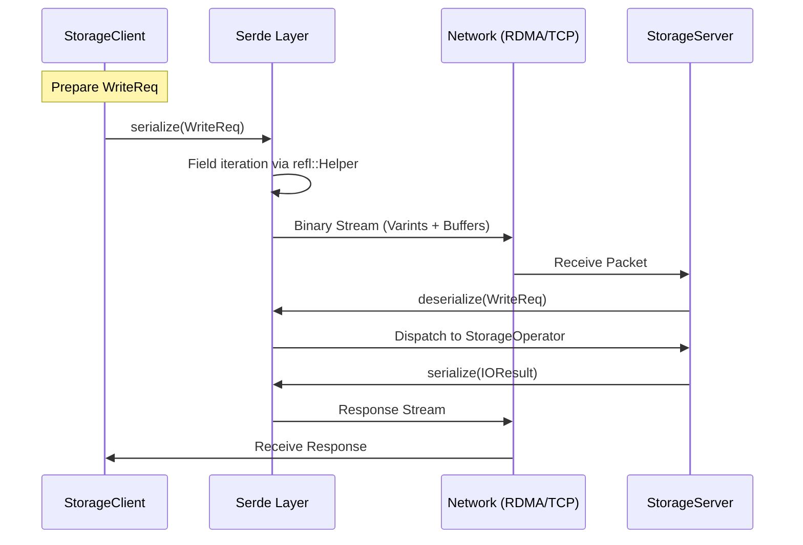

<!-- source: DeepWiki mcp.deepwiki.com · repo deepseek-ai/3FS · page 7.3 RPC and Serialization Framework · fetched 2026-10-30 -->

# RPC and Serialization Framework

Relevant source files

The following files were used as context for generating this wiki page:

- [src/common/net/ib/IBConnect.h](src/common/net/ib/IBConnect.h)
- [src/common/serde/Serde.h](src/common/serde/Serde.h)
- [src/common/utils/Address.h](src/common/utils/Address.h)
- [src/common/utils/UtcTimeSerde.h](src/common/utils/UtcTimeSerde.h)
- [src/fbs/storage/Common.h](src/fbs/storage/Common.h)
- [src/storage/chunk_engine/src/utils/aligned.rs](src/storage/chunk_engine/src/utils/aligned.rs)
- [tests/common/utils/TestVarint32.cc](tests/common/utils/TestVarint32.cc)

The 3FS RPC and Serialization framework provides a high-performance, type-safe mechanism for communication between distributed services (mgmtd, meta, storage, and FUSE clients). It leverages a custom `serde` (serialization/deserialization) library designed for zero-copy efficiency and support for both binary and human-readable (JSON) formats.

## 1. Serde Framework Implementation

The core of the RPC system is the `serde` library. It uses C++ reflection helpers to automate the generation of serialization logic for complex structures.

### 1.1 Field Definitions and Reflection
Structures are made serializable using macros that register fields with the reflection system. This avoids the need for external IDL (Interface Definition Language) files like Protocol Buffers while providing similar benefits.

*   **`SERDE_STRUCT_FIELD`**: Defines a public field in a struct and registers it for serialization [src/common/serde/Serde.h:59-60]().
*   **`SERDE_CLASS_FIELD`**: Defines a private field with public accessors in a class [src/common/serde/Serde.h:56-57]().
*   **`SerdeMethod`**: A template trait that can be specialized to provide custom serialization logic for types that cannot use macros (e.g., third-party types or primitives) [src/common/serde/Serde.h:115-126]().

### 1.2 Integer Encoding (Varint)
To minimize network overhead, the framework supports variable-length integer encoding via `Varint32` and `Varint64`. This is particularly useful for small identifiers and lengths [src/common/utils/Varint32.h:5-5]().
*   Values $< 128$ occupy 1 byte [src/common/serde/Serde.h:150-151]().
*   Larger values use a continuation bit (MSB) to signal additional bytes [src/common/serde/Serde.h:153-158]().

### 1.3 Natural Language to Code Mapping: Serialization
| System Concept | Code Entity | File |
| :--- | :--- | :--- |
| **Field Registration** | `SERDE_STRUCT_FIELD` | [src/common/serde/Serde.h:59]() |
| **Reflection Helper** | `hf3fs::refl::Helper` | [src/common/serde/Serde.h:27]() |
| **Custom Trait** | `hf3fs::serde::SerdeMethod` | [src/common/serde/Serde.h:116]() |
| **Variable Integer** | `hf3fs::Varint32` | [src/common/utils/Varint32.h:5]() |

**Sources:** [src/common/serde/Serde.h:1-160](), [src/common/utils/Varint32.h:1-10]().

---

## 2. Service Definitions and Contexts

The RPC framework organizes communication into request/response pairs handled within specific contexts.

### 2.1 Message Schema (Common.h)
The storage layer defines common RPC types in `Common.h`, ensuring consistency between the Storage Server and the Storage Client.

*   **`ChunkId`**: A unique identifier for data chunks, supporting 128-bit IDs [src/fbs/storage/Common.h:82-110]().
*   **`ChecksumInfo`**: Encapsulates data integrity checks using CRC32 or CRC32C [src/fbs/storage/Common.h:113-116]().
*   **`UpdateType`**: Enum defining operations like `WRITE`, `REMOVE`, `TRUNCATE`, and `COMMIT` [src/fbs/storage/Common.h:51-58]().
*   **`IOResult`**: A standard response structure for I/O operations containing length, versioning, and checksums [src/fbs/storage/Common.h:221-226]().

### 2.2 Address and Transport Selection
The `Address` struct handles multi-protocol addressing, allowing the RPC layer to transparently switch between TCP, RDMA, and Unix Domain Sockets [src/common/utils/Address.h:18-23]().

**Address Resolution Flow:**
1.  **Parsing**: `Address::fromString` parses strings like `rdma://192.168.1.1:8000` [src/common/utils/Address.h:81-92]().
2.  **Conversion**: `toFollyAddress` converts the internal representation to `folly::SocketAddress` for network stack integration [src/common/utils/Address.h:62-67]().

**Sources:** [src/fbs/storage/Common.h:22-110](), [src/common/utils/Address.h:18-103]().

---

## 3. Storage RPC Data Flow

The following diagram illustrates how a storage request (e.g., a Write) is serialized and processed through the RPC framework.

**Storage RPC Processing Diagram**

**Sources:** [src/common/serde/Serde.h:109-113](), [src/fbs/storage/Common.h:221-226]().

---

## 4. Checksum and Integrity

The framework integrates checksumming directly into the serialization of storage messages to ensure end-to-end data integrity.

### 4.1 Checksum Computation
The `ChecksumInfo` class provides static methods to compute checksums over data buffers using `folly::crc32c` [src/fbs/storage/Common.h:158-160]().

### 4.2 Aligned I/O
For high-performance storage operations, the framework enforces alignment (typically 4096 bytes) for both memory buffers and file offsets [src/storage/chunk_engine/src/utils/aligned.rs:4-6]().
*   `is_aligned_io`: Validates that both the data pointer and the length meet alignment requirements [src/storage/chunk_engine/src/utils/aligned.rs:55-57]().

**Sources:** [src/fbs/storage/Common.h:113-201](), [src/storage/chunk_engine/src/utils/aligned.rs:1-58]().

---

## 5. RDMA Connection Handshake (IBConnect)

Before standard RPCs can be sent over RDMA, a handshake occurs using TCP to exchange InfiniBand Queue Pair (QP) information.

### 5.1 Connection Structures
*   **`IBConnectReq`**: Contains local hostname, device name, port, MTU, and QP number [src/common/net/ib/IBConnect.h:139-143]().
*   **`IBConnectConfig`**: Specifies RDMA parameters like `max_rdma_wr`, `buf_size`, and retry counts [src/common/net/ib/IBConnect.h:75-98]().
*   **`IBDeviceInfo`**: Describes available IB devices and ports on a node [src/common/net/ib/IBConnect.h:26-37]().

### 5.2 Natural Language to Code Mapping: RDMA Setup
| System Name | Code Entity | File |
| :--- | :--- | :--- |
| **Link Layer Info** | `IBConnectIBInfo` / `IBConnectRoCEInfo` | [src/common/net/ib/IBConnect.h:109-116]() |
| **Connection Request** | `hf3fs::net::IBConnectReq` | [src/common/net/ib/IBConnect.h:139]() |
| **Address Type** | `hf3fs::net::Address::Type::RDMA` | [src/common/utils/Address.h:21]() |
| **GID Representation** | `ibv_gid` SerdeMethod | [src/common/net/ib/IBConnect.h:173]() |

**Sources:** [src/common/net/ib/IBConnect.h:1-170](), [src/common/utils/Address.h:18-32]().

---

## 6. Summary of Key Components

| Component | Role | Key Classes/Macros |
| :--- | :--- | :--- |
| **Serialization** | Logic for converting C++ objects to bytes | `serde::serialize`, `SERDE_STRUCT_FIELD` |
| **Reflection** | Metadata extraction for types | `hf3fs::refl::Helper`, `FieldInfo` |
| **Addressing** | Multi-protocol endpoint identification | `hf3fs::net::Address` |
| **Storage Schema** | Definitions for storage-specific RPCs | `ChunkId`, `ChecksumInfo`, `IOResult` |
| **RDMA Handshake** | Setup for high-speed transport | `IBConnectReq`, `IBConnectRsp` |

**Sources:** [src/common/serde/Serde.h:1-142](), [src/fbs/storage/Common.h:1-226](), [src/common/utils/Address.h:1-103]().

---

