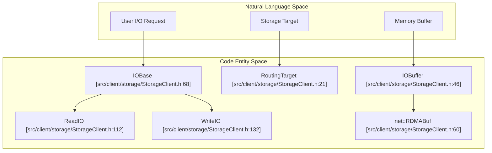
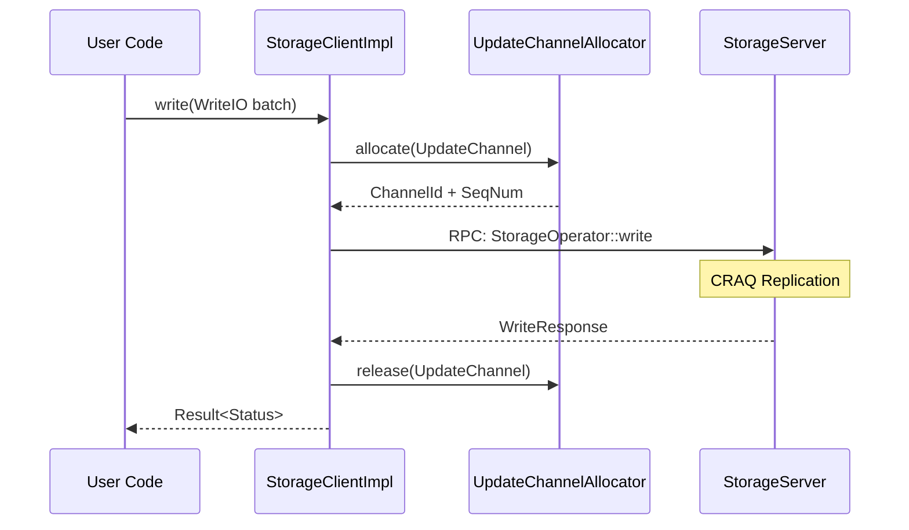

<!-- source: DeepWiki mcp.deepwiki.com · repo deepseek-ai/3FS · page 8 Storage Client · fetched 2026-10-30 -->

# Storage Client

Relevant source files

The following files were used as context for generating this wiki page:

- [benchmarks/storage_bench/StorageBench.cc](benchmarks/storage_bench/StorageBench.cc)
- [src/client/storage/StorageClient.h](src/client/storage/StorageClient.h)
- [src/client/storage/StorageClientImpl.cc](src/client/storage/StorageClientImpl.cc)
- [src/client/storage/UpdateChannelAllocator.cc](src/client/storage/UpdateChannelAllocator.cc)
- [src/common/monitor/Recorder.cc](src/common/monitor/Recorder.cc)
- [src/fuse/UserConfig.cc](src/fuse/UserConfig.cc)
- [tests/analytics/TestStructuredTraceLog.cc](tests/analytics/TestStructuredTraceLog.cc)
- [tests/lib/UnitTestFabric.cc](tests/lib/UnitTestFabric.cc)

The Storage Client is the primary interface used by 3FS services (like the FUSE client and Metadata service) to perform data operations on storage nodes. It abstracts the complexities of the disaggregated architecture, including chain routing, RDMA data transfers, and the CRAQ consistency model.

### Overview of Client-Side Access

The storage client layer is responsible for translating high-level I/O requests into specific RPCs directed at the correct storage targets. It manages connection pooling, RDMA buffer registration, and sophisticated retry logic to handle transient network or server failures.

| Component | Role |
| :--- | :--- |
| `StorageClient` | Abstract interface defining supported operations (Read, Write, Query). [src/client/storage/StorageClient.h:253-253]() |
| `StorageClientImpl` | Concrete implementation handling RPC dispatch and retry logic. [src/client/storage/StorageClientImpl.cc:22-22]() |
| `UpdateChannelAllocator` | Manages sequence numbers and IDs for write operations to ensure consistency. [src/client/storage/UpdateChannelAllocator.cc:12-12]() |
| `TargetSelection` | Strategy for choosing which replica to read from (e.g., Head, Tail, or Local). [src/client/storage/TargetSelection.h:1-1]() |

### Core Data Entities

The following diagram illustrates the relationship between user-facing I/O structures and the internal routing entities used by the `StorageClient`.

**Diagram: I/O Structure to Code Entity Mapping**

Sources: [src/client/storage/StorageClient.h:21-157]()

---

### StorageClient Interface

The `StorageClient` interface provides asynchronous, coroutine-based methods for batch operations. Key operations include `read`, `write`, `remove`, and `queryChunk`. 

For details, see [StorageClient Interface](#8.1).

*   **Batching:** Operations are typically performed in batches to saturate network bandwidth. [src/client/storage/StorageClient.h:357-360]()
*   **RDMA Integration:** Uses `IOBuffer` to wrap `net::RDMABuf`, enabling zero-copy data transfers directly between client memory and storage hardware. [src/client/storage/StorageClient.h:46-66]()
*   **Routing:** Every I/O contains a `RoutingTarget` which stores the `ChainId` and `ChainVer` necessary to locate the data in the distributed cluster. [src/client/storage/StorageClient.h:21-42]()

### Update Channel Allocation

To maintain consistency in the CRAQ (Chain Replication with Apportioned Queries) model, write operations must be sequenced. The `UpdateChannelAllocator` manages a pool of `UpdateChannel` objects.

*   **Allocation:** Before a write, a channel and a sequence of slots are allocated. [src/client/storage/UpdateChannelAllocator.cc:39-63]()
*   **Sequencing:** Each write is assigned a `ChannelSeqNum` to ensure storage nodes process updates in the correct order. [src/client/storage/UpdateChannelAllocator.cc:58-59]()

Sources: [src/client/storage/UpdateChannelAllocator.cc:7-81]()

### Server Selection and Retries

The client implements intelligent server selection via `TargetSelectionOptions`. For read operations, the client can prefer the "Tail" (for committed data) or the "Local" node (if the client is co-located with a storage target) to minimize network latency. [src/client/storage/StorageClient.h:191-191]()

The `ClientRequestContext` tracks failures per target and manages the `retryCount` to implement exponential backoff when a storage node is unreachable or returns a retryable error. [src/client/storage/StorageClientImpl.cc:69-131]()

**Diagram: Request Execution Flow**

Sources: [src/client/storage/StorageClientImpl.cc:69-131](), [src/client/storage/UpdateChannelAllocator.cc:39-79]()

---

### Admin CLI and Management Tools

Beyond programmatic access, 3FS provides the `admin_cli` for manual cluster management. This tool interacts with the Management Service (`mgmtd`) and the Storage Client layer to perform maintenance tasks like chain table uploads and node status monitoring.

For details, see [Admin CLI and Management Tools](#8.2).

### Python Client Utilities

The `hf3fs_utils` package provides Pythonic wrappers around the C++ client, enabling high-performance storage access for AI training scripts and automation. This includes `hf3fs_cli` and direct filesystem manipulation via `fs.py`.

For details, see [Python Client Utilities](#8.3).

---

