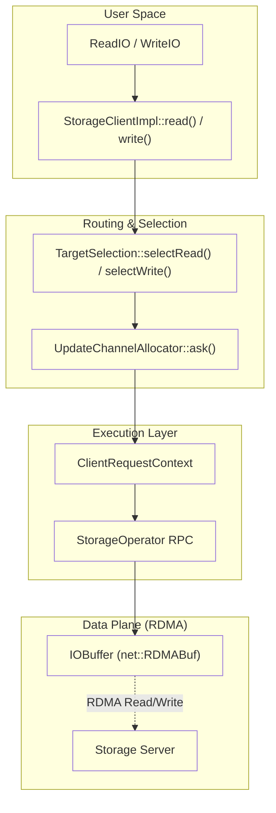
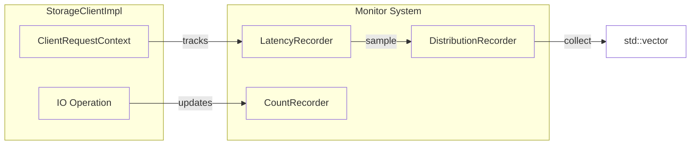

<!-- source: DeepWiki mcp.deepwiki.com · repo deepseek-ai/3FS · page 8.1 StorageClient Interface · fetched 2026-10-30 -->

# StorageClient Interface

Relevant source files

The following files were used as context for generating this wiki page:

- [src/client/storage/StorageClient.h](src/client/storage/StorageClient.h)
- [src/client/storage/StorageClientImpl.cc](src/client/storage/StorageClientImpl.cc)
- [src/common/monitor/Recorder.cc](src/common/monitor/Recorder.cc)

The `StorageClient` is the primary interface for client-side interaction with the 3FS distributed storage layer. It abstracts the complexities of the CRAQ (Chain Replication with Apportioned Queries) consistency model, target selection, RDMA memory management, and error recovery, providing a simplified batch I/O API for metadata services and FUSE clients.

## Interface Overview

The interface is defined as an abstract base class `StorageClient` [src/client/storage/StorageClient.h:431-431](), with its primary implementation being `StorageClientImpl`. It supports high-throughput batch operations for reading and writing data chunks.

### Key Data Structures

| Class | Description |
| :--- | :--- |
| `IOBuffer` | A wrapper around `net::RDMABuf` providing registered memory for zero-copy RDMA transfers [src/client/storage/StorageClient.h:46-66](). |
| `ReadIO` | Represents a single chunk read request, containing the `ChainId`, `ChunkId`, and destination buffer [src/client/storage/StorageClient.h:112-130](). |
| `WriteIO` | Represents a single chunk write request, including local checksums for data integrity [src/client/storage/StorageClient.h:132-157](). |
| `RoutingTarget` | Contains dynamic routing information, including `UpdateChannel` for writes and `SlimTargetInfo` for server addressing [src/client/storage/StorageClient.h:21-42](). |

Sources: [src/client/storage/StorageClient.h:21-157]()

## StorageClientImpl Implementation

`StorageClientImpl` manages the lifecycle of I/O requests, including server selection via `TargetSelection` and channel allocation via `UpdateChannelAllocator`.

### I/O Flow and Execution
The client uses a coroutine-based execution model. For each batch of I/O operations, the client:
1.  **Resolves Routing**: Consults the `MgmtdClient` to obtain the latest `RoutingInfo` [src/client/storage/StorageClient.h:8-8]().
2.  **Groups Operations**: Aggregates `ReadIO` or `WriteIO` objects by their target storage server.
3.  **Executes RPCs**: Sends batched `StorageOperator` RPCs to the corresponding storage nodes.
4.  **Handles RDMA**: For writes, the storage server pulls data from the client's `IOBuffer` using RDMA Read. For reads, the server pushes data to the client using RDMA Write.

### Code Entity Mapping: I/O Request Path

The following diagram illustrates how high-level I/O requests map to internal code entities and networking primitives.

**Storage Client I/O Path**

Sources: [src/client/storage/StorageClient.h:68-157](), [src/client/storage/StorageClientImpl.cc:69-131]()

## Batch Read/Write Operations

The client provides `read` and `write` methods that process spans of I/O descriptors. These methods are asynchronous and return `CoTryTask<void>` [src/client/storage/StorageClient.h:444-450]().

### Write Pattern (CRAQ)
For writes, the `StorageClient` must interact with the **Head** of a replication chain. 
1.  The client requests an `UpdateChannel` from the `UpdateChannelAllocator` [src/client/storage/StorageClient.h:41-41]().
2.  The write is issued to the primary node.
3.  The `StorageClientImpl` tracks the `requestId` to ensure idempotency and ordering [src/client/storage/StorageClient.h:155-155]().

### Read Pattern (Apportioned)
Reads can be directed to any node in the chain (Head, Mid, or Tail) to balance load, provided the node has a committed version of the data.
1.  `TargetSelection` chooses a target based on the `ReadOptions` (e.g., favoring local nodes or specific chain positions) [src/client/storage/StorageClient.h:188-205]().
2.  If `allowReadUncommitted` is false, the client ensures it only reads from nodes that have acknowledged the write [src/client/storage/StorageClient.h:193-193]().

Sources: [src/client/storage/StorageClient.h:431-460](), [src/client/storage/StorageClientImpl.cc:137-160]()

## Observability and Metrics

`StorageClientImpl` extensively uses `monitor::Recorder` types to track performance and error rates. These metrics are tagged by `MethodType` and `UserInfo` [src/client/storage/StorageClientImpl.cc:73-92]().

### Key Metrics
*   **Latency**: `overall_latency`, `network_latency`, and `server_latency` [src/client/storage/StorageClientImpl.cc:44-49]().
*   **Throughput**: `user_call_bw` and `request_bw` [src/client/storage/StorageClientImpl.cc:41-42]().
*   **Operations**: `num_processed_chunks` and `num_retried_ops` [src/client/storage/StorageClientImpl.cc:51-54]().

**Metric Collection Architecture**

Sources: [src/client/storage/StorageClientImpl.cc:26-63](), [src/common/monitor/Recorder.cc:31-45]()

## Error Handling and Retries

The client implements sophisticated retry logic defined in `RetryOptions` [src/client/storage/StorageClient.h:181-186]().

*   **Permanent Errors**: Errors like `kInvalidArg` or `kNoSpace` are not retried [src/client/storage/StorageClientImpl.cc:137-152]().
*   **Transient Errors**: Network timeouts or `kObjectLocked` trigger an exponential backoff retry mechanism [src/client/storage/StorageClientImpl.cc:15-19]().
*   **Routing Updates**: If a target returns `kNotPrimary` or `kVersionMismatch`, the client refreshes its `RoutingInfo` from the management service and retries the operation with the new chain configuration.

Sources: [src/client/storage/StorageClient.h:181-186](), [src/client/storage/StorageClientImpl.cc:137-160]()

---

