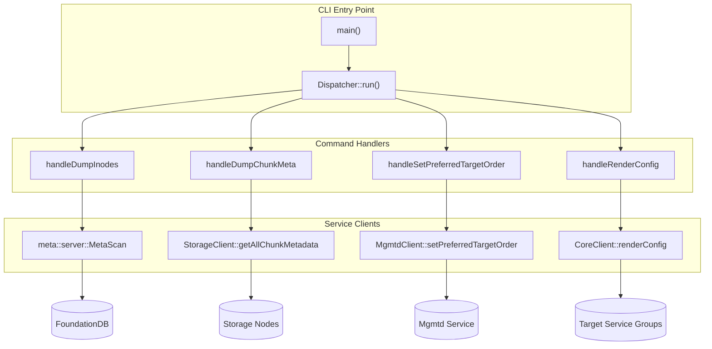
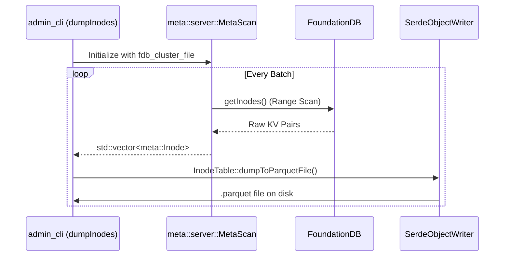

<!-- source: DeepWiki mcp.deepwiki.com · repo deepseek-ai/3FS · page 8.2 Admin CLI and Management Tools · fetched 2026-10-30 -->

# Admin CLI and Management Tools

Relevant source files

The following files were used as context for generating this wiki page:

- [src/client/cli/admin/DumpChainTable.cc](src/client/cli/admin/DumpChainTable.cc)
- [src/client/cli/admin/DumpChains.cc](src/client/cli/admin/DumpChains.cc)
- [src/client/cli/admin/DumpChunkMeta.cc](src/client/cli/admin/DumpChunkMeta.cc)
- [src/client/cli/admin/DumpInodes.cc](src/client/cli/admin/DumpInodes.cc)
- [src/client/cli/admin/RenderConfig.cc](src/client/cli/admin/RenderConfig.cc)
- [src/client/cli/admin/SetPreferredTargetOrder.cc](src/client/cli/admin/SetPreferredTargetOrder.cc)

The `admin_cli` is a comprehensive command-line utility designed for the administration, configuration, and maintenance of a 3FS cluster. It interacts primarily with the Management Service (`mgmtd`) and Metadata Service (`meta`) to perform operations such as cluster initialization, node management, routing table updates, and diagnostic data dumping.

## Architecture and Execution Flow

The `admin_cli` is built upon a `Dispatcher` pattern that routes command-line arguments to specific handler functions. Each command is associated with an `argparse::ArgumentParser` for validation and an asynchronous handler that executes the logic within a coroutine environment.

### Command Dispatching Logic
The CLI uses an `AdminEnv` object to manage connections to various cluster services. When a command is executed, the `Dispatcher` invokes the corresponding handler, which typically uses a `MgmtdClient` or `StorageClient` to communicate with the cluster.

"Admin CLI Dispatch Flow"

Sources: [src/client/cli/admin/DumpInodes.cc:41-72](), [src/client/cli/admin/DumpChunkMeta.cc:28-166](), [src/client/cli/admin/SetPreferredTargetOrder.cc:20-36](), [src/client/cli/admin/RenderConfig.cc:38-171]()

## Key Administrative Operations

### 1. Metadata Diagnostics (Dump Inodes)
The `dump-inodes` command allows administrators to extract inode information directly from the FoundationDB persistence layer. It utilizes the `MetaScan` utility to iterate through the metadata schema and can export data in either raw or Parquet formats.

*   **Implementation**: It uses `meta::server::MetaScan` to perform multi-threaded scanning of FDB [src/client/cli/admin/DumpInodes.cc:92-96]().
*   **Parallelism**: Supports a `--threads` argument to control the number of concurrent FDB scan tasks [src/client/cli/admin/DumpInodes.cc:53]().
*   **Batching**: Inodes are saved in batches defined by `--num-inodes-perfile` to prevent memory exhaustion [src/client/cli/admin/DumpInodes.cc:129-142]().

### 2. Storage Diagnostics (Dump Chunk Metadata)
The `dump-chunkmeta` command retrieves the state of data chunks directly from storage nodes. This is critical for verifying data distribution and consistency across replication chains.

*   **Logic**:
    1.  Refreshes routing info from `mgmtd` [src/client/cli/admin/DumpChunkMeta.cc:56-58]().
    2.  Identifies targets in the `SERVING` state [src/client/cli/admin/DumpChunkMeta.cc:135]().
    3.  Calls `StorageClient::getAllChunkMetadata` for each target [src/client/cli/admin/DumpChunkMeta.cc:75]().
    4.  Aggregates results into a `ChunkMetaTable` and writes to disk [src/client/cli/admin/DumpChunkMeta.cc:104-106]().

### 3. Chain and Routing Management
The CLI provides tools to manipulate the "Chain Table," which defines how data is replicated across targets.

| Command | Functionality | Key Code Entity |
| :--- | :--- | :--- |
| `dump-chain-table` | Exports a specific version of the chain table to CSV [src/client/cli/admin/DumpChainTable.cc:21-49](). | `flat::ChainTableId` |
| `dump-chains` | Dumps all chains grouped by replica count [src/client/cli/admin/DumpChains.cc:19-55](). | `routingInfo->raw()->chains` |
| `set-preferred-target-order` | Manually overrides the preference order of targets within a chain [src/client/cli/admin/SetPreferredTargetOrder.cc:20-36](). | `MgmtdClient::setPreferredTargetOrder` |

### 4. Configuration Rendering
The `render-config` command is used to generate or update service configurations using templates. It supports "mocking" local environment variables or querying live nodes for their current configuration state.

*   **Remote Rendering**: Sends a `core::RenderConfigReq` to a target address to see how a template would be interpreted by that specific node [src/client/cli/admin/RenderConfig.cc:158-160]().
*   **Hot Update**: If the `--hot` flag is provided, the command attempts to apply the rendered configuration to the running process without a restart [src/client/cli/admin/RenderConfig.cc:50]().

## Data Flow: Inode Dumping

"Inode Extraction Data Flow"

Sources: [src/client/cli/admin/DumpInodes.cc:76-155]()

## Implementation Details

### Admin Environment (`AdminEnv`)
The `AdminEnv` class acts as the central context for all admin operations. It inherits from `IEnv` and provides getters for specialized clients:
*   `mgmtdClientGetter()`: Access to cluster management functions.
*   `storageClientGetter()`: Access to storage node metadata and data operations.
*   `coreClientGetter()`: Access to common service features like configuration rendering.

### Output Formatting
Most commands return a `Dispatcher::OutputTable`, which is a `std::vector<std::vector<std::string>>`. This table is rendered to the console after the command execution completes, providing a uniform UI for administrative feedback [src/client/cli/common/Dispatcher.h]().

Sources:
- `src/client/cli/admin/SetPreferredTargetOrder.cc`
- `src/client/cli/admin/DumpChainTable.cc`
- `src/client/cli/admin/DumpChains.cc`
- `src/client/cli/admin/DumpChunkMeta.cc`
- `src/client/cli/admin/DumpInodes.cc`
- `src/client/cli/admin/RenderConfig.cc`

---

