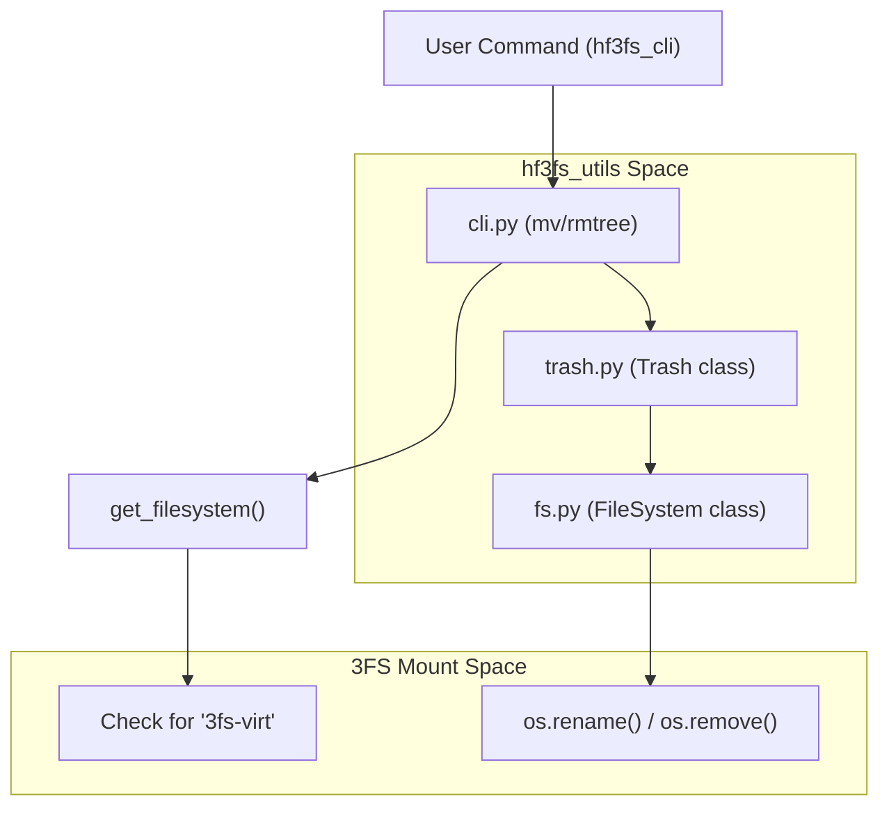
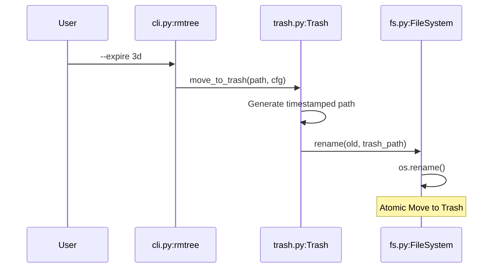

<!-- source: DeepWiki mcp.deepwiki.com · repo deepseek-ai/3FS · page 8.3 Python Client Utilities · fetched 2026-10-30 -->

# Python Client Utilities

<details>
<summary>Relevant source files</summary>

The following files were used as context for generating this wiki page:

- [hf3fs_utils/cli.py](hf3fs_utils/cli.py)

</details>


The `hf3fs_utils` package provides a set of Python-based tools and bindings for interacting with the 3FS distributed file system. It includes high-level command-line interfaces for file management, specialized trash handling for safe deletions, and Python bindings for the FUSE client to enable scripting and automation.

## Package Architecture

The utilities are structured into three primary modules that interact with the 3FS mount point via standard system calls and specialized virtual files.

| Component | File | Purpose |
| :--- | :--- | :--- |
| **CLI** | `hf3fs_utils/cli.py` | Entry point for `hf3fs_cli`, providing `mv` and `rmtree` commands. |
| **FileSystem** | `hf3fs_utils/fs.py` | Low-level wrappers for 3FS-specific operations like cross-mount renames. |
| **Trash** | `hf3fs_utils/trash.py` | Logic for moving files to expiration-based trash directories. |

### Data Flow: CLI to FileSystem
The following diagram illustrates how a user command flows through the utility layers to the underlying 3FS filesystem.

**CLI Operation Flow**

Sources: [hf3fs_utils/cli.py:13-27](), [hf3fs_utils/cli.py:46-56](), [hf3fs_utils/cli.py:104-112]()

---

## Command Line Interface (`hf3fs_cli`)

The `hf3fs_cli` tool provides enhanced file operations that are optimized for 3FS metadata handling.

### Filesystem Detection
The utility identifies a 3FS mount by searching for a special virtual directory named `3fs-virt` within the directory hierarchy. This is implemented in `get_filesystem` [hf3fs_utils/cli.py:13-27](). Users can override this detection by setting the `HF3FS_CLI_MOUNTPOINT` environment variable [hf3fs_utils/cli.py:10]().

### Operations
1.  **`mv`**: Supports moving files between different mount points within the same 3FS cluster. It uses `FileSystem.rename` which handles the logic of ensuring the move is valid across 3FS directory structures [hf3fs_utils/cli.py:53-81]().
2.  **`rmtree`**: A "safe delete" command. Instead of immediate unlinking, it moves directory trees into a hidden trash folder with a specified expiration time [hf3fs_utils/cli.py:104-125]().

Sources: [hf3fs_utils/cli.py:10-27](), [hf3fs_utils/cli.py:53-81](), [hf3fs_utils/cli.py:104-125]()

---

## Trash Management System

3FS implements a time-based trash system to prevent accidental data loss and to manage background deletion of large datasets.

### Trash Configurations
Expiration is managed via predefined intervals defined in `TRASH_CONFIGS`. Valid expiration windows include:
*   `1h`, `3h`, `8h` (Hours)
*   `1d`, `3d`, `7d` (Days)

These are validated by the `ExpireType` class in the CLI [hf3fs_utils/cli.py:83-101]().

### Implementation Logic
When `rmtree` is called, the `Trash` class calculates a target path within the 3FS trash directory (typically `/hf3fs/{cluster}/trash`). The path includes the expiration timestamp, allowing a background cleaner (like `trash_cleaner` in Rust) to identify expired data.

**Code Entity Association: Trash Workflow**

Sources: [hf3fs_utils/cli.py:112-183](), [hf3fs_utils/cli.py:83-101]()

---

## FileSystem Wrapper (`fs.py`)

The `FileSystem` class provides a high-level abstraction over standard Python `os` and `shutil` modules, specifically tailored for 3FS behaviors.

### Key Functions
*   **`rename(old_path, new_path)`**: Performs a standard rename. On 3FS, this operation is atomic at the metadata level within the same cluster, even if the paths appear to be on different sub-mounts [hf3fs_utils/cli.py:75]().
*   **`remove(path, recursive)`**: Handles both file unlinking and recursive directory removal. If `recursive=True`, it typically uses `shutil.rmtree`. When used via the CLI on a path already inside the trash, it triggers immediate deletion to free up space [hf3fs_utils/cli.py:173-175]().

### Path Validation
The utilities include a helper `is_relative_to` to ensure operations do not escape the 3FS mount point or to check if a path is already residing within the trash hierarchy [hf3fs_utils/cli.py:134]().

Sources: [hf3fs_utils/cli.py:75-76](), [hf3fs_utils/cli.py:171-178](), [hf3fs_utils/cli.py:134]()

---

## Automation and Scripting

The `hf3fs_utils` package is designed to be imported into Python scripts for automation.

### Example: Programmatic Trash Move
```python
from hf3fs_utils.fs import FileSystem
from hf3fs_utils.trash import Trash, TRASH_CONFIGS

fs = FileSystem("/mnt/hf3fs")
trash = Trash(fs)

# Move a directory to trash with 1 day expiration
trash.move_to_trash("/mnt/hf3fs/old_data", TRASH_CONFIGS["1d"])
```

### Integration with FUSE Bindings
While `hf3fs_utils` provides high-level logic, it operates on top of the `hf3fs_fuse` Python bindings. These bindings expose the underlying C++ `FuseOps` to Python, allowing for:
1.  Direct metadata manipulation.
2.  Custom IO patterns via USRBIO (User-space Block I/O).
3.  Monitoring and cluster status checks through the `3fs-virt` interface.

Sources: [hf3fs_utils/cli.py:7-8](), [hf3fs_utils/cli.py:132-140]()

---

