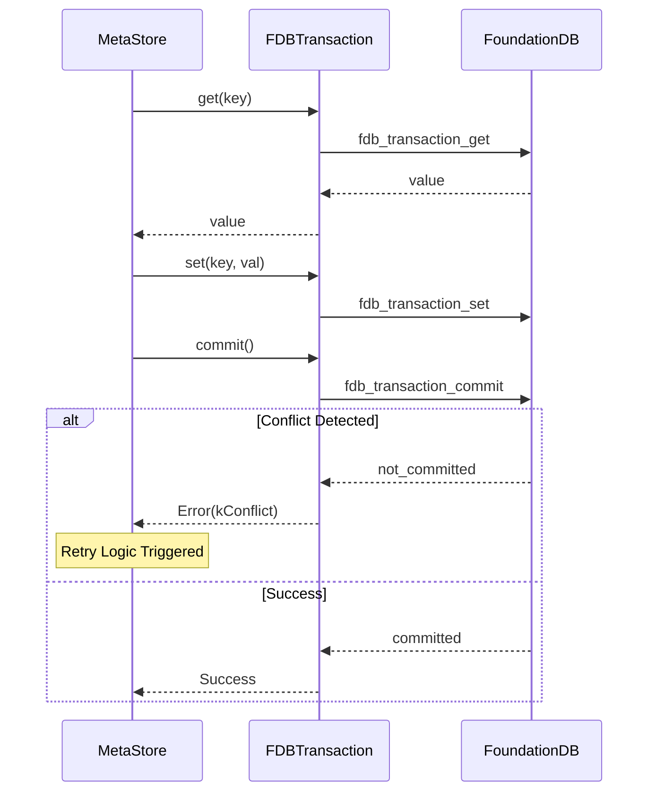

<!-- source: DeepWiki mcp.deepwiki.com · repo deepseek-ai/3FS · page 9 FoundationDB Integration · fetched 2026-10-30 -->

# FoundationDB Integration

<details>
<summary>Relevant source files</summary>

The following files were used as context for generating this wiki page:

- [docs/design_notes.md](docs/design_notes.md)
- [specs/README.md](specs/README.md)
- [src/common/kv/mem/MemTransaction.h](src/common/kv/mem/MemTransaction.h)
- [src/fdb/FDBTransaction.cc](src/fdb/FDBTransaction.cc)
- [src/lib/api/UsrbIo.md](src/lib/api/UsrbIo.md)
- [src/stubs/CMakeLists.txt](src/stubs/CMakeLists.txt)

</details>


3FS utilizes FoundationDB (FDB) as its primary transactional metadata store. By leveraging FDB's distributed ACID transactions and ordered key-value semantics, 3FS achieves high-performance metadata operations with strong consistency guarantees [docs/design_notes.md:9-11](). The system abstracts interaction with the persistence layer through a KV engine interface, allowing for transaction management, retry logic, and specialized key-value operations like versionstamping.

## Architectural Overview

The metadata service in 3FS is stateless; it acts as a translation layer between filesystem RPCs (e.g., `create`, `mkdir`, `rename`) and FoundationDB transactions [docs/design_notes.md:9-11](). This disaggregated architecture allows metadata services to scale horizontally while FoundationDB handles data durability and concurrency control.

### System Entity Mapping
The following diagram illustrates how high-level metadata concepts map to specific C++ classes and the underlying FDB storage.

**Metadata Persistence Mapping**
```mermaid
graph TD
    subgraph "Metadata Service (meta)"
        "MetaStore" -- "uses" --> "IKVEngine"
        "IKVEngine" -- "implements" --> "FDBKVEngine"
        "FDBKVEngine" -- "creates" --> "FDBTransaction"
    end

    subgraph "FoundationDB Cluster"
        "FDBTransaction" -- "RPC" --> "FDB_Server_Process"
        "FDB_Server_Process" -- "writes" --> "KV_Storage"
    end

    class "MetaStore" [MetaStore]
    class "IKVEngine" [hf3fs::kv::IKVEngine]
    class "FDBKVEngine" [hf3fs::kv::FDBKVEngine]
    class "FDBTransaction" [hf3fs::kv::FDBTransaction]
```
Sources: [src/fdb/FDBTransaction.cc:84-101](), [docs/design_notes.md:9-11]()

## Key-Value Engine Abstraction

3FS does not bind itself exclusively to FoundationDB's C API. Instead, it defines a set of interfaces to manage transactions and key-value operations. This abstraction facilitates testing (via in-memory implementations) and potential support for other backends.

*   **`IKVEngine`**: The base interface for the key-value storage engine.
*   **`ITransaction`**: An interface representing a single unit of work. It supports standard operations such as `get`, `set`, `clear`, and `getRange` [common/kv/mem/MemTransaction.h:59-75]().
*   **`IReadWriteTransaction`**: Extends `ITransaction` with mutation capabilities, including specialized `setVersionstampedKey` and `setVersionstampedValue` methods [common/kv/mem/MemTransaction.h:121-149]().

For a deep dive into these interfaces and the hybrid engine used for caching, see **[FDB Transaction Layer](#9.1)**.

## Transaction Management and Retries

Because FoundationDB uses optimistic concurrency control, transactions may fail due to conflicts or transient network issues. 3FS implements a robust retry mechanism within its transaction layer.

### Transaction Lifecycle
1.  **Creation**: A transaction is instantiated via the `FDBKVEngine`.
2.  **Execution**: The metadata service performs multiple reads and writes.
3.  **Conflict Tracking**: 3FS can manually add read/write conflict ranges using `addReadConflict` [src/fdb/FDBTransaction.cc:92-92]().
4.  **Commit**: The transaction attempts to commit. If a conflict is detected (e.g., `error_code_not_committed`), the transaction is retried [src/fdb/FDBTransaction.cc:37-42]().
5.  **Fault Injection**: For testing robustness, 3FS includes macros to inject random failures during commit or get operations [src/fdb/FDBTransaction.cc:54-70]().

**Transaction Execution Flow**

Sources: [src/fdb/FDBTransaction.cc:32-52](), [common/kv/mem/MemTransaction.h:151-155]()

## Metadata Schema

3FS maps the filesystem hierarchy into FDB's flat key-value space using specific prefixes. This includes:
*   **Inodes (INOD)**: Storing file/directory attributes.
*   **Directory Entries (DENT)**: Mapping filenames to Inode IDs.
*   **Versionstamping**: Utilizing FDB's versionstamp feature to provide strictly increasing transaction versions for metadata consistency [src/fdb/FDBTransaction.cc:96-97]().

For detailed information on the key structure and how filesystem operations are implemented, see **[Metadata Schema and Operations](#9.2)**.

## Child Pages
*   **[FDB Transaction Layer](#9.1)**: Detailed documentation of `FDBTransaction`, `FDBKVEngine`, `HybridKvEngine`, and retry strategies.
*   **[Metadata Schema and Operations](#9.2)**: Documentation of the FoundationDB key schema (INOD/DENT prefixes) and `MetaStore` operation implementations.

---

