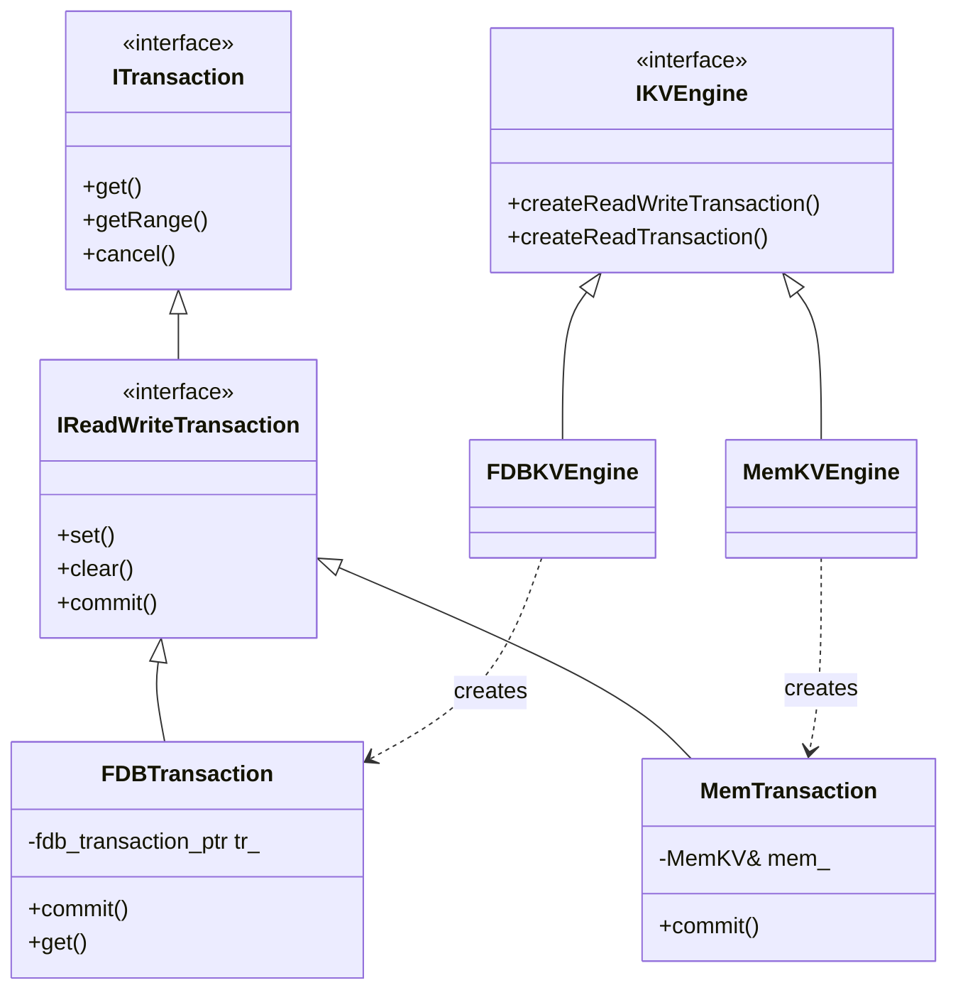
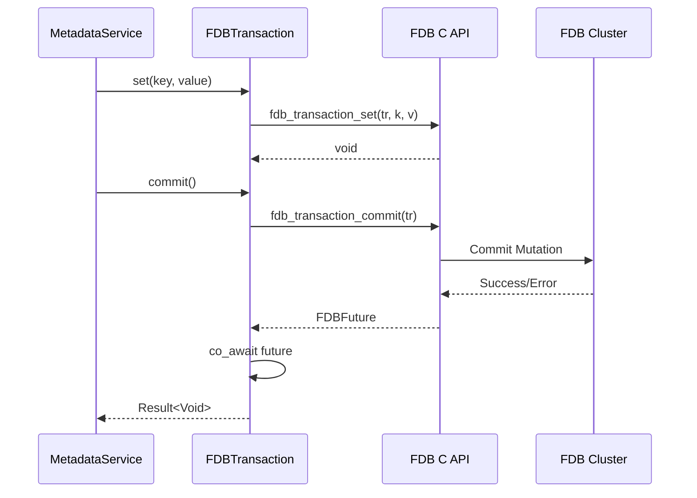

<!-- source: DeepWiki mcp.deepwiki.com · repo deepseek-ai/3FS · page 9.1 FDB Transaction Layer · fetched 2026-10-30 -->

# FDB Transaction Layer

Relevant source files

The following files were used as context for generating this wiki page:

- [src/common/kv/mem/MemTransaction.h](src/common/kv/mem/MemTransaction.h)
- [src/fdb/FDBTransaction.cc](src/fdb/FDBTransaction.cc)

The FoundationDB (FDB) Transaction Layer provides a robust, transactional Key-Value (KV) abstraction for the 3FS metadata service. It encapsulates FDB's C API into a C++ coroutine-friendly interface, implementing retry logic, fault injection, and performance monitoring. This layer ensures that high-level metadata operations (like file creation or directory renames) maintain ACID properties across distributed components.

### Core Abstractions

3FS defines a set of abstract interfaces to decouple the metadata logic from the underlying storage engine. This allows for both the production FDB implementation and a memory-based implementation for testing.

*   **`IKVEngine`**: The top-level interface for the KV store. It provides methods to create transactions and manage the engine lifecycle [src/common/kv/IKVEngine.h:20-40]().
*   **`ITransaction`**: The base interface for all transaction types, supporting snapshot reads and cancellation [src/common/kv/ITransaction.h:46-75]().
*   **`IReadWriteTransaction`**: Extends `ITransaction` to support write operations (`set`, `clear`) and conflict range management [src/common/kv/ITransaction.h:77-110]().

### Transaction Layer Architecture

The following diagram illustrates the relationship between the abstract interfaces and their concrete implementations in the FDB and Memory providers.

**KV Engine and Transaction Class Hierarchy**

Sources: [src/common/kv/IKVEngine.h:20-40](), [src/common/kv/ITransaction.h:46-110](), [src/fdb/FDBTransaction.h:35-100](), [src/common/kv/mem/MemTransaction.h:59-120]()

---

### FDB Implementation Details

#### FDBTransaction
`FDBTransaction` is the primary implementation used in production. It wraps an FDB `FDBTransaction *` and maps FDB's callback-based asynchronous model to C++ `CoTryTask` coroutines [src/fdb/FDBTransaction.h:35-40]().

Key behaviors include:
1.  **Read Operations**: Supports both standard and snapshot reads. Snapshot reads do not create read conflicts, allowing for higher concurrency at the cost of strict serializability [src/fdb/FDBTransaction.cc:103-108]().
2.  **Conflict Management**: Explicitly adds read/write conflict ranges via `fdb_transaction_add_conflict_range` to ensure transaction isolation [src/fdb/FDBTransaction.cc:440-460]().
3.  **Atomic Operations**: Implements versionstamped keys and values, which are critical for generating consistent timestamps in the metadata layer [src/fdb/FDBTransaction.cc:538-570]().

#### Retry Strategy
The layer implements a sophisticated retry mechanism to handle transient FDB errors (e.g., `transaction_too_old`, `conflict`). The `TransactionHelper::run` utility automates this process [src/common/kv/TransactionHelper.h:25-50]().

*   **Backoff**: Uses exponential backoff for retriable errors.
*   **Error Mapping**: FDB error codes are mapped to 3FS `StatusCode` values for consistent error handling across the system [src/fdb/FDBTransaction.cc:32-52]().
*   **Commit Unknown**: Handles the `commit_unknown_result` case where a transaction might have succeeded despite a network timeout [src/fdb/FDBTransaction.cc:58-70]().

### Data Flow: Executing a Transaction

The following diagram traces the flow of a `set` and `commit` operation through the `FDBTransaction` layer.

**FDB Transaction Execution Flow**

Sources: [src/fdb/FDBTransaction.cc:513-536](), [src/fdb/FDBTransaction.cc:630-670]()

---

### Hybrid and Memory Engines

#### HybridKvEngine
In certain deployment scenarios, 3FS uses a `HybridKvEngine`. This engine routes requests to different underlying KV stores based on key prefixes. This is often used to separate transient metadata from persistent state or to migrate data between engines.

#### MemKVEngine
The `MemKVEngine` provides a thread-safe, in-memory implementation of the KV interface using `std::map` and versioning [src/common/kv/mem/MemKV.h:20-45]().
*   **Isolation**: Uses a `readVersion` assigned at the start of the transaction to provide Snapshot Isolation [src/common/kv/mem/MemTransaction.h:61-64]().
*   **Conflict Detection**: Maintains `readKeys` and `readRanges` sets. During `commit`, it checks if any keys in the conflict sets have been modified by a later version than the transaction's `readVersion` [src/common/kv/mem/MemTransaction.h:152-180]().

### Fault Injection
To ensure system resilience, the transaction layer includes macros for injecting artificial failures:
*   **`FAULT_INJECTION_ON_GET`**: Simulates latency or `transaction_too_old` errors during read operations [src/fdb/FDBTransaction.cc:72-82]().
*   **`FAULT_INJECTION_ON_COMMIT`**: Simulates `commit_unknown_result` or `not_committed` errors, forcing the higher-level logic to handle idempotency and retries [src/fdb/FDBTransaction.cc:54-70]().

### Monitoring and Metrics
Every transaction operation is instrumented using `OpRecorder`. This tracks:
*   **Total Count**: `fdb_total_count_<op>` [src/fdb/FDBTransaction.cc:110-116]().
*   **Failure Count**: `fdb_failed_count_<op>` [src/fdb/FDBTransaction.cc:118-125]().
*   **Latency**: `fdb_latency_<op>` using high-resolution timers [src/fdb/FDBTransaction.cc:127-135]().

Sources: [src/fdb/FDBTransaction.cc:1-140](), [src/fdb/FDBTransaction.h:1-100](), [src/common/kv/mem/MemTransaction.h:1-180](), [src/common/kv/ITransaction.h:1-110]().

---

