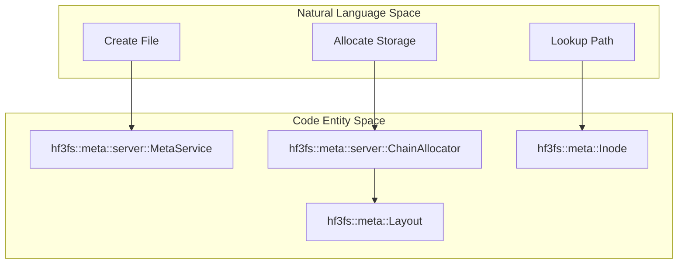
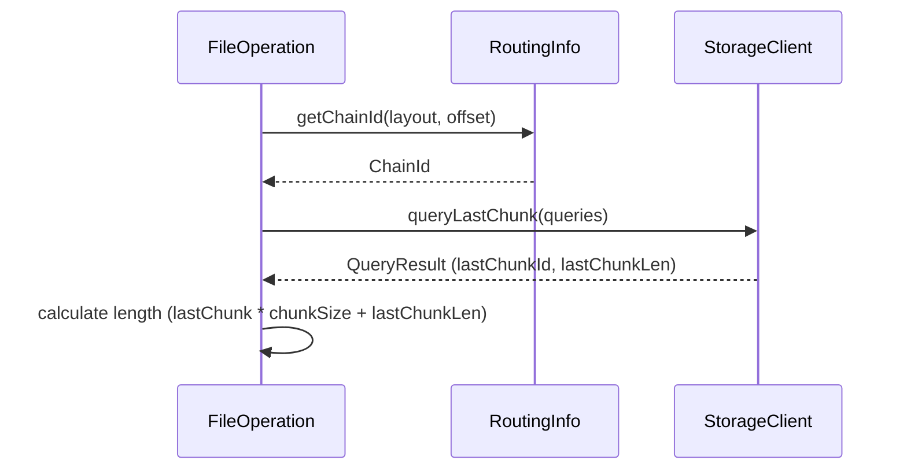

<!-- source: DeepWiki mcp.deepwiki.com · repo deepseek-ai/3FS · page 9.2 Metadata Schema and Operations · fetched 2026-10-30 -->

# Metadata Schema and Operations

Relevant source files

The following files were used as context for generating this wiki page:

- [CMakeLists.txt](CMakeLists.txt)
- [docs/design_notes.md](docs/design_notes.md)
- [specs/README.md](specs/README.md)
- [src/common/utils/Shuffle.h](src/common/utils/Shuffle.h)
- [src/fbs/meta/FileOperation.cc](src/fbs/meta/FileOperation.cc)
- [src/fbs/meta/Schema.cc](src/fbs/meta/Schema.cc)
- [src/fbs/meta/Schema.h](src/fbs/meta/Schema.h)
- [src/lib/api/UsrbIo.md](src/lib/api/UsrbIo.md)
- [src/meta/components/ChainAllocator.h](src/meta/components/ChainAllocator.h)
- [src/stubs/CMakeLists.txt](src/stubs/CMakeLists.txt)
- [tests/common/utils/TestShuffle.cc](tests/common/utils/TestShuffle.cc)

The 3FS metadata layer provides POSIX-like file system semantics on top of a distributed transactional key-value store (FoundationDB). The Metadata Service (meta) is stateless, delegating persistence to FoundationDB while managing inode lifecycles, directory entries, and file layouts.

## Metadata Key Schema

3FS organizes metadata in FoundationDB using specific key prefixes to distinguish between Inodes and Directory Entries.

### Inode Prefix (INOD)
Inodes are identified by a unique `InodeId`. The key in FoundationDB is typically constructed using a prefix followed by the big-endian representation of the `InodeId`.
*   **Key Format**: `[INOD_PREFIX][InodeId]`
*   **Value**: A serialized `Inode` structure containing `Acl`, `InodeType`, and type-specific data (e.g., `File`, `Directory`, or `Symlink` details) [src/fbs/meta/Schema.h:171-176]().

### Directory Entry Prefix (DENT)
Directory entries map a parent `InodeId` and a filename to a child `InodeId`.
*   **Key Format**: `[DENT_PREFIX][ParentInodeId][FileName]`
*   **Value**: The `InodeId` of the child and the `InodeType` [docs/design_notes.md:51-53]().

### Chunk ID Mapping
File data is split into chunks. The `ChunkId` is designed to be ordered and searchable within the storage service [src/fbs/meta/Schema.h:177-186]().
*   **Format**: `[Tenant(1B)][Reserved(1B)][InodeId(8B)][TrackId(2B)][ChunkNum(4B)]` [src/fbs/meta/Schema.h:182-187]().

Sources: [src/fbs/meta/Schema.h:171-198](), [docs/design_notes.md:51-53]()

## Inode and Directory Lifecycle

The lifecycle of file system objects is managed through atomic transactions in the MetaStore.

### File Creation and Layout Allocation
When a file is created, the metadata service must determine which storage chains will host its data chunks. This is handled by the `ChainAllocator`.

1.  **Layout Selection**: Users can specify `chunkSize` and `stripeSize` per directory [docs/design_notes.md:54-55]().
2.  **Chain Allocation**: The `ChainAllocator` selects chains from the `RoutingInfo` provided by the `mgmtd` service [src/meta/components/ChainAllocator.h:49-65]().
3.  **Shuffle Mechanism**: To avoid hotspots, 3FS uses a "safe shuffle" algorithm to randomize chain selection within a `ChainTable` [src/meta/components/ChainAllocator.h:114-120]().

### Directory Operations
*   **Atomic Move**: Supported by FoundationDB's cross-key transactions, allowing files or directories to be moved by updating `DENT` entries atomically [docs/design_notes.md:19-21]().
*   **Recursive Delete**: 3FS implements recursive deletion, which is crucial for handling large datasets with many small files [docs/design_notes.md:21-22]().

### Metadata Code Entity Mapping
The following diagram bridges the natural language operations to the C++ classes and functions.

**Diagram: Metadata Operation Mapping**

Sources: [src/meta/components/ChainAllocator.h:23-47](), [src/fbs/meta/Schema.h:71-169](), [docs/design_notes.md:19-22]()

## File Operation Implementations

The `FileOperation` class handles the logic for querying file attributes and data locations.

### Querying Chunk Locations
To read or write a file, the client or metadata service must know where chunks are located on the storage nodes.
*   **`queryChunks`**: Aggregates chunk information across all stripes to determine total file length and the last chunk's details [src/fbs/meta/FileOperation.cc:45-76]().
*   **`queryChunksByChain`**: Sends `QueryLastChunkOp` RPCs to the storage service for each chain in the file's layout [src/fbs/meta/FileOperation.cc:78-124]().

### Layout Validation
Before any metadata operation involving storage, the layout is validated to ensure the `chunkSize` is a power of two and `stripeSize` is non-zero [src/fbs/meta/Schema.h:129-158]().

**Diagram: File Query Data Flow**

Sources: [src/fbs/meta/FileOperation.cc:45-124](), [src/fbs/meta/Schema.h:78-91]()

## Chain Allocation and Shuffling

3FS uses a deterministic yet randomized approach to distribute data across storage chains.

### Chain Selection Strategies
The `ChainAllocator` supports multiple allocation modes:
1.  **Round Robin**: Uses a counter to cycle through available chains in a `ChainTable` [src/meta/components/ChainAllocator.h:49-65]().
2.  **Chain Range**: Allocates a contiguous range of chains starting from a randomized base index [src/fbs/meta/Schema.h:85-112]().

### Safe Shuffling
Because 3FS may be compiled with different versions of `libstdc++`, and `std::shuffle` behavior can vary between GCC versions (e.g., GCC 10 vs GCC 11), 3FS implements a `safe_shuffle_seed` check. This ensures that the generated chain sequence is consistent across different metadata service instances regardless of the compiler used [src/common/utils/Shuffle.h:174-194]().

| Shuffle Method | Description |
| :--- | :--- |
| `STD_SHUFFLE` | Standard `std::shuffle` using `std::mt19937_64`. |
| `GCC10_SHUFFLE` | Emulated GCC 10 `std::shuffle` algorithm. |
| `GCC11_SHUFFLE` | Emulated GCC 11 `std::shuffle` algorithm (Lemire's algorithm). |

Sources: [src/common/utils/Shuffle.h:26-34](), [src/common/utils/Shuffle.h:174-194](), [src/meta/components/ChainAllocator.h:113-120]()

## USRBIO and Metadata Interaction

User Space Ring Based IO (USRBIO) bypasses the kernel for data path operations but relies on metadata for setup.

1.  **Registration**: Applications call `hf3fs_reg_fd` to register a file descriptor [src/lib/api/UsrbIo.md:111-128]().
2.  **Inode Mapping**: The FUSE daemon maps the Linux file descriptor to the internal `InodeId` managed in FoundationDB [src/lib/api/UsrbIo.md:11-12]().
3.  **Zero-Copy I/O**: Once registered, I/O requests are submitted via the `Ior` (shared ring buffer) and data is transferred via the `Iov` (shared memory region) [src/lib/api/UsrbIo.md:7-12]().

Sources: [src/lib/api/UsrbIo.md:4-12](), [src/lib/api/UsrbIo.md:111-128]()

---

